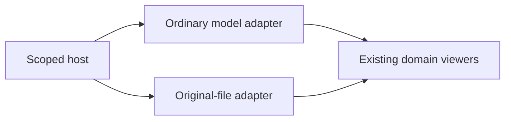

# Contained viewer host

A small, renderer-independent shell for mounting engineering viewers in a page.
Each instance owns its toolbar, loading state, inspector, keyboard focus and lifetime.
The ordinary assembly/STL and original-file adapters prove the same contract.



| Source | Responsibility |
| --- | --- |
| `viewer-host.js` | Lifecycle and scoped DOM; no Three.js dependency |
| `viewer-host.css` | Container layout, accessible toolbar and inspector styles |
| `adapters.js` | Ordinary-model and original-file composition |
| `stage-controls.js` | Shared 3D keyboard and camera-state support |
| [example.html](example.html) | Two working sibling viewers with an ordinary scrolling page around them |
| `example.js` | Demo mounts and page lifetime |
| `example.json` | Ordinary assembly manifest with exact fixture mesh hash |
| `example.stl` | Original 20 × 32 × 18 mm block fixture; illustrative geometry |

## Embed two independent viewers

Load `host/viewer-host.css`, keep the kit's existing Three.js import map, and give
each connected container an explicit available height. Then mount either adapter:

```js
import { createModelHost, createFileHost } from './kit/host/adapters.js';
const assembly = createModelHost(assemblyElement, { manifestUrl: './view.json' });
const original = createFileHost(fileElement, { file: './part.step' });
await Promise.all([assembly.ready, original.ready]);
```

The generic `createViewerHost` in `viewer-host.js` imports no renderer. Its `mount`
adapter receives `viewport`, `inspector`, an abort `signal` and scoped progress,
selection and state callbacks. It returns `fit`, `dispose`, `getViewState`,
`restoreViewState` and optionally `select`. An adapter must release partial
allocations when mounting fails. The host disposes returned handles after a late
completion, owns only its descendants, and automatically disposes when detached.

`ready` resolves `true` when usable, or `false` on error/cancellation. Errors remain
visible with Retry; `retry()` starts a new mount. Each handle exposes `fit()`,
`select(nativeId|null)` when available, `getViewState()`, `restoreViewState(state)`,
`subscribe(listener)` returning an unsubscribe function, and idempotent `dispose()`.
Only the readiness/capabilities available on the actual adapter enable controls.

Camera state and selection belong to one successful mount. Foreign or previous
mount state is rejected, even when a URL is reused. This protects against changed
source bytes without claiming durable artifact identity. Ordinary-model part names
and original-file `mesh:0` identifiers remain domain-local; review anchors and
cross-artifact mappings need their own versioned identity layer.

The camera supports orbit/pan/pinch and visible Zoom to fit. Focus it for arrow-key
orbit, Shift + arrows to pan, +/− zoom and Home to fit. Resizing preserves a deliberate
camera. Inspectors/forms may scroll; the camera never uses scrollbars. Reduced
motion disables camera damping/easing. Closing a viewer restores focus to its
connected container when it owned keyboard focus.

Standalone entrypoints remain supported. Simulation clocks and command authority
belong to the application/session, not this presentation host. Load only scoped
host CSS in embedded pages; `hud.css` and `file-viewer.css` retain legacy page rules.

[Web kit](../README.md) · [Browser tests](https://github.com/Valpatel/cad-agent/tree/dev/tests/webkit/host)
