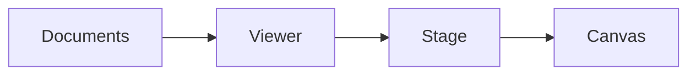

# 3D model views

Ordinary assembly/STL viewing, inline packed models and the shared Three.js stage. Geometry and camera behavior stay in this domain; host controls compose it without owning the renderer.

| File | Responsibility |
| --- | --- |
| [stage.js](stage.js) | Renderer, camera, lighting, floor grid and frame lifecycle shared by 3D viewers. |
| [viewer.js](viewer.js) | Validated ordinary assembly/STL loading, selection, visibility, sectioning and guide state. |
| [viewer.html](viewer.html) | Standalone ordinary model and assembly guide page. |
| [model.js](model.js) | Inline `<cad-model>` packed-model element, lazy loading and presentation. |
| [model.css](model.css) | Layout and states for inline model elements. |

[Web kit](../README.md)
