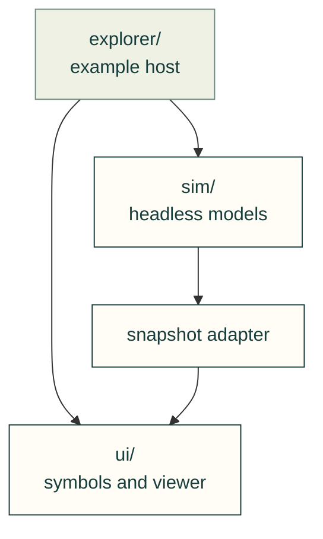
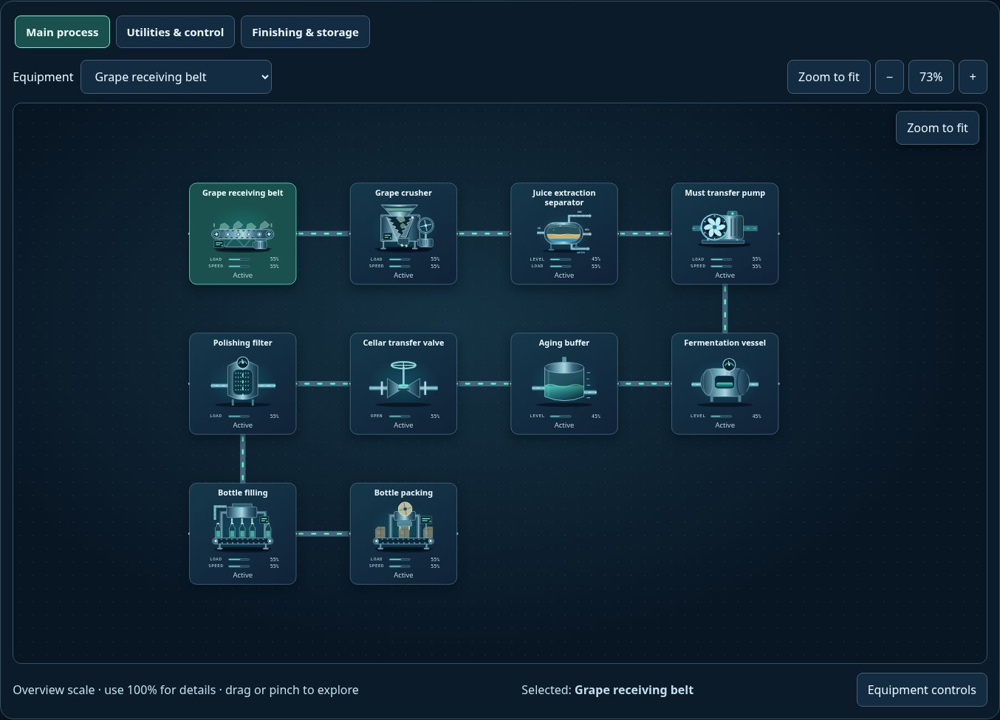

# SCADA toolkit

Animated process diagrams, reusable equipment, headless models and a complete
simulation example, maintained together in cad-agent.

The arrows show runtime dependencies. The Explorer owns a session and supplies
its state to the UI; the model never imports a browser renderer.

| Owner | Contents and next step |
| --- | --- |
| [ui/](ui/README.md) | Equipment registry, SVG states, diagram/viewer controls, system schema, API/style guides and the library's [image gallery](ui/img/README.md) |
| [sim/](sim/README.md) | Independent v1/v2 engines, replaceable equations, model/snapshot schemas, scenarios and the model library's [image gallery](sim/img/README.md) |
| [explorer/](explorer/README.md) | Runnable host: scenario selection, one clock/session, editable assumptions, faults, sound and shared views |
| [AGENTS.md](AGENTS.md) | Domain boundaries and maintenance rules |
| [LICENSE.txt](LICENSE.txt) | Retained SCADA package terms and authorized integration scope |
| [transfer.json](transfer.json) | Original source identity, physical destination and file provenance; not a remote dependency |

## Use and maintain

Serve the copied web kit over HTTP(S) and open `scada/explorer/index.html`.
The public Toolkit presents equipment and simulations under `/toolkit/scada/`.
The code, symbols, scenario data and maintenance sources are physically present
here; the historical development repository is not needed to run or maintain them.

The two libraries retain their public package names and source exports. Their
`img/` folders stay with the libraries. Generators live under the repository's
[SCADA tools](../../../../../tools/webkit/scada/README.md), and executable
regressions live under [SCADA tests](../../../../../tests/webkit/scada/README.md).
This separates reusable assets from maintenance commands without duplicating them.

Models are explicitly illustrative unless an independently qualified provider is
installed. Equipment artwork does not establish physical accuracy. Keep assumptions
editable and preserve the documented SI/index conversions when changing equations.

[Web kit](../README.md) · [User and integration guides](../../../../../docs/practice/scada/README.md)
