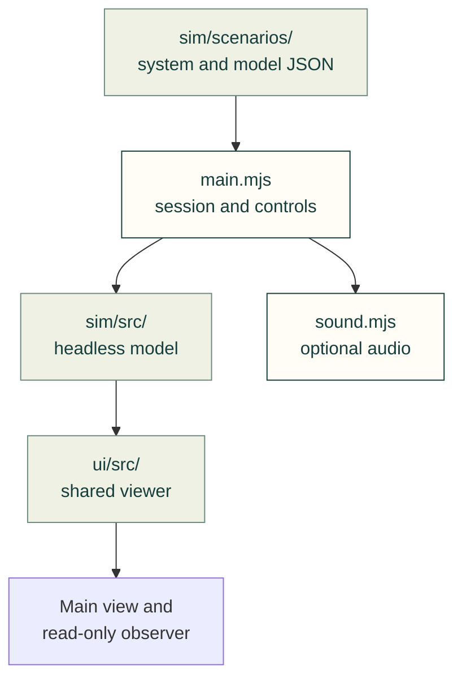

# SCADA simulation lab

Cad-agent's native browser host for the shared SCADA viewer and headless simulation library.

The arrows describe actual imports and data reads. The application creates one
model session; its main viewer and optional read-only observer subscribe to that
same model. Neither viewer owns the simulation clock.

| File | Responsibility |
| --- | --- |
| [index.html](index.html), [styles.css](styles.css) | Accessible standalone workspace and Toolkit navigation |
| [main.mjs](main.mjs) | Scenario loading, one clock, command dispatch, shared observer and session persistence |
| [model-editor.mjs](model-editor.mjs) | Editable v2 circuit, energy and environmental assumptions |
| [selection.mjs](selection.mjs) | Explicit scenario/type/variant deep-link resolution |
| [search.mjs](search.mjs) | Catalog search and composable industry/technology/facility filters |
| [sound.mjs](sound.mjs) | Opt-in browser audio and deduplicated current-state alarms |

The public entry is `/kit/scada/explorer/index.html?scenario=wastewater-digester`.
A source checkout can serve the web-kit folder over HTTP(S), including the sibling
SCADA `ui/` and `sim/` libraries, shared `../../ui/theme.css` / `theme.js`, and
`../../vendor/fonts/`. No build step, external API, remote source repository or plant
workbook is needed at runtime.

The default wastewater example connects treatment, sludge digestion, biogas
conditioning, a generator, flare and electrical loads. **Water treatment**,
**Sludge & biogas** and **Power & control** are layouts of the same equipment and
state. All process values are editable normalized estimates. This example does
not model biological removal, methane stoichiometry, hydraulic design, electrical
protection or treatment-quality acceptance.

Session controls, timing and model limits

Use **Fault lab** to inject failures, **Model & guesses** to edit declared
parameters, and **Session** to save/restore state or open the read-only observer.
The observer has its own camera and layout but no process-command capability.
Closing it removes its viewer subscription; the original session continues.
Reset preserves parameter edits, while choosing another scenario loads that
scenario's initial configuration. One simulation minute advances per timer tick
at 1×; the clock suspends while the document is hidden. Audio starts disabled
and remains silent when the model is paused or the document is hidden.

The bundled pump/heater equation providers support compatible saved sessions.
The linked equation bench demonstrates live law replacement; the ordinary
parameter form is not a generic provider editor. Complete external solvers can
implement the same snapshot/subscription/command adapter without using the
placeholder kernel.

Responsive layout, camera and shared theme

The host selects `fitMaxZoom:1.5`: Fit can enlarge a compact layout to 150% when
space permits, without changing authored world positions or manual zoom.

The host fills the available desktop window with a compact navigation and control
frame. Smaller or short windows keep normal page flow; the diagram itself never
uses native scrolling. The application follows the shared light/dark palette and
system preference, and its theme button shares the `cad-theme` preference with
other same-origin cad-agent pages. Direct entry and offline copied-kit serving
use the same local files. Equipment artwork retains its dark, semantic-color
stage in either application theme.

Drag/pinch/wheel moves the camera inside a scrollbar-free viewport. **Zoom to fit**
recovers the whole diagram. Normal document and long-inspector scrolling remains
available. Equipment inspectors keep their text readable independently of diagram
zoom. Keyboard focus, reduced motion and optional sound use the library's controls.

The primary Explorer opts into `responsiveLayout: 'process-chain'`: unbranched diagrams can use fewer rows on a wide screen while card sizes and declared connections remain intact. Complex diagrams keep their authored geometry. Manual pan/zoom preserves the arrangement on resize; **Zoom to fit** recalculates it. The observer remains an independent presentation of the same session. Browser checks measure occupied equipment width, not only the canvas frame.

The camera owns the single in-view **Fit / − / percentage / +** toolbar. Equipment selection stays in the host row; no second camera toolbar is rendered above the process. Inspector buttons and on/off status text use paired application palette tokens in both themes; browser regression checks require at least 4.5:1 text contrast in default and hovered states.

[SCADA owner](../README.md) · [UI library](../ui/README.md) ·
[Simulation library](../sim/README.md) ·
[Model/API contract](../sim/docs/MODEL-API.md) ·
[Explorer tests](https://github.com/Valpatel/cad-agent/tree/dev/tests/webkit/scada/explorer)
