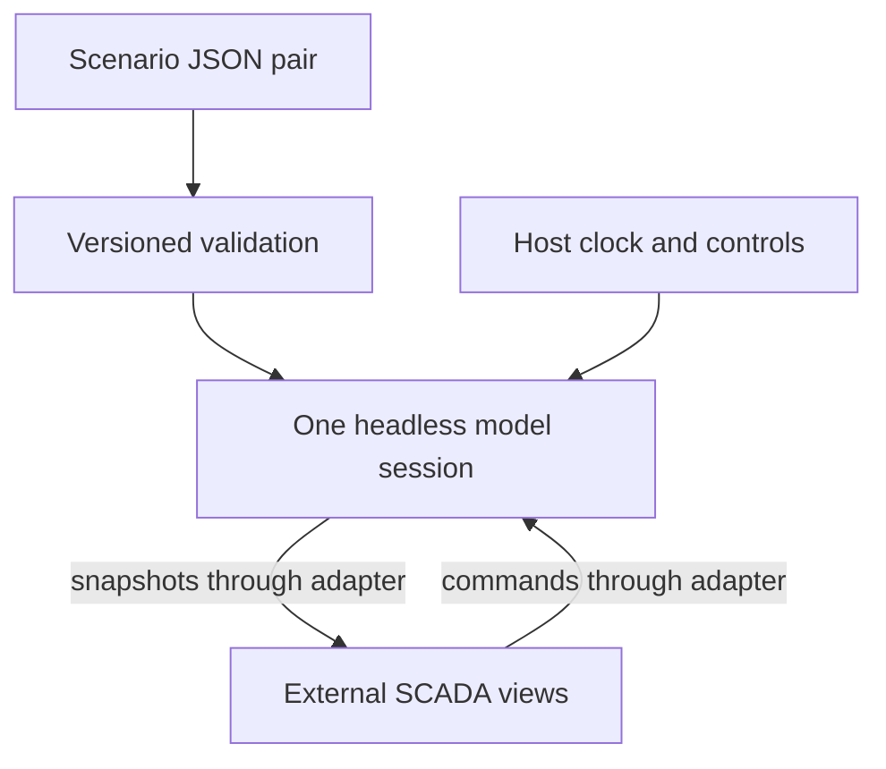
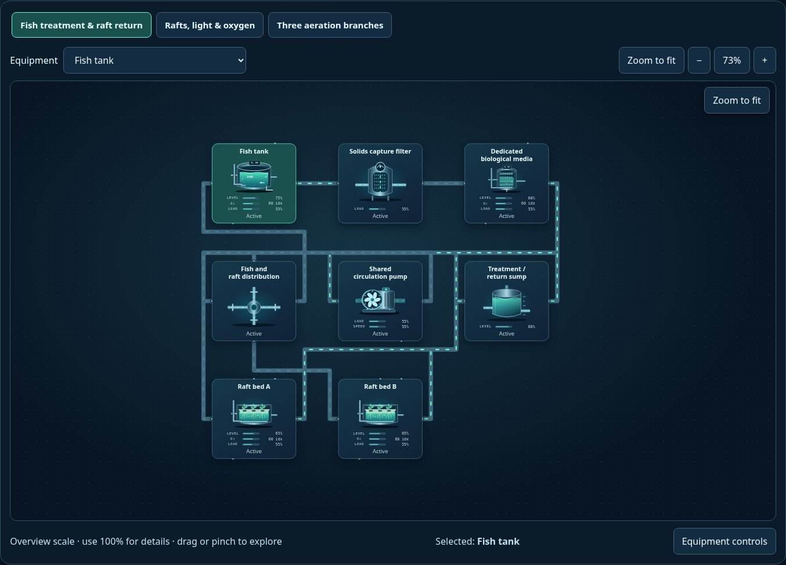

# Valpatel SCADA simulation kernels and models

This package supplies replaceable equation providers and runnable illustrative models across the equipment catalog and [scenario collection](./scenarios/README.md), including wastewater digestion, industrial processes, power generation and agriculture. It is separate from `@valpatel/scada-ui`: the UI owns presentation, while this package owns illustrative state, topology, commands, faults, and deterministic replay.

Built-in scenario quantities are editable normalized assumptions. Pressure, temperature, flow, power, chemistry, and crop responses are illustrative indices; visual engineering units do not turn them into predicted measurements. Both engines also support registered constitutive laws and per-component state, with physical SI examples and explicit unit bridges. A custom provider needs its own evidence and operating domain; the defaults do not establish plant operating instructions, protection settings, nuclear design calculations or crop recipes. No CAD, live-plant connection, network access, or persistence is built in. Importing the package starts no timers.

[Packages map](https://github.com/Valpatel/cad-agent/blob/dev/software/cadagent/webkit/scada/README.md) · [Browse scenarios](./scenarios/README.md) · [Scenario thumbnails](./img/README.md) · [Topology SVGs](./img/topologies/README.md)

## Folder map

| Folder | Owns |
| --- | --- |
| [src](./src/README.md) | Headless engines, descriptors, validation and adapters; [v2](./src/v2/README.md) adds explicit resource/energy domains |
| [schema](./schema/README.md) | Separate versioned model and saved-snapshot JSON contracts |
| [scenarios](./scenarios/README.md) | System/model pairs, experiment catalog and a local guide for each example |
| [docs](./docs/README.md) | API, integration, model matrix, references and documented limits |
| [metadata](./metadata/README.md) | Generated descriptor projections and thumbnail provenance |
| [examples](./examples/README.md) | Interactive equation bench, physical pump/heater fixtures and a fake-engine adapter; the Explorer is a sibling host |
| [img](./img/README.md) | Captured scenario previews and [compact topology SVGs](./img/topologies/README.md) owned by this package; canonical equipment artwork stays with `scada-ui` |
| [Source tools](https://github.com/Valpatel/cad-agent/blob/dev/tools/webkit/scada/sim/README.md) | Development-only metadata, topology, documentation and verification tools |
| [Source tests](https://github.com/Valpatel/cad-agent/blob/dev/tests/webkit/scada/sim/README.md) | Development-only model, validation, conservation and replay checks |



<a href="./img/thumbnails/agriculture-aquaculture/aquaponics-dwc/preview.jpg"></a>

The [local aquaponics guide](./scenarios/aquaponics-dwc/README.md) connects this
captured view to its actual topology, model roles and assumptions.

To replace illustrative behavior, use the [model-adaptation guide](./docs/REAL_MODEL_ADAPTATION.md)
for supported calibration, registered equations/models and external-engine boundaries. Its
[fake-engine example](./examples/external-adapter/README.md) proves adapter plumbing,
not pump physics or a calibrated plant model.

## Use with a viewer

```js
import {ScadaViewer} from '@valpatel/scada-ui';
import {
  PlaceholderSystemModel,
  createPlaceholderAdapter,
  validatePlaceholderModelDefinition,
} from '@valpatel/scada-sim';

// The host loads two ordinary JSON files. Neither package fetches them.
// The validator and constructor select the engine from modelDefinition.version.
const checked = validatePlaceholderModelDefinition(systemDefinition, modelDefinition);
if (!checked.ok) throw new Error(checked.errors.map(item => item.message).join('\n'));

const model = new PlaceholderSystemModel(systemDefinition, checked.definition);
const viewer = new ScadaViewer({
  definition:systemDefinition,
  adapter:createPlaceholderAdapter(model),
}).mount(element);
const monitor = new ScadaViewer({
  definition:systemDefinition,
  adapter:createPlaceholderAdapter(model, {readOnly:true}),
}).mount(monitorElement);

// The host chooses its clock policy. One model serves every view.
const timer = setInterval(() => {
  if (model.getSnapshot().running) model.step(1);
}, 1000);

// Route changes can destroy a viewer without destroying the model.
viewer.destroy();
monitor.destroy();
clearInterval(timer);
model.destroy();
```

`model.start()` / `model.stop()` provide an optional explicit clock instead. Choose either a host timer or the model clock for a session. Creating or importing a model never starts that clock. A read-only `createPlaceholderAdapter` omits `dispatch` and retains the shared subscription.

The package is `private: true`, `UNLICENSED`, with no public npm publication or new license grant. The repository can produce local npm tarballs for the owner's other applications. Install those tarballs or use the source package; the model package has no runtime dependency on the UI package.

## Select a model version

Each scenario has two independent JSON files. `system.json` uses the UI package's `scada-system` version 1 format for equipment identities, explicit symbol variants, ports, connections, layouts, bindings, and command declarations. `model.json` uses `scada-placeholder-model` version 1 or 2 for the corresponding model state and assumptions. Every equipment ID needs a model record.

| Model contract | Coverage | Template and descriptor selection | Behavior |
| --- | --- | --- | --- |
| Version 1 | Original 80 types and 20 industrial scenarios | `createModelDefinition(system)`; `getModelDescriptor(type)`; `MODEL_DESCRIPTORS` | Preserves the existing shared-family equations, defaults, bench-supply assumptions, commands, and snapshot format. |
| Version 2 | All 142 types, explicit registered variants, and the explicit-circuit scenarios | `createModelDefinition(system, {version:2})`; `getModelDescriptor(type, {version:2, variant})`; `V2_MODEL_DESCRIPTORS` and `V2_VARIANT_DESCRIPTORS` | Adds explicit resource circuits and energy supplies, finite stores, thermal links, tracer amounts, zones, and signed mode-dependent connections. |

The default remains version 1. Selecting version 2 creates a different model contract; existing version 1 files and snapshots are not automatically migrated. `PlaceholderSystemModel` and `validatePlaceholderModelDefinition` dispatch from the file's `version`. For an explicitly version 2 integration, use `CircuitSystemModel`, `createV2ModelDefinition`, and `validateV2ModelDefinition`.

```js
import {
  createV2ModelDefinition,
  getV2ModelDescriptor,
  validateV2ModelDefinition,
  CircuitSystemModel,
} from '@valpatel/scada-sim';

// Component variants are declared in systemDefinition.components.
const definition = createV2ModelDefinition(systemDefinition, {seed:12345});
const pumpContract = getV2ModelDescriptor('pump');

// Edit the declared circuits, supplies, parameters, and assumptions before use.
const checked = validateV2ModelDefinition(systemDefinition, definition);
if (!checked.ok) throw new Error(checked.errors.map(item => item.message).join('\n'));
const model = new CircuitSystemModel(systemDefinition, checked.definition);
model.step(1); // One toy minute; no clock is started.
```

Version 2 defaults component parameter and initial-control fields from the selected descriptor, plus omitted circuit tracer indices. Circuit membership, fluid identity, transfer parameters, and initial inventory/heat indices remain explicit. Runtime validation checks references and registered circuit isolation in addition to JSON Schema shape and bounds. See [MODEL-API.md](./docs/MODEL-API.md) for the full contract and command tables.

## Public contracts

| Package export | Contents |
| --- | --- |
| `@valpatel/scada-sim` | Version-dispatching runtime, shared adapter, both template APIs, descriptors, and validators. |
| `@valpatel/scada-sim/models` | Existing version 1 descriptor registry and version-selecting helpers. |
| `@valpatel/scada-sim/models-v2` | Version 2 descriptors, explicit variant descriptors, templates, and field definitions. |
| `@valpatel/scada-sim/engine-v2` | `CircuitSystemModel` and `createV2Adapter`. |
| `@valpatel/scada-sim/validation-v2` | Version 2 runtime validation. |
| `@valpatel/scada-sim/schema` and `/snapshot-schema` | Unchanged version 1 model and snapshot schemas. |
| `@valpatel/scada-sim/schema-v2` and `/snapshot-schema-v2` | Version 2 model and snapshot schemas. |
| `@valpatel/scada-sim/model-registry.json` | Existing 80-type version 1 metadata. |
| `@valpatel/scada-sim/model-registry-v2.json` | All 142 version 2 base descriptors and their explicit registered variants. |
| `@valpatel/scada-sim/scenarios` | Scenario manifest linking each separate system/model pair. |

The [model matrix](./docs/MODEL-MATRIX.md) summarizes default families, circuits, energy roles, and faults. Descriptors include ports, parameters, bounds, units, assumptions, failure modes, visual-state fields, and editable initial templates.

## Circuit behavior and limits

Version 2 assigns each resource port to exactly one declared circuit. Isolated exchanger paths retain separate inventory and heat. Material transfers are limited by aggregate circuit capacity, available stock, and receiving space. A powered driver is required for circulating loops; an unconnected pump does not gain an implicit supply. Source and sink roles explicitly declare external material boundaries.

AC, DC, mechanical, and optical energy domains remain distinct. Sources declare their boundary, environment, fuel, or thermal supply; converters declare efficiency; finite stores retain charge. Direction changes and reversible modes use declared connections and modes. Resource, electrical/mechanical/optical, data, measurement, and thermal channels are evaluated separately. Ground and observation references do not create material inventory. Instantaneous energy cycles must converge within the solver bound or are rejected.

Stored heat and transported tracer amounts follow declared circuits. Separate thermal links couple stores without mixing their material. Agriculture models add bounded illustrative moisture, oxygen/nutrient/solids/pH/EC tracers, irrigation phases, and environmental zones. Boundary ledgers expose external material, heat, and energy contributions and declared losses. These bookkeeping rules do not supply hydraulic, thermodynamic, electrical-network, chemistry, biological, or nuclear engineering fidelity.

## Examples and checks

The [scenario folder maps](./scenarios/README.md) link each JSON pair, thumbnail and experiment recipe. Serve `software/cadagent/webkit/` and open `/scada/explorer/?scenario=wastewater-digester`. The [Explorer](https://github.com/Valpatel/cad-agent/blob/dev/software/cadagent/webkit/scada/explorer/README.md) is a sibling application that consumes both libraries, owns one clock, and demonstrates controls, assumptions, faults, alternate views and snapshots. It is not embedded in this model package. See [INTEGRATION.md](./docs/INTEGRATION.md), [scenario-coverage.md](./docs/scenario-coverage.md) and the [scenario gallery](./docs/scenario-gallery.md).

The package's [tests map](https://github.com/Valpatel/cad-agent/blob/dev/tests/webkit/scada/sim/README.md) links the owning workflow. `tests/scada-sim.test.mjs` covers version 1 behavior. `tests/scada-sim-v2.test.mjs` exercises version 2 templates, isolated circuits, supply coupling, commands, and replay. `tests/scada-circuit-conservation.test.mjs` checks boundary accounting, stores, thermal/tracer bounds, cyclic energy, invalid-command/import atomicity, and extended deterministic runs. `tests/v2-presentation-semantics.test.mjs` checks model-to-visual field meaning for source selection, degraded readings, relay output, operating stress and instantaneous actuator position. Workspace scenario/schema integration checks cover system/model pairs; distribution tests exercise the produced package in a separate consumer. These checks establish software behavior under declared teaching assumptions.

## Package-owned scenario gallery

[Browse the scenario image gallery](./img/README.md). This model library owns scenario captures at `img/thumbnails/<sector>/<scenario>/preview.jpg`, with exact state/source metadata in `metadata/thumbnails.json`. Its [topology gallery](./img/topologies/README.md) uses `img/topologies/<sector>/<scenario>/topology.svg` for compact SVG diagrams of the first focused view's actual equipment and declared connections; [topology metadata](./metadata/topologies.json) records their sources. These static schematics are separate from captured model state. The separate [SCADA UI gallery](https://github.com/Valpatel/cad-agent/blob/dev/software/cadagent/webkit/scada/ui/img/README.md) owns canonical equipment symbols, visual state images and viewer/workspace previews. Keep these galleries with their reusable owners when extracting the toolkit; do not collect them in a host application's top-level `img/` folder.

## Files

| File | Purpose |
| --- | --- |
| [AGENTS.md](AGENTS.md) | Scoped authoring and verification instructions. |
| [package.json](package.json) | Private package metadata and explicit public exports. |
| [LICENSE.txt](LICENSE.txt) | Retained package terms, included in runtime distributions. |

The notice’s source-identity and authorization record is the repository-owned
[source provenance](https://github.com/Valpatel/cad-agent/blob/dev/software/cadagent/webkit/scada/SOURCE.json);
the package includes the actual retained terms in `LICENSE.txt`.
