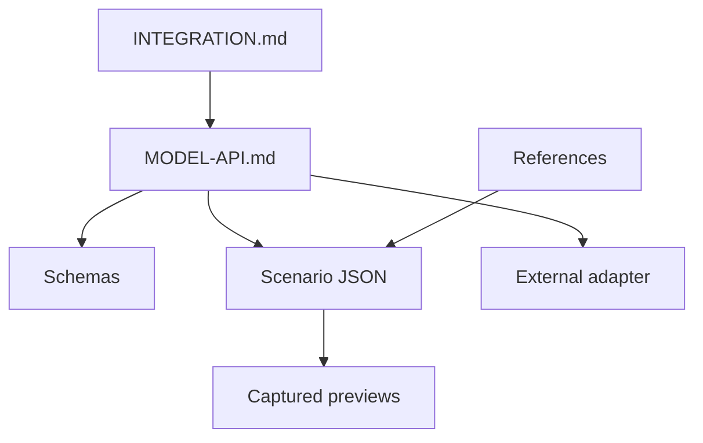
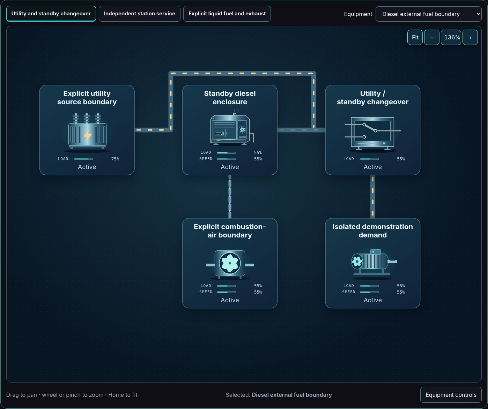

# Model documentation

[Package map](../README.md) · [Scenario folders](../scenarios/README.md) · [Image gallery](../img/README.md)

Start with the integration guide to connect a host and viewer. Use the model API
when changing equations, commands or replay. Scenario and reference documents
describe authored examples; they do not establish engineering accuracy.

| Document | Read it for |
| --- | --- |
| [INTEGRATION.md](./INTEGRATION.md) | One model serving multiple views, adapters, host lifecycle, JSON/YAML and CAD integration boundaries |
| [MODEL-API.md](./MODEL-API.md) | Versioned definitions, commands, state, equations, quality, repair and explicit limitations |
| [REAL_MODEL_ADAPTATION.md](./REAL_MODEL_ADAPTATION.md) | Calibrate parameters, replace headless equations or adapt an external engine with explicit evidence, units and acceptance fixtures |
| [MODEL-MATRIX.md](./MODEL-MATRIX.md) | Descriptor summary: families, circuits, energy roles and fault names |
| [scenario-coverage.md](./scenario-coverage.md) | Authored scenario intent, equipment selection and experiment descriptions |
| [scenario-gallery.md](./scenario-gallery.md) | Generated first-view captures linked to their system/model JSON |
| [Power reference register](https://github.com/Valpatel/cad-agent/blob/dev/software/cadagent/webkit/scada/ui/docs/POWER_REFERENCES.md) | Sources for structural roles and circuit separation, with stated interpretation limits |
| [Agriculture reference register](https://github.com/Valpatel/cad-agent/blob/dev/software/cadagent/webkit/scada/ui/docs/AGRICULTURE_REFERENCES.md) | Sources for growing/aquaculture layouts, with fictional biological coefficients kept explicit |
| [EXTERNAL-ENGINES.md](./EXTERNAL-ENGINES.md) | Candidate engineering solvers, licensing and adapter responsibilities; none is bundled here |

The preview shows a declared example, not measured plant performance. Source and
capture-state details live in the [thumbnail manifest](../metadata/thumbnails.json).
The [topology SVG gallery](../img/topologies/README.md) is a separate compact view
of declared equipment relationships, using the same canonical equipment symbols.
For artwork and per-state limitations, read the sibling UI package's
[state coverage](https://github.com/Valpatel/cad-agent/blob/dev/software/cadagent/webkit/scada/ui/docs/STATE_COVERAGE.md).

`npm --prefix tools/webkit/scada run build:metadata` owns the generated registry JSON; the model matrix
is a documentation summary that must stay aligned with source descriptors. The
Explorer capture workflow owns the scenario gallery and thumbnail manifest.
Edit source models or capture tools before regenerating their products.
