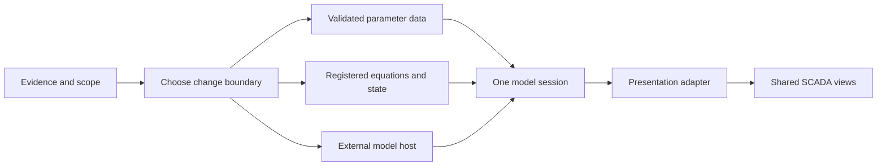
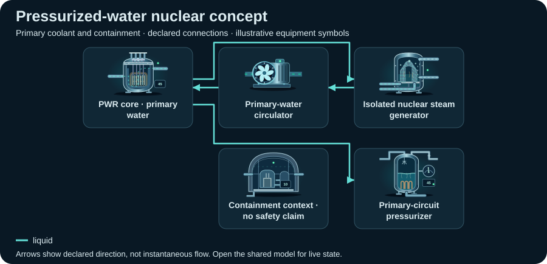

# Adapt illustrative behavior to a real system

[Documentation map](./README.md) · [Package map](../README.md) · [Model API](./MODEL-API.md) · [Integration](./INTEGRATION.md)

Both engines support registered, swappable constitutive equations and owned
per-component model state. Built-in scenario defaults remain normalized teaching
models. Physical providers can calculate in SI and bridge their results into the
existing allocation kernel, while a whole external engine can replace that
kernel through the viewer adapter. A measured pump curve improves a defined
part of a system without establishing accuracy for unrelated equipment. The UI
and its animations convey supplied state; they do not calculate physics.

The repository's [model-adaptation agent skill](https://github.com/Valpatel/cad-agent/blob/dev/.agents/skills/scada-model-adaptation/SKILL.md)
turns this guide into a repeatable implementation/review workflow. Its presence
does not install a skill or viewer into cad-agent. Transfer remains governed by
the [cad-agent integration design](https://github.com/Valpatel/cad-agent/blob/dev/docs/practice/scada/architecture.md).

## Choose one of three paths

| Path | Choose it when | Actual change point | What it does not supply |
| --- | --- | --- | --- |
| Parameter calibration | Existing equations, state variables, topology and index meanings already fit the intended experiment | Scenario `model.json`, validated through the public factories/validators and bounded parameter commands | New pump curves, engineering units, phase equilibrium or absent dynamics |
| Registered equations/models | You need different constitutive laws or per-component dynamic state inside the existing kernel | Trusted `equationProviders`, data-only `definition.equations` bindings and atomic `setEquationBindings()` | New global solver variables, unrestricted topology changes or automatic validation of a custom law's physical assumptions |
| External engine adapter | A solver, worker, backend or telemetry session already owns the real model | A host-owned object implementing `getSnapshot`, `subscribe` and optional `dispatch` for the UI | An interchangeable placeholder model/snapshot format, solver clock, physical validation or automatic unit conversion |



Read [external engine candidates](./EXTERNAL-ENGINES.md) for EPANET, Modelica,
TESPy, CoolProp, pandapower and FMI/FMPy references and license boundaries.
None is bundled, selected by a JSON model name, or validated by this repository.
Pick a solver by the needed physical domain and retained state, then pin its
version and dependent model/property data.

## Establish evidence and scope first

Write a short model specification with equipment IDs, included/excluded physics,
input/output quantities, state variables, operating domain, boundary conditions,
initial conditions, discontinuities and acceptance tolerances. For each parameter
or dataset record one of:

- **Measured:** instrument/source file, channel, unit, reference conditions,
  sampling interval, calibration/quality and uncertainty where known.
- **Source-derived:** exact document/version/page, curve or equation, digitization
  or fitting method, valid domain and transformation into model units.
- **Assumed:** editable value/range, reason, uncertainty or unknowns and the
  effect expected when it changes. A plausible estimate remains an assumption.

Keep a machine-readable evidence sidecar with the host's own documented schema
when structured provenance is needed. Placeholder model JSON accepts assumption
strings at model/component level; it does **not** accept arbitrary provenance,
solver or unit fields. The UI system document has separate provenance and
assumption records; see the [system format](https://github.com/Valpatel/cad-agent/blob/dev/software/cadagent/webkit/scada/ui/docs/SYSTEM_FORMAT.md).
Record evidence identifiers in those supported strings or records and link the
sidecar from the host's manifest/README. Never hide an extra payload in a numeric
field or silently weaken a validator.

A useful sidecar maps equipment ID + parameter/quantity path to source identity,
original value/unit, transform, uncertainty, applicability and model revision.
Include engine/model versions, topology/configuration hashes, curve/data hashes,
initialization choices, solver tolerances and seeds. This is a proposed project
evidence organization, not a new library standard or importable snapshot.

Physical coordinates belong to the model: a diagram's placement, port side and
polyline are drawing coordinates, not pipe length, elevation, cross-section or
electrical impedance. If another CAD viewer supplies geometry, document axis
orientation, handedness, scale, origin and elevation datum in an explicit mapping.
Preserve stable equipment and circuit identities across that mapping; never infer
connectivity from overlapping lines.

## Path A: calibrate supported parameters

Use [public descriptors](../src/model-registry.mjs) and the
[v2 descriptors](../src/v2/contract.mjs) to inspect parameter meanings and bounds.
`getModelDescriptor(type, {version:2, variant})` selects the explicit v2 variant;
`createModelDefinition(system, {version:2})` and `createV2ModelDefinition(system)`
produce editable templates. Version 1 remains the default of
`createModelDefinition`, so specify the intended version. Validators clone and
freeze normalized output; edit a detached configuration before validation.

```js
import {
  PlaceholderSystemModel, validatePlaceholderModelDefinition,
} from '@valpatel/scada-sim';

// The host obtains these variables from its evidence/configuration workflow.
const candidate = structuredClone(currentDefinition);
candidate.components[equipmentId].parameters.response = fittedResponseIndex;
candidate.components[equipmentId].assumptions ??= [];
candidate.components[equipmentId].assumptions.push(
  'Response is fitted within the documented experiment; other coefficients remain assumed.',
);
const checked = validatePlaceholderModelDefinition(systemDefinition, candidate);
if (!checked.ok) throw new Error(JSON.stringify(checked.errors));
const session = new PlaceholderSystemModel(systemDefinition, checked.definition);
```

This example is a configuration-validation pattern, not a fitted physical model.
The current `response` is a rate per illustrative minute; `capacity`, pressure,
temperature, pH and EC remain teaching indices. In particular v1 display units
are mapped from indices, not predicted kPa/°C. Fitting a visual index alone does
not justify labeling it as a physical measurement.

Use existing commands for live bounded edits: `setParameter`, and in v2
`setCircuitParameter`, `setEnergyParameter`, `setEnvironment`, `setTracer` and
`setZoneValue`. Structural changes, new modes, variant/port changes or circuit
ownership changes require a new validated session. Current parameter commands
cannot introduce a pump curve or arbitrary equation. `exportModelDefinition()`
includes edits. `reset()` retains those edited parameters while restoring initial
state; create a new session from the original configuration to discard edits.

V2 separates finite resource circuits, energy domains and retained heat. Its
validator protects registered circuit separation and compatible fluids/domains;
do not merge exchanger streams to force a calibration to pass. A source/sink is
an explicit external boundary. Unlike v1's documented bench-supply assumptions,
v2 does not create missing pump power or material. Prefer v2 for experiments that
need finite inventories, explicit boundaries or AC/DC/mechanical separation.

## Path B: register interchangeable equations and model state

The session constructor accepts trusted JavaScript providers through
`{equationProviders:[providerA, providerB]}`. Both v1 and v2 evaluate selected
providers inside the real resource, energy and state-update paths. A provider
can replace one phase while leaving the other built-in phases intact. The
[provider core](../src/equations/README.md) owns registration, data validation and
state; [physical examples](../examples/equation-models/README.md) supply concrete
SI pump/thermal equations and explicit kernel bridges.

The public package subpaths are `@valpatel/scada-sim/equations` for contracts and
runtime helpers and `@valpatel/scada-sim/equation-examples` for the supplied physical
helpers/providers. The main package entry also exports the core provider API.

Model JSON selects registered identities and editable parameters; it never
contains executable source, module URLs or expressions:

```json
{
  "version": 1,
  "families": {"v1": {}, "v2": {}},
  "types": {"pump": {"id": "engineering.pump.quadratic", "version": "1.0.0", "parameters": {}}},
  "components": {"maintenancePump": null}
}
```

This is the value of `definition.equations`, not a whole model document. The
`maintenancePump` selector is only valid when that equipment exists. Resolution
is component → type → engine-scoped family → built-in. An explicit `null` stops
fallback and selects the built-in law. V1 family keys are configured `kind`
values; v2 keys are configured `model` values. A binding's `parameters` override
its registered `defaultParameters`, then the closed parameter schema validates
the resolved object. Defaults are editable example assumptions unless documented
otherwise. Register the selected provider before constructing or restoring a
session; missing IDs/versions are errors, never silent fallback.

```js
import {PlaceholderSystemModel} from '@valpatel/scada-sim';
// suppliedProviders contains reviewed JS objects, not names loaded from JSON.
const model = new PlaceholderSystemModel(system, modelDefinition, {
  equationProviders:suppliedProviders,
});
const next = structuredClone(model.exportModelDefinition().equations);
next.components.deliveryPump = {
  id:'engineering.pump.linear', version:'1.0.0', parameters:{},
};
model.setEquationBindings(next);
```

`deliveryPump` must exist in this example's system. `setEquationBindings()` is an
atomic session method: it validates and selects registered implementations,
initializes selected provider state, refreshes the result, and retains core
stocks, heat, controls and elapsed time. It does not register new code or change
ports/topology. Changing provider parameters uses the same method and deliberately
reinitializes provider state; it is not an in-place edit to a provider closure.
Use `undefined` to remove equation bindings and return to built-in behavior.
The [model-switching browser bench](../examples/model-switching/README.md) puts
these operations in one session with two views. It is a local runnable example;
its presence is not proof of deployment.

### Provider declaration and owned state

A provider declares `id`, `version`, positive integer `stateVersion`, supported
`engines`, `phases`, `units:'scada-index-v1'`, `parameterSchema`, `stateSchema`,
optional `defaultParameters`, and trusted synchronous callbacks:

```js
const provider = {
  id:'example.capacity', version:'1.0.0', stateVersion:1,
  engines:[1,2], phases:['resource'], units:'scada-index-v1',
  parameterSchema:{type:'object', additionalProperties:false,
    properties:{capacity:{type:'number', minimum:0, maximum:100}},
    required:['capacity']},
  defaultParameters:{capacity:40}, // assumed normalized example value
  stateSchema:{type:'object', additionalProperties:false, properties:{}},
  initialize(context) { return {}; },
  evaluate(phase, context) {
    return {capacity:context.parameters.capacity};
  },
};
```

This minimal constant-capacity example proves a replacement seam; it is not a
pump curve. A physical or degraded-equipment law must use its declared operating
inputs/factors and acceptance evidence. The complete source/schema definitions
are [contracts.mjs](../src/equations/contracts.mjs),
[schema.mjs](../src/equations/schema.mjs) and
[runtime.mjs](../src/equations/runtime.mjs).

`evaluate(phase, context)` returns a partial object overriding that phase's default
proposal. It can run many times during allocation, construction, command refresh
and snapshot projection. It must be pure: no mutable closure state, PRNG draw,
clock, IO or external side effect. `initialize(context)` creates JSON state.
Optional `advance(context)` returns its next complete JSON state once per accepted
engine substep, using accepted local results; it does not change physical stocks
by writing to a context object. If any later part of the step fails, engine and
provider state roll back together.

Contexts are defensive, deeply frozen plain data. Common fields are
`engineVersion`, `equipment:{id,type,variant,family}`, resolved `parameters`,
`providerState` and `defaults`; initialization has `providerState:null`. Engines
add `core`, `configuration`, `timeMinutes`, `dtMinutes`, phase-specific `readings`,
`gates` and accepted results. Resource contexts distinguish `healthFactor`,
`powerFactor`, external `controlFactor`, `operatingFraction`, enabled state and
isolation. `advance` receives accepted resource/energy results; v2 also exposes
accepted thermal contributions. Inspect the engine-specific fixture/context
before using a field not present in another phase. A missing input is not a
license to invent a physical zero.

`availablePower`, `ratedDemand` and `powerBasis` distinguish actual accepted main
drive supply from nominal demand or a v1 bench-supply assumption; v2 disconnected
supply is zero. Advance context `accepted.core` and `accepted.gates` describe the
interval that actually produced its accepted rates, while top-level `core` and
`gates` reflect the current post-update state. A fault that latches at the end of
the step must not erase the interval's earlier accepted work. Consult the
engine-specific tests for these time boundaries.

The session supplies core/configuration/time context when it initializes selected
providers after constructing initial engine state, and when it resets or swaps
bindings. Import restores owned state without calling `initialize`. Direct use of
`createEquationRuntime` is a lower-level integration API: its default initialization
has only common metadata/parameters; engine authors use `initialize:false` then
`reset(id => context)` to supply their initial core context.

Freezing prevents alias mutation; it does **not** sandbox trusted JavaScript or
prove purity. A malicious or careless callback can still change external state.
Only engine-owned JSON state participates in rollback/replay. Promises and
thenables are rejected synchronously; native rejected promises are consumed so
the rejected operation does not later create an unhandled rejection. This is a
synchronous numerical extension contract, not a remote RPC interface.

The schema subset supports closed objects, arrays with item schemas, primitive
scalar types, required properties, primitive enum/const values and numeric/length
bounds. It does not support `$ref`, schema fetching, expressions, coercion,
implicit schema defaults or arbitrary keywords. Parameters and state must use
closed object roots. Validate difficult physical cross-field constraints in the
trusted pure law before returning a proposal; use a clear error rather than a
plausible invalid result.

### Phase units and kernel responsibilities

`EQUATION_PHASE_CONTRACTS` is the exported source of output shapes, engine
support, bounds, unit bases and engine-specific stage semantics. These kernel
units are explicitly normalized; the physical examples calculate in SI and
convert at this boundary. The unit-contract name does not label all inputs SI.

| Phase | Returned fields | Meaning |
| --- | --- | --- |
| `operating` | `operating` | Next 0–100 operating index before allocation |
| `resource` | `capacity` | Effective requested local transfer rate; kernel applies configured rating, absolute gates and finite allocation |
| `energy` | `capacity`, `demand`; v2 also `efficiency`, `auxiliaryDemand` | Effective requested capacity/load demand. V2 auxiliary demand is nominal per port and receives the existing health gate once. |
| `pressure` | `target` | **V1:** target before its response integration. **V2:** next pressure index, replacing the already-integrated default proposal. These stages are not interchangeable. |
| `temperature`, `signal` | `target` | V1-only response/signal targets |
| `condition` | `damage` | Next absolute 0–100 damage index; engine owns declared fault latching |
| `thermal-source` | `heat` | V2 requested heat amount for the current substep |
| `thermal-transfer` | `heat`, `lossFraction` | V2 proposed paired transfer and declared loss |
| `thermal-loss` | `heat` | V2 proposed loss from retained heat |

V1 resource and energy-store inventory indices change by accepted rate ×
`dtMinutes / 10`. V2 resource amount changes by accepted rate × `dtMinutes`,
and amount = inventory index × `stockScale`; stored energy uses its declared
capacity and efficiency/loss accounting. These are distinct normalization bases.
Pressure and other indices need explicit physical scales/reference values.
Thermal proposals are amounts for the current substep, not rates that should
receive `dtMinutes` twice. Preserve seconds/minutes and J/W conversions in the
physical bridge and test them numerically.

Providers return **effective requests**. Kernel invariants enforce finite,
nonnegative values, configured ratings, absolute disable/closure/no-supply/control
isolation and finite resource/energy allocation. The kernel does not multiply
fractional availability a second time, cap a new law at the old default result,
or impose a hidden linear power-to-flow law. The provider owns fractional
health/power/control response. A nonlinear law may request more than the old
linear rule while remaining within the configured rating and accepted supply.
Conservation and bounds do not prove a custom law is physically valid.

The kernel continues to own paired debits/credits and boundary ledgers. Thermal
proposals cannot create unaccounted heat or erase donor stock. Initial conditions,
manual stock edits, leakage, external sources and losses remain explicit. The
existing `step(minutes)` accepts positive durations up to 60 with substeps of at
most one model minute; a physical response may convert that duration to seconds.
Perform timestep refinement and domain/reference checks rather than equating a
render frame with a numerical integration step.

### Save, restore and source ownership

Selected provider state appears in optional top-level saved `equationState`:

```text
version: 1
components[equipmentId]:
  id, version, stateVersion, units
  parameters       resolved parameters including registered defaults
  schemaSignature  canonical JSON of parameter/state schemas
  state            provider-owned JSON state
```

A saved session's `model.equations` restores the saved selection, even when the
current session has another registered law selected. The candidate is fully
validated before commit: missing/incompatible implementations, mismatched units,
resolved parameters, schema signature or state version reject atomically.
Restore uses saved state directly, without initialization, elapsed-time replay
or another clock. `reset()` restores core initial state and reinitializes selected
providers with the current edited model/binding parameters. No-binding sessions
omit the extra envelope and retain the existing built-in formats and behavior.

Identity/version and canonical schema signatures are compatibility declarations,
not cryptographic code verification. Changed JavaScript under the same declared
version is not automatically detected. Pin source/dependency revisions in the
host's evidence and increment provider/state versions deliberately. Pure physical
helpers, independent reference cases and round-trip continuation tests belong
with each provider.

| Owner | Responsibility |
| --- | --- |
| [equations](../src/equations/README.md) | Registry, selectors, phase/unit contracts, bounded schemas, owned state and rollback checkpoints |
| [components.mjs](../src/components.mjs), [placeholder-system.mjs](../src/placeholder-system.mjs) | V1 family defaults and registered phase invocation in actual transport/state transitions |
| [v2/circuit-system.mjs](../src/v2/circuit-system.mjs) | V2 provider proposals, allocation, conservation, thermal updates and transactional lifecycle |
| [Validation](../src/validation.mjs), [v2 validation](../src/v2/validation.mjs), [schemas](../schema/README.md) | Versioned data and saved-state boundaries |
| [Equation examples](../src/equation-examples/README.md) | Reusable physical calculations and explicitly parameterized bridges |
| [Model-switching example](../examples/model-switching/README.md) | Host controls around one model and shared viewer state |

New constitutive laws use providers; new global solver variables, topology
semantics or unsupported phases require deliberate core evolution or a whole
external-engine adapter. A local pump/system-curve closure is real replaceable
physics, but it is not a general hydraulic-network solve. Keep that boundary and
its calibration limits explicit.

The current v2 kernel performs three coupled resource/energy passes per substep.
Its energy allocation has a bounded convergence check, but the combined material,
energy and custom nonlinear equations are not a converged multiphysics network
solve. Accepted budgets and balance checks are distinct from nonlinear physical
convergence. Use a whole-network solver when that convergence or new state/domain
semantics are required.

## Path C: adapt an external session

The [viewer](https://github.com/Valpatel/cad-agent/blob/dev/software/cadagent/webkit/scada/ui/src/viewer/viewer.mjs) accepts this existing shape:

```js
const adapter = {
  getSnapshot() { return currentPresentationSnapshot; },
  subscribe(listener) { return matchingUnsubscribe; },
  // Optional. Omit it for a read-only viewer.
  dispatch(command) { return hostCommandResult; },
};
```

The viewer calls `getSnapshot()` on attachment and updates, so a subscription must
make the new snapshot available before notifying. It must return an unsubscribe
function. The host may pass snapshot/event metadata to listeners; the viewer
refreshes from the adapter. `dispatch` can return a result or Promise; a rejection
appears as a command error. Publish authoritative observations through the same
session rather than optimistic animation that invents successful operation.

The viewer does not require a placeholder snapshot envelope. It resolves explicit
JSON Pointer bindings or `/components/<equipmentId>` visual state, and boolean
connection bindings or `/flows/<connectionId>`. Visual fields must match that
type/variant's catalog; unknown fields and invalid ranges mark bound state
unavailable. Keep physical telemetry, convergence, source time and model identity
elsewhere in your host snapshot and expose them deliberately in metrics/inspectors.
Do not put an undeclared `valid` field inside a pump symbol state.

| Mapping | Required distinction |
| --- | --- |
| Speed | Raw rpm vs bounded visual percent against a documented display basis |
| Pressure | Pa/kPa/bar and absolute/gauge reference; no implicit atmospheric offset |
| Flow | Signed kg/s vs m³/h; converting requires documented fluid density/reference conditions |
| Temperature | K/°C and property-model domain; an index is neither |
| Electrical values | AC/DC, RMS/peak, line/phase, import/export sign and frequency where applicable |
| Quality | Good/degraded/stale/missing/failed observation vs an actual zero; sample time separate from receive/render time |
| Control | Requested enabled/load/position vs observed shaft speed, actual contact position or measured output |

The default edge renderer consumes a boolean activity binding; it does not infer
reverse transport from a signed raw value or v2 `directions`. Keep direction in
the observation contract and add an explicit host renderer where needed. Missing
connection activity should remain unavailable, while a valid zero is inactive.
Never sum unrelated material, electrical and signal `flowRates` as production.

Use the [tested fake-engine example](../examples/external-adapter/README.md) for
unit projection, raw-value retention, command/request separation, read-only
behavior and subscription lifetime. It supplies no physics, snapshot restart,
fault injection or repair. Those commands must not appear as successful actions
unless the chosen host implements and tests them.

`createPlaceholderAdapter` wraps the bundled model contract and requires
`getSnapshot`, `subscribe` and `dispatch` even when its read-only option omits the
returned dispatch. An external read-only source can instead implement the viewer
contract directly. `createV2Adapter(model, {readOnly:true})` uses the same validated
model contract and omits `dispatch` too. The viewer detects command authority by
the presence of `dispatch`, so a read-only adapter must omit it rather than expose
a function that throws. Test this boundary with a mounted viewer: controls remain
disabled, observations continue, and destroying the view only unsubscribes it.

## State, lifecycle and replay agreements

| Situation | Agreement to test |
| --- | --- |
| Off/idle/low/high | Commands and observations remain distinct; low/high visuals reflect a defined observed quantity. Turning a drive off need not drain a vessel or remove retained heat. |
| Pause | One host clock policy; pause stops stepping, not state retention. Manual `model.step()` still advances while paused; the `step` command also pauses. Presentation reduced motion is separate. |
| Warning/fault | State quality, physical failure and protective trip are separate. Drift may remain available with degraded quality; missing telemetry is unavailable. Do not infer an interlock from a wire, alarm color or glyph. |
| Damage/repair | Define damage cause, retention, available throughput and recovery. Repair in the toy model clears the fault latch/damage, not controls, pressure, inventories or heat. A real repair workflow may differ and needs its own contract. |
| Disconnected/stale | Retain raw last-known values with invalid quality/time when supported; stop presenting them as fresh. Define reconnect and fresh-sample requirements. Missing samples never silently become zero. |
| Import/reset | Restore only compatible state, start no duplicate clock, emit no historical alarms as new incidents and perform no elapsed-time replay. Keep configuration reset distinct from parameter reset. |
| View mount/unmount | One solver/model session serves all views. Unsubscribe/destroy the view without destroying the shared model; only the session owner closes the solver/worker/connection. |

The current v2 protection relay has no protection decision law and reports
`tripped:false`; equipment damage does not establish a successful trip. Rod
position edits are instantaneous and `moving:false`; they do not imply a travel
model. Other visual-only placeholders and state coverage are cataloged in
[STATE_COVERAGE.md](https://github.com/Valpatel/cad-agent/blob/dev/software/cadagent/webkit/scada/ui/docs/STATE_COVERAGE.md). A qualified safety or
protection model must come from separately defined behavior and evidence, not from
the renderer. A thermal solver alone does not add nuclear kinetics or protection.

For an external engine, distinguish exact restart, initialized configuration and
recorded results. Claim exact restart only if the saved state includes everything
needed by that solver: integrator/discrete states, event queue, random state,
model/property versions and time. A results export is not necessarily restartable.
Keep unsupported save/repair/fault operations absent or visibly rejected. Replay
tests must compare identical command sequences after restoration with stated
tolerances; deterministic toy tests do not prove a third-party solver's replay.

## Acceptance fixtures and evidence

Use a small isolated fixture before connecting a whole scenario. For a pump,
declare reservoir boundaries, fluid properties, elevations, pipe resistance,
curve and speed explicitly; compare zero speed, shutoff, normal flow, changed
speed and out-of-domain conditions to a source reference. Do not fabricate these
inputs from a symbol. For other domains select equally bounded reference cases.

| Check | Required evidence | Existing source test owner to extend or follow |
| --- | --- | --- |
| Definition/reference validity | Accepted intended topology; rejected unknown IDs, units/fields, modes and mismatched circuits without mutation | [v1 tests](https://github.com/Valpatel/cad-agent/blob/dev/tests/webkit/scada/sim/scada-sim.test.mjs), [v2 tests](https://github.com/Valpatel/cad-agent/blob/dev/tests/webkit/scada/sim/scada-sim-v2.test.mjs) |
| Physical/reference behavior | Named dataset/equation case, independent expected results, tolerance and valid domain; step refinement where dynamic | New domain fixtures beside the model tests; current toy tests are insufficient proof |
| Bounds and balances | Empty/full/zero supply, branch totals, signed/reversed transfer, leakage, retained heat/stock and boundary ledger over time | [Circuit conservation](https://github.com/Valpatel/cad-agent/blob/dev/tests/webkit/scada/sim/scada-circuit-conservation.test.mjs) |
| Registered laws and state | Actual pre-allocation/state changes, nonlinear rate above old default within rating, absolute gates, repeated pure evaluation, once-per-substep state, hot swap and late-step rollback | [Shared runtime](https://github.com/Valpatel/cad-agent/blob/dev/tests/webkit/scada/sim/equation-runtime.test.mjs), [v1 integration](https://github.com/Valpatel/cad-agent/blob/dev/tests/webkit/scada/sim/equation-providers-v1.test.mjs), [v2 integration](https://github.com/Valpatel/cad-agent/blob/dev/tests/webkit/scada/sim/equation-providers-v2.test.mjs) |
| SI bridge and analytic references | Independent physical duty points, off-design distinction, explicit units and finite accepted power/stock | [Physical helpers](https://github.com/Valpatel/cad-agent/blob/dev/tests/webkit/scada/sim/equation-physics.test.mjs), [physical provider integration](https://github.com/Valpatel/cad-agent/blob/dev/tests/webkit/scada/sim/equation-examples.test.mjs) |
| Commands and quality | Unknown/rejected command leaves state intact; requested vs observed behavior; valid zero, stale, drift, failure and recovery | [Presentation semantics](https://github.com/Valpatel/cad-agent/blob/dev/tests/webkit/scada/sim/v2-presentation-semantics.test.mjs), [external adapter tests](https://github.com/Valpatel/cad-agent/blob/dev/tests/webkit/scada/sim/external-adapter.test.mjs) |
| Lifetime and replay | No import-time timers/IO; one clock and shared subscribers; deterministic compatible restoration or an explicit unsupported-restart statement | [v1 lifecycle/replay](https://github.com/Valpatel/cad-agent/blob/dev/tests/webkit/scada/sim/scada-sim.test.mjs), [v2 continuation](https://github.com/Valpatel/cad-agent/blob/dev/tests/webkit/scada/sim/scada-sim-v2.test.mjs) |
| Model to visual | Canonical source state, inspector reading, glyph and connection agree in two simultaneous views; meaningful animated/paused/fault/reduced-motion states | [Viewer tests](https://github.com/Valpatel/cad-agent/blob/dev/tests/webkit/scada/ui/scada-viewer.test.mjs), [viewer review skill](https://github.com/Valpatel/cad-agent/blob/dev/.agents/skills/scada-viewer-review/SKILL.md) |

Run applicable package checks from the source repository:

```sh
npm --prefix tools/webkit/scada test
npm --prefix tools/webkit/scada run check:metadata
node --test tests/webkit/scada/sim/external-adapter.test.mjs
node tools/site/compiler/site-repo-map.mjs --check
python -m pytest -q tests/repo/test_areas.py tests/repo/test_skills.py
```

The package suite is Node built-in code plus Python standard-library topology
checks. The documentation renderer additionally needs the repository's pinned
Mermaid, Python Playwright and Chromium; see the
[documentation tools](https://github.com/Valpatel/cad-agent/blob/dev/.agents/skills/repository-documentation/SKILL.md).
Metadata/schema edits may require regeneration through
[the model tools](https://github.com/Valpatel/cad-agent/blob/dev/tools/webkit/scada/sim/README.md)
before the read-only check. Browser model/viewer checks require the separate UI
and host setup; do not report them from headless test results.

Finish with changed source owners, model/data versions, calibrated range,
assumptions, executed checks, inspected UI states and known unsupported behavior.
Link the acceptance fixtures and evidence from the model's README. Packaging,
consumer packaging and live publication are separate verification steps.
The same adapter boundary can later serve SCADA and other design viewers without
coupling the headless model to their cameras or HUDs.

<a href="../img/topologies/power-utilities/power-nuclear-pwr/topology.svg"></a>

This existing topology is a navigation aid for circuit separation, not a
calibrated reactor model or evidence of a safety/interlock implementation.
