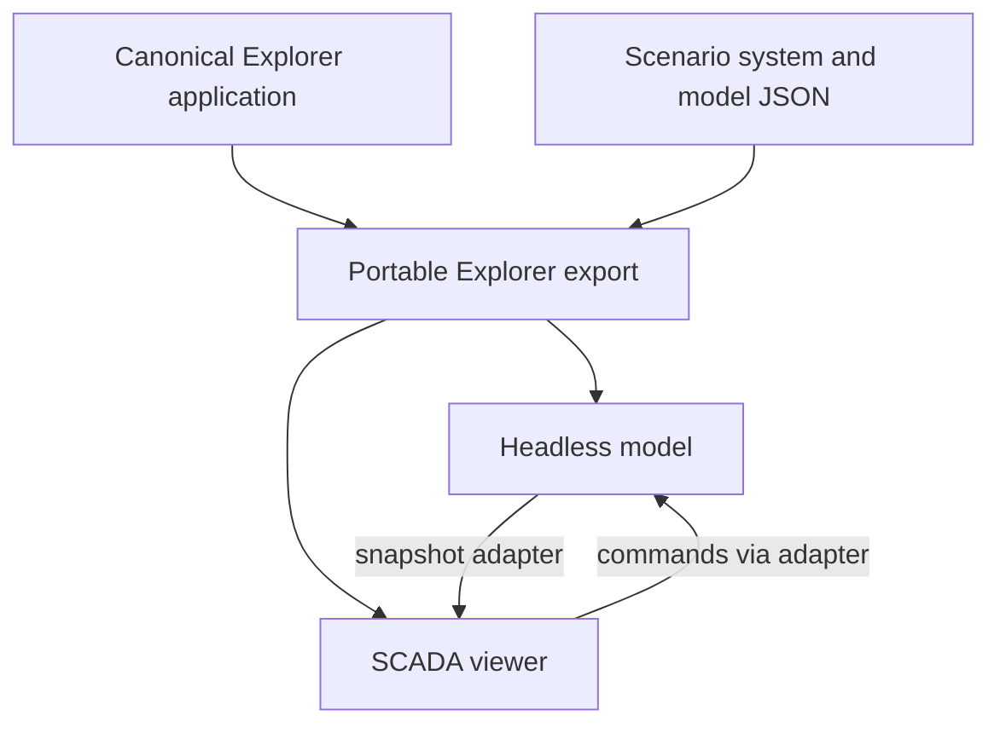
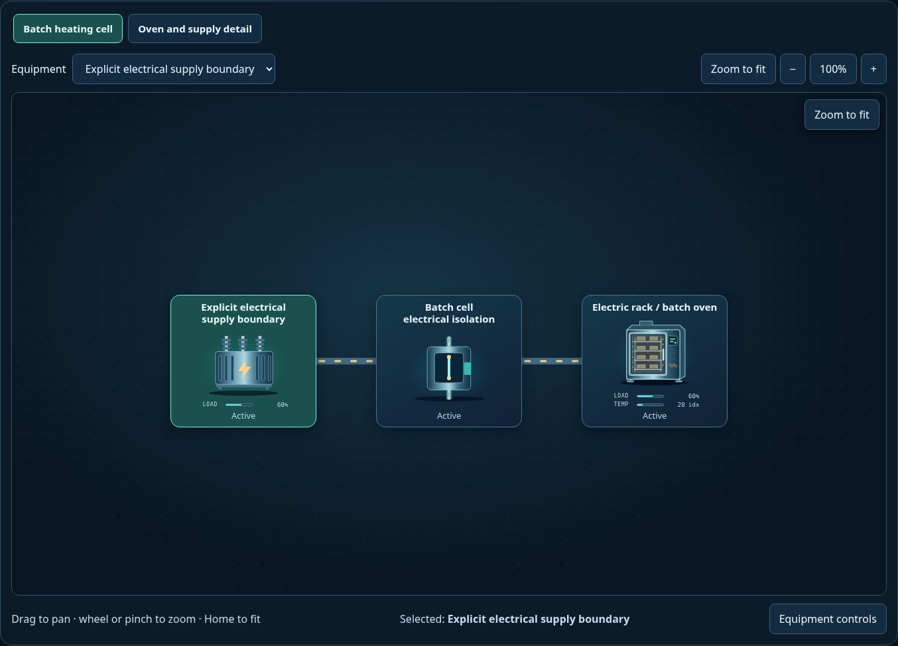

# Runnable package examples

[Package map](../README.md) · [Scenario definitions](../scenarios/README.md) · [Integration guide](../docs/INTEGRATION.md)

| Folder | Role | Edit here? |
| --- | --- | --- |
| [explorer](../../explorer/README.md) | Portable browser host for the shared model and SCADA viewer | No; generated from the canonical Explorer application |
| [external-adapter](./external-adapter/README.md) | Node-only developer example mapping a fake source's units, observations and commands to the viewer contract | Yes; no physics or automatic clock |
| [equation-models](./equation-models/README.md) | Runnable v1/v2 pump-law replacement and v2 resistor benches with SI scales, finite allocation and exact replay | Yes; all physical coefficients are editable assumptions |
| [model-switching](./model-switching/README.md) | Browser bench swapping registered SI pump laws in one v2 session, with editable assumptions and replay | Yes; a portable host using the shared model and viewer |

The source application is
[`apps/scada-explorer`](../../explorer).
The repository's `npm run build:explorer` exports it into this package. Keeping
this copy lets consumers serve sibling `scada-ui` and `scada-sim` packages without
running the source repository's build tools.

From the repository root, serve the sibling packages with
`python -m http.server 8000 --directory packages`, then open
`http://localhost:8000/scada-sim/examples/explorer/?scenario=electric-batch-oven`.
On GitHub the [HTML entry](../../explorer/index.html) is source, not a running app.

The host owns clock advancement, dialogs, file IO, audio and session lifetime.
Switching focused views does not create another model. Pan/zoom and Zoom to fit
belong to the reusable viewer; page and inspector scrolling belong to the host.
