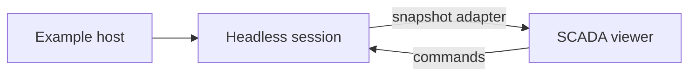

# Runnable model examples

[Model package](../README.md) · [Scenario definitions](../scenarios/README.md) · [Integration](../docs/INTEGRATION.md) · [Explorer host](https://github.com/Valpatel/cad-agent/blob/dev/software/cadagent/webkit/scada/explorer/README.md)

These focused examples exercise replaceable models and the adapter boundary. The full Explorer is a sibling application, outside the headless model package.

| Folder | Purpose |
| --- | --- |
| [external-adapter/](./external-adapter/README.md) | Fake source, unit conversions, observations and commands; no claimed pump physics. |
| [equation-models/](./equation-models/README.md) | Runnable v1/v2 pump laws and a v2 resistor with SI scales, finite allocation and replay. |
| [model-switching/](./model-switching/README.md) | Browser bench swapping registered SI pump laws in one session. |

From the checkout root, run `python -m http.server 8000 --directory software/cadagent/webkit` and open `http://localhost:8000/scada/explorer/?scenario=electric-batch-oven` for the full system explorer, or `/scada/sim/examples/model-switching/` for the equation bench. Node examples list their executable command in their own README.

Hosts own clocks, file IO, audio and lifecycle. Multiple views use one model. Pan, zoom and Zoom to fit belong to the contained diagram; native viewer scrollbars are not a navigation mechanism.
