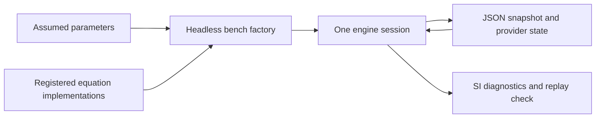
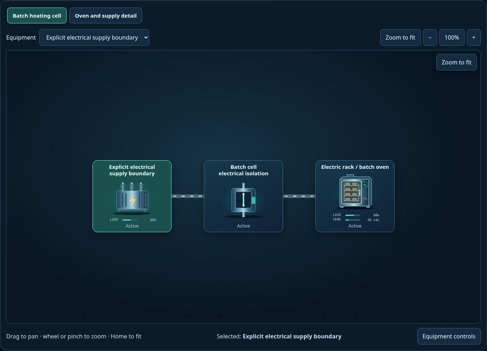

# Headless equation replacement benches

[Example map](../README.md) · [Equation implementation](../../src/equation-examples/README.md) · [Provider contract](../../src/equations/README.md) · [Browser switching bench](../model-switching/README.md)

These Node/browser-importable fixtures bind real equation providers to the core
engines. All physical parameters and ratings are editable assumptions. They
exercise replacement of equations, finite allocation and save/restore; they do
not constitute a calibrated plant or a nonlinear hydraulic network solver.

| File | Role |
| --- | --- |
| [run.mjs](./run.mjs) | Node CLI: step, switch pump law and verify exact saved-state continuation in both engines |
| [pump-bench.mjs](./pump-bench.mjs) | V1 finite-tank pump bench and v2 declared water/electrical-boundary bench |
| [pump-parameters.json](./pump-parameters.json) | Explicit assumed physical configuration, shared scales and alternative curve coefficients |
| [heater-bench.mjs](./heater-bench.mjs) | V2 resistor with actual electric demand and accepted heat; isolated store for a measurable energy balance |



<a href="../../img/thumbnails/electric-batch-oven.jpg"></a>

The preview is an existing scenario using the same model package, not a capture
of this command-line fixture or evidence of calibrated heat transfer.

From the repository root:

```sh
node packages/scada-sim/examples/equation-models/run.mjs
npm --prefix packages/scada-sim test
```

The CLI prints both laws' accepted flow, electrical allocation, developed head
and serialized shaft state. At the default nominal speed the two assumed curves
share a duty point; below nominal speed their predictions differ. The CLI steps
a command change, changes the registered binding in the same session, then
restores an earlier binding and verifies identical continuation. No timer or
external service starts. The host owns stepping and must destroy its model.

```js
import {createPumpBench} from './pump-bench.mjs';

const {model} = createPumpBench({
  version: 2,
  curve: 'quadratic',
  parameters: {initialSpeedRatio: 0.5, staticHeadM: 4},
});
model.step(0.1);
console.log(model.exportSnapshot().equationState.components.pump.state);
model.setEquationBindings({version: 1, components: {
  pump: {id: 'engineering.pump.linear', version: '1.0.0',
    parameters: {initialSpeedRatio: 0.5, staticHeadM: 4}},
}});
model.step(0.1);
model.destroy();
```

The JSON file is data, not evaluated code. Providers must be explicitly registered
as trusted modules. Unknown IDs, versions, parameters and incompatible saved
state are rejected. A runtime binding change retains core inventories and
resets the chosen provider's state; importing a snapshot restores its binding
and state when that registered version is available.

`powerRating` and `flowRating` are kernel ratings, independent of the equation's
SI scales. Lowering `powerRating` below the requested motor envelope lowers
effective speed; a supply below running idle power produces zero flow. Lowering
`flowRating` clips accepted flow while preserving the reported local potential.
An explicit electricity connection is required by these engineering providers
in both versions; v1's legacy unconnected-bench assumption supplies no physical
power to this equation binding.
The pump's pressure reading is developed head converted to an index; v1 retains
its family response while v2 assigns the next circuit pressure directly.

V1's stock increment is `rate × minutes / 10`; v2's is `rate × minutes`.
Consequently, at the default 0.05 m³/s flow-at-100 scale, one v1 stock-index unit
represents 0.3 m³, while one v2 amount unit represents 0.03 m³. V2 visible
inventory also includes each circuit's `stockScale`. Consult the
[explicit conversion table](../../src/equation-examples/README.md#state-units-and-acceptance)
before interpreting another component's storage physically.

The heater bench deliberately sets its body/material link conductance to zero
and disables default thermal loss, isolating the electrical/thermal equation.
Those assumptions are fixture choices, not changed rack-oven defaults. With
240 V, 24 Ω and efficiency 0.9, six seconds accepts 14,400 J electricity and
12,960 J heat when supply and receiver capacity allow. Finite supply and retained
store limits remain enforced by the core.
