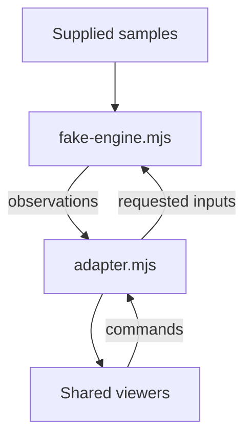

# External adapter contract example

[Examples map](../README.md) · [Model adaptation](../../docs/REAL_MODEL_ADAPTATION.md) · [Integration](../../docs/INTEGRATION.md)

This developer example connects a **fake pump observation source** to the existing
SCADA viewer adapter contract. It contains no pump equations, physical solver,
plant connection, timers or automatic simulation. Published samples are supplied
test data. It is included as example source, not as a new package export or an
installed cad-agent integration.

| File | Responsibility |
| --- | --- |
| [adapter.mjs](./adapter.mjs) | Read snapshots, translate raw units into bounded visual fields, translate two allowed commands and unsubscribe cleanly |
| [fake-engine.mjs](./fake-engine.mjs) | Explicitly supplied observations and separate requested inputs; no generated physical response |
| [Contract tests](https://github.com/Valpatel/cad-agent/blob/dev/tests/webkit/scada/sim/external-adapter.test.mjs) | Unit mapping, invalid/stale observations, command rejection, shared subscriptions and no implicit browser/clock dependencies |



Run this from the `software/cadagent/webkit/scada/sim` directory; Node 20.18+ is sufficient:

```sh
node --input-type=module <<'JS'
import {FakePumpEngine} from './examples/external-adapter/fake-engine.mjs';
import {createExternalAdapter} from './examples/external-adapter/adapter.mjs';
const engine = new FakePumpEngine();
const adapter = createExternalAdapter(engine, {readOnly:false});
engine.publishSample({timeSeconds:1, valid:true, mechanicalRunning:true,
  speedRpm:1800, powerKW:2.5, massFlowKgS:12, fault:false, warning:false});
adapter.dispatch({action:'setSpeedPercent', component:'pump', arguments:{value:75}});
console.log(adapter.getSnapshot());
JS
```

The requested speed becomes 2,700 rpm while observed speed remains 1,800 rpm.
Observed visual speed is 50% against the explicitly assumed 3,600 rpm display
range; observed visual load is 25% against the assumed 10 kW display range. Raw
values and units remain under `telemetry.pump`. Real integration must replace
these scales with documented choices. No density is assumed and kg/s is never
relabeled as m³/h. Above-range observations retain their raw value, cap the visual
percentage at 100 and show warning status.

<details>
<summary>Snapshot bindings, command vocabulary and observation validity</summary>

`getSnapshot()` exposes `components.pump` and `components.meter`, so system
components with IDs `pump`/`meter` and types `pump`/`flow-meter` can use the viewer's
default state binding. Label the meter **Mass flow (kg/s)**; its generic symbol
has no fixed engineering unit and this example supplies kg/s explicitly. An optional connection
with ID `delivery` uses `/flows/delivery`. Valid zero flow is `false`; missing or
stale flow omits the boolean and the standard connection renderer marks it
unavailable. Raw negative mass flow is preserved, but the standard connection
animation only represents activity: use a deliberate host edge-renderer extension
if reverse direction must be conveyed. A rotating shaft can have zero material
flow. The command to stop is separate from the latest observed running state.

`setEnabled` and `setSpeedPercent` are this example's command vocabulary, declared
by the consuming system's commands/controls. `setSpeedPercent` is **not** a
placeholder-engine action. Requested enabled state binds to
`/controls/pump/enabled`; requested speed binds to
`/controls/pump/speedPercent`. The default viewer inspector shows symbol state;
a host metric/inspector renderer must deliberately display raw telemetry, its
unit, validity and sample age.

Adapters are read-only by default and omit `dispatch`. A writable adapter rejects
unknown equipment, actions, extra argument keys and invalid values before calling
the fake host. Authorization and safe deserialization of untrusted remote input
remain host responsibilities. The example's host methods are local trusted code.

An invalid sample retains the last observation with `valid:false` and its original
`lastValidTimeSeconds`; before any valid sample the raw values are `null`. The
symbol becomes offline and stops production motion. The pump's offline `0%`
speed/load values are display placeholders, not raw zero measurements; its
symbol has no unavailable-reading field. The companion meter uses its supported
`active:false`/`status:'offline'` gate to render a dash. A valid zero is displayed
as zero. Values outside its ±9,999 display range also make that meter unavailable
while preserving the raw sample for an appropriately ranged host inspector.
Set `engine.setRunning(false)` to represent a paused session while
retaining observations. Freshness timeout policy and solver convergence belong
to the real host; this fixture marks validity explicitly.

`subscribe` does not emit initially; the viewer calls `getSnapshot()` when it
attaches. Each subscription returns an idempotent unsubscribe. Neither an adapter
nor a viewer owns solver destruction. The fake engine has no restart format,
conservation ledger, automatic fault/repair lifecycle, interlock, motor coast-down
or physics validation; those are explicit follow-on acceptance work for a real
engine, not behavior to infer from this illustration.

</details>

From the repository root, run the independent contract tests:

```sh
node --test tests/webkit/scada/sim/external-adapter.test.mjs
node --test tests/webkit/scada/external-adapter-render.test.mjs
```

Tests are source-repository development files and are excluded from npm runtime
packages. The cross-owner render test needs the root UI/jsdom setup and verifies
resolver/markup behavior, not a mounted browser session. The two example modules run without the UI package or third-party
dependencies. Mounting them in a browser still requires the separately installed
UI package and a validated system document as described in the
[integration guide](../../docs/INTEGRATION.md).

<a href="../../img/topologies/manufacturing-thermal-processing/electric-batch-oven/topology.svg"></a>

This existing package-owned topology illustrates explicit equipment relationships;
it is not a capture of this pump adapter or evidence of its physical accuracy.
