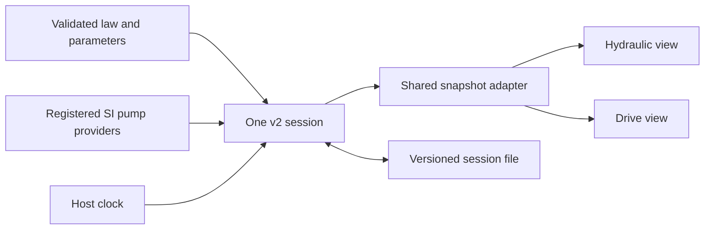

# Pump equation bench

[Examples map](../README.md) · [Model API](../../docs/MODEL-API.md) · [Equation providers](../../src/equation-examples/README.md) · [Viewer API](https://github.com/Valpatel/cad-agent/blob/dev/software/cadagent/webkit/scada/ui/docs/API.md)

A framework-free browser host for live equation replacement in one version 2
simulation session. The quadratic and linear pump laws are registered providers:
the selector calls the core `setEquationBindings()` method, and the controls edit
validated provider parameters. Both focused diagrams observe the same model,
inventories, fault state and host clock.

| File | Ownership |
| --- | --- |
| [index.html](./index.html) | Accessible host shell, clock controls and SI readouts |
| [system.json](./system.json) | Data-only equipment, connections, two views and inspector commands |
| [bench.mjs](./bench.mjs) | Explicit model boundaries, provider registration and session file envelope |
| [main.mjs](./main.mjs) | Host clock, live binding changes, schema-derived parameter form and file IO |
| [styles.css](./styles.css) | Example layout; component, viewer and workspace styles come from the sibling UI package |

## Run and explore

From the repository root, run `python -m http.server 8000 --directory packages`
and open
`http://localhost:8000/scada-sim/examples/model-switching/`.
The two sibling packages must remain adjacent when using extracted packages.
Opening the HTML directly from disk is unsupported because the host fetches JSON.

1. Start paused at the assumed 60% shaft speed. Select each pump law and compare
   its local potential, actual allocation and requested electrical power.
2. Open **Curve parameters** to edit SI coefficients, efficiencies, shaft lag and
   the explicit unit bridges. Applying a law or parameter change preserves the
   core system time and inventories, and initializes provider state again.
3. Inspect the pump to change its speed command, disable it, inject a fault or
   repair it. Inspect the valve to close it or limit normalized allocation.
4. Switch to **Drive & pump** and disable the electrical boundary. It is the same
   pump, model and clock. Pan/zoom the contained canvas and recover with its
   pinned **Zoom to fit** button. Equipment controls live in reusable dialogs.
5. **Save session** includes the selected provider ID/version, parameters,
   provider state, core state and focused view. **Load session** restores that
   identity and opens paused. Invalid or unavailable provider state/version is
   rejected by the core. **Reset state** retains edited parameters and the
   selected law, while returning core/provider state to their initial values.

## What the numbers mean

All starting coefficients and boundaries are **assumed**, editable demonstration
values. The provider contains the actual SI equations; the UI imports its pure
solver helper for the **local curve potential** readout rather than duplicating
the formula. The **allocated outlet flow** and **accepted electric power** come
from the v2 model snapshot, using the provider's declared SI conversion scales.
Changing these scales changes the physical interpretation of kernel capacities.
The power allocation is a conservative demand envelope over possible throttled
flows, so it can exceed the displayed local duty-point demand. The shaft readout
is the provider's committed commanded speed; supply limits can reduce effective
speed and actual delivery. Historical `last*` provider fields describe an accepted
interval and are not mixed into the current allocation readouts.

The two laws intersect their local pump curve with an assumed system curve.
The surrounding shared allocation kernel still uses normalized resource and
energy budgets. The displayed head is a local curve result, **not a solved
network pressure**. Closing a valve restricts allocation; it does not solve a
physical Cv network. The tank artwork represents explicit source/sink boundaries,
and the transformer artwork represents an explicit electrical supply. Their
appearance does not add finite-tank or electromagnetic physics.

The model has no automatic damage drift in this bench. Manual faults exercise the
existing kernel gates; no cavitation, surge, reverse flow, calibrated protection,
thermal pump damage or field accuracy is claimed. See the
[provider references and limitations](../../src/equation-examples/README.md) before
replacing assumptions with equipment data.

## Embedding and lifecycle

Reuse the model providers and public viewer separately from this host. The UI
package receives only an adapter and never imports the model. The host uses one
animation-frame clock, skips hidden-page time, and bounds any one elapsed frame
to 250 ms. It never starts an engine timer. The rate control scales simulated
seconds. Background suspension therefore does not imply wall-clock simulation.
Page teardown destroys its viewers, subscriptions and model; browser history
cache restoration resumes the same retained session.

`window.equationBench` exposes the actual model and viewer plus `metrics()`,
`saveData()` and `restore()` for developer inspection. It is a demonstration
host aid, not a new package API. Session files are data-only and limited to 2 MB;
provider code must already be registered by the host. This example does not
connect to live equipment, acquire telemetry, load arbitrary code or add audio.

For maintenance use the repository
[viewer review workflow](https://github.com/Valpatel/cad-agent/blob/dev/.agents/skills/scada-viewer-review/SKILL.md)
and [model adaptation workflow](https://github.com/Valpatel/cad-agent/blob/dev/.agents/skills/scada-model-adaptation/SKILL.md).
Verify law/parameter changes against actual snapshot readings, same-clock view
switches, valid replay, rejected import without mutation, fault/repair, keyboard
dialogs, reduced motion and responsive contained-camera behavior.
The source repository's repeatable browser acceptance command is
`python tools/webkit/scada/sim/check-model-switching-browser.py --output /tmp/model-switching-review`; use
`--url` to select an existing served entry and `--sizes` for viewport coverage.
See the [source tooling map](https://github.com/Valpatel/cad-agent/blob/dev/tools/webkit/scada/sim/README.md).
