# Simulation scenario gallery

**61 illustrative systems** grouped by sector. These previews belong to the simulation library and travel with its system/model examples.

Each image shows the real viewer after resetting the model, pausing the host clock and using Zoom to fit. Diagram layout is illustrative; overview text size depends on the system bounds. Open the portable Explorer example to zoom, inspect equipment and issue commands.

[Package owner](../README.md) · [Compact SVG topology maps](topologies/README.md) · [Thumbnail folder map](thumbnails/README.md) · [Explorer instructions](../../explorer/README.md) · [Contact sheet](thumbnails/contact-sheet.jpg) · [Capture manifest](../metadata/thumbnails.json)

The UI library owns its separate [symbol and workspace gallery](../../ui/img/README.md). Each library keeps its own image directory; there is no shared root asset bucket.

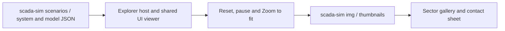

| Folder or file | Purpose |
| --- | --- |
| [topologies/](topologies/README.md) | Compact static vector process maps with equipment symbols and declared directed connections. |
| [thumbnails/](thumbnails/README.md) | One real initial-view JPEG per scenario, plus the complete contact sheet. |
| [Capture manifest](../metadata/thumbnails.json) | Source hashes, captured view, camera coverage and image dimensions. |

The Explorer app owns capture tooling; this model package owns the resulting images. Regenerate captures only when rendering or model inputs change. Documentation-only map refreshes use `npm run thumbnails:scenarios -- --indexes-only` after the existing capture provenance and bytes pass validation.

## Agriculture &amp; aquaculture

| Preview | System | Definitions and example |
| --- | --- | --- |
| <a href="thumbnails/aquaponics-media-bed.jpg">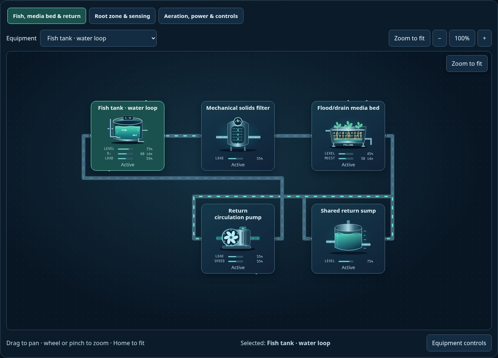</a> | **Media-bed aquaponics** `aquaponics-media-bed` | [System JSON](../scenarios/aquaponics-media-bed/system.json) · [Model JSON](../scenarios/aquaponics-media-bed/model.json) · [Portable example](../../explorer/index.html?scenario=aquaponics-media-bed) |
| <a href="thumbnails/aquaponics-dwc.jpg">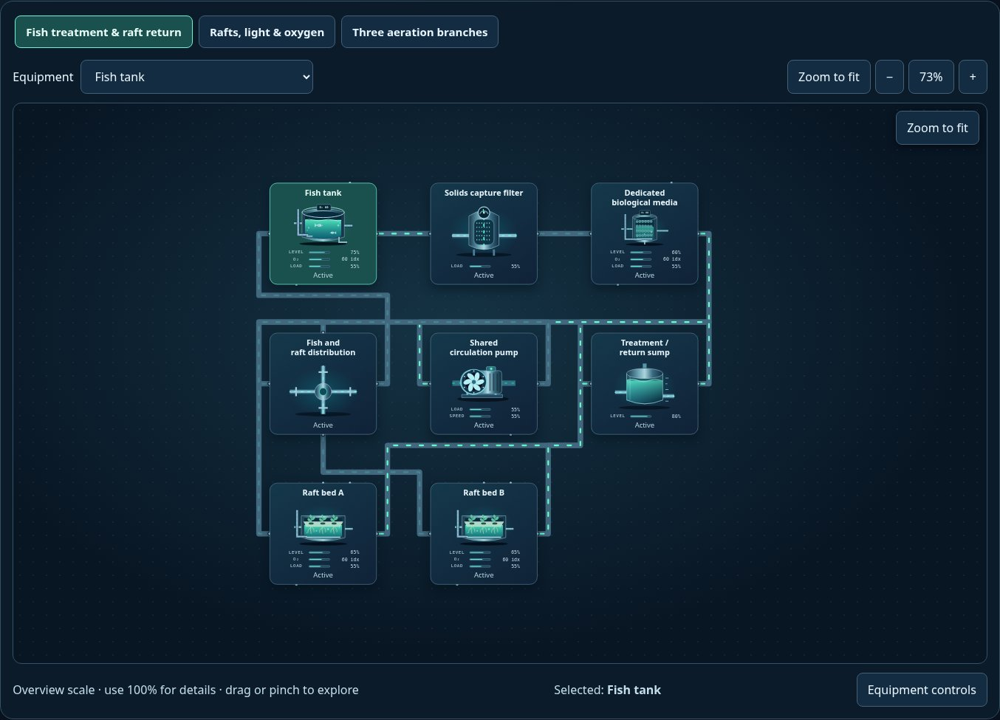</a> | **Raft / DWC aquaponics** `aquaponics-dwc` | [System JSON](../scenarios/aquaponics-dwc/system.json) · [Model JSON](../scenarios/aquaponics-dwc/model.json) · [Portable example](../../explorer/index.html?scenario=aquaponics-dwc) |
| <a href="thumbnails/hydroponics-nft.jpg">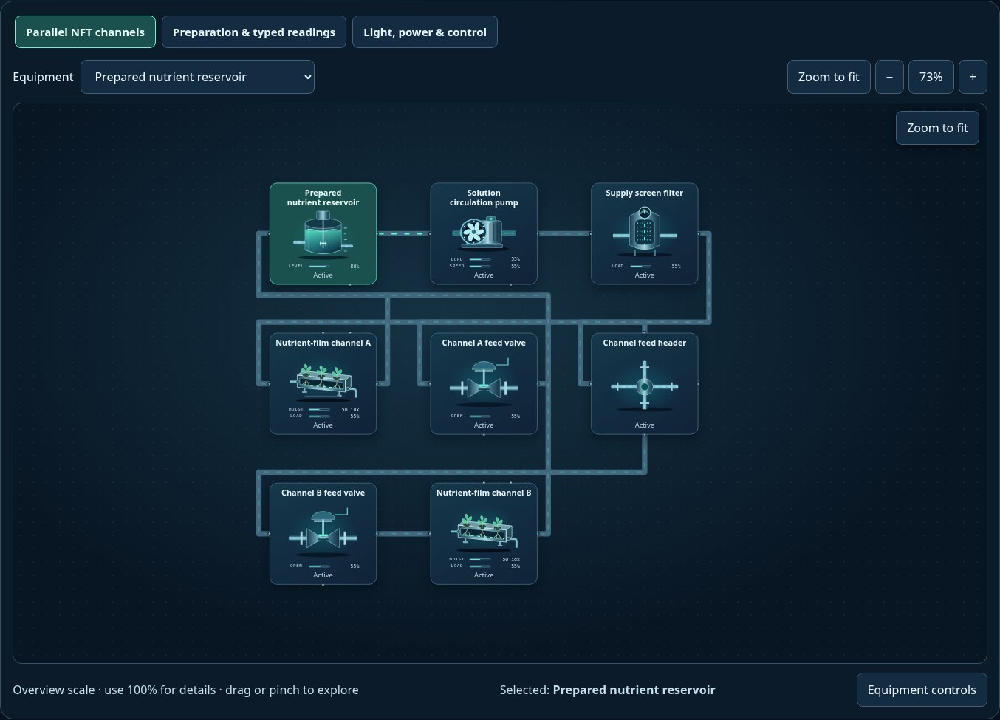</a> | **NFT hydroponics** `hydroponics-nft` | [System JSON](../scenarios/hydroponics-nft/system.json) · [Model JSON](../scenarios/hydroponics-nft/model.json) · [Portable example](../../explorer/index.html?scenario=hydroponics-nft) |
| <a href="thumbnails/hydroponics-ebb-flow.jpg">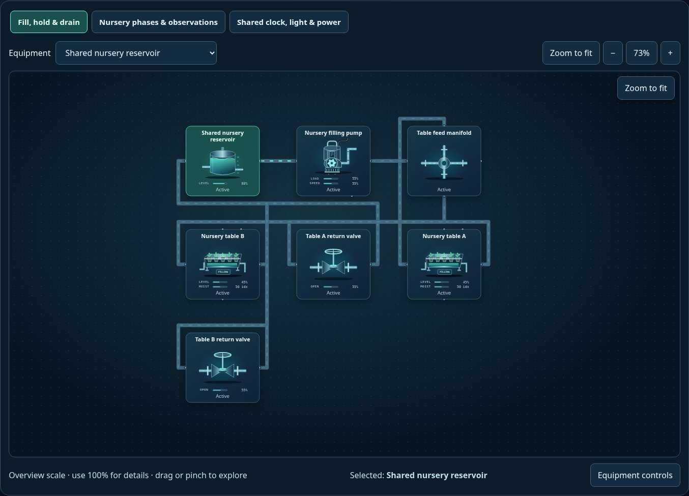</a> | **Ebb-and-flow nursery** `hydroponics-ebb-flow` | [System JSON](../scenarios/hydroponics-ebb-flow/system.json) · [Model JSON](../scenarios/hydroponics-ebb-flow/model.json) · [Portable example](../../explorer/index.html?scenario=hydroponics-ebb-flow) |
| <a href="thumbnails/greenhouse-drip.jpg">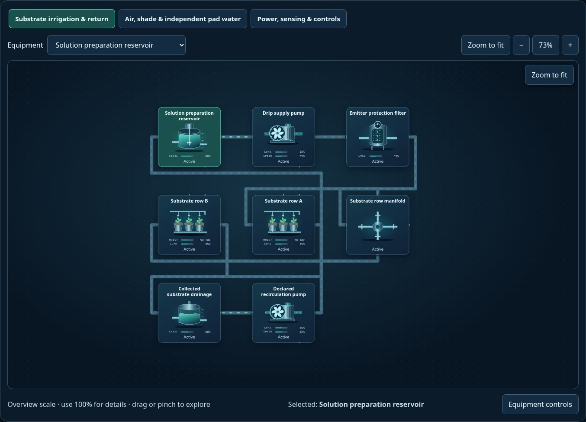</a> | **Drip / substrate greenhouse** `greenhouse-drip` | [System JSON](../scenarios/greenhouse-drip/system.json) · [Model JSON](../scenarios/greenhouse-drip/model.json) · [Portable example](../../explorer/index.html?scenario=greenhouse-drip) |
| <a href="thumbnails/indoor-aeroponics.jpg">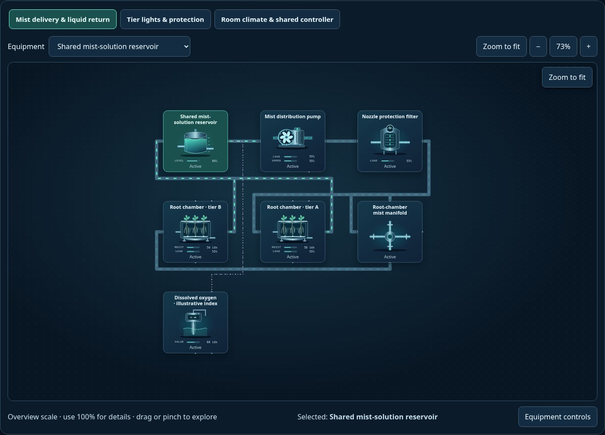</a> | **Indoor vertical / aeroponic room** `indoor-aeroponics` | [System JSON](../scenarios/indoor-aeroponics/system.json) · [Model JSON](../scenarios/indoor-aeroponics/model.json) · [Portable example](../../explorer/index.html?scenario=indoor-aeroponics) |

## Biopharma

| Preview | System | Definitions and example |
| --- | --- | --- |
| <a href="thumbnails/biopharma-fermentation.jpg">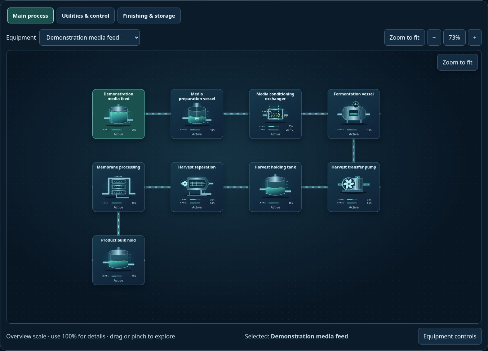</a> | **Biopharma fermentation** `biopharma-fermentation` | [System JSON](../scenarios/biopharma-fermentation/system.json) · [Model JSON](../scenarios/biopharma-fermentation/model.json) · [Portable example](../../explorer/index.html?scenario=biopharma-fermentation) |

## Chemicals

| Preview | System | Definitions and example |
| --- | --- | --- |
| <a href="thumbnails/paint-blending.jpg">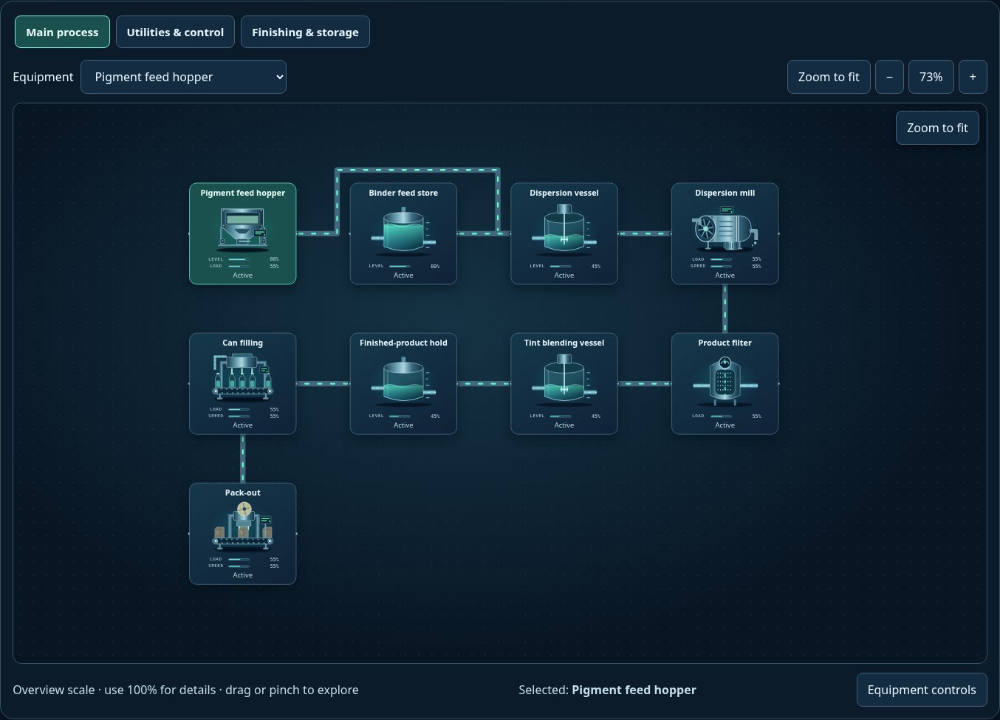</a> | **Paint blending** `paint-blending` | [System JSON](../scenarios/paint-blending/system.json) · [Model JSON](../scenarios/paint-blending/model.json) · [Portable example](../../explorer/index.html?scenario=paint-blending) |
| <a href="thumbnails/industrial-detergent.jpg">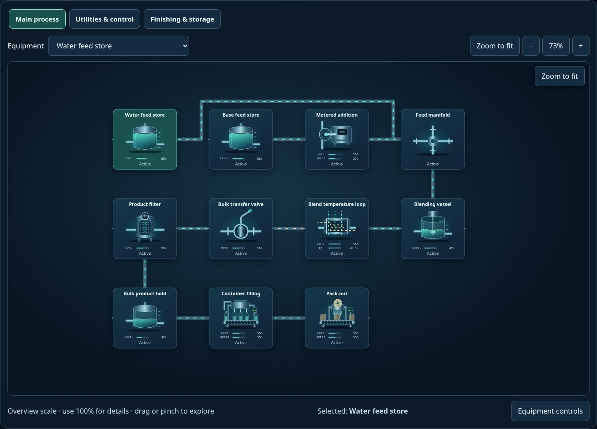</a> | **Industrial detergent** `industrial-detergent` | [System JSON](../scenarios/industrial-detergent/system.json) · [Model JSON](../scenarios/industrial-detergent/model.json) · [Portable example](../../explorer/index.html?scenario=industrial-detergent) |

## Construction materials

| Preview | System | Definitions and example |
| --- | --- | --- |
| <a href="thumbnails/concrete-batching.jpg">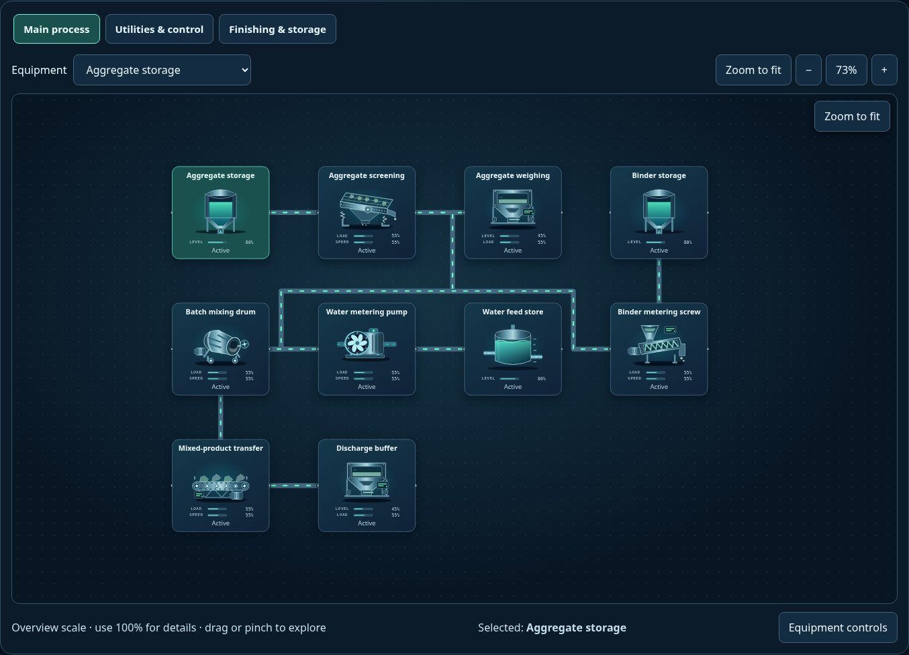</a> | **Concrete batching** `concrete-batching` | [System JSON](../scenarios/concrete-batching/system.json) · [Model JSON](../scenarios/concrete-batching/model.json) · [Portable example](../../explorer/index.html?scenario=concrete-batching) |
| <a href="thumbnails/cement.jpg">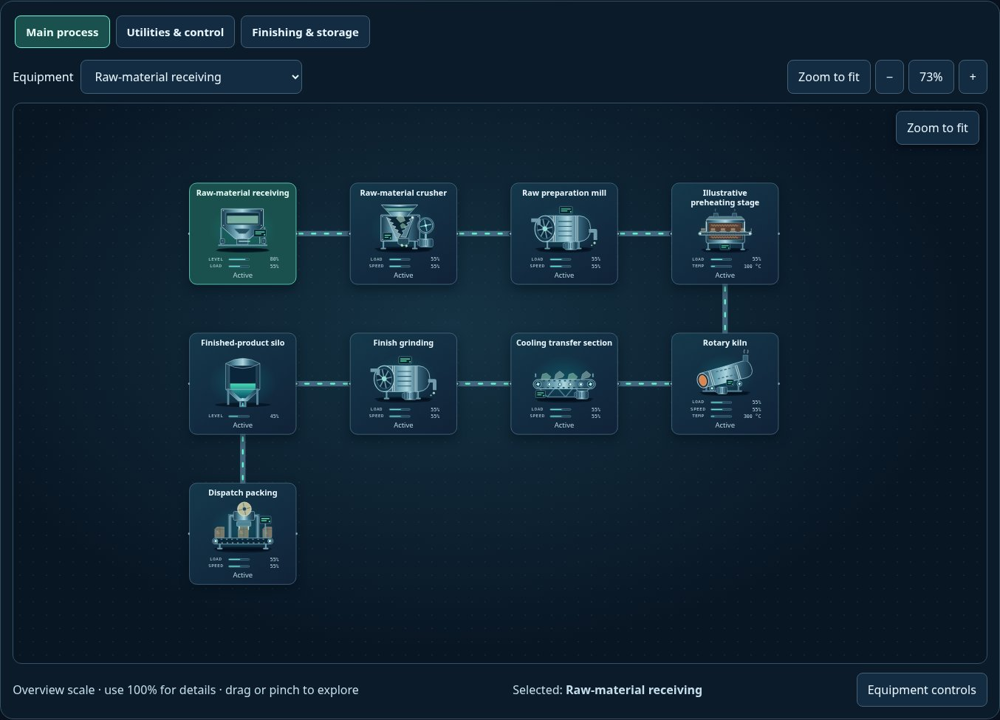</a> | **Cement processing** `cement` | [System JSON](../scenarios/cement/system.json) · [Model JSON](../scenarios/cement/model.json) · [Portable example](../../explorer/index.html?scenario=cement) |

## Consumer products

| Preview | System | Definitions and example |
| --- | --- | --- |
| <a href="thumbnails/shampoo.jpg">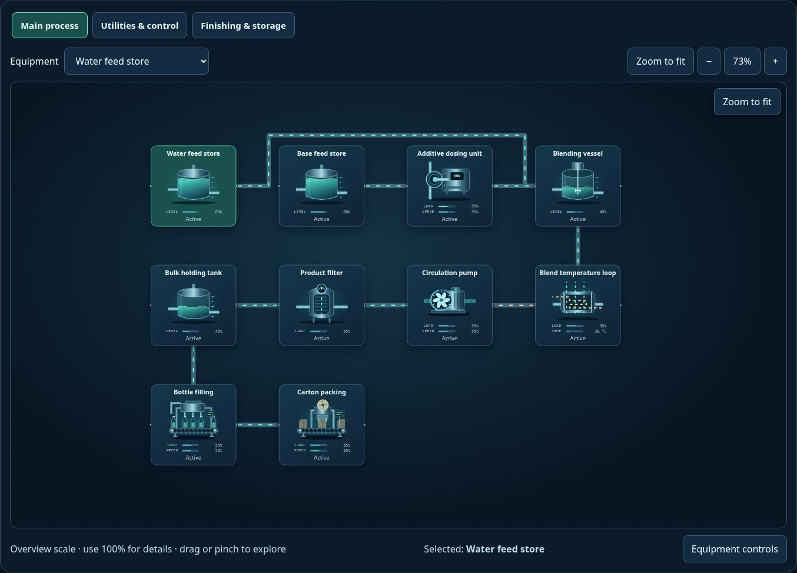</a> | **Shampoo blending** `shampoo` | [System JSON](../scenarios/shampoo/system.json) · [Model JSON](../scenarios/shampoo/model.json) · [Portable example](../../explorer/index.html?scenario=shampoo) |

## Fiber processing

| Preview | System | Definitions and example |
| --- | --- | --- |
| <a href="thumbnails/pulp-paper.jpg">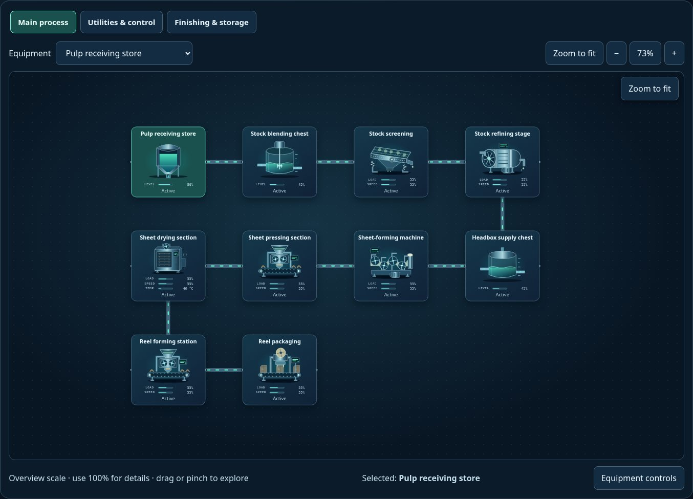</a> | **Pulp &amp; paper** `pulp-paper` | [System JSON](../scenarios/pulp-paper/system.json) · [Model JSON](../scenarios/pulp-paper/model.json) · [Portable example](../../explorer/index.html?scenario=pulp-paper) |

## Food &amp; beverage

| Preview | System | Definitions and example |
| --- | --- | --- |
| <a href="thumbnails/winery.jpg">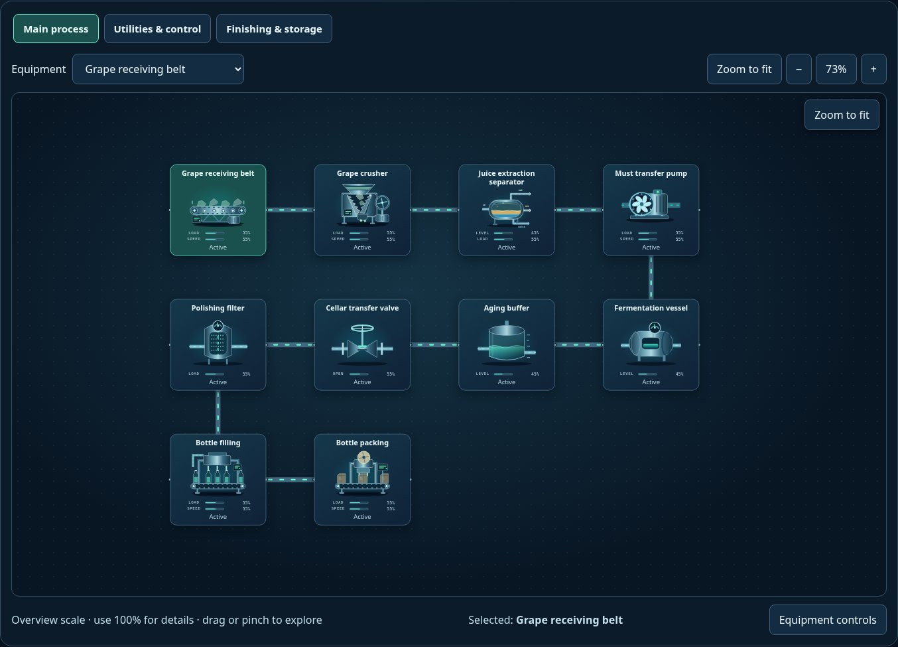</a> | **Winery** `winery` | [System JSON](../scenarios/winery/system.json) · [Model JSON](../scenarios/winery/model.json) · [Portable example](../../explorer/index.html?scenario=winery) |
| <a href="thumbnails/brewery.jpg">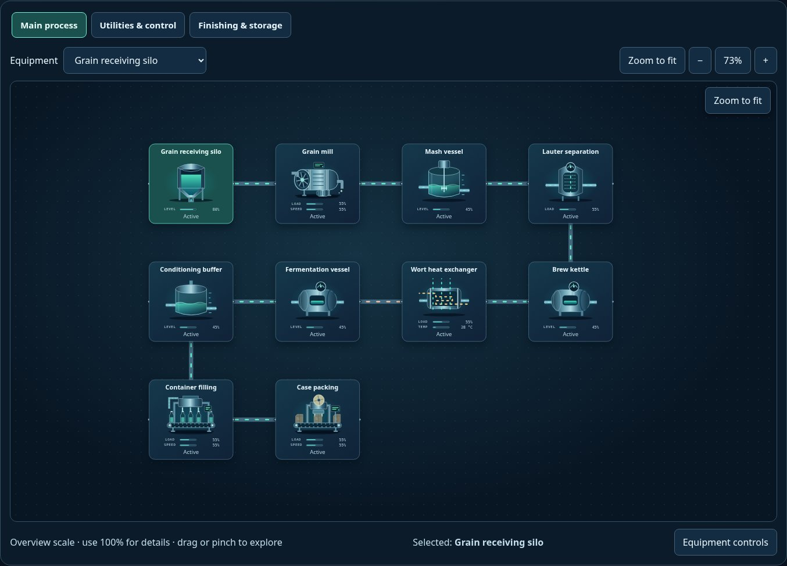</a> | **Brewery** `brewery` | [System JSON](../scenarios/brewery/system.json) · [Model JSON](../scenarios/brewery/model.json) · [Portable example](../../explorer/index.html?scenario=brewery) |
| <a href="thumbnails/fortune-cookies.jpg">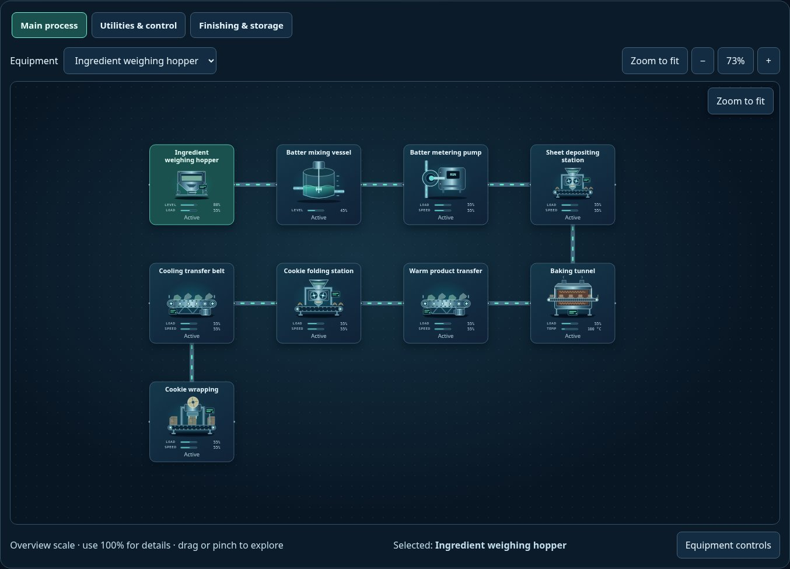</a> | **Fortune-cookie factory** `fortune-cookies` | [System JSON](../scenarios/fortune-cookies/system.json) · [Model JSON](../scenarios/fortune-cookies/model.json) · [Portable example](../../explorer/index.html?scenario=fortune-cookies) |
| <a href="thumbnails/carbonated-beverages.jpg">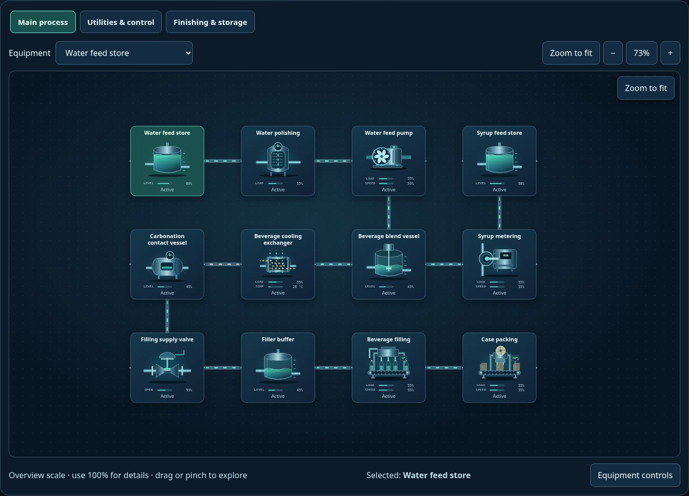</a> | **Carbonated beverages** `carbonated-beverages` | [System JSON](../scenarios/carbonated-beverages/system.json) · [Model JSON](../scenarios/carbonated-beverages/model.json) · [Portable example](../../explorer/index.html?scenario=carbonated-beverages) |
| <a href="thumbnails/dairy.jpg">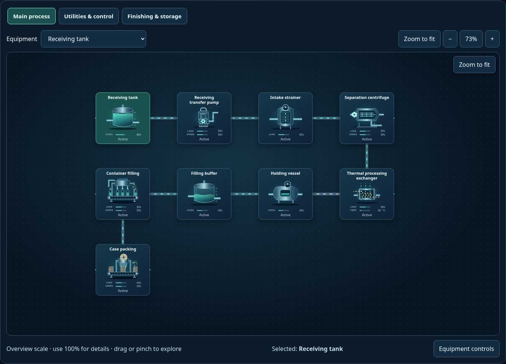</a> | **Dairy processing** `dairy` | [System JSON](../scenarios/dairy/system.json) · [Model JSON](../scenarios/dairy/model.json) · [Portable example](../../explorer/index.html?scenario=dairy) |
|  | **Fruit-juice line** `fruit-juice` | [System JSON](../scenarios/fruit-juice/system.json) · [Model JSON](../scenarios/fruit-juice/model.json) · [Portable example](../../explorer/index.html?scenario=fruit-juice) |

## Manufacturing &amp; thermal processing

| Preview | System | Definitions and example |
| --- | --- | --- |
| <a href="thumbnails/electric-batch-oven.jpg">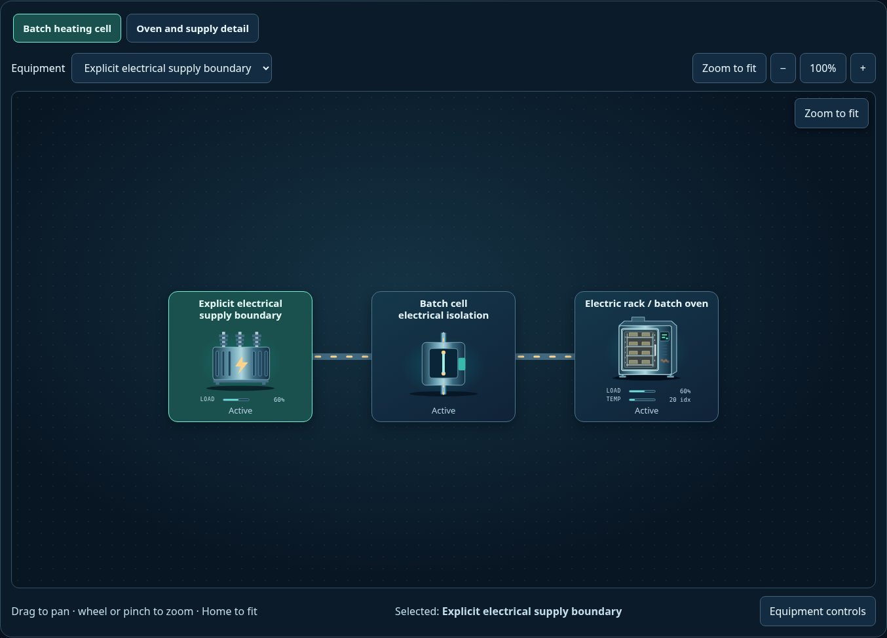</a> | **Electric batch heating cell** `electric-batch-oven` | [System JSON](../scenarios/electric-batch-oven/system.json) · [Model JSON](../scenarios/electric-batch-oven/model.json) · [Portable example](../../explorer/index.html?scenario=electric-batch-oven) |

## Materials

| Preview | System | Definitions and example |
| --- | --- | --- |
| <a href="thumbnails/polymer-extrusion.jpg">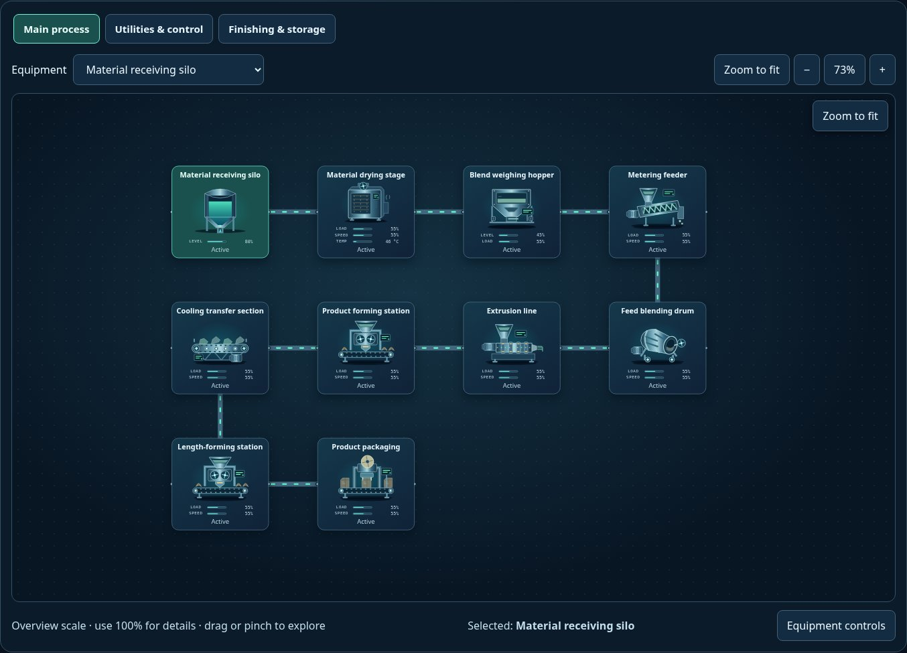</a> | **Polymer extrusion** `polymer-extrusion` | [System JSON](../scenarios/polymer-extrusion/system.json) · [Model JSON](../scenarios/polymer-extrusion/model.json) · [Portable example](../../explorer/index.html?scenario=polymer-extrusion) |

## Mineral processing

| Preview | System | Definitions and example |
| --- | --- | --- |
| <a href="thumbnails/mineral-crushing.jpg">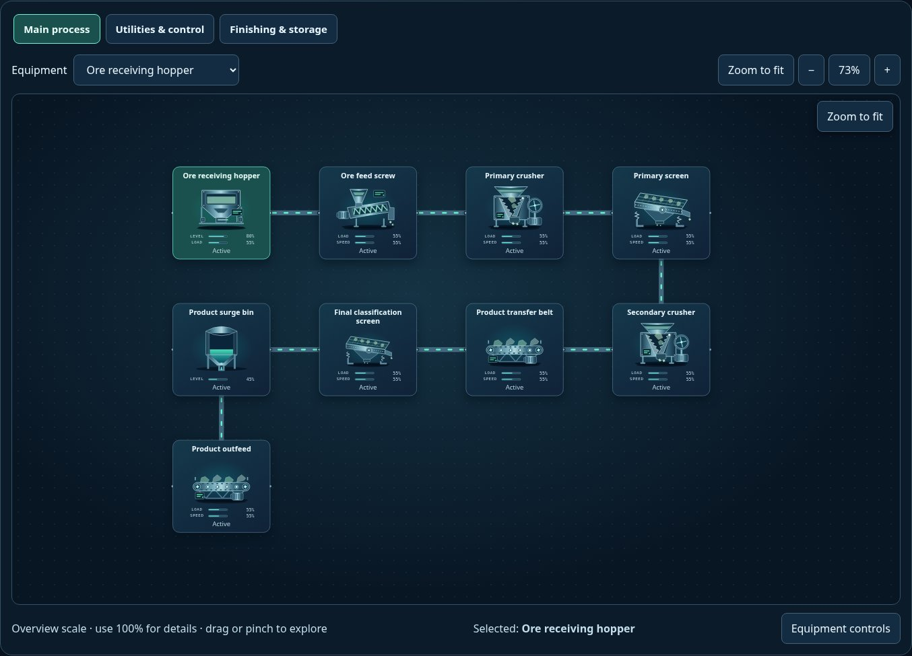</a> | **Mineral crushing &amp; screening** `mineral-crushing` | [System JSON](../scenarios/mineral-crushing/system.json) · [Model JSON](../scenarios/mineral-crushing/model.json) · [Portable example](../../explorer/index.html?scenario=mineral-crushing) |
| <a href="thumbnails/mineral-flotation.jpg">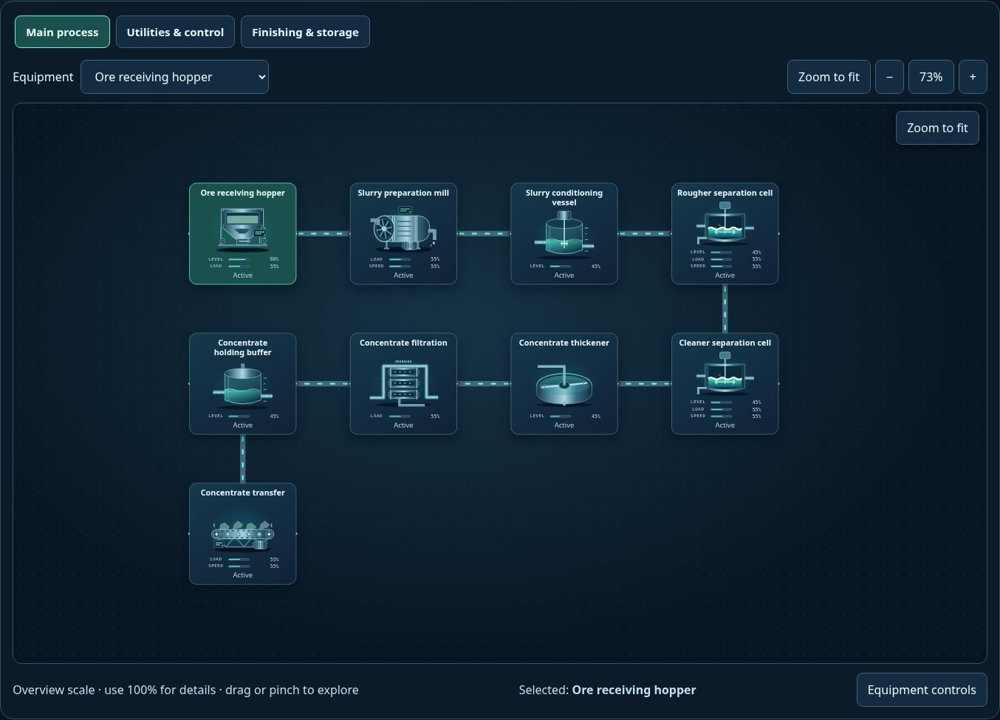</a> | **Mineral flotation** `mineral-flotation` | [System JSON](../scenarios/mineral-flotation/system.json) · [Model JSON](../scenarios/mineral-flotation/model.json) · [Portable example](../../explorer/index.html?scenario=mineral-flotation) |

## Pharmaceuticals

| Preview | System | Definitions and example |
| --- | --- | --- |
| <a href="thumbnails/pharma-oral-liquid.jpg">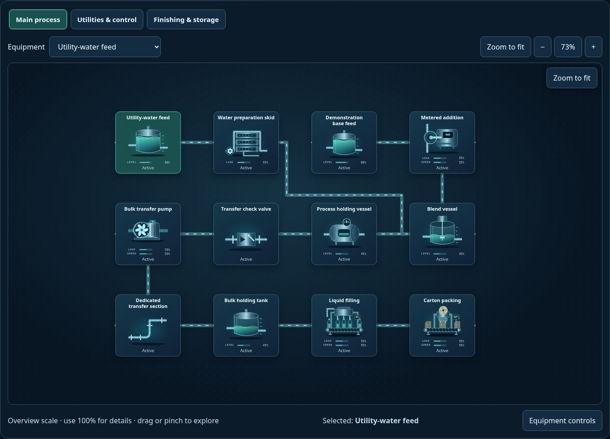</a> | **Oral-liquid manufacturing** `pharma-oral-liquid` | [System JSON](../scenarios/pharma-oral-liquid/system.json) · [Model JSON](../scenarios/pharma-oral-liquid/model.json) · [Portable example](../../explorer/index.html?scenario=pharma-oral-liquid) |
| <a href="thumbnails/tablets.jpg">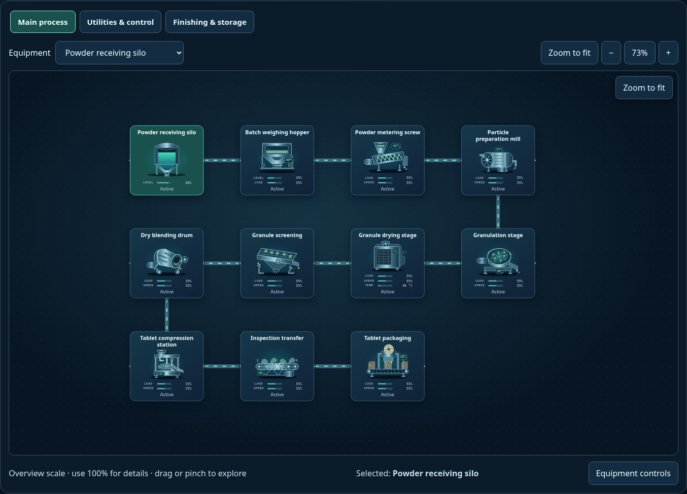</a> | **Tablet manufacturing** `tablets` | [System JSON](../scenarios/tablets/system.json) · [Model JSON](../scenarios/tablets/model.json) · [Portable example](../../explorer/index.html?scenario=tablets) |
| <a href="thumbnails/sterile-filling.jpg">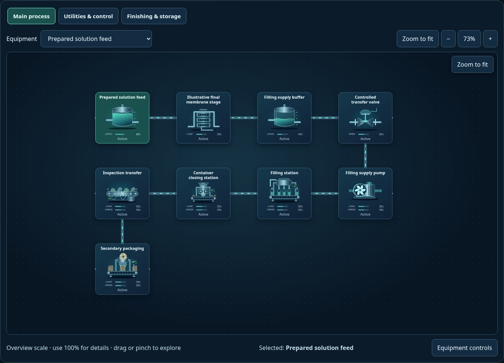</a> | **Sterile-filling concept** `sterile-filling` | [System JSON](../scenarios/sterile-filling/system.json) · [Model JSON](../scenarios/sterile-filling/model.json) · [Portable example](../../explorer/index.html?scenario=sterile-filling) |

## Power &amp; utilities

| Preview | System | Definitions and example |
| --- | --- | --- |
| <a href="thumbnails/power-gas-simple-cycle.jpg">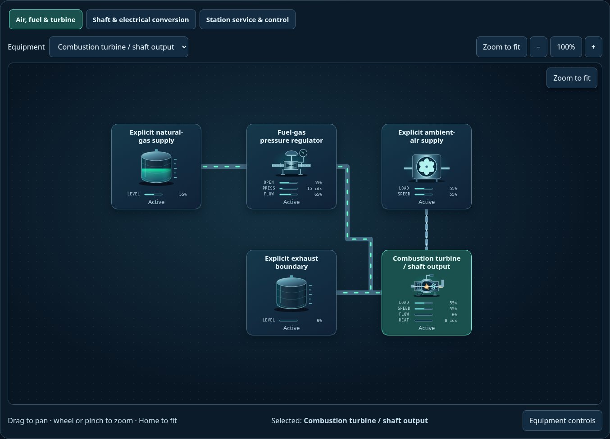</a> | **Simple-cycle gas turbine** `power-gas-simple-cycle` | [System JSON](../scenarios/power-gas-simple-cycle/system.json) · [Model JSON](../scenarios/power-gas-simple-cycle/model.json) · [Portable example](../../explorer/index.html?scenario=power-gas-simple-cycle) |
| <a href="thumbnails/power-gas-combined-cycle.jpg">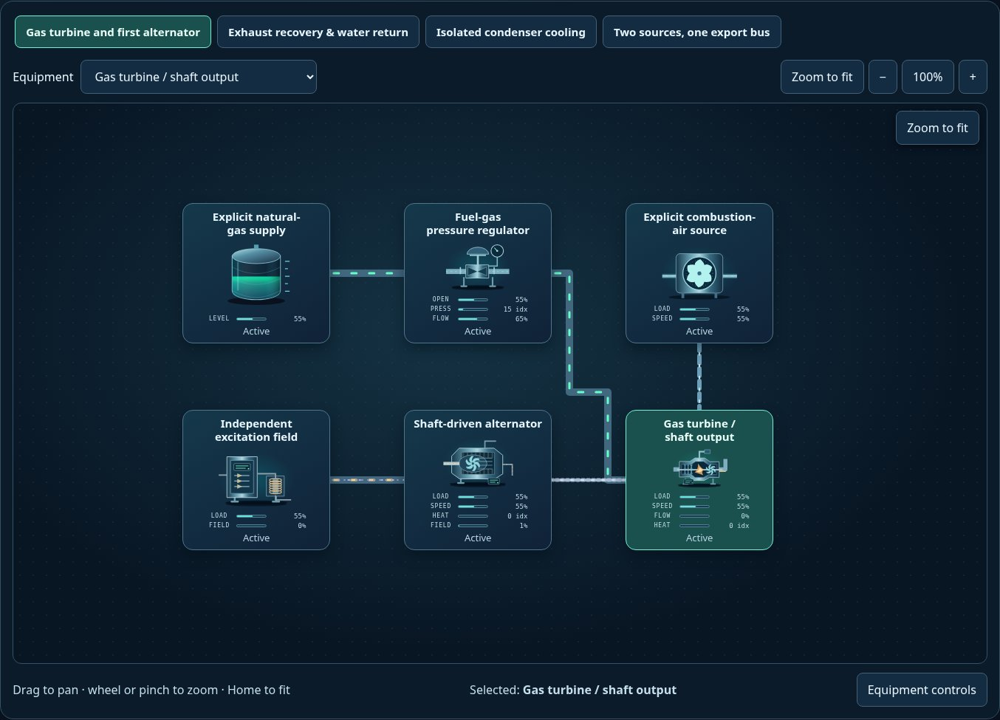</a> | **Combined-cycle gas plant** `power-gas-combined-cycle` | [System JSON](../scenarios/power-gas-combined-cycle/system.json) · [Model JSON](../scenarios/power-gas-combined-cycle/model.json) · [Portable example](../../explorer/index.html?scenario=power-gas-combined-cycle) |
| <a href="thumbnails/power-coal-steam.jpg">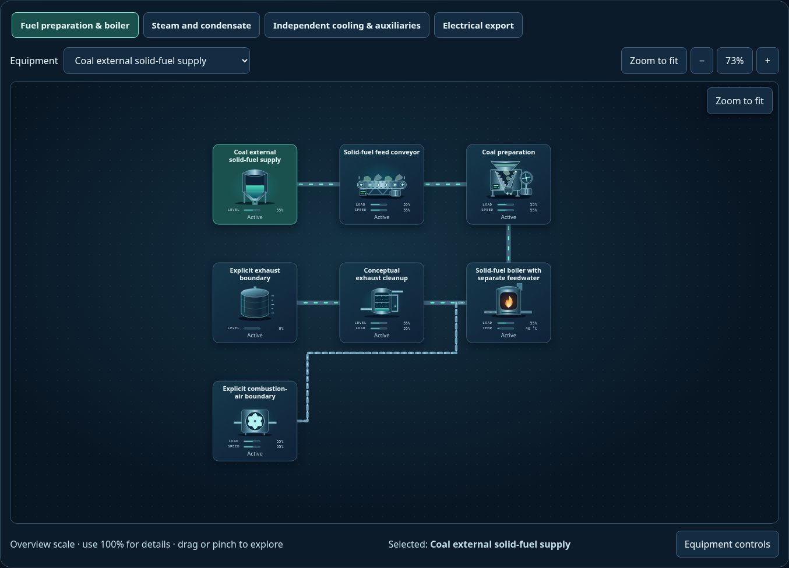</a> | **Coal steam-cycle plant** `power-coal-steam` | [System JSON](../scenarios/power-coal-steam/system.json) · [Model JSON](../scenarios/power-coal-steam/model.json) · [Portable example](../../explorer/index.html?scenario=power-coal-steam) |
| <a href="thumbnails/power-biomass-chp.jpg">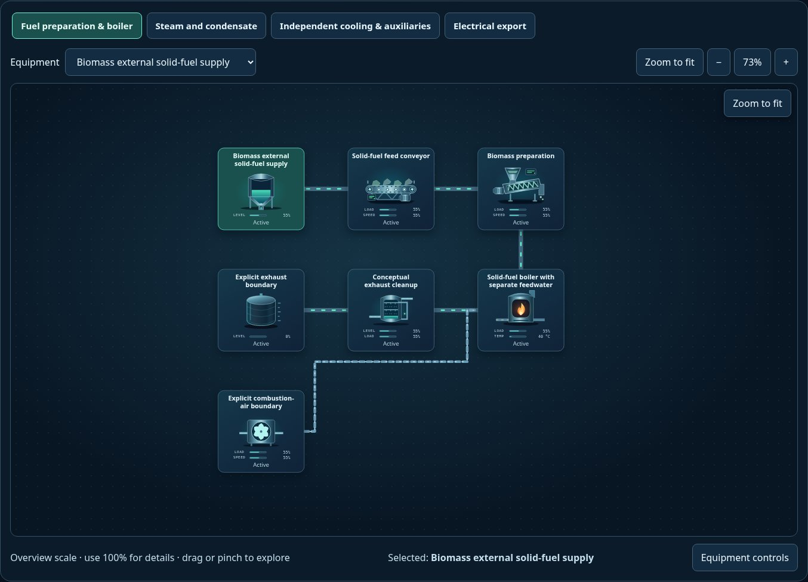</a> | **Biomass CHP** `power-biomass-chp` | [System JSON](../scenarios/power-biomass-chp/system.json) · [Model JSON](../scenarios/power-biomass-chp/model.json) · [Portable example](../../explorer/index.html?scenario=power-biomass-chp) |
| <a href="thumbnails/power-hydro-impoundment.jpg">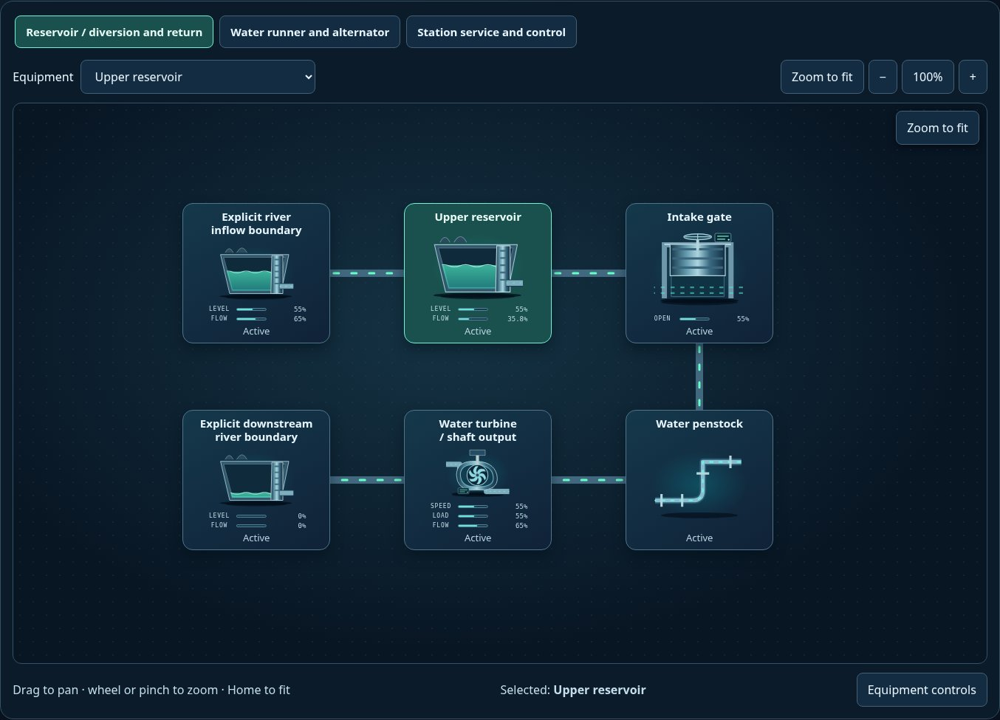</a> | **Impoundment hydropower** `power-hydro-impoundment` | [System JSON](../scenarios/power-hydro-impoundment/system.json) · [Model JSON](../scenarios/power-hydro-impoundment/model.json) · [Portable example](../../explorer/index.html?scenario=power-hydro-impoundment) |
| <a href="thumbnails/power-hydro-diversion.jpg">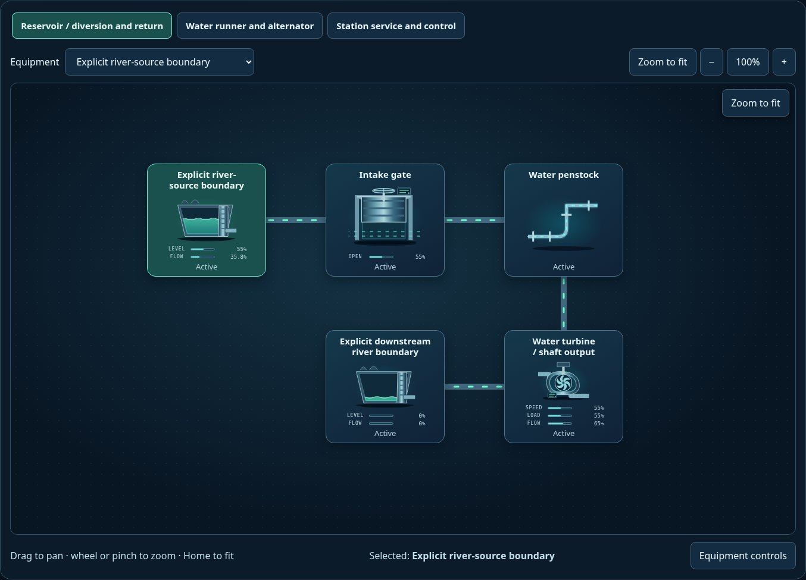</a> | **Diversion hydropower** `power-hydro-diversion` | [System JSON](../scenarios/power-hydro-diversion/system.json) · [Model JSON](../scenarios/power-hydro-diversion/model.json) · [Portable example](../../explorer/index.html?scenario=power-hydro-diversion) |
| <a href="thumbnails/power-pumped-storage.jpg">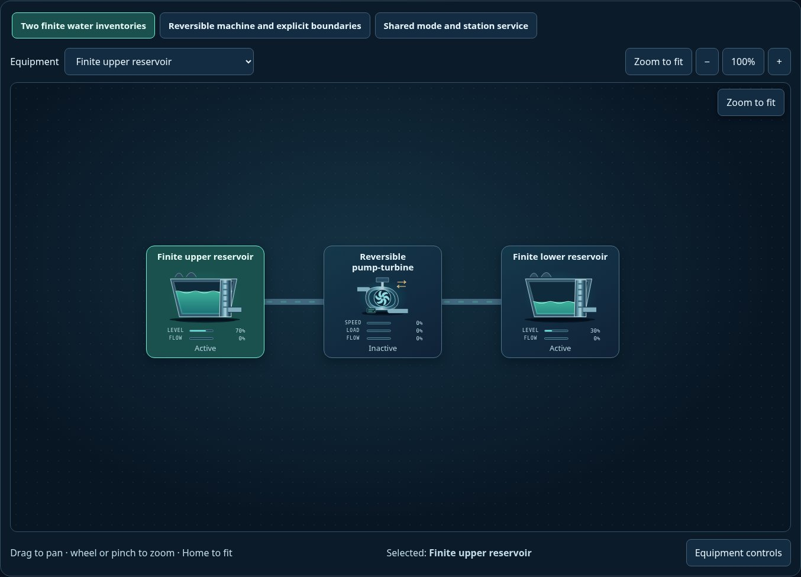</a> | **Reversible pumped storage** `power-pumped-storage` | [System JSON](../scenarios/power-pumped-storage/system.json) · [Model JSON](../scenarios/power-pumped-storage/model.json) · [Portable example](../../explorer/index.html?scenario=power-pumped-storage) |
|  | **Pressurized-water nuclear concept** `power-nuclear-pwr` | [System JSON](../scenarios/power-nuclear-pwr/system.json) · [Model JSON](../scenarios/power-nuclear-pwr/model.json) · [Portable example](../../explorer/index.html?scenario=power-nuclear-pwr) |
| <a href="thumbnails/power-nuclear-phwr.jpg">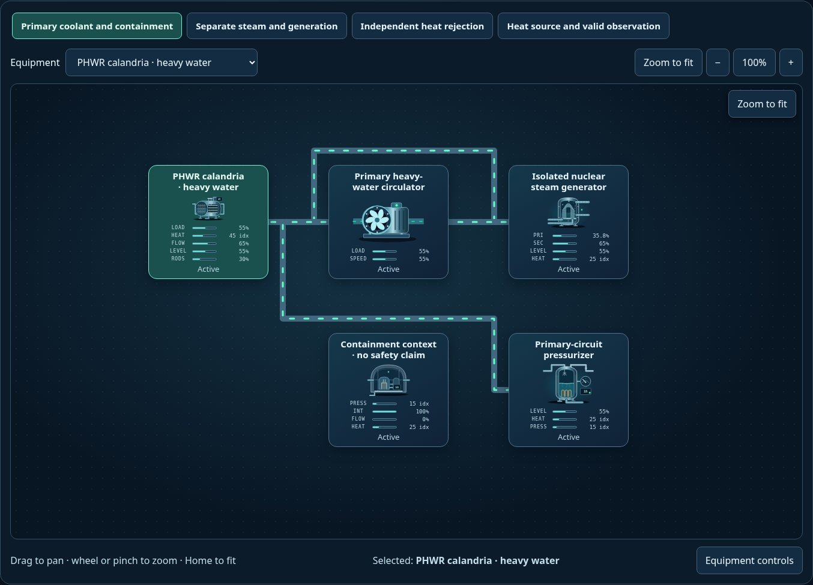</a> | **Pressure-channel heavy-water concept** `power-nuclear-phwr` | [System JSON](../scenarios/power-nuclear-phwr/system.json) · [Model JSON](../scenarios/power-nuclear-phwr/model.json) · [Portable example](../../explorer/index.html?scenario=power-nuclear-phwr) |
| <a href="thumbnails/power-nuclear-htgr.jpg">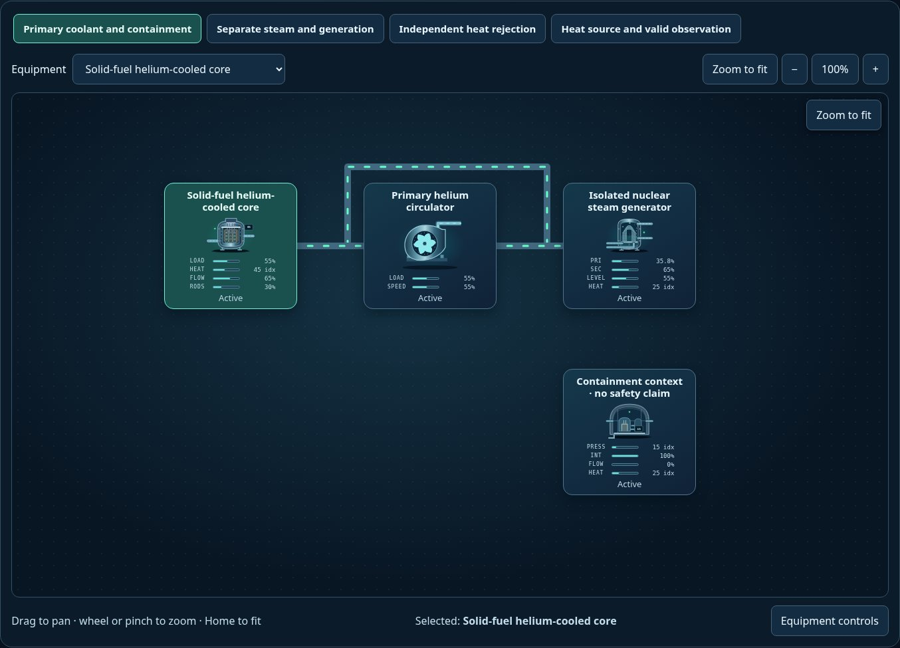</a> | **Helium-cooled reactor concept** `power-nuclear-htgr` | [System JSON](../scenarios/power-nuclear-htgr/system.json) · [Model JSON](../scenarios/power-nuclear-htgr/model.json) · [Portable example](../../explorer/index.html?scenario=power-nuclear-htgr) |
| <a href="thumbnails/power-nuclear-sodium-fast.jpg">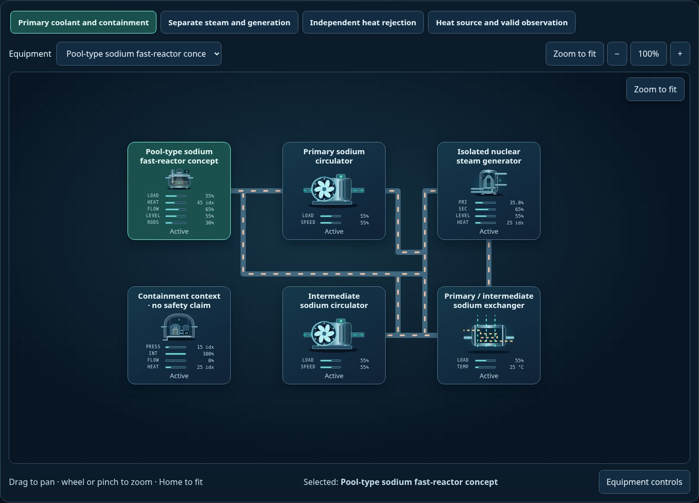</a> | **Pool-type sodium fast-reactor concept** `power-nuclear-sodium-fast` | [System JSON](../scenarios/power-nuclear-sodium-fast/system.json) · [Model JSON](../scenarios/power-nuclear-sodium-fast/model.json) · [Portable example](../../explorer/index.html?scenario=power-nuclear-sodium-fast) |
| <a href="thumbnails/power-nuclear-molten-salt.jpg">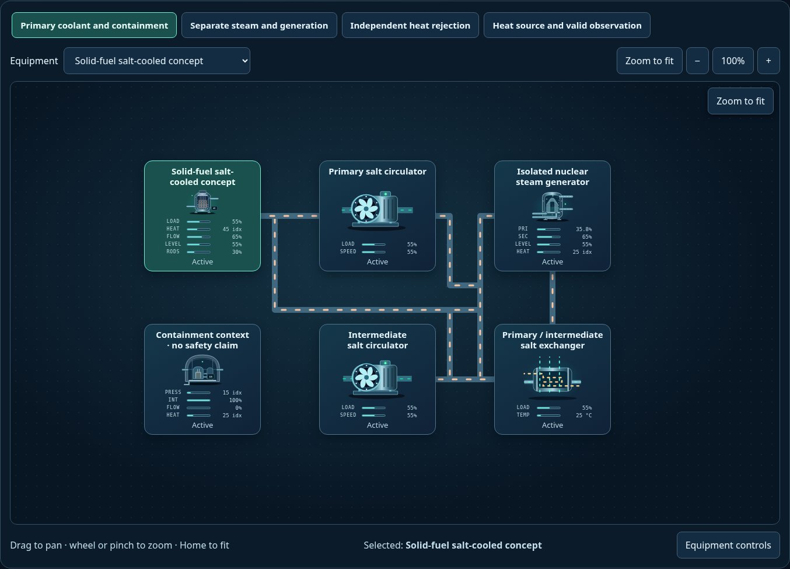</a> | **Solid-fuel salt-cooled nuclear concept** `power-nuclear-molten-salt` | [System JSON](../scenarios/power-nuclear-molten-salt/system.json) · [Model JSON](../scenarios/power-nuclear-molten-salt/model.json) · [Portable example](../../explorer/index.html?scenario=power-nuclear-molten-salt) |
| <a href="thumbnails/power-nuclear-bwr.jpg">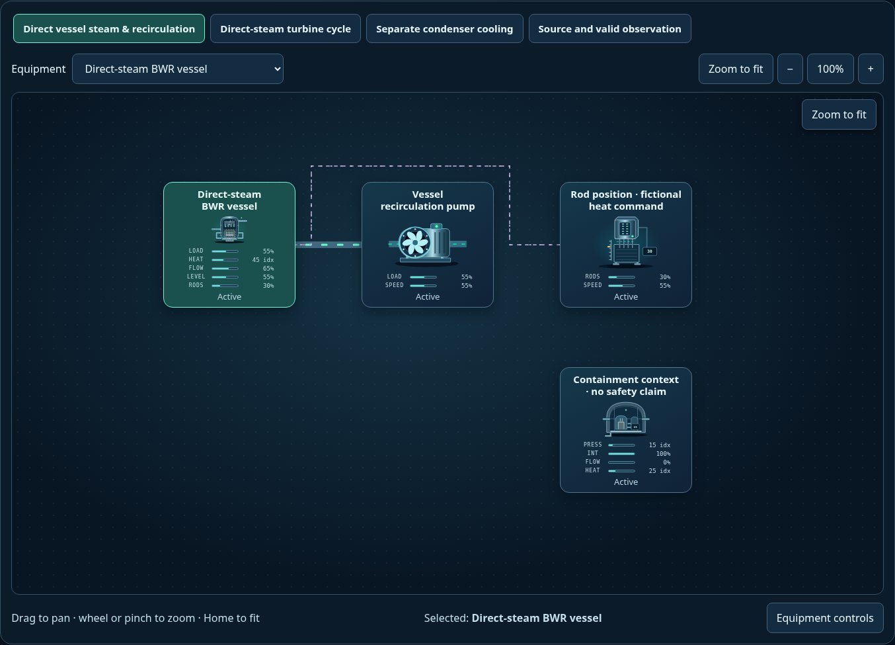</a> | **Boiling-water nuclear concept** `power-nuclear-bwr` | [System JSON](../scenarios/power-nuclear-bwr/system.json) · [Model JSON](../scenarios/power-nuclear-bwr/model.json) · [Portable example](../../explorer/index.html?scenario=power-nuclear-bwr) |
| <a href="thumbnails/power-nuclear-lw-smr.jpg">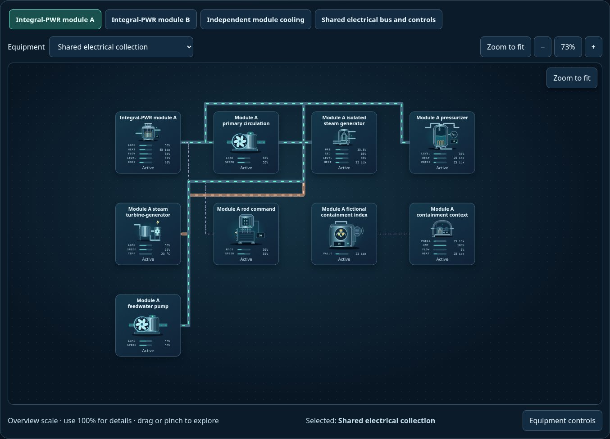</a> | **Two-module integral-PWR concept** `power-nuclear-lw-smr` | [System JSON](../scenarios/power-nuclear-lw-smr/system.json) · [Model JSON](../scenarios/power-nuclear-lw-smr/model.json) · [Portable example](../../explorer/index.html?scenario=power-nuclear-lw-smr) |
| <a href="thumbnails/power-ng-engine-chp.jpg">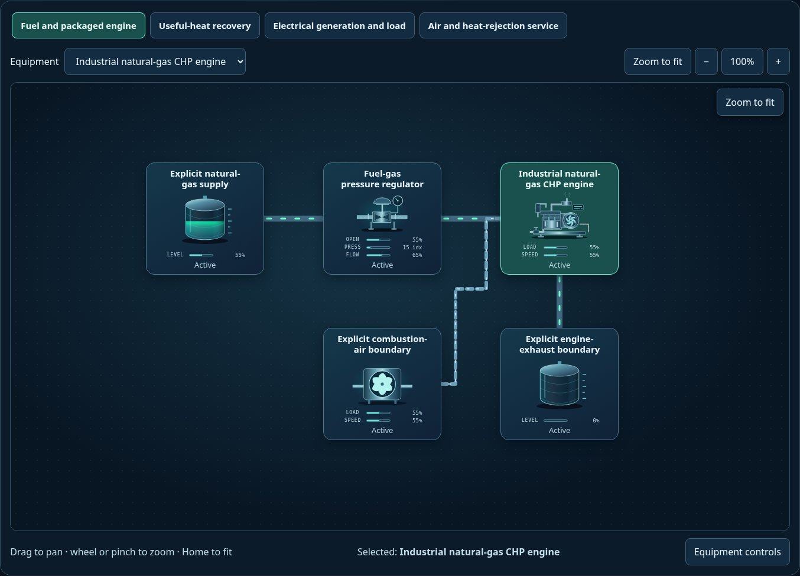</a> | **Natural-gas engine CHP** `power-ng-engine-chp` | [System JSON](../scenarios/power-ng-engine-chp/system.json) · [Model JSON](../scenarios/power-ng-engine-chp/model.json) · [Portable example](../../explorer/index.html?scenario=power-ng-engine-chp) |
| <a href="thumbnails/power-diesel-standby.jpg">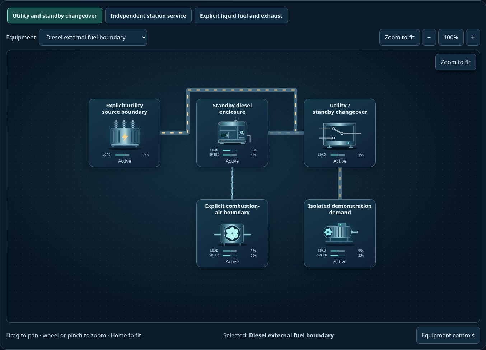</a> | **Diesel standby supply** `power-diesel-standby` | [System JSON](../scenarios/power-diesel-standby/system.json) · [Model JSON](../scenarios/power-diesel-standby/model.json) · [Portable example](../../explorer/index.html?scenario=power-diesel-standby) |
| <a href="thumbnails/power-gasoline-portable.jpg">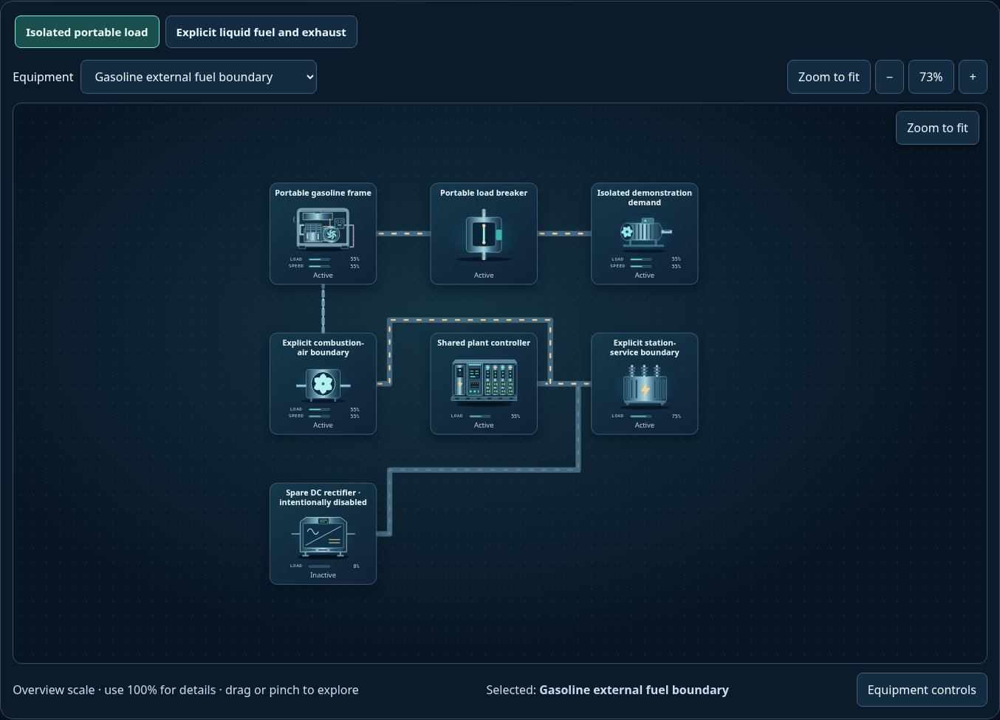</a> | **Portable gasoline generator** `power-gasoline-portable` | [System JSON](../scenarios/power-gasoline-portable/system.json) · [Model JSON](../scenarios/power-gasoline-portable/model.json) · [Portable example](../../explorer/index.html?scenario=power-gasoline-portable) |
| <a href="thumbnails/power-substation-distribution.jpg">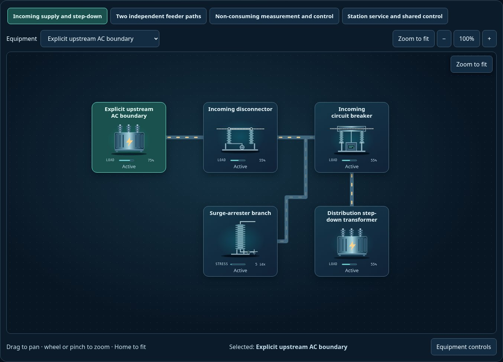</a> | **Distribution substation** `power-substation-distribution` | [System JSON](../scenarios/power-substation-distribution/system.json) · [Model JSON](../scenarios/power-substation-distribution/model.json) · [Portable example](../../explorer/index.html?scenario=power-substation-distribution) |
| <a href="thumbnails/power-substation-gsu.jpg">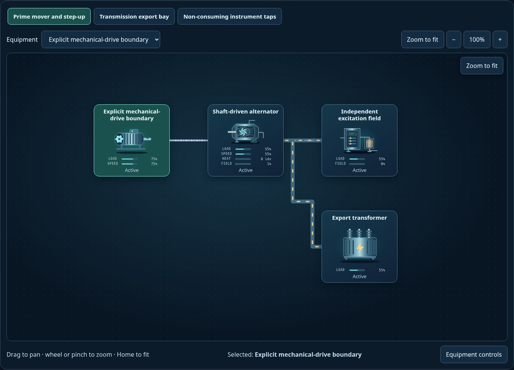</a> | **Generator step-up substation** `power-substation-gsu` | [System JSON](../scenarios/power-substation-gsu/system.json) · [Model JSON](../scenarios/power-substation-gsu/model.json) · [Portable example](../../explorer/index.html?scenario=power-substation-gsu) |
| <a href="thumbnails/power-substation-gis.jpg">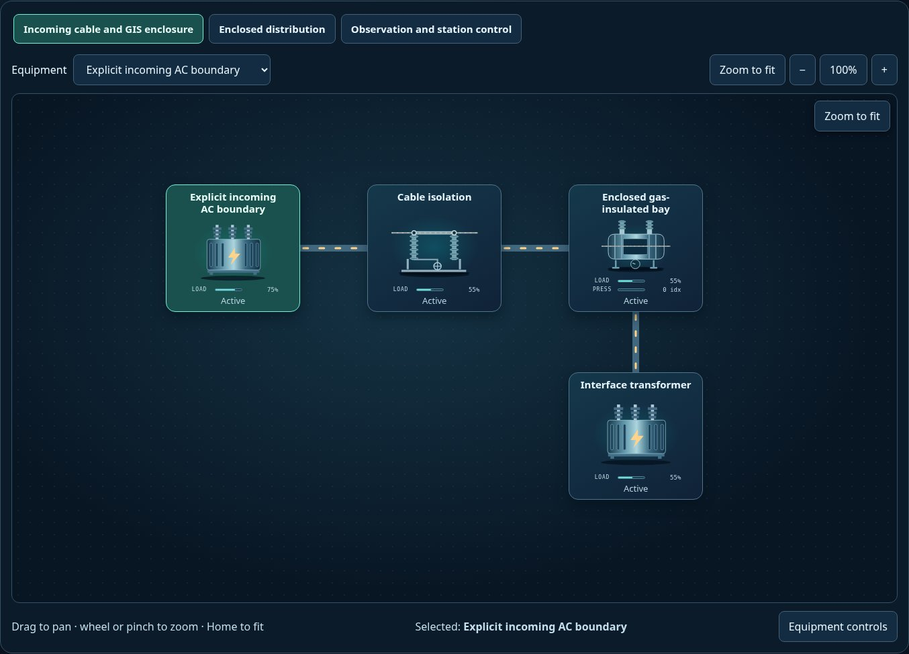</a> | **Gas-insulated substation interface** `power-substation-gis` | [System JSON](../scenarios/power-substation-gis/system.json) · [Model JSON](../scenarios/power-substation-gis/model.json) · [Portable example](../../explorer/index.html?scenario=power-substation-gis) |
| <a href="thumbnails/power-hvdc-interface.jpg">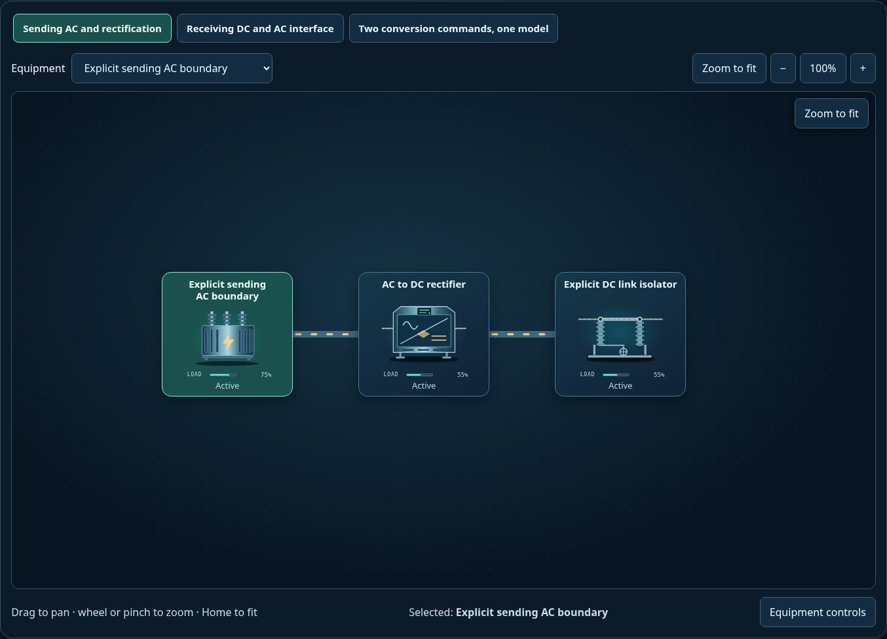</a> | **Back-to-back HVDC interface** `power-hvdc-interface` | [System JSON](../scenarios/power-hvdc-interface/system.json) · [Model JSON](../scenarios/power-hvdc-interface/model.json) · [Portable example](../../explorer/index.html?scenario=power-hvdc-interface) |
| <a href="thumbnails/power-solar-pv.jpg">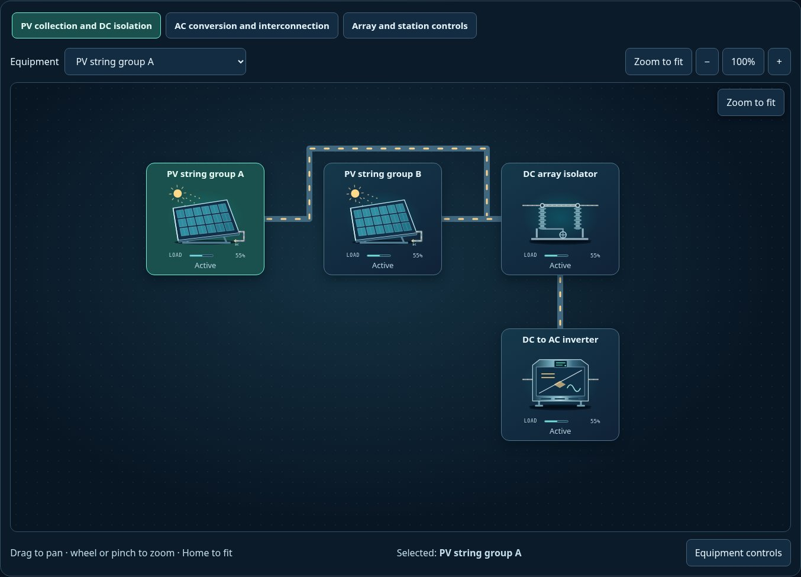</a> | **Photovoltaic field** `power-solar-pv` | [System JSON](../scenarios/power-solar-pv/system.json) · [Model JSON](../scenarios/power-solar-pv/model.json) · [Portable example](../../explorer/index.html?scenario=power-solar-pv) |
|  | **Wind collection network** `power-wind-collection` | [System JSON](../scenarios/power-wind-collection/system.json) · [Model JSON](../scenarios/power-wind-collection/model.json) · [Portable example](../../explorer/index.html?scenario=power-wind-collection) |
| <a href="thumbnails/power-tidal-current.jpg">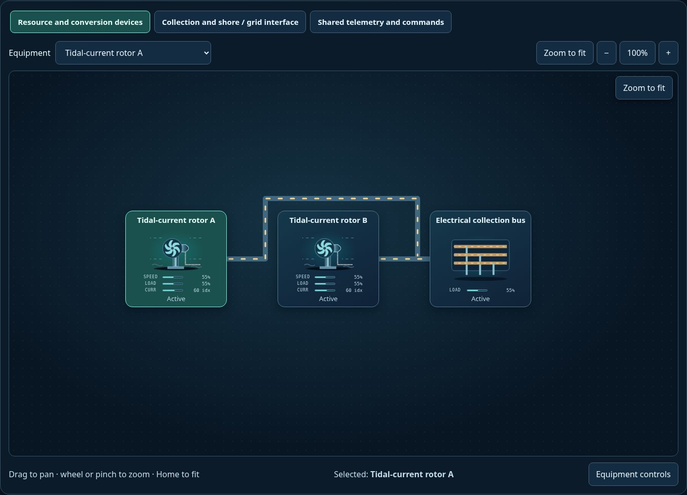</a> | **Tidal-current array** `power-tidal-current` | [System JSON](../scenarios/power-tidal-current/system.json) · [Model JSON](../scenarios/power-tidal-current/model.json) · [Portable example](../../explorer/index.html?scenario=power-tidal-current) |
|  | **Wave point-absorber array** `power-wave-point-absorber` | [System JSON](../scenarios/power-wave-point-absorber/system.json) · [Model JSON](../scenarios/power-wave-point-absorber/model.json) · [Portable example](../../explorer/index.html?scenario=power-wave-point-absorber) |
| <a href="thumbnails/power-csp-tower.jpg">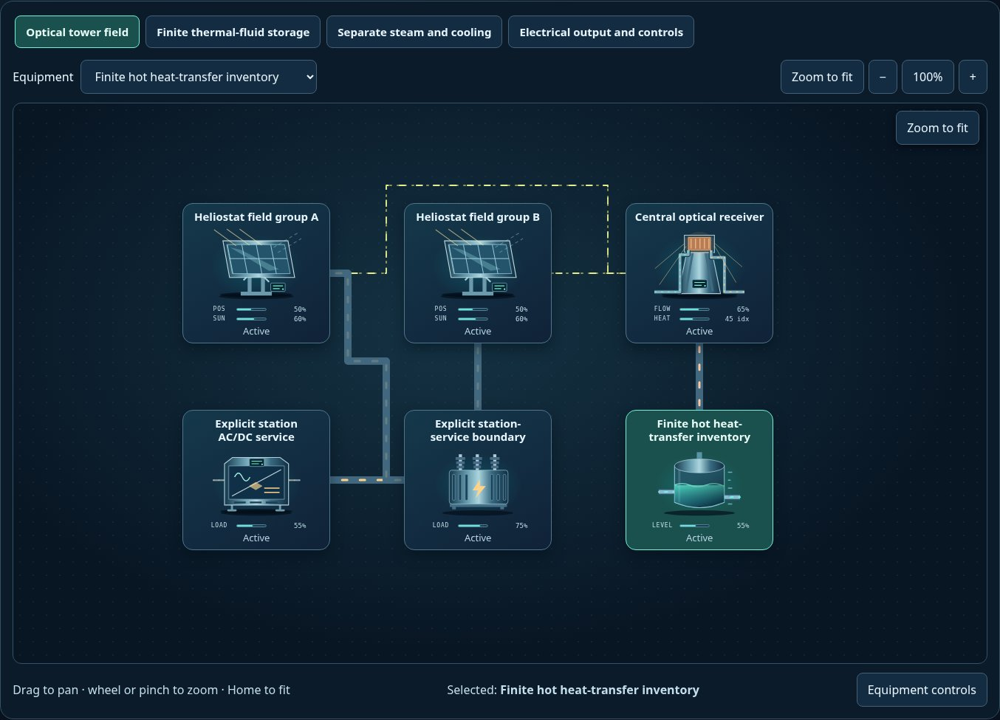</a> | **Solar power tower** `power-csp-tower` | [System JSON](../scenarios/power-csp-tower/system.json) · [Model JSON](../scenarios/power-csp-tower/model.json) · [Portable example](../../explorer/index.html?scenario=power-csp-tower) |
| <a href="thumbnails/power-csp-trough.jpg">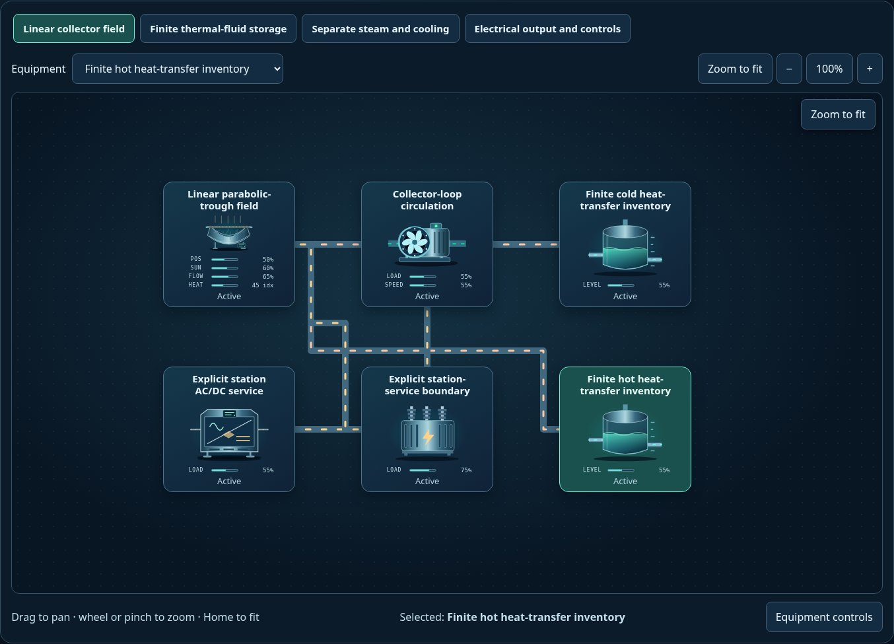</a> | **Parabolic-trough solar plant** `power-csp-trough` | [System JSON](../scenarios/power-csp-trough/system.json) · [Model JSON](../scenarios/power-csp-trough/model.json) · [Portable example](../../explorer/index.html?scenario=power-csp-trough) |
|  | **Stationary fuel-cell system** `power-fuel-cell` | [System JSON](../scenarios/power-fuel-cell/system.json) · [Model JSON](../scenarios/power-fuel-cell/model.json) · [Portable example](../../explorer/index.html?scenario=power-fuel-cell) |
|  | **Flash geothermal** `power-geothermal-flash` | [System JSON](../scenarios/power-geothermal-flash/system.json) · [Model JSON](../scenarios/power-geothermal-flash/model.json) · [Portable example](../../explorer/index.html?scenario=power-geothermal-flash) |
|  | **Binary geothermal** `power-geothermal-binary` | [System JSON](../scenarios/power-geothermal-binary/system.json) · [Model JSON](../scenarios/power-geothermal-binary/model.json) · [Portable example](../../explorer/index.html?scenario=power-geothermal-binary) |
|  | **Dry-steam geothermal** `power-geothermal-dry-steam` | [System JSON](../scenarios/power-geothermal-dry-steam/system.json) · [Model JSON](../scenarios/power-geothermal-dry-steam/model.json) · [Portable example](../../explorer/index.html?scenario=power-geothermal-dry-steam) |
|  | **Battery energy-storage system** `power-battery-storage` | [System JSON](../scenarios/power-battery-storage/system.json) · [Model JSON](../scenarios/power-battery-storage/model.json) · [Portable example](../../explorer/index.html?scenario=power-battery-storage) |
|  | **Hybrid islandable microgrid** `power-hybrid-microgrid` | [System JSON](../scenarios/power-hybrid-microgrid/system.json) · [Model JSON](../scenarios/power-hybrid-microgrid/model.json) · [Portable example](../../explorer/index.html?scenario=power-hybrid-microgrid) |

## Surface treatment

| Preview | System | Definitions and example |
| --- | --- | --- |
|  | **Metal-finishing line** `metal-finishing` | [System JSON](../scenarios/metal-finishing/system.json) · [Model JSON](../scenarios/metal-finishing/model.json) · [Portable example](../../explorer/index.html?scenario=metal-finishing) |

## Water &amp; utilities

| Preview | System | Definitions and example |
| --- | --- | --- |
|  | **Wastewater &amp; biogas digital twin** `wastewater-digester` | [System JSON](../scenarios/wastewater-digester/system.json) · [Model JSON](../scenarios/wastewater-digester/model.json) · [Portable example](../../explorer/index.html?scenario=wastewater-digester) |

Generated by the Explorer capture tool with `npm run thumbnails:scenarios`. Check freshness with `npm run thumbnails:scenarios -- --check`. Do not hand-edit the images, index or capture manifest.
