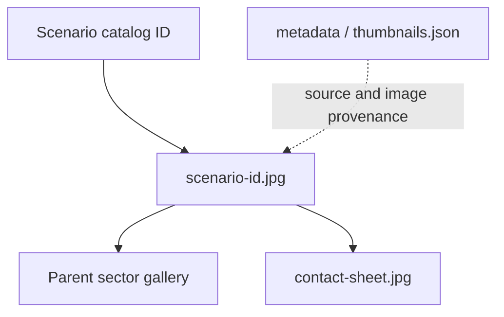

# Scenario thumbnail files

[Parent image gallery](../README.md) · [Package owner](../../README.md) · [Scenario definitions](../../scenarios/README.md) · [Capture manifest](../../metadata/thumbnails.json)

This folder contains **61 scenario JPEGs** and one contact sheet. Each scenario filename is its stable catalog ID: `<scenario-id>.jpg`. These are model-owned previews of the portable Explorer, captured after resetting and pausing the shared simulation and fitting the diagram.

| File or map | Use |
| --- | --- |
| [`<scenario-id>.jpg`](../README.md) | Browse the parent gallery for every image with its system/model links. |
| [contact-sheet.jpg](contact-sheet.jpg) | Complete visual inventory at overview scale. |
| [Explorer instructions](../../../explorer/README.md) | Open an interactive view to inspect equipment, issue commands and zoom. |

A fitted thumbnail is a navigation aid, not proof of operating-scale readability or model accuracy. All scenarios remain illustrative and editable. Equipment artwork and UI control captures belong to the sibling [UI image gallery](../../../ui/img/README.md).

Regenerate images with `npm run thumbnails:scenarios`; check their provenance with `npm run thumbnails:scenarios -- --check`. The generator also owns this README. For documentation-only changes, use `--indexes-only`; it preserves the historical capture receipt and validates existing image bytes before writing maps.
