# Captured simulation views

Real Explorer images captured after reset, pause and Zoom to fit. Values and behavior remain illustrative; overview text size is not an operating-scale readability guarantee.

[Library image gallery](../README.md) · [Scenario definitions](../../scenarios/README.md) · [Generation metadata](../../metadata/thumbnails.json)

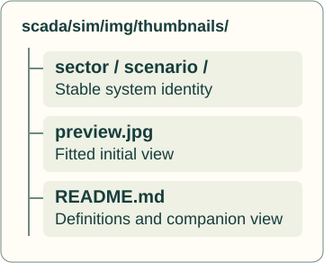

| Map | Purpose |
| --- | --- |
| [gallery-map.svg](gallery-map.svg) | Shared sector, scenario and image ownership map. |

Browse 61 scenarios in 14 sectors. Paths use `sector/scenario/preview.jpg` for captures and `sector/scenario/topology.svg` for topology maps.

| Sector | Scenarios | Representative preview |
| --- | ---: | --- |
| [Agriculture &amp; aquaculture](agriculture-aquaculture/README.md) | 6 | <a href="agriculture-aquaculture/aquaponics-media-bed/preview.jpg">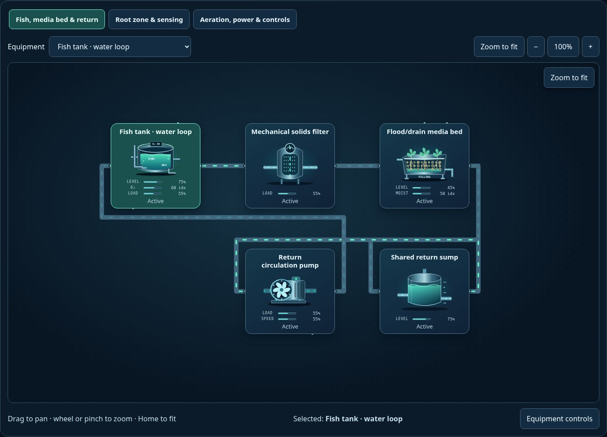</a> |
| [Biopharma](biopharma/README.md) | 1 | <a href="biopharma/biopharma-fermentation/preview.jpg">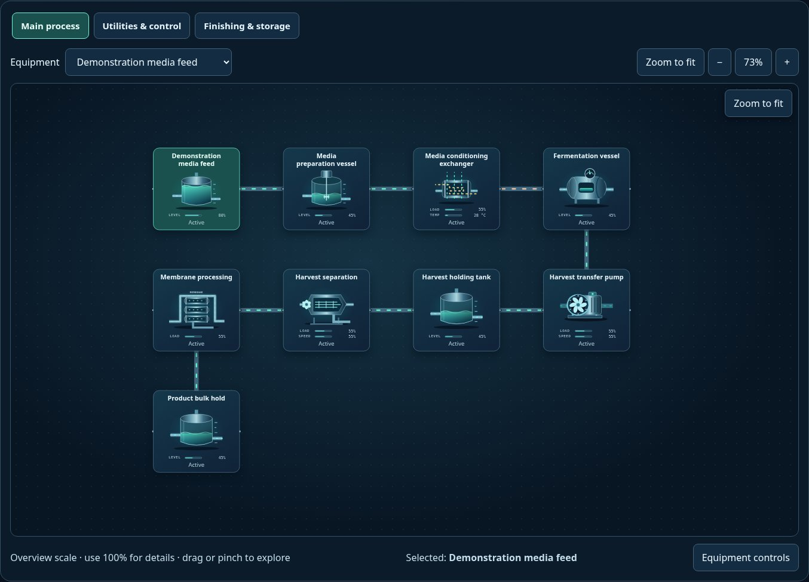</a> |
| [Chemicals](chemicals/README.md) | 2 | <a href="chemicals/paint-blending/preview.jpg">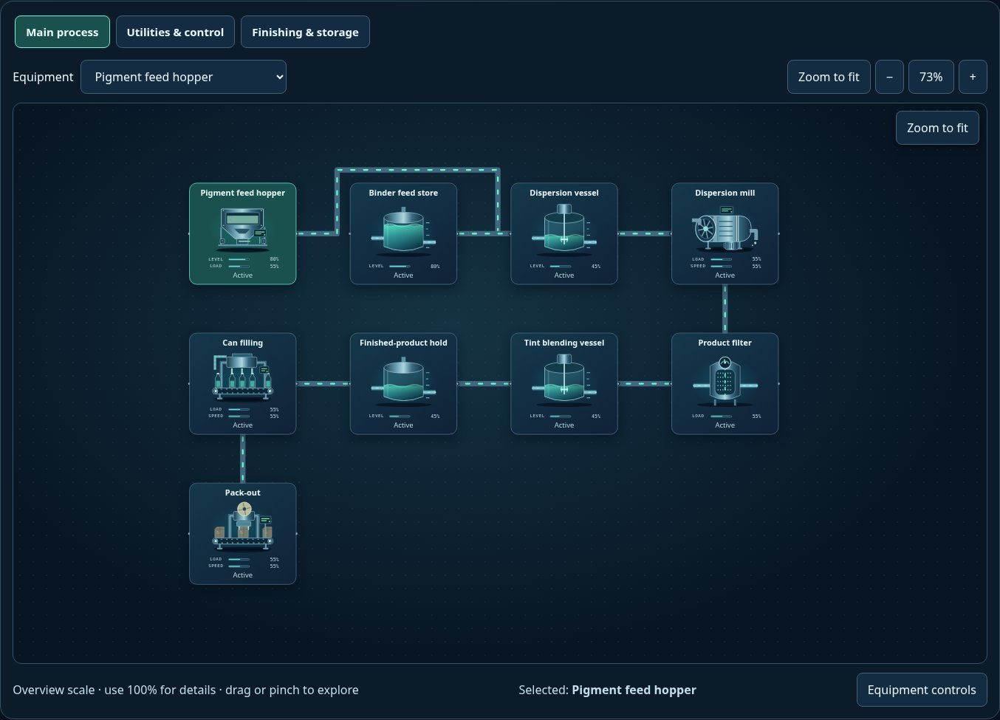</a> |
| [Construction materials](construction-materials/README.md) | 2 | <a href="construction-materials/concrete-batching/preview.jpg">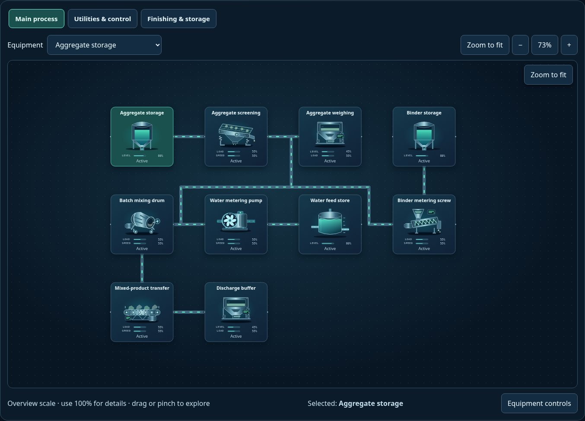</a> |
| [Consumer products](consumer-products/README.md) | 1 | <a href="consumer-products/shampoo/preview.jpg">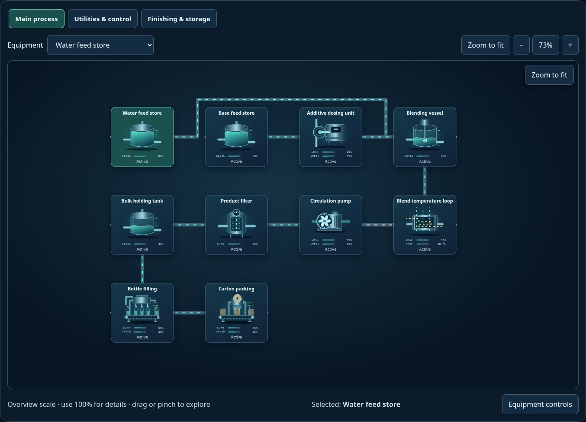</a> |
| [Fiber processing](fiber-processing/README.md) | 1 | <a href="fiber-processing/pulp-paper/preview.jpg">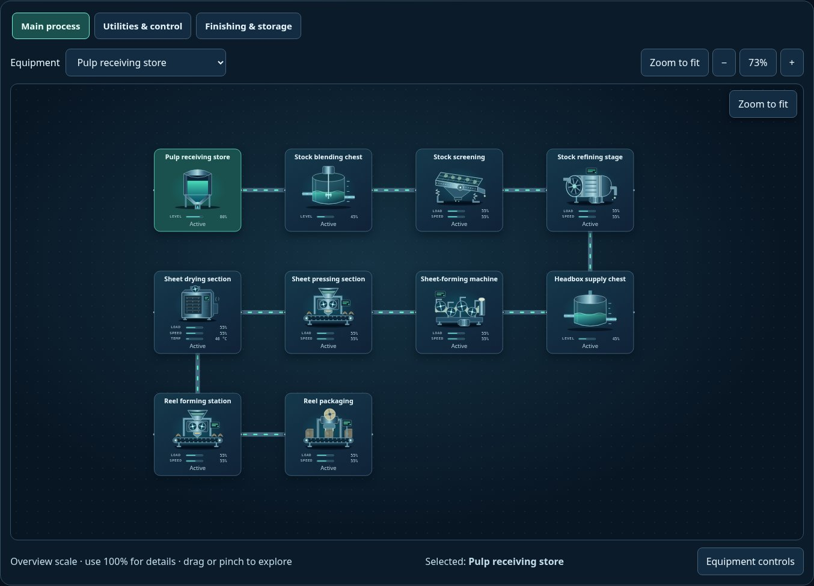</a> |
| [Food &amp; beverage](food-beverage/README.md) | 6 |  |
| [Manufacturing &amp; thermal processing](manufacturing-thermal-processing/README.md) | 1 |  |
| [Materials](materials/README.md) | 1 | <a href="materials/polymer-extrusion/preview.jpg">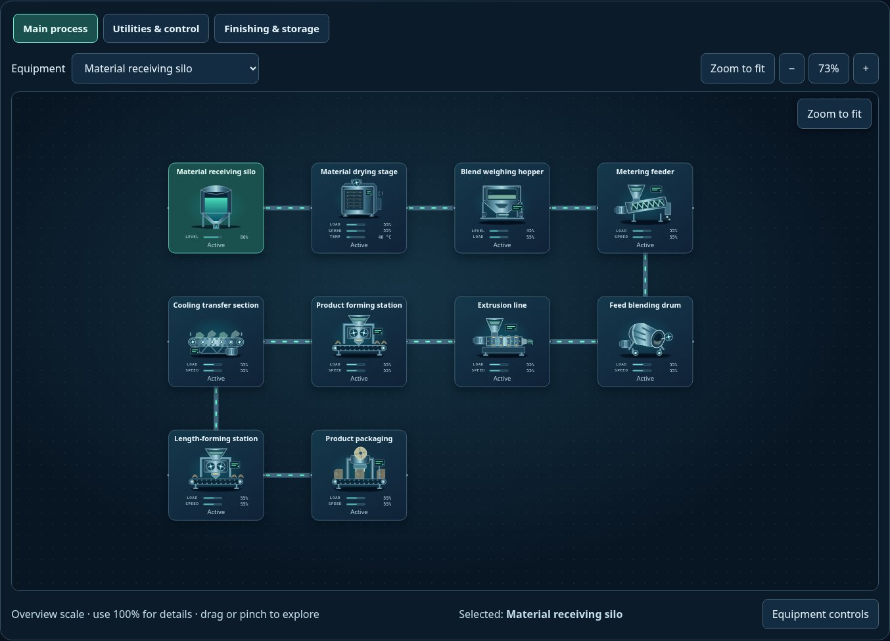</a> |
| [Mineral processing](mineral-processing/README.md) | 2 | <a href="mineral-processing/mineral-crushing/preview.jpg">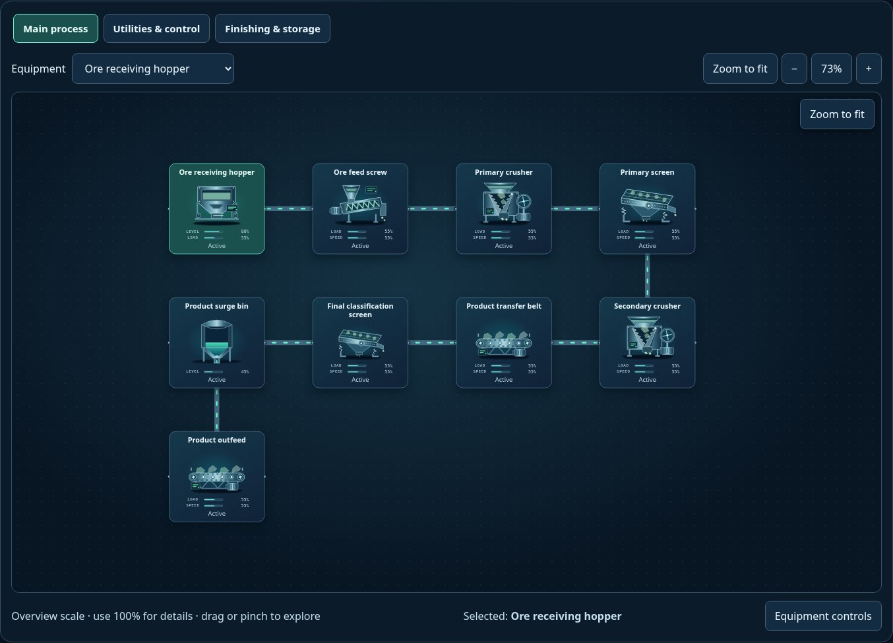</a> |
| [Pharmaceuticals](pharmaceuticals/README.md) | 3 | <a href="pharmaceuticals/pharma-oral-liquid/preview.jpg">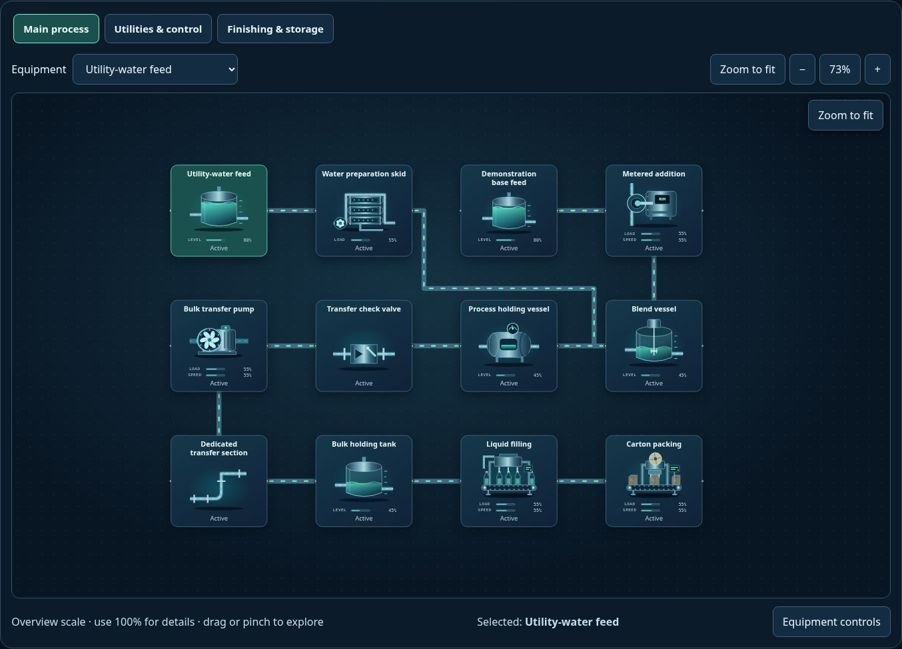</a> |
| [Power &amp; utilities](power-utilities/README.md) | 33 | <a href="power-utilities/power-gas-simple-cycle/preview.jpg">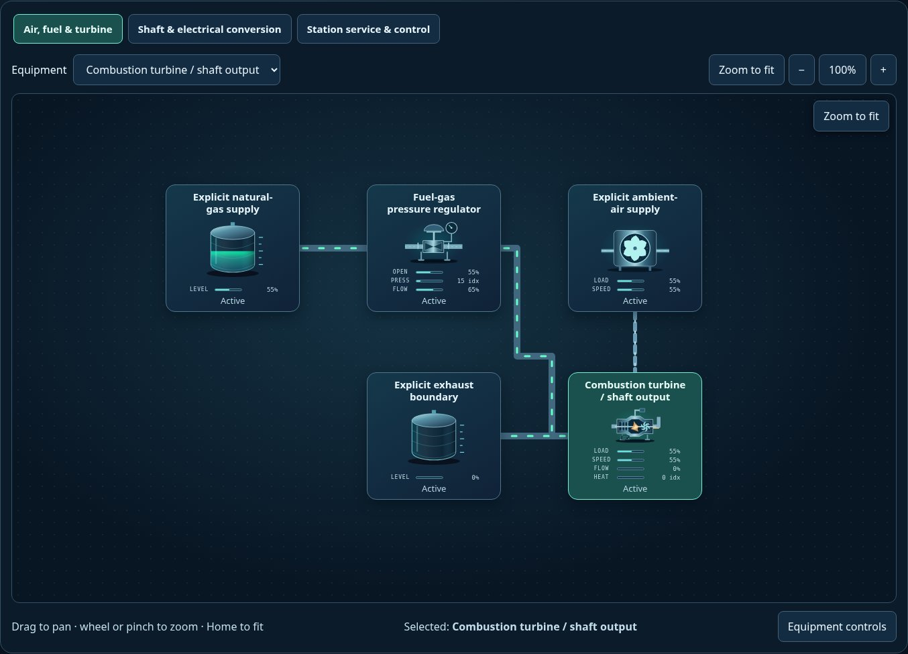</a> |
| [Surface treatment](surface-treatment/README.md) | 1 | <a href="surface-treatment/metal-finishing/preview.jpg">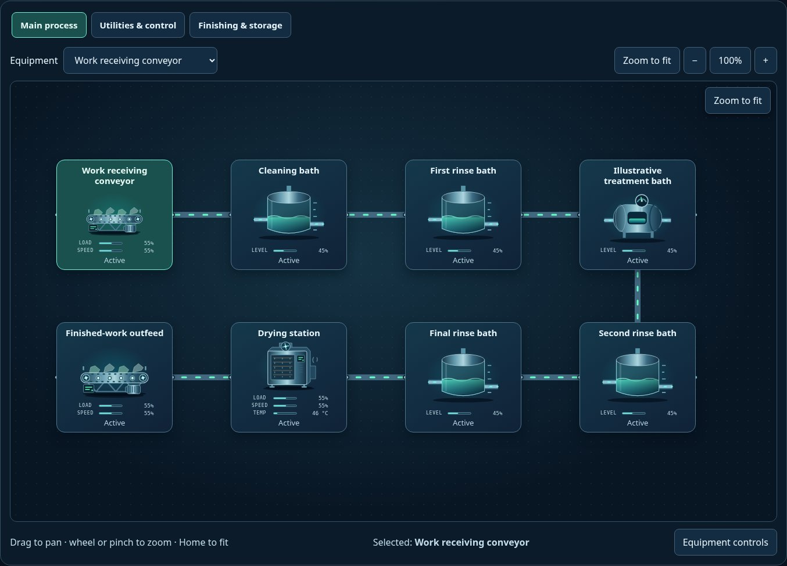</a> |
| [Water &amp; utilities](water-utilities/README.md) | 1 | <a href="water-utilities/wastewater-digester/preview.jpg">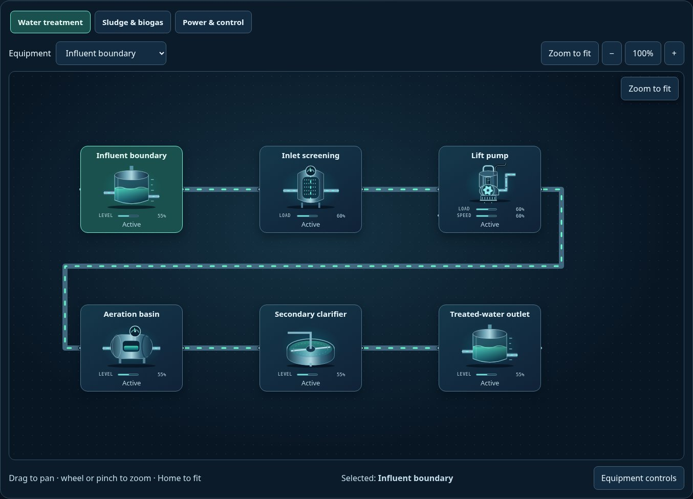</a> |
| [Complete contact sheet](contact-sheet.jpg) | 61 | Complete visual inventory at overview scale. |
