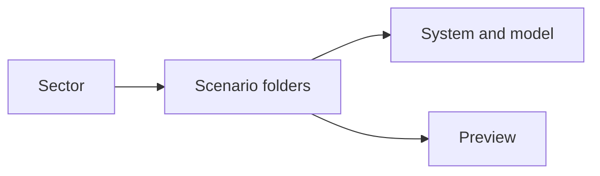
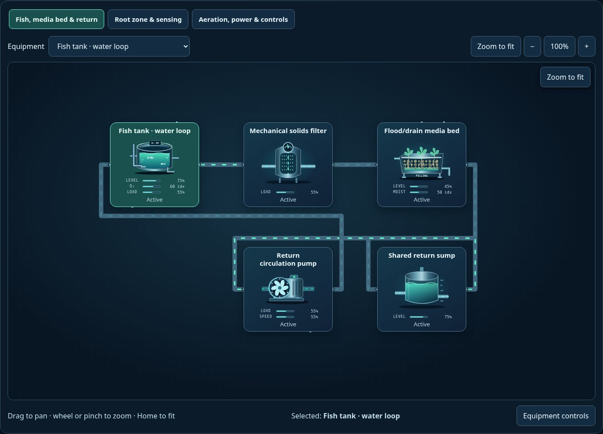
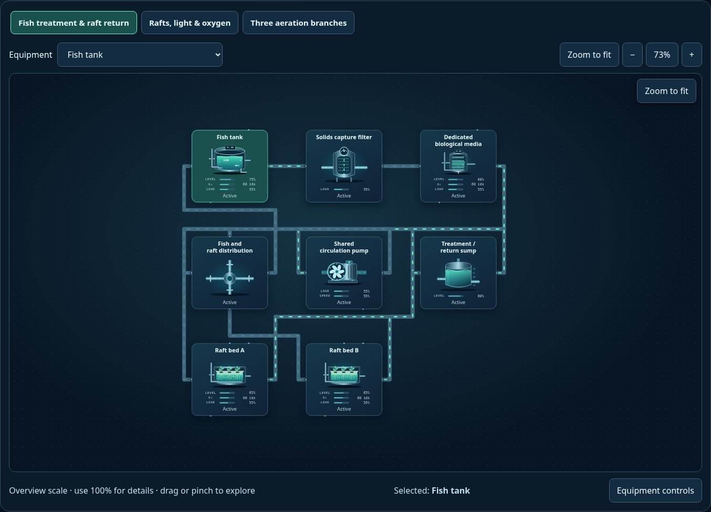
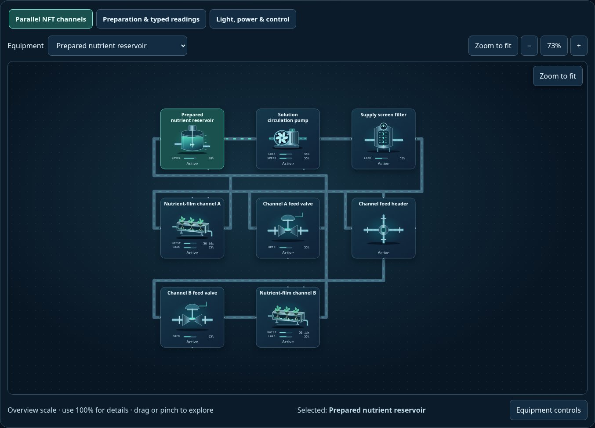
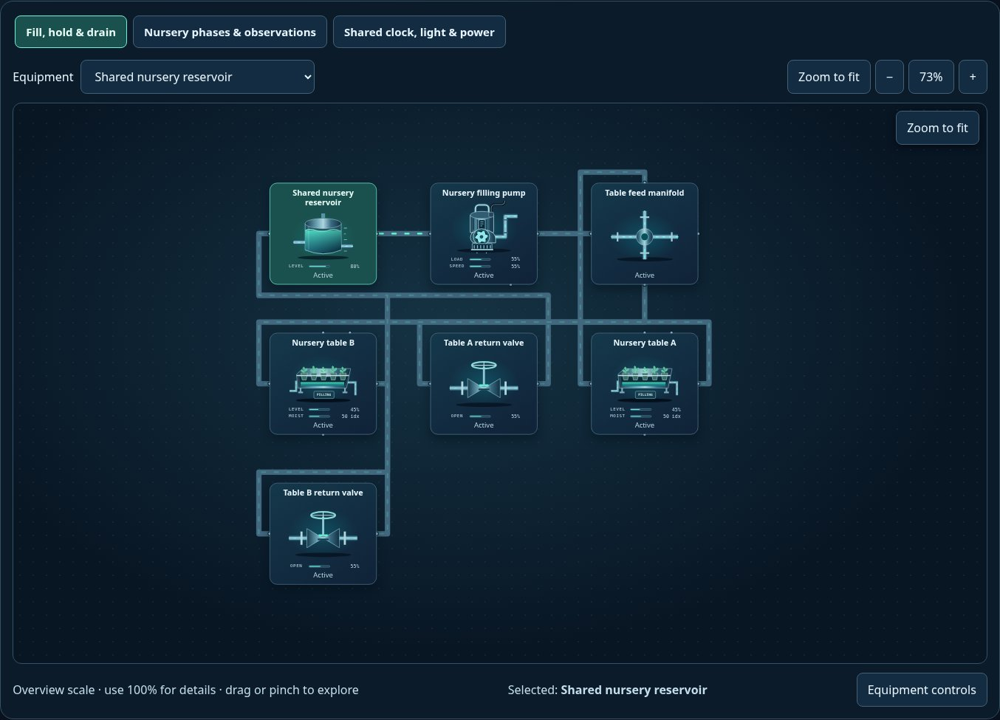
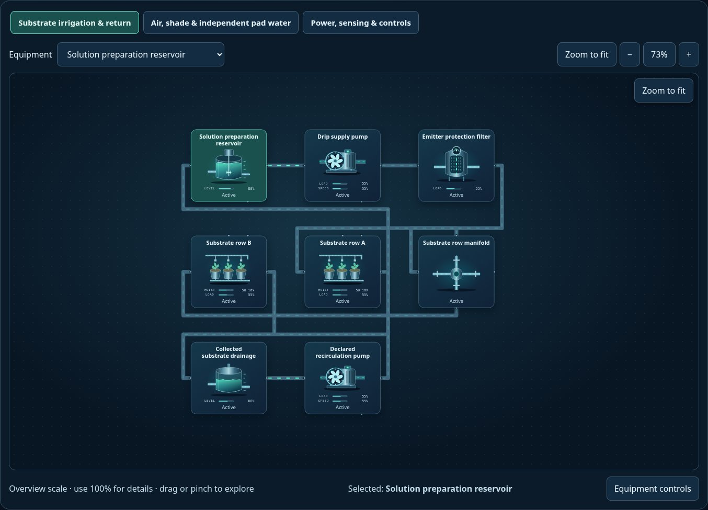
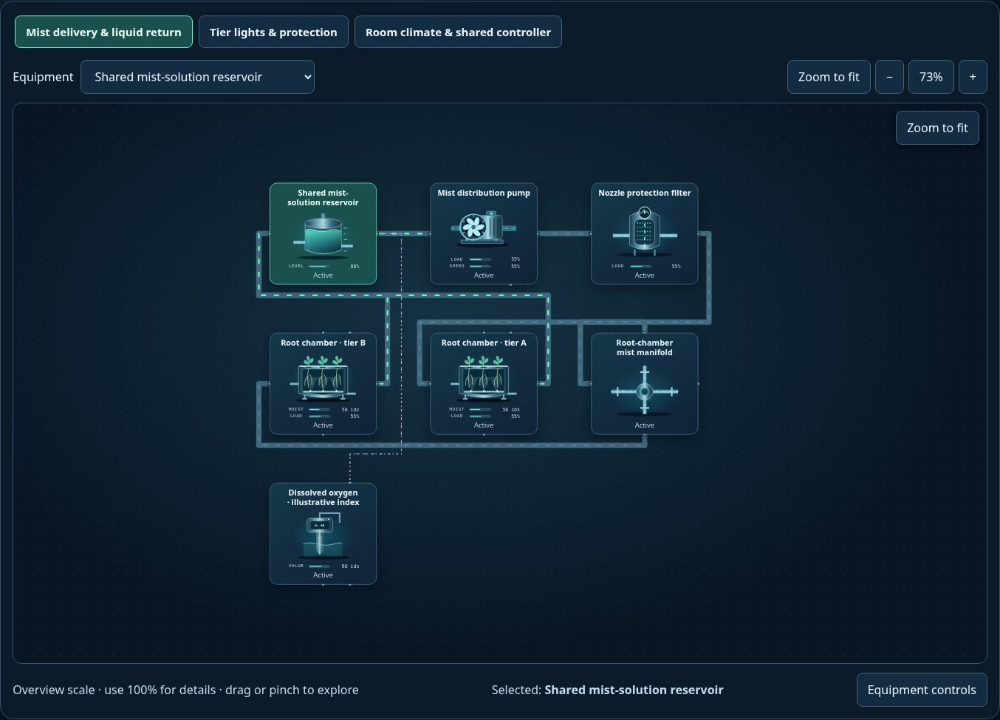

# Agriculture & aquaculture — captured simulation views

Real Explorer images captured after reset, pause and Zoom to fit. Values and behavior remain illustrative; overview text size is not an operating-scale readability guarantee.

[All sectors](../README.md) · [Scenario library](../../../scenarios/README.md)

| Scenario | Preview |
| --- | --- |
| [Media-bed aquaponics](aquaponics-media-bed/README.md) `aquaponics-media-bed` |  |
| [Raft / DWC aquaponics](aquaponics-dwc/README.md) `aquaponics-dwc` |  |
| [NFT hydroponics](hydroponics-nft/README.md) `hydroponics-nft` |  |
| [Ebb-and-flow nursery](hydroponics-ebb-flow/README.md) `hydroponics-ebb-flow` |  |
| [Drip / substrate greenhouse](greenhouse-drip/README.md) `greenhouse-drip` |  |
| [Indoor vertical / aeroponic room](indoor-aeroponics/README.md) `indoor-aeroponics` |  |
