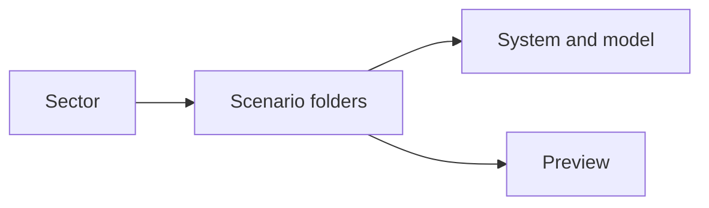
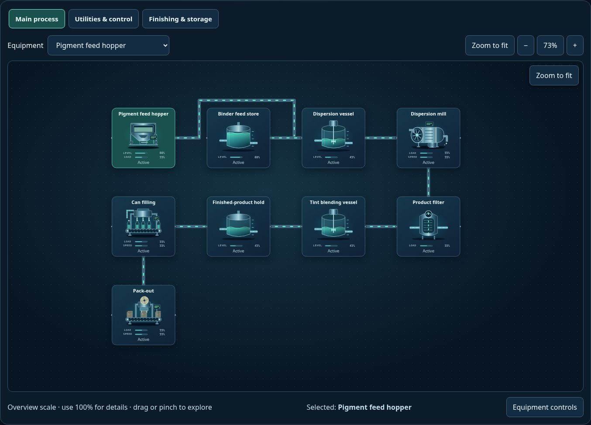
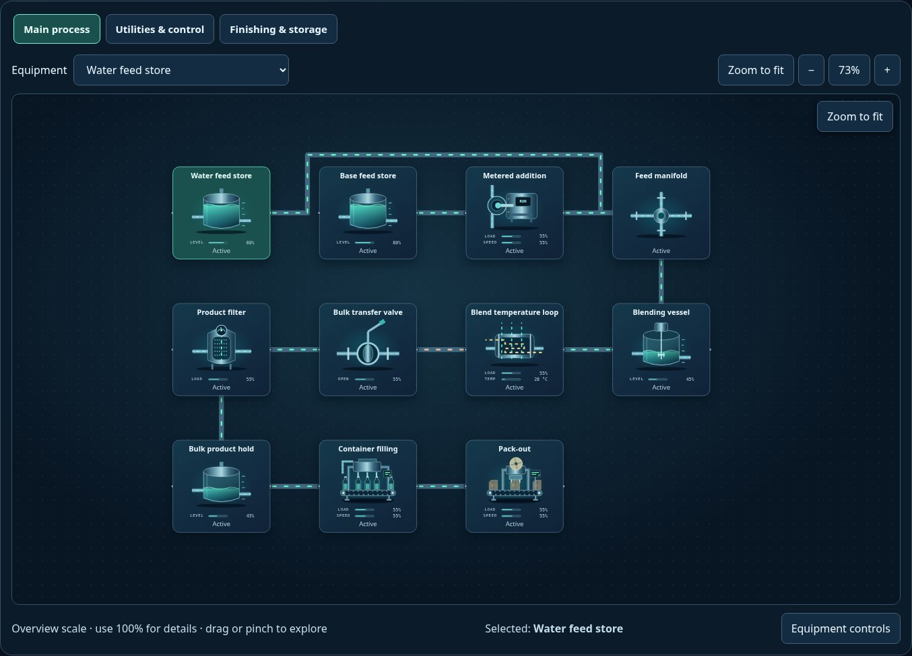

# Chemicals — captured simulation views

Real Explorer images captured after reset, pause and Zoom to fit. Values and behavior remain illustrative; overview text size is not an operating-scale readability guarantee.

[All sectors](../README.md) · [Scenario library](../../../scenarios/README.md)

| Scenario | Preview |
| --- | --- |
| [Paint blending](paint-blending/README.md) `paint-blending` |  |
| [Industrial detergent](industrial-detergent/README.md) `industrial-detergent` |  |
