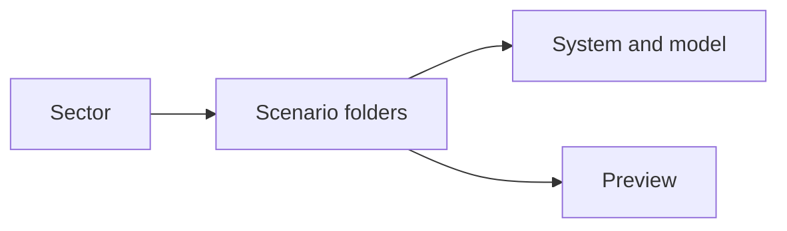
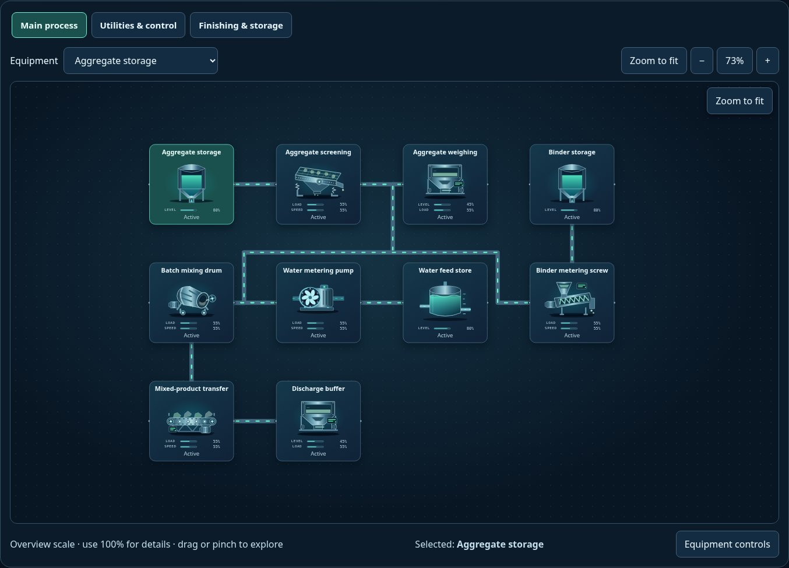
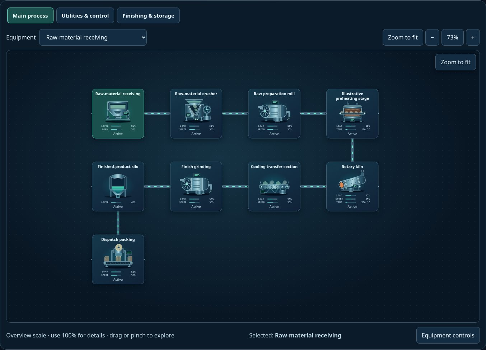

# Construction materials — captured simulation views

Real Explorer images captured after reset, pause and Zoom to fit. Values and behavior remain illustrative; overview text size is not an operating-scale readability guarantee.

[All sectors](../README.md) · [Scenario library](../../../scenarios/README.md)

| Scenario | Preview |
| --- | --- |
| [Concrete batching](concrete-batching/README.md) `concrete-batching` |  |
| [Cement processing](cement/README.md) `cement` |  |
