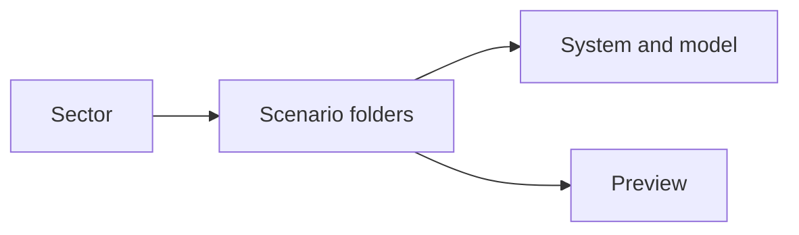
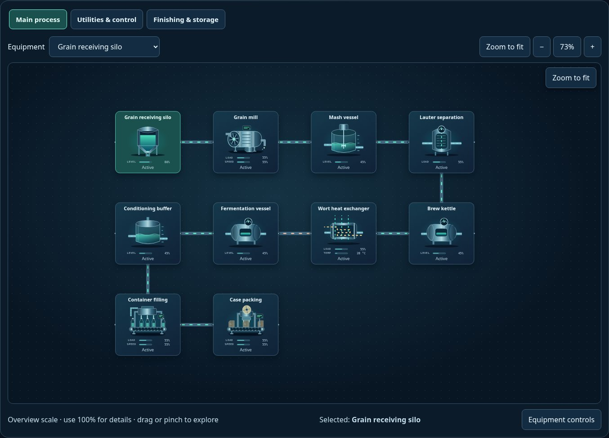
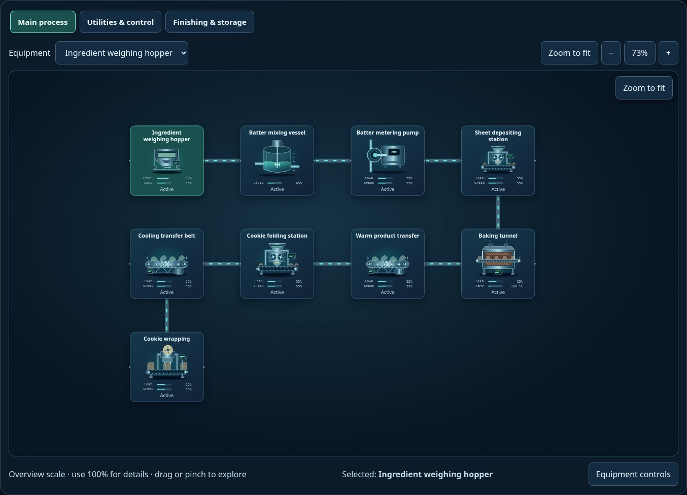
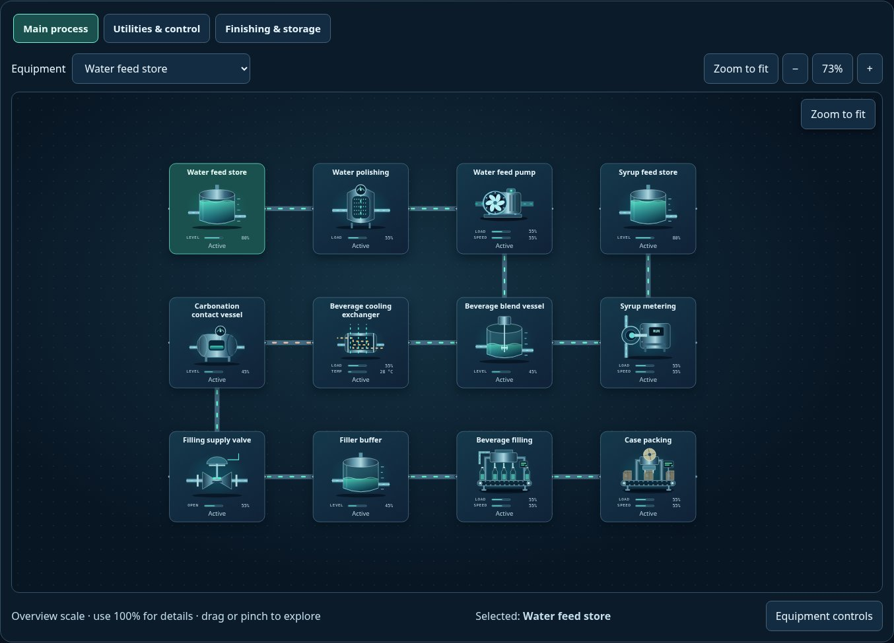
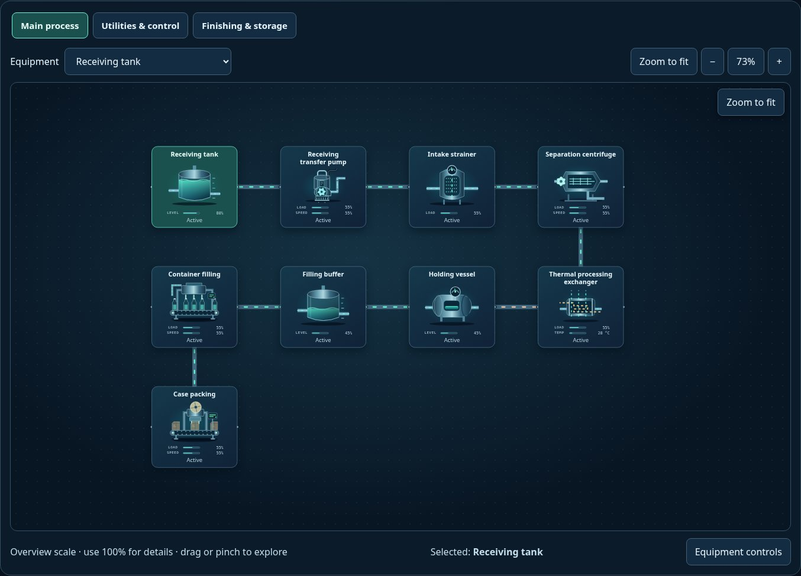

# Food & beverage — captured simulation views

Real Explorer images captured after reset, pause and Zoom to fit. Values and behavior remain illustrative; overview text size is not an operating-scale readability guarantee.

[All sectors](../README.md) · [Scenario library](../../../scenarios/README.md)

| Scenario | Preview |
| --- | --- |
| [Winery](winery/README.md) `winery` |  |
| [Brewery](brewery/README.md) `brewery` |  |
| [Fortune-cookie factory](fortune-cookies/README.md) `fortune-cookies` |  |
| [Carbonated beverages](carbonated-beverages/README.md) `carbonated-beverages` |  |
| [Dairy processing](dairy/README.md) `dairy` |  |
| [Fruit-juice line](fruit-juice/README.md) `fruit-juice` |  |
