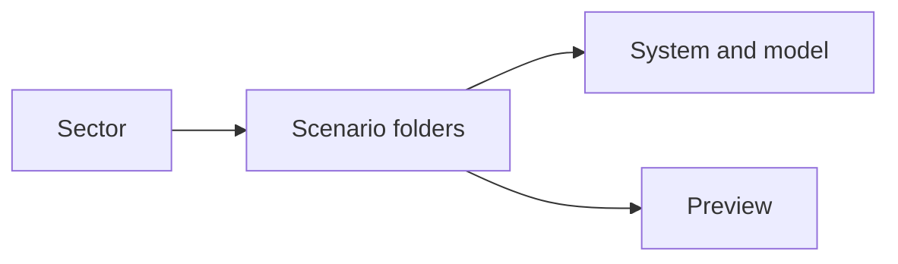
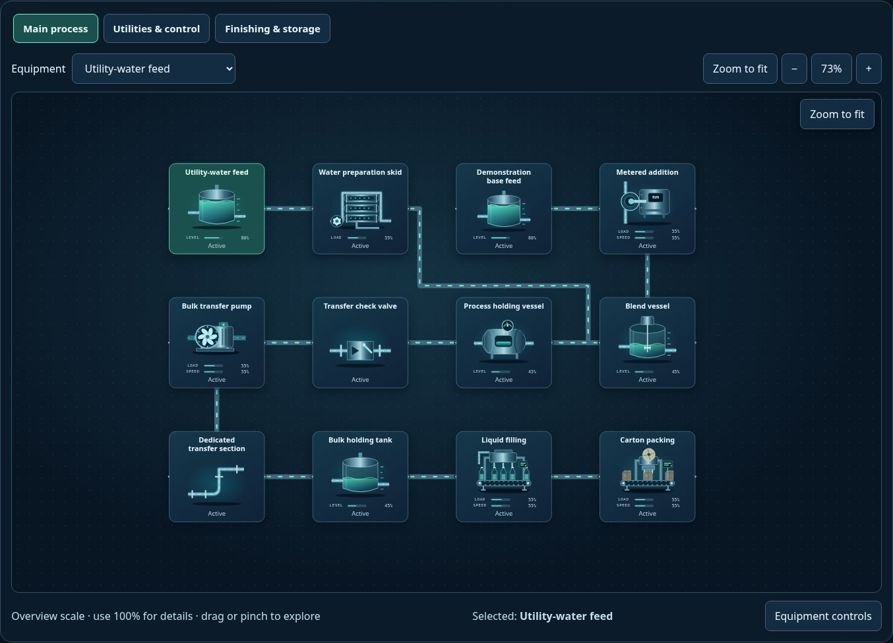
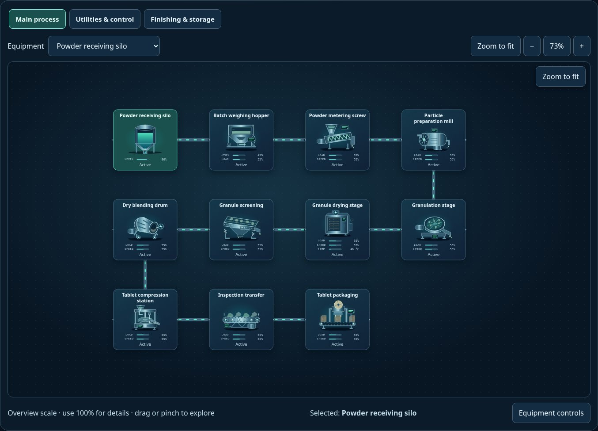
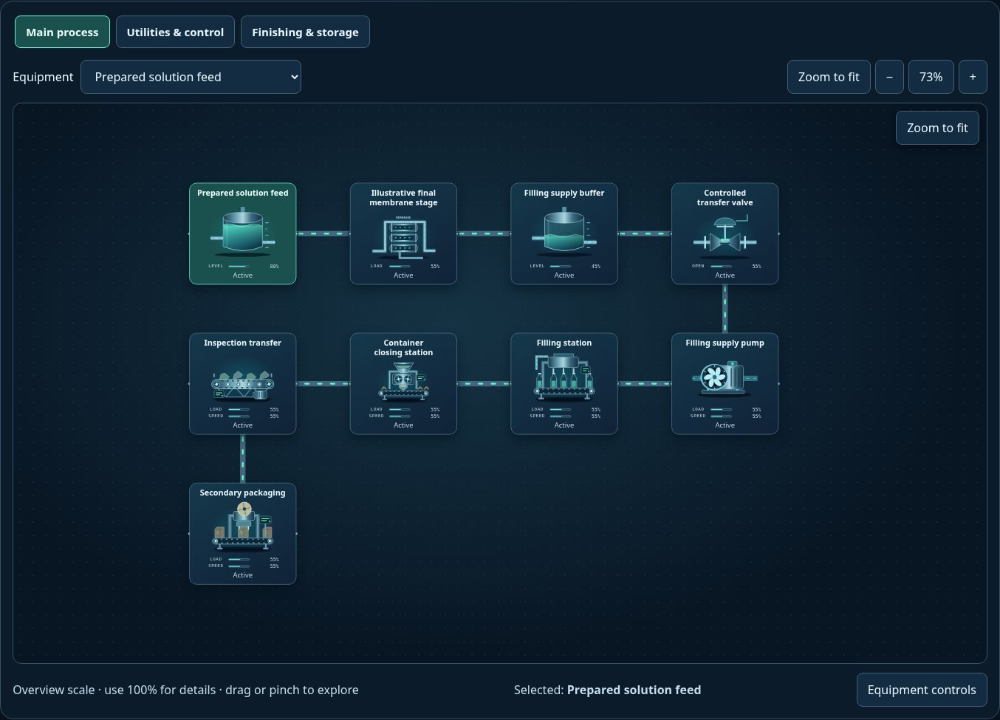

# Pharmaceuticals — captured simulation views

Real Explorer images captured after reset, pause and Zoom to fit. Values and behavior remain illustrative; overview text size is not an operating-scale readability guarantee.

[All sectors](../README.md) · [Scenario library](../../../scenarios/README.md)

| Scenario | Preview |
| --- | --- |
| [Oral-liquid manufacturing](pharma-oral-liquid/README.md) `pharma-oral-liquid` |  |
| [Tablet manufacturing](tablets/README.md) `tablets` |  |
| [Sterile-filling concept](sterile-filling/README.md) `sterile-filling` |  |
