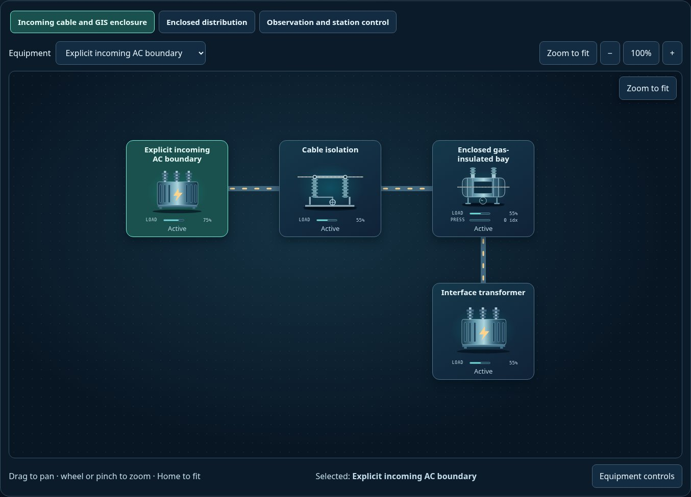
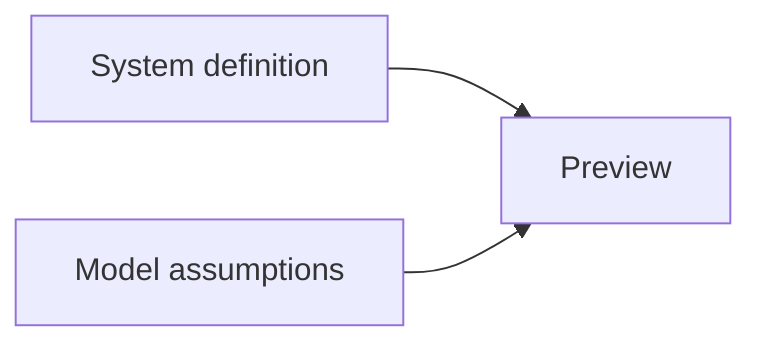

# Gas-insulated substation interface

[Power & utilities](../README.md) · [All sectors](../../README.md)

Real Explorer images captured after reset, pause and Zoom to fit. Values and behavior remain illustrative; overview text size is not an operating-scale readability guarantee.

| File or source | Purpose |
| --- | --- |
| [Preview](preview.jpg) | Actual fitted initial model state |
| [Scenario documentation](../../../../scenarios/power-substation-gis/README.md) | Equipment roles, focused views and editable assumptions |
| [System JSON](../../../../scenarios/power-substation-gis/system.json) | Equipment, ports, connections and layouts |
| [Model JSON](../../../../scenarios/power-substation-gis/model.json) | Replaceable behavior and initial values |
| [Companion topology](../../../topologies/power-utilities/power-substation-gis/README.md) | Another representation of this scenario |
| [Generation metadata](../../../../metadata/thumbnails.json) | Source and output provenance |
