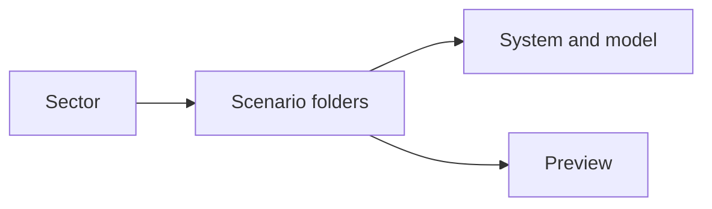
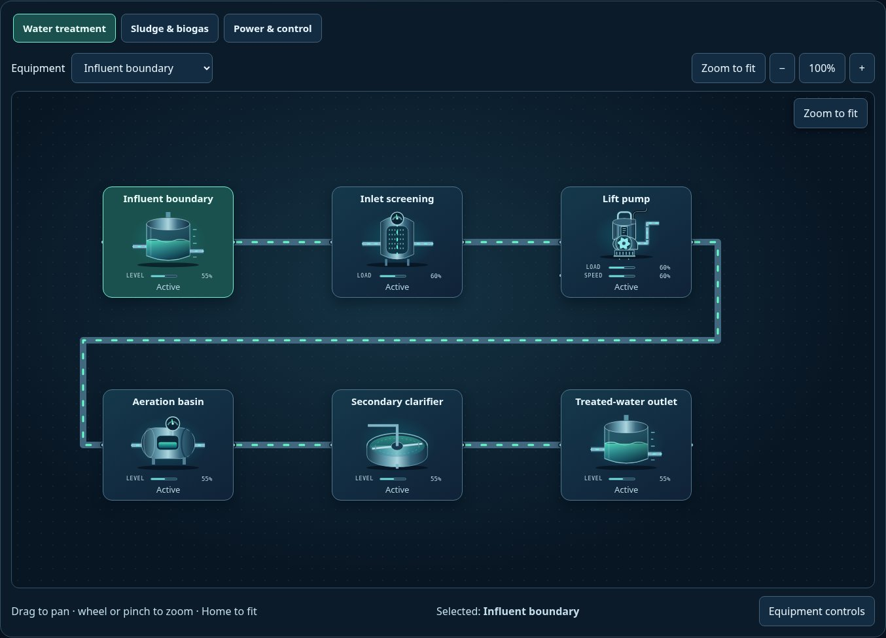

# Water & utilities — captured simulation views

Real Explorer images captured after reset, pause and Zoom to fit. Values and behavior remain illustrative; overview text size is not an operating-scale readability guarantee.

[All sectors](../README.md) · [Scenario library](../../../scenarios/README.md)

| Scenario | Preview |
| --- | --- |
| [Wastewater &amp; biogas digital twin](wastewater-digester/README.md) `wastewater-digester` |  |
