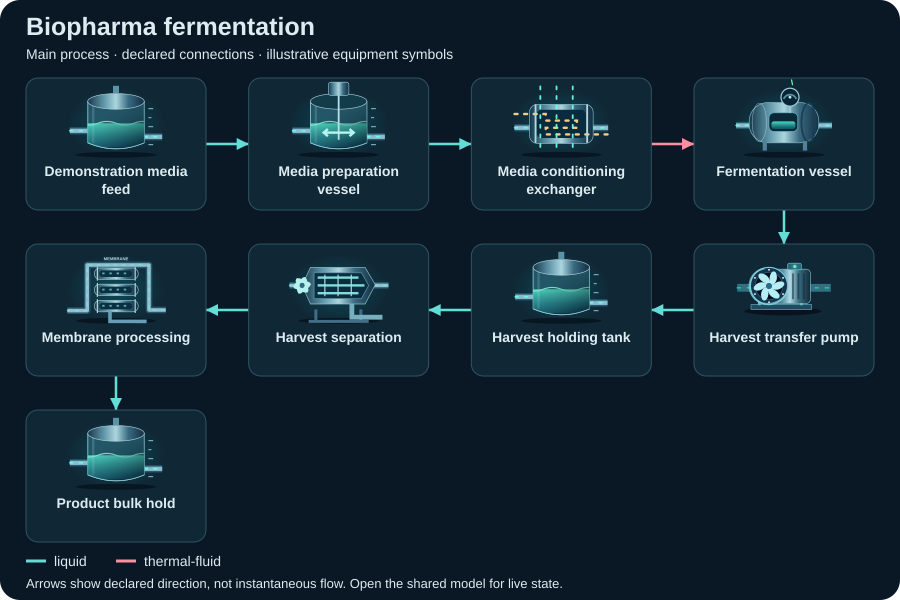
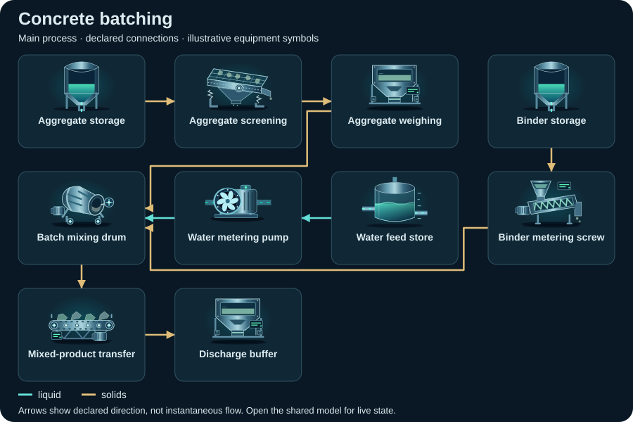
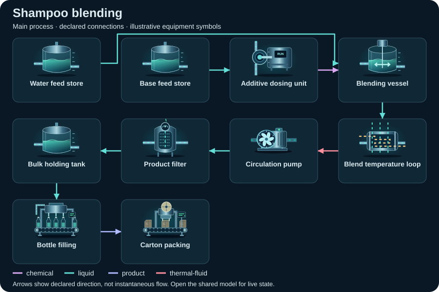
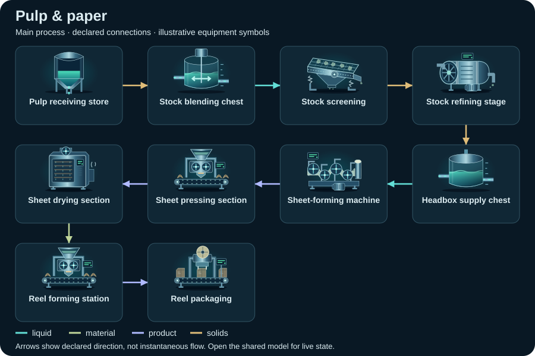
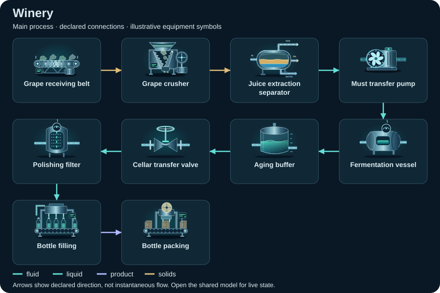
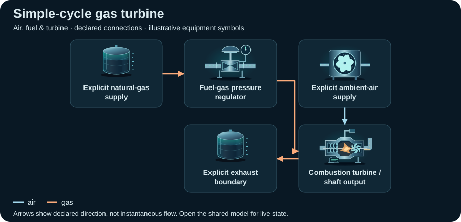
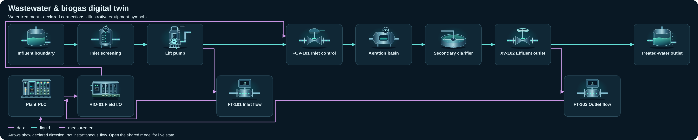

# Compact topology diagrams

Static SVG schematics of the first declared view. Symbols identify equipment; arrows show declared connections, not instantaneous flow or measured facility performance.

[Library image gallery](../README.md) · [Scenario definitions](../../scenarios/README.md) · [Generation metadata](../../metadata/topologies.json)

Browse 61 scenarios in 14 sectors. Paths use `sector/scenario/preview.jpg` for captures and `sector/scenario/topology.svg` for topology maps.

| Sector | Scenarios | Representative preview |
| --- | ---: | --- |
| [Agriculture &amp; aquaculture](agriculture-aquaculture/README.md) | 6 |  |
| [Biopharma](biopharma/README.md) | 1 |  |
| [Chemicals](chemicals/README.md) | 2 |  |
| [Construction materials](construction-materials/README.md) | 2 |  |
| [Consumer products](consumer-products/README.md) | 1 |  |
| [Fiber processing](fiber-processing/README.md) | 1 |  |
| [Food &amp; beverage](food-beverage/README.md) | 6 |  |
| [Manufacturing &amp; thermal processing](manufacturing-thermal-processing/README.md) | 1 |  |
| [Materials](materials/README.md) | 1 |  |
| [Mineral processing](mineral-processing/README.md) | 2 |  |
| [Pharmaceuticals](pharmaceuticals/README.md) | 3 |  |
| [Power &amp; utilities](power-utilities/README.md) | 33 |  |
| [Surface treatment](surface-treatment/README.md) | 1 |  |
| [Water &amp; utilities](water-utilities/README.md) | 1 |  |
