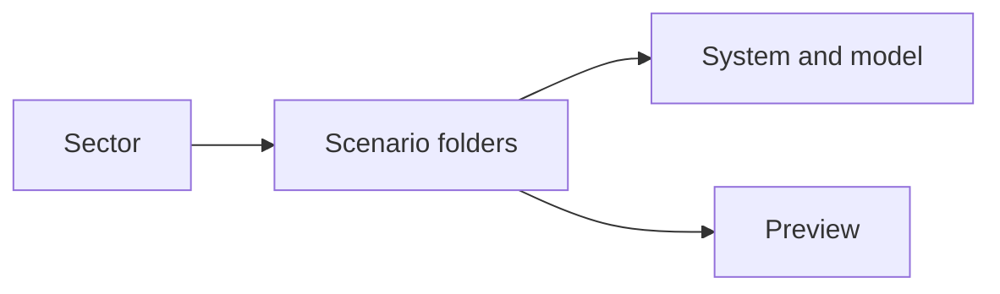
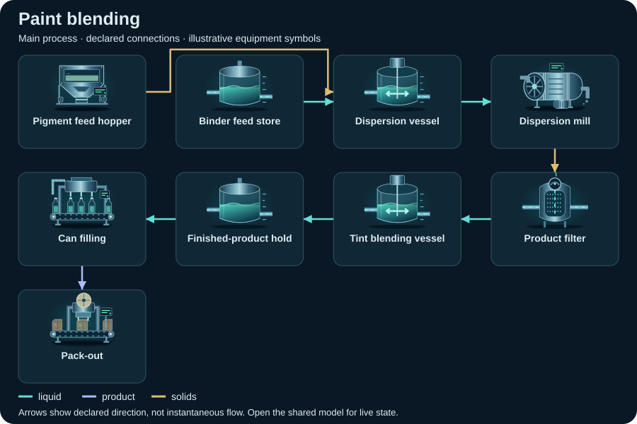
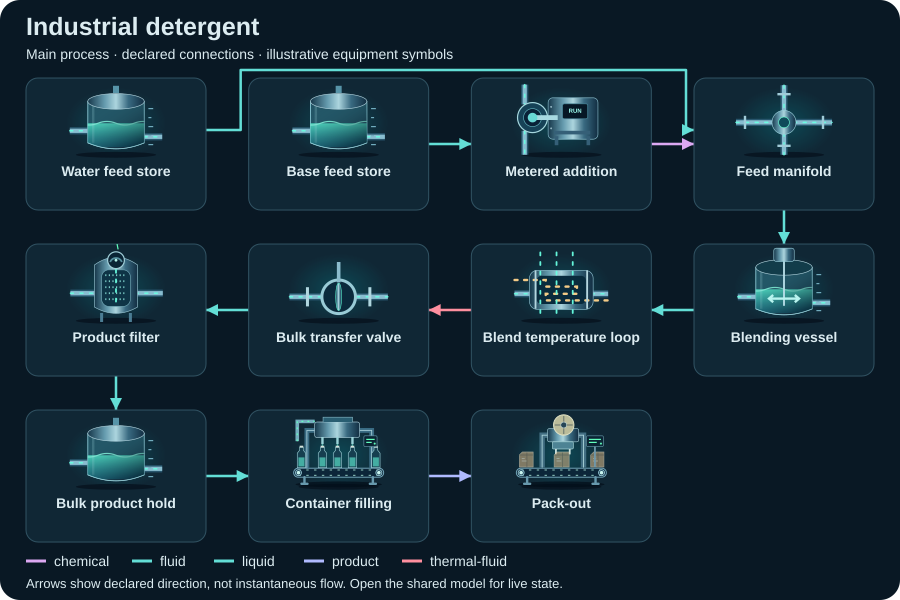

# Chemicals — compact topology diagrams

Static SVG schematics of the first declared view. Symbols identify equipment; arrows show declared connections, not instantaneous flow or measured facility performance.

[All sectors](../README.md) · [Scenario library](../../../scenarios/README.md)

| Scenario | Preview |
| --- | --- |
| [Paint blending](paint-blending/README.md) `paint-blending` |  |
| [Industrial detergent](industrial-detergent/README.md) `industrial-detergent` |  |
