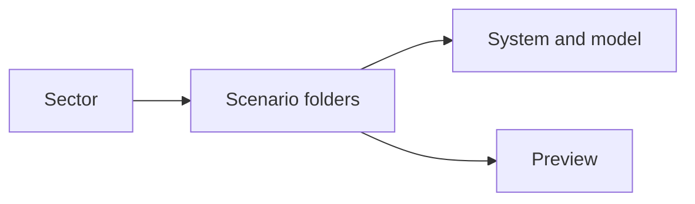
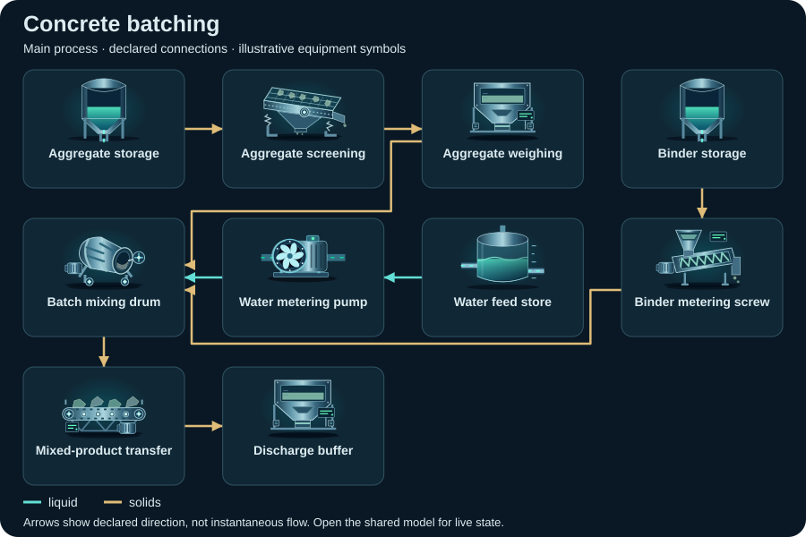
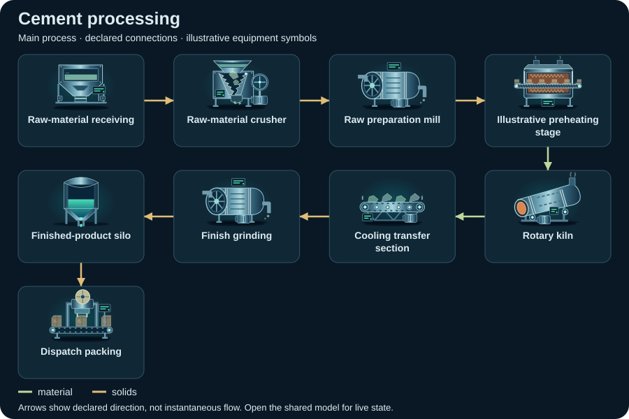

# Construction materials — compact topology diagrams

Static SVG schematics of the first declared view. Symbols identify equipment; arrows show declared connections, not instantaneous flow or measured facility performance.

[All sectors](../README.md) · [Scenario library](../../../scenarios/README.md)

| Scenario | Preview |
| --- | --- |
| [Concrete batching](concrete-batching/README.md) `concrete-batching` |  |
| [Cement processing](cement/README.md) `cement` |  |
