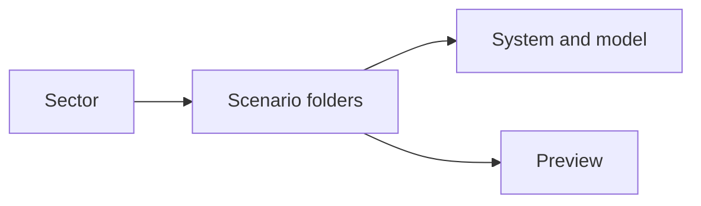
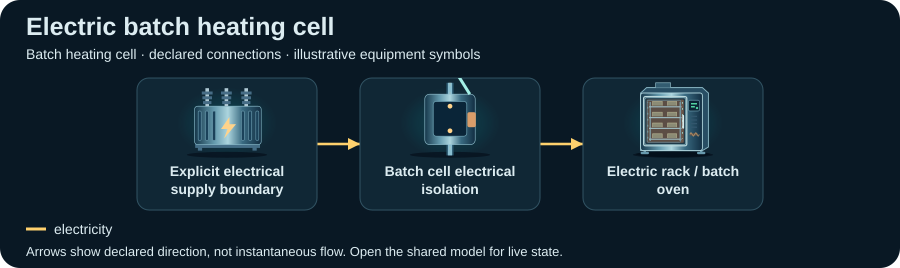

# Manufacturing & thermal processing — compact topology diagrams

Static SVG schematics of a declared view, selected by the catalog topologyView when present. Symbols identify equipment; arrows show declared connections, not instantaneous flow or measured facility performance.

[All sectors](../README.md) · [Scenario library](../../../scenarios/README.md)

| Scenario | Preview |
| --- | --- |
| [Electric batch heating cell](electric-batch-oven/README.md) `electric-batch-oven` |  |
