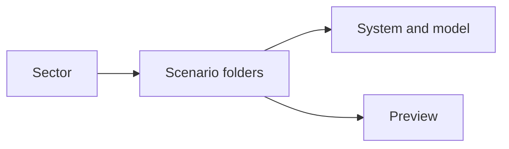
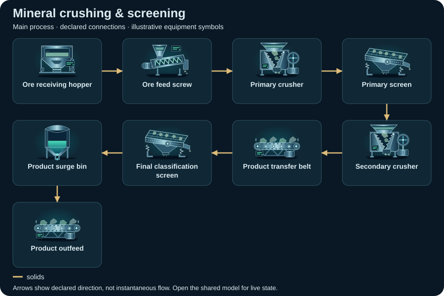
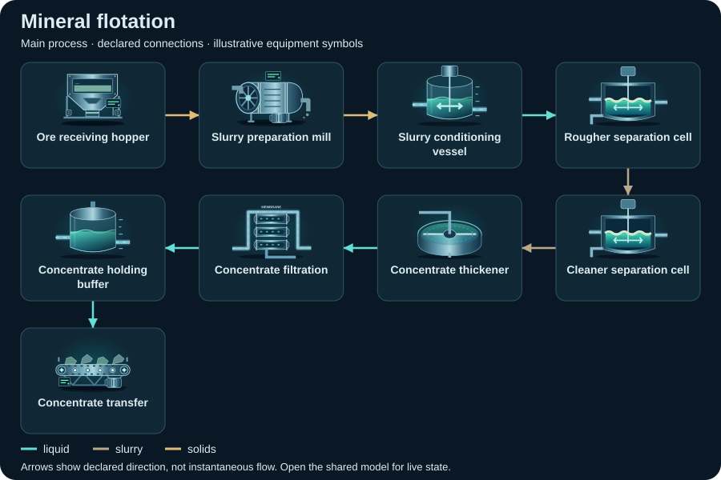

# Mineral processing — compact topology diagrams

Static SVG schematics of the first declared view. Symbols identify equipment; arrows show declared connections, not instantaneous flow or measured facility performance.

[All sectors](../README.md) · [Scenario library](../../../scenarios/README.md)

| Scenario | Preview |
| --- | --- |
| [Mineral crushing &amp; screening](mineral-crushing/README.md) `mineral-crushing` |  |
| [Mineral flotation](mineral-flotation/README.md) `mineral-flotation` |  |
