# Power & utilities — compact topology diagrams

Static SVG schematics of the first declared view. Symbols identify equipment; arrows show declared connections, not instantaneous flow or measured facility performance.

[All sectors](../README.md) · [Scenario library](../../../scenarios/README.md)

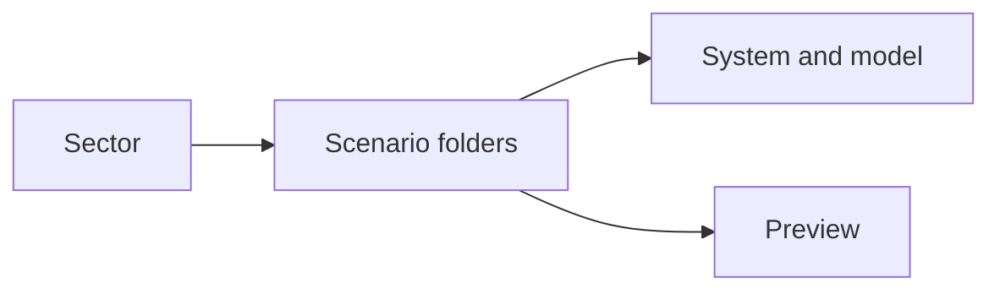

| Scenario | Preview |
| --- | --- |
| [Simple-cycle gas turbine](power-gas-simple-cycle/README.md) `power-gas-simple-cycle` | <a href="power-gas-simple-cycle/topology.svg">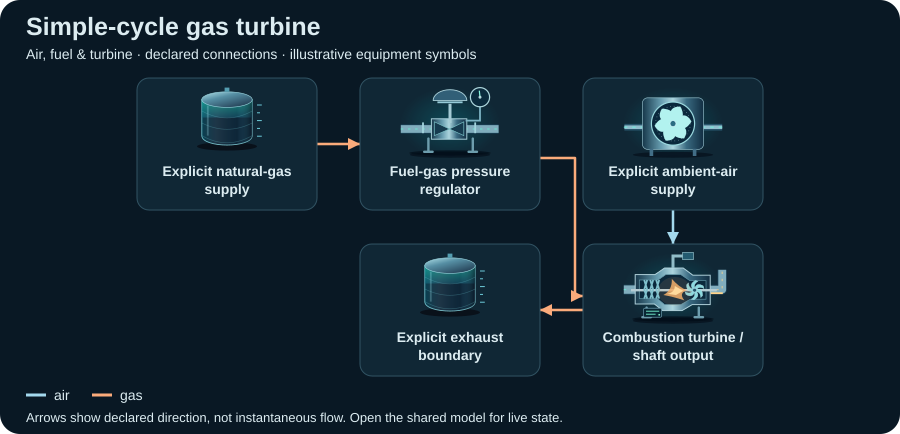</a> |
| [Combined-cycle gas plant](power-gas-combined-cycle/README.md) `power-gas-combined-cycle` | <a href="power-gas-combined-cycle/topology.svg">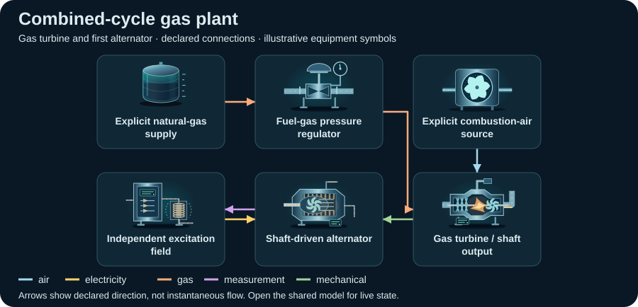</a> |
| [Coal steam-cycle plant](power-coal-steam/README.md) `power-coal-steam` | <a href="power-coal-steam/topology.svg">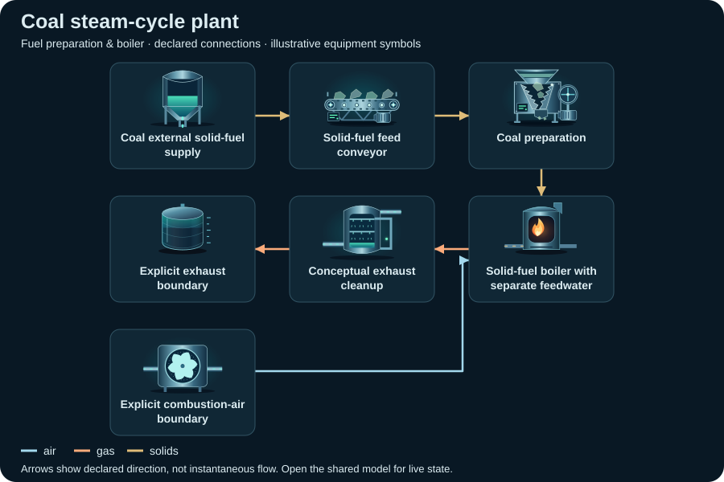</a> |
| [Biomass CHP](power-biomass-chp/README.md) `power-biomass-chp` | <a href="power-biomass-chp/topology.svg">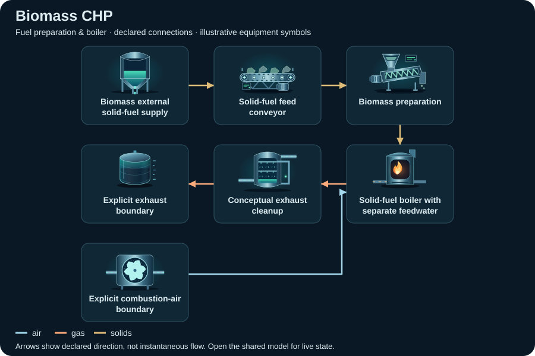</a> |
| [Impoundment hydropower](power-hydro-impoundment/README.md) `power-hydro-impoundment` | <a href="power-hydro-impoundment/topology.svg">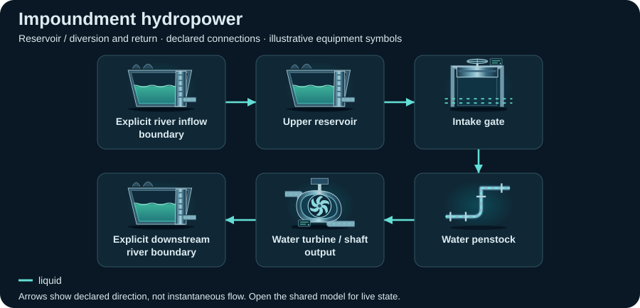</a> |
| [Diversion hydropower](power-hydro-diversion/README.md) `power-hydro-diversion` | <a href="power-hydro-diversion/topology.svg">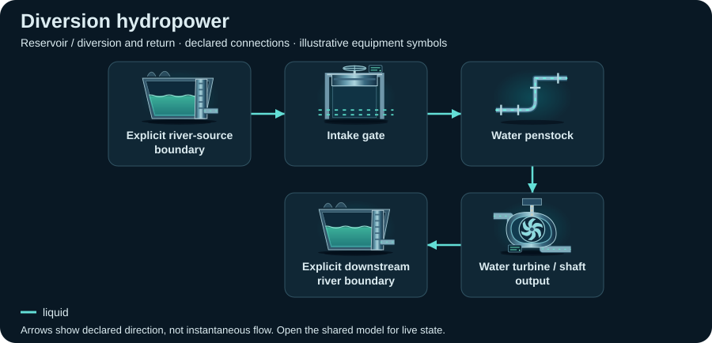</a> |
| [Reversible pumped storage](power-pumped-storage/README.md) `power-pumped-storage` | <a href="power-pumped-storage/topology.svg">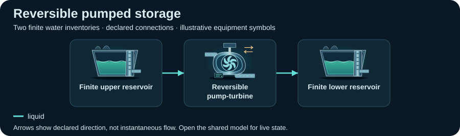</a> |
| [Pressurized-water nuclear concept](power-nuclear-pwr/README.md) `power-nuclear-pwr` | <a href="power-nuclear-pwr/topology.svg">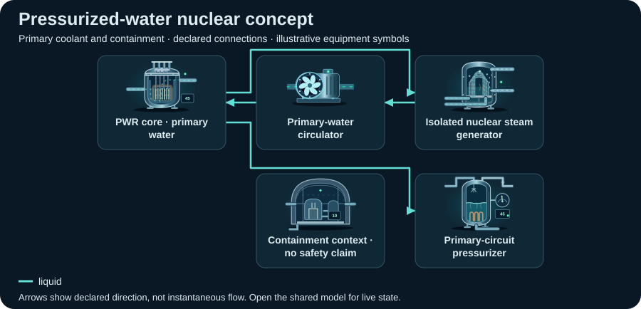</a> |
| [Pressure-channel heavy-water concept](power-nuclear-phwr/README.md) `power-nuclear-phwr` | <a href="power-nuclear-phwr/topology.svg">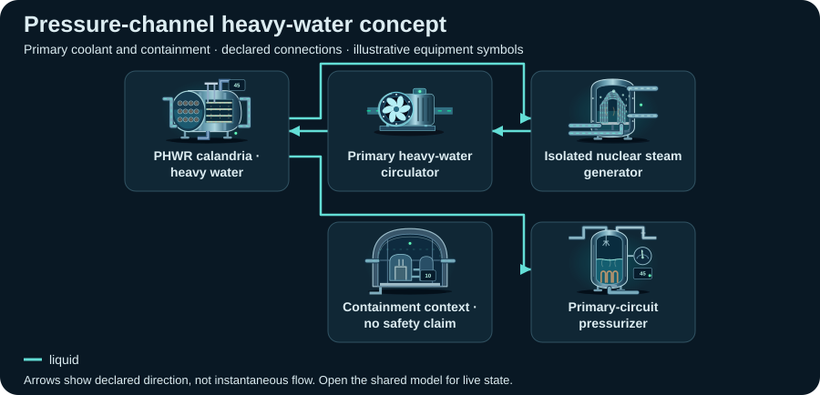</a> |
| [Helium-cooled reactor concept](power-nuclear-htgr/README.md) `power-nuclear-htgr` | <a href="power-nuclear-htgr/topology.svg">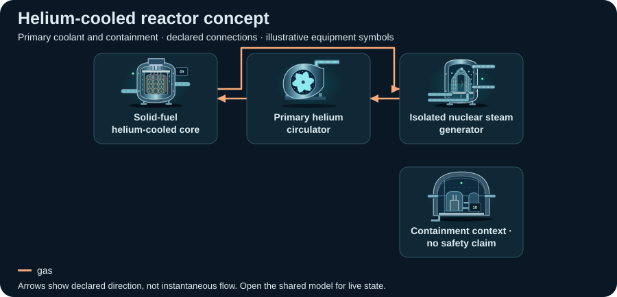</a> |
| [Pool-type sodium fast-reactor concept](power-nuclear-sodium-fast/README.md) `power-nuclear-sodium-fast` | <a href="power-nuclear-sodium-fast/topology.svg">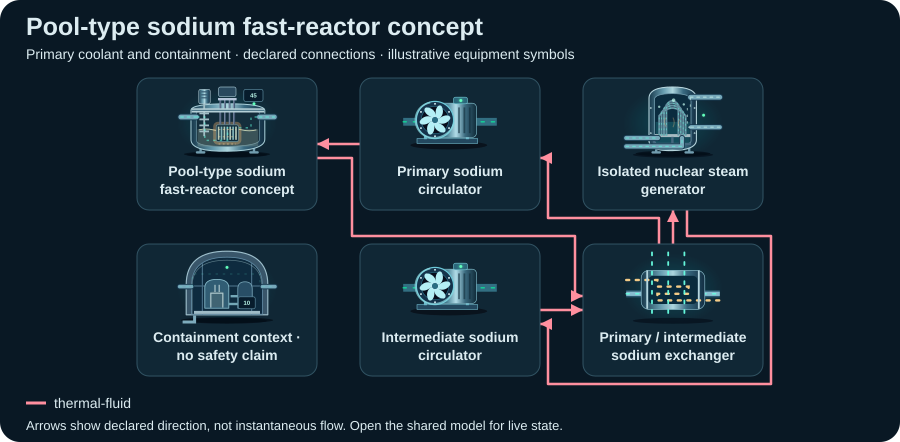</a> |
| [Solid-fuel salt-cooled nuclear concept](power-nuclear-molten-salt/README.md) `power-nuclear-molten-salt` | <a href="power-nuclear-molten-salt/topology.svg">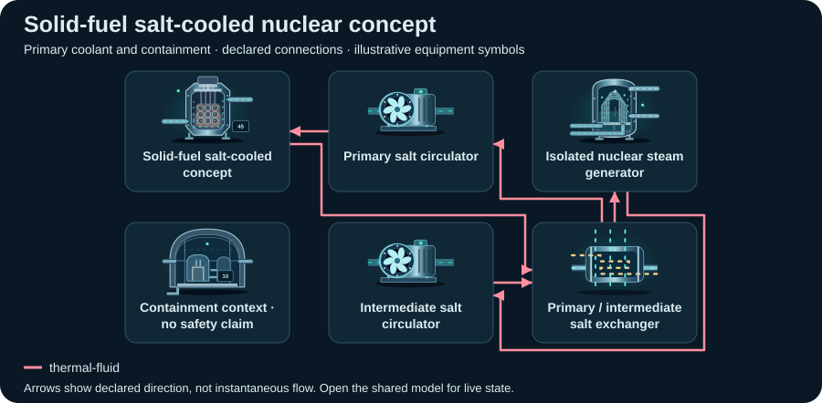</a> |
| [Boiling-water nuclear concept](power-nuclear-bwr/README.md) `power-nuclear-bwr` | <a href="power-nuclear-bwr/topology.svg">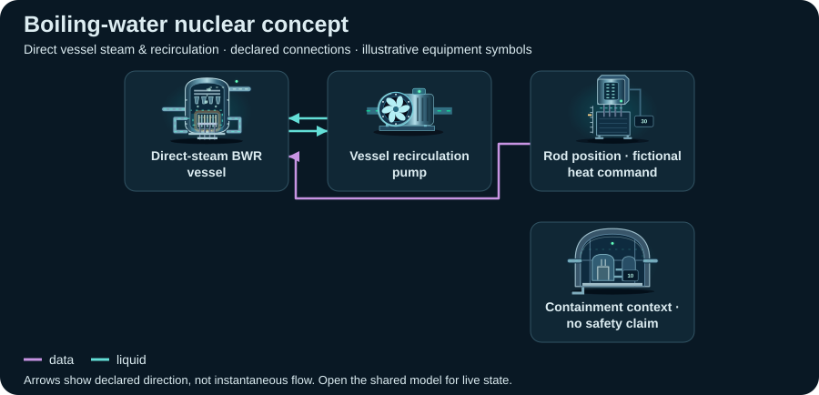</a> |
| [Two-module integral-PWR concept](power-nuclear-lw-smr/README.md) `power-nuclear-lw-smr` | <a href="power-nuclear-lw-smr/topology.svg">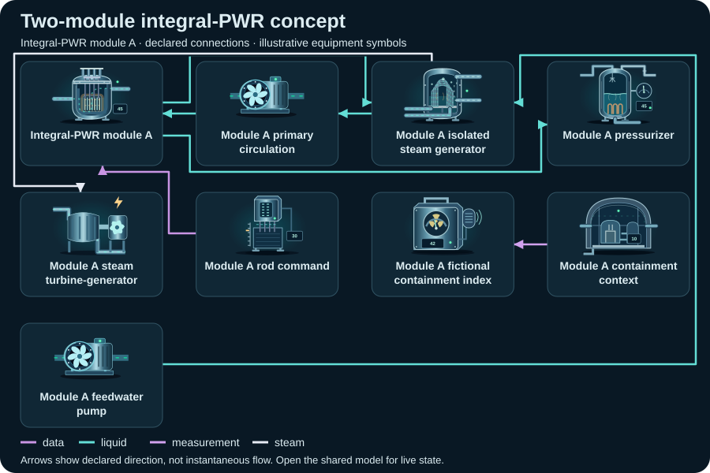</a> |
| [Natural-gas engine CHP](power-ng-engine-chp/README.md) `power-ng-engine-chp` | <a href="power-ng-engine-chp/topology.svg">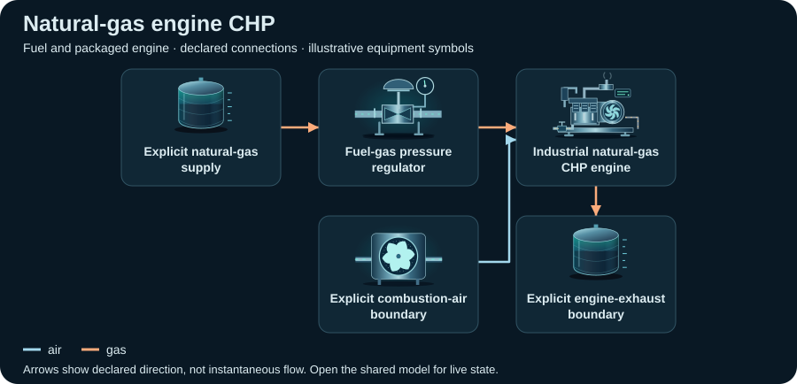</a> |
| [Diesel standby supply](power-diesel-standby/README.md) `power-diesel-standby` | <a href="power-diesel-standby/topology.svg">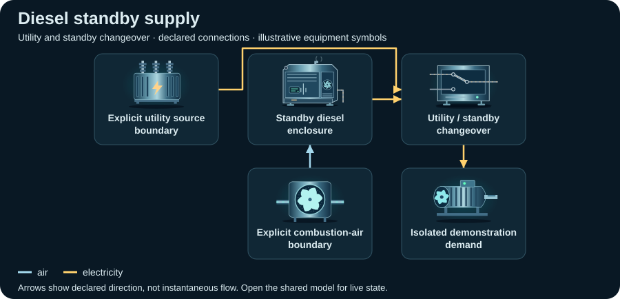</a> |
| [Portable gasoline generator](power-gasoline-portable/README.md) `power-gasoline-portable` | <a href="power-gasoline-portable/topology.svg">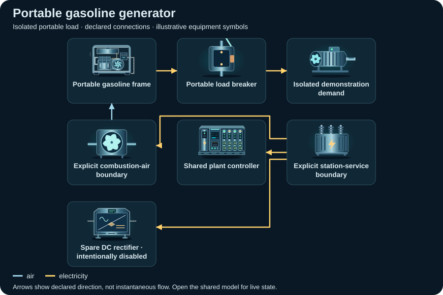</a> |
| [Distribution substation](power-substation-distribution/README.md) `power-substation-distribution` | <a href="power-substation-distribution/topology.svg">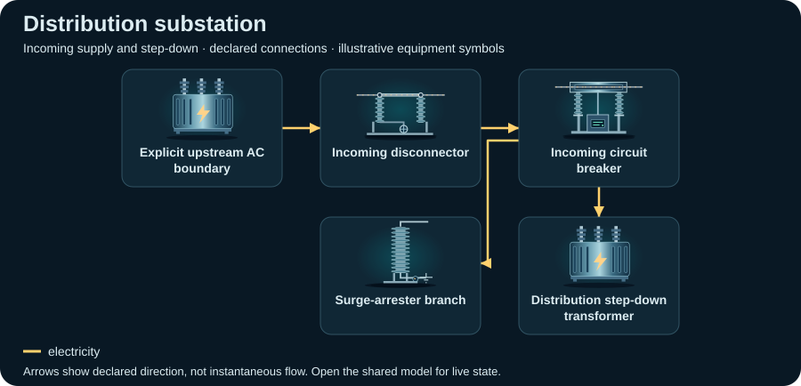</a> |
| [Generator step-up substation](power-substation-gsu/README.md) `power-substation-gsu` | <a href="power-substation-gsu/topology.svg">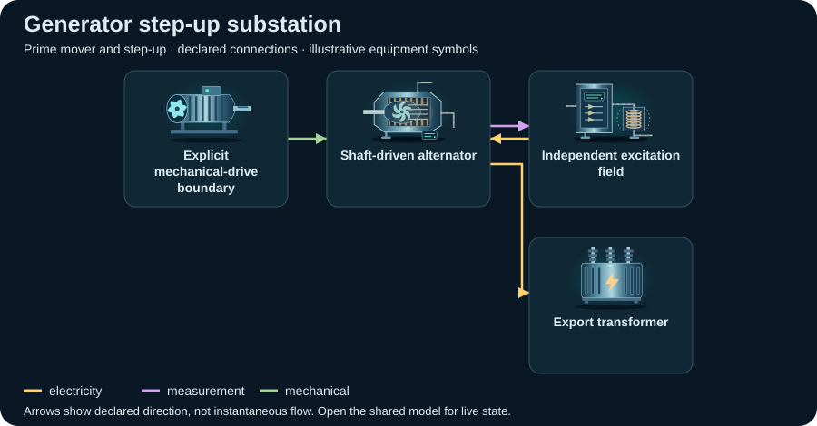</a> |
| [Gas-insulated substation interface](power-substation-gis/README.md) `power-substation-gis` | <a href="power-substation-gis/topology.svg">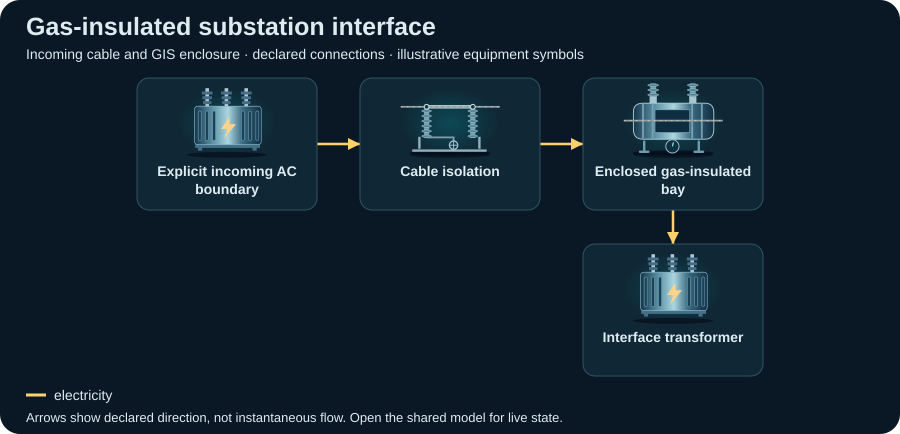</a> |
| [Back-to-back HVDC interface](power-hvdc-interface/README.md) `power-hvdc-interface` | <a href="power-hvdc-interface/topology.svg">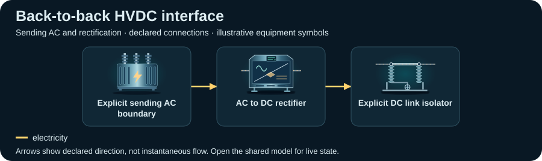</a> |
| [Photovoltaic field](power-solar-pv/README.md) `power-solar-pv` | <a href="power-solar-pv/topology.svg">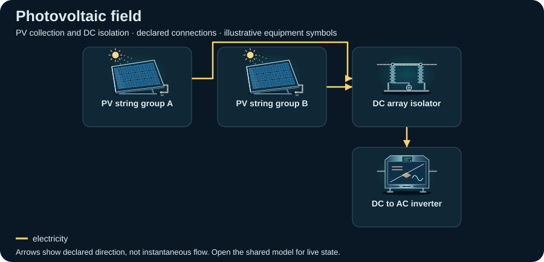</a> |
| [Wind collection network](power-wind-collection/README.md) `power-wind-collection` | <a href="power-wind-collection/topology.svg">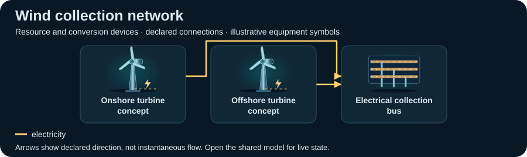</a> |
| [Tidal-current array](power-tidal-current/README.md) `power-tidal-current` | <a href="power-tidal-current/topology.svg">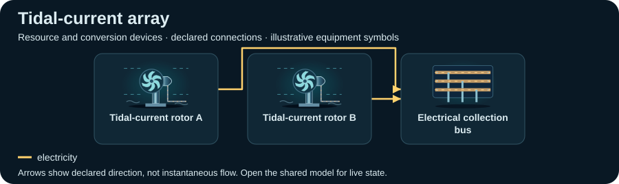</a> |
| [Wave point-absorber array](power-wave-point-absorber/README.md) `power-wave-point-absorber` | <a href="power-wave-point-absorber/topology.svg">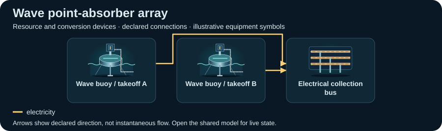</a> |
| [Solar power tower](power-csp-tower/README.md) `power-csp-tower` | <a href="power-csp-tower/topology.svg">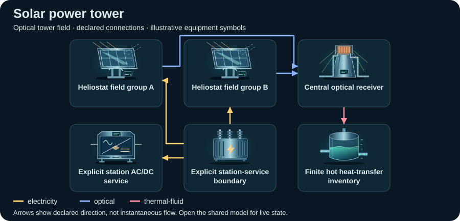</a> |
| [Parabolic-trough solar plant](power-csp-trough/README.md) `power-csp-trough` | <a href="power-csp-trough/topology.svg">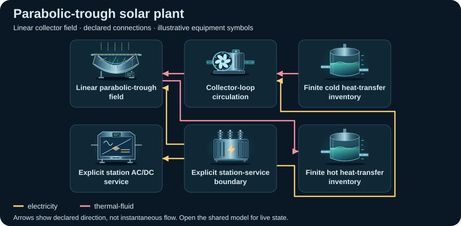</a> |
| [Stationary fuel-cell system](power-fuel-cell/README.md) `power-fuel-cell` | <a href="power-fuel-cell/topology.svg">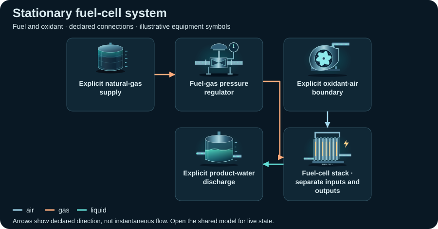</a> |
| [Flash geothermal](power-geothermal-flash/README.md) `power-geothermal-flash` | <a href="power-geothermal-flash/topology.svg">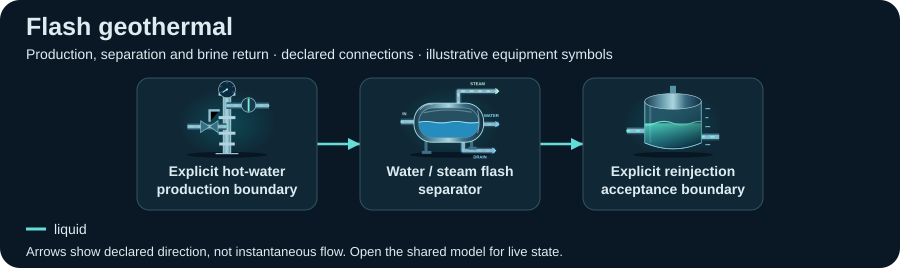</a> |
| [Binary geothermal](power-geothermal-binary/README.md) `power-geothermal-binary` | <a href="power-geothermal-binary/topology.svg">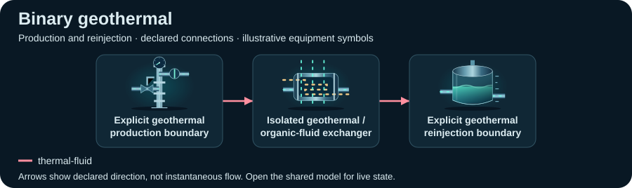</a> |
| [Dry-steam geothermal](power-geothermal-dry-steam/README.md) `power-geothermal-dry-steam` | <a href="power-geothermal-dry-steam/topology.svg">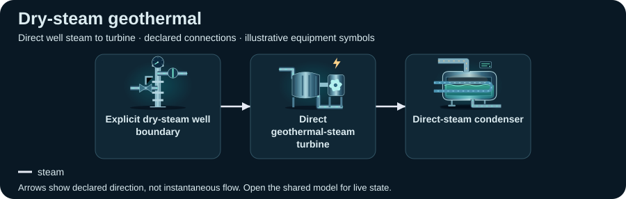</a> |
| [Battery energy-storage system](power-battery-storage/README.md) `power-battery-storage` | <a href="power-battery-storage/topology.svg">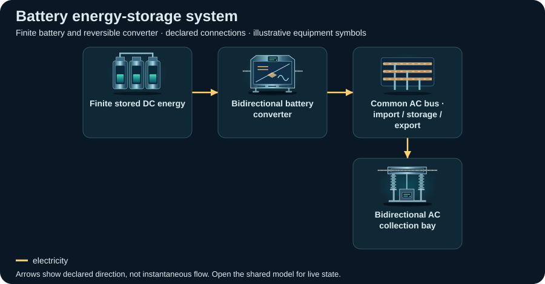</a> |
| [Hybrid islandable microgrid](power-hybrid-microgrid/README.md) `power-hybrid-microgrid` | <a href="power-hybrid-microgrid/topology.svg">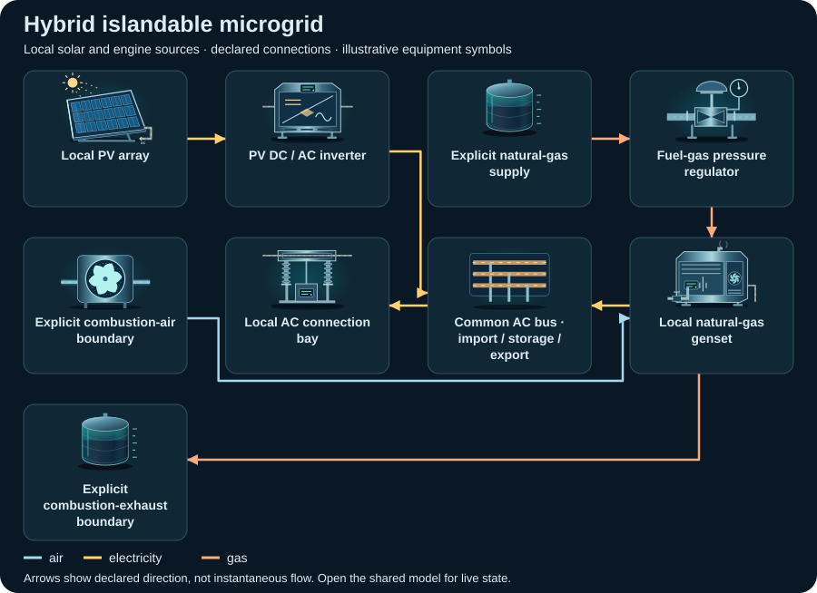</a> |
