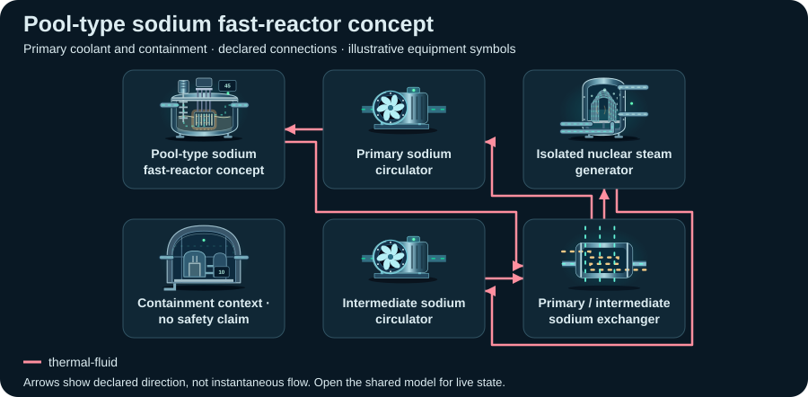
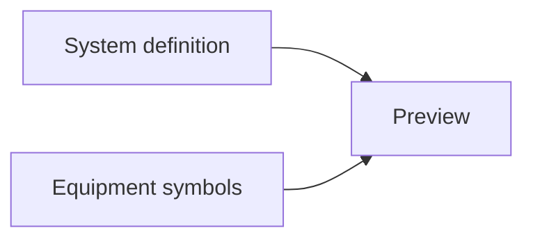

# Pool-type sodium fast-reactor concept

[Power & utilities](../README.md) · [All sectors](../../README.md)

Static SVG schematics of a declared view, selected by the catalog topologyView when present. Symbols identify equipment; arrows show declared connections, not instantaneous flow or measured facility performance.

| File or source | Purpose |
| --- | --- |
| [Preview](topology.svg) | Static declared `primary` view |
| [Scenario documentation](../../../../scenarios/power-nuclear-sodium-fast/README.md) | Equipment roles, focused views and editable assumptions |
| [System JSON](../../../../scenarios/power-nuclear-sodium-fast/system.json) | Equipment, ports, connections and layouts |
| [Model JSON](../../../../scenarios/power-nuclear-sodium-fast/model.json) | Replaceable behavior and initial values |
| [Captured model state](../../../thumbnails/power-utilities/power-nuclear-sodium-fast/README.md) | Another representation of this scenario |
| [Generation metadata](../../../../metadata/topologies.json) | Source and output provenance |
