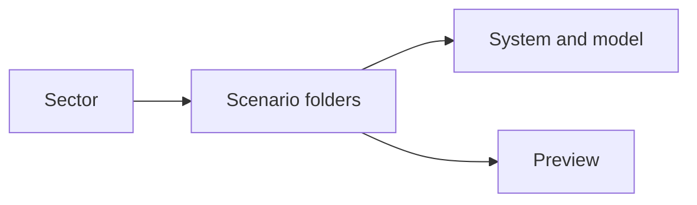
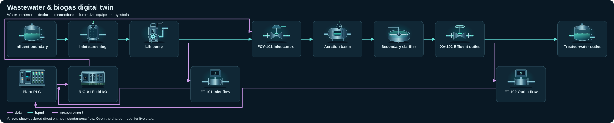

# Water & utilities — compact topology diagrams

Static SVG schematics of the first declared view. Symbols identify equipment; arrows show declared connections, not instantaneous flow or measured facility performance.

[All sectors](../README.md) · [Scenario library](../../../scenarios/README.md)

| Scenario | Preview |
| --- | --- |
| [Wastewater &amp; biogas digital twin](wastewater-digester/README.md) `wastewater-digester` |  |
