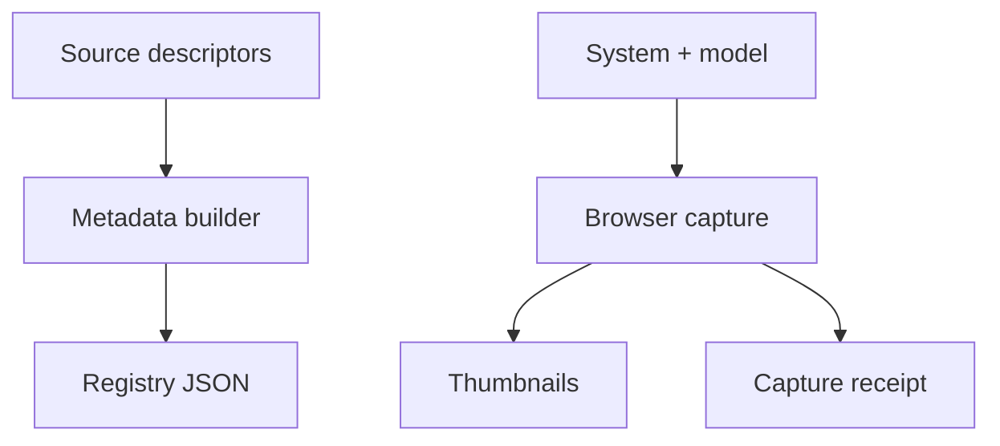

# Model discovery and capture metadata

[Package map](../README.md) · [Model descriptors](../src/README.md) · [Scenario gallery](../img/README.md)

These files are generated read-only projections for consumers that need discovery
or capture provenance without loading a model engine. They are not the runtime's
mutable state or an alternate authoring source.

| File | Contents | Owner |
| --- | --- | --- |
| [model-registry.json](./model-registry.json) | v1 type descriptors, bounds, defaults, ports and assumptions | `npm --prefix tools/webkit/scada run build:metadata` |
| [model-registry-v2.json](./model-registry-v2.json) | v2 base/variant descriptors and explicit circuit/energy contracts | `npm --prefix tools/webkit/scada run build:metadata` |
| [thumbnails.json](./thumbnails.json) | Scenario capture/source hashes, view/state information and image paths | Explorer capture workflow |
| [topologies.json](./topologies.json) | Compact topology SVG sources, selected views and output inventory | `npm --prefix tools/webkit/scada run topologies:generate` |

[Open the complete capture contact sheet](../img/thumbnails/contact-sheet.jpg).

Edit [source contracts](../src/README.md) or [scenario definitions](../scenarios/README.md),
then use the owning workflow. Do not hand-edit hashes or registry records.
Metadata and static previews describe what was captured; they do not establish
animation, interaction, physical fidelity or complete state coverage.
The [topology SVG gallery](../img/topologies/README.md) separately represents
declared connections with illustrative symbol states, rather than a model snapshot.
