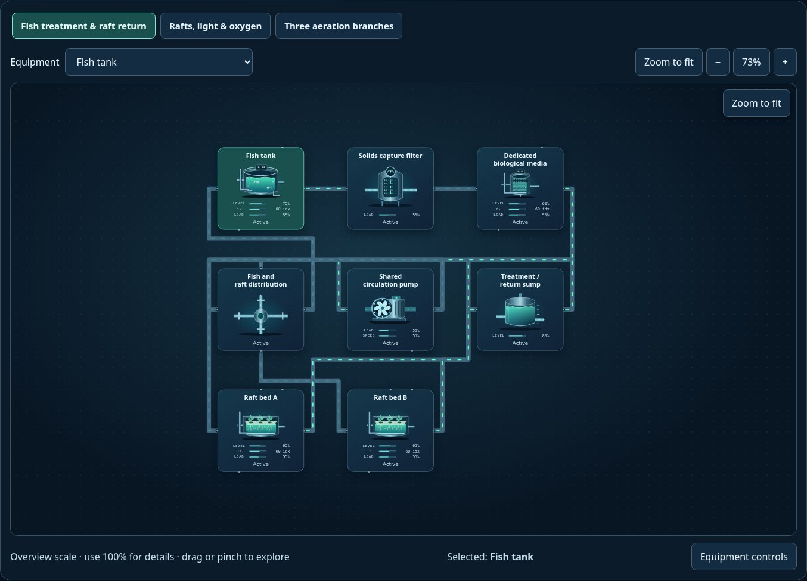
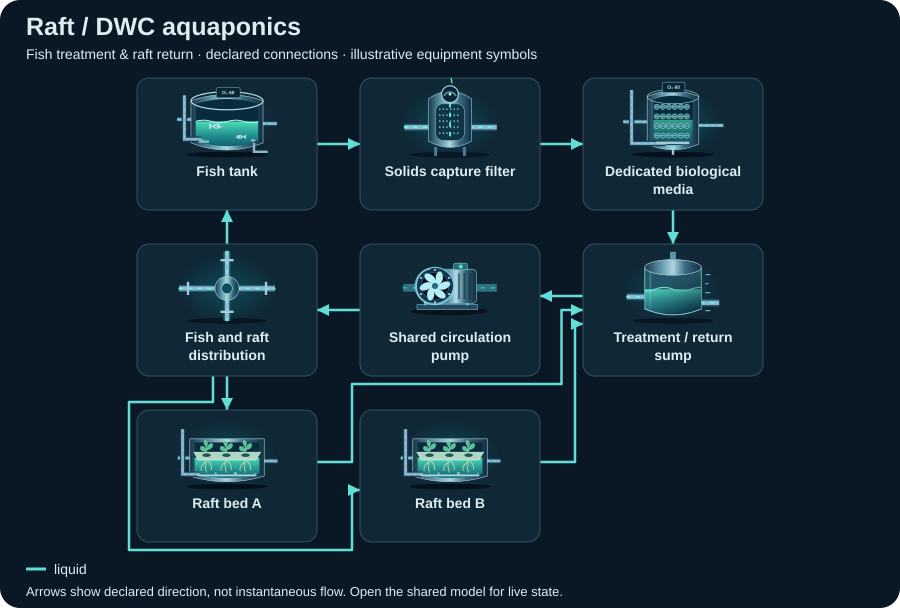

# Raft / DWC aquaponics

<!-- Generated by tools/webkit/scada/sim/generate-scenario-docs.py -->

Generated scenario map. Edit the [canonical JSON catalog](../index.json) or the local system/model JSON for facts; edit the [documentation generator](https://github.com/Valpatel/cad-agent/blob/main/tools/webkit/scada/sim/generate-scenario-docs.py) for layout. Run `npm run docs:scenarios` from the source repository. Check freshness with `npm run docs:scenarios:check`; do not hand-edit this output.

[Scenario map](../README.md) · [Package map](../../README.md) · [Model API](../../docs/MODEL-API.md)

Fish-water treatment feeds parallel floating-raft beds. Mechanical filtration, biological media and aeration have distinct roles.

**Model contract:** `scada-placeholder-model` v2. **Diagram contract:** `scada-system` v1.
This pair contains 17 equipment records, 30 declared connections and 3 focused views of one shared model.

The thumbnail is a captured initial state; it is not evidence of every fault or animation.
[Capture metadata](../../metadata/thumbnails.json) records its source and state.

## Files and editing

| File | Owns |
| --- | --- |
| [system.json](system.json) | Equipment identities/types/variants, ports, connections, focused layouts, bindings, controls and provenance |
| [model.json](model.json) | Versioned initial state, editable parameters and scenario/component assumptions |
| [../index.json](../index.json) | The `aquaponics-dwc` catalog entry: discovery metadata and experiment command recipes |

Use the [v2 model schema](../../schema/placeholder-model-v2.schema.json) and matching runtime validator when editing.
Keep component IDs synchronized between the two JSON documents. Parameters and
positions are authored teaching assumptions, not measured facility specifications.

## Topology: Fish treatment & raft return

**Legend:** equipment symbols identify the first focused view's assets; connectors
show declared relationships between them. The SVG is a compact schematic with
illustrative icon states, not a live snapshot or a prediction of instantaneous
flow. [system.json](system.json) retains full port identities, other views and
connections; [model.json](model.json) owns behavior and editable assumptions.

[Browse topology SVGs](../../img/topologies/README.md) · [Generation metadata](../../metadata/topologies.json)

| Focused view | ID | Equipment placements |
| --- | --- | ---: |
| Fish treatment & raft return | `water` | 8 |
| Rafts, light & oxygen | `roots` | 6 |
| Three aeration branches | `utilities` | 9 |

## Equipment and model roles

Roles below are the actual records in this scenario. A shared family name does
not imply a calibrated device equation. Circuit roles describe resource bookkeeping;
energy roles describe declared supply/conversion/load relationships.

| Equipment ID and label | Symbol | Model / declared domains |
| --- | --- | --- |
| `fish` · Fish tank | `fish-tank` | `storage`; water: water (storage); air: air (sink); zone: growRoom |
| `solidsFilter` · Solids capture filter | `filter` | `processor`; water: water (passage) |
| `biofilter` · Dedicated biological media | `biofilter` | `processor`; water: water (storage); air: air (sink); sludge: sludge (storage); zone: growRoom |
| `sump` · Treatment / return sump | `tank` | `storage`; water: water (storage) |
| `returnPump` · Shared circulation pump | `pump` / `water` | `pump`; water: water (passage); energy: load |
| `manifold` · Fish and raft distribution | `junction` | `pipe`; water: water (passage) |
| `raftA` · Raft bed A | `dwc-raft-bed` | `storage`; water: water (storage); air: air (sink); energy: load; zone: growRoom |
| `raftB` · Raft bed B | `dwc-raft-bed` | `storage`; water: water (storage); air: air (sink); energy: load; zone: growRoom |
| `sitePower` · Explicit grid-service boundary | `transformer` | `processor`; energy: source |
| `plc` · Shared growing-system controller | `plc-rack` | `controller`; energy: load |
| `airSupply` · Ambient-air blower · explicit source | `blower` | `pump`; air: air (source); energy: load |
| `fishAir` · Fish-tank air diffuser | `air-diffuser` | `processor`; air: air (passage); zone: growRoom |
| `bioAir` · Biofilter air diffuser | `air-diffuser` | `processor`; air: air (passage); zone: growRoom |
| `raftAir` · Raft-zone air diffuser | `air-diffuser` | `processor`; air: air (passage); zone: growRoom |
| `raftLight` · Growing-zone light | `grow-light` | `load`; energy: converter; zone: growRoom |
| `fishProbe` · Fish oxygen · illustrative index | `water-quality-probe` | `sensor`; energy: load; explicit observation |
| `raftProbe` · Raft oxygen · illustrative index | `water-quality-probe` | `sensor`; energy: load; explicit observation |

## Editable assumptions

The complete scenario and per-component assumptions are in [model.json](model.json).
Reference provenance and authored-layout declarations are in [system.json](system.json).
Key scope statements from this model:

- All sources, sinks, and environmental inputs are explicitly declared. Model values are normalized indices, not plant operating predictions.
- Structural references: A2, A4, A5; every model number remains an editable teaching guess.
- No fish welfare, nutrient sufficiency, crop yield, disease, irrigation schedule or real protection claim.

See the [agriculture reference notes](../../docs/agriculture-references.md) for
structural sources and their limits; biological responses remain illustrative.

## Authored experiments

The [catalog entry](../index.json) stores each recipe, expected observation and
limitation. These are editable playground commands, not operating procedures.
Run or step the shared model to observe time-dependent effects.

| Experiment | Commands |
| --- | --- |
| Stop raft A transfer (`isolate-raft`) | `setEnabled(equipment="raftA", value=false)` |
| Foul the solids filter (`foul-treatment`) | `setFault(equipment="solidsFilter", value="fouled")` |
| Stop the biofilter diffuser (`stop-bio-air`) | `setEnabled(equipment="bioAir", value=false)` |
| Disconnect the controller (`break-controller`) | `setFault(equipment="plc", value="comms-loss")` |

Serve the sibling packages over HTTP and open
`scada-sim/examples/explorer/?scenario=aquaponics-dwc`; see the
[runnable example map](../../examples/README.md). GitHub displays the JSON and
thumbnail but does not execute the Explorer. The host owns the clock and session.

[All scenarios](../README.md) · [Scenario image gallery](../../img/README.md) · [Integration](../../docs/INTEGRATION.md)
