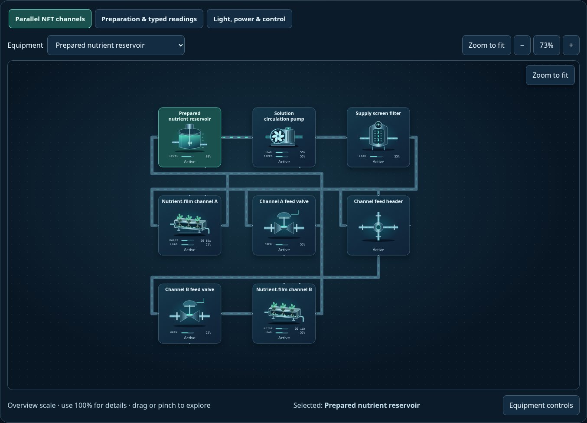
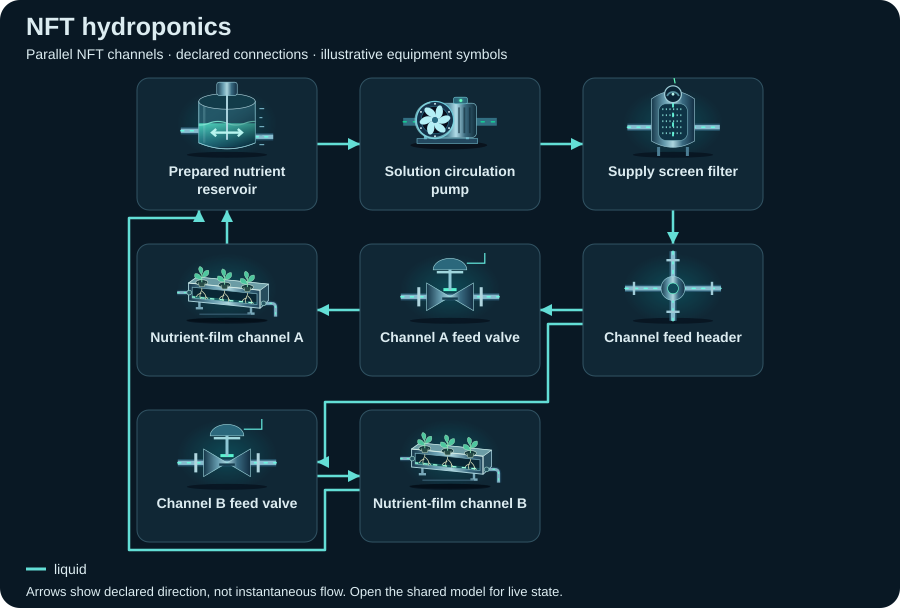

# NFT hydroponics

<!-- Generated by tools/webkit/scada/sim/generate-scenario-docs.py -->

Generated scenario map. Edit the [canonical JSON catalog](../index.json) or the local system/model JSON for facts; edit the [documentation generator](https://github.com/Valpatel/cad-agent/blob/dev/tools/webkit/scada/sim/generate-scenario-docs.py) for layout. Run `npm --prefix tools/webkit/scada run docs:scenarios` from the source repository. Check freshness with `npm --prefix tools/webkit/scada run docs:scenarios:check`; do not hand-edit this output.

[Scenario map](../README.md) · [Package map](../../README.md) · [Model API](../../docs/MODEL-API.md)

A prepared solution reservoir feeds two separately valved shallow channels and a common return. Probe identities remain pH, EC and dissolved oxygen indices.

**Model contract:** `scada-placeholder-model` v2. **Diagram contract:** `scada-system` v1.
This pair contains 17 equipment records, 32 declared connections and 3 focused views of one shared model.

The thumbnail is a captured initial state; it is not evidence of every fault or animation.
[Capture metadata](../../metadata/thumbnails.json) records its source and state.

## Files and editing

| File | Owns |
| --- | --- |
| [system.json](system.json) | Equipment identities/types/variants, ports, connections, focused layouts, bindings, controls and provenance |
| [model.json](model.json) | Versioned initial state, editable parameters and scenario/component assumptions |
| [../index.json](../index.json) | The `hydroponics-nft` catalog entry: discovery metadata and experiment command recipes |

Use the [v2 model schema](../../schema/placeholder-model-v2.schema.json) and matching runtime validator when editing.
Keep component IDs synchronized between the two JSON documents. Parameters and
positions are authored teaching assumptions, not measured facility specifications.

## Topology: Parallel NFT channels

**Legend:** equipment symbols identify the first focused view's assets; connectors
show declared relationships between them. The SVG is a compact schematic with
illustrative icon states, not a live snapshot or a prediction of instantaneous
flow. [system.json](system.json) retains full port identities, other views and
connections; [model.json](model.json) owns behavior and editable assumptions.

[Browse topology SVGs](../../img/topologies/README.md) · [Generation metadata](../../metadata/topologies.json)

| Focused view | ID | Equipment placements |
| --- | --- | ---: |
| Parallel NFT channels | `water` | 8 |
| Preparation & typed readings | `preparation` | 6 |
| Light, power & control | `utilities` | 9 |

## Equipment and model roles

Roles below are the actual records in this scenario. A shared family name does
not imply a calibrated device equation. Circuit roles describe resource bookkeeping;
energy roles describe declared supply/conversion/load relationships.

| Equipment ID and label | Symbol | Model / declared domains |
| --- | --- | --- |
| `reservoir` · Prepared nutrient reservoir | `mixing-tank` | `processor`; water: water (storage); energy: load; zone: growRoom |
| `supplyPump` · Solution circulation pump | `pump` / `water` | `pump`; water: water (passage); energy: load |
| `screen` · Supply screen filter | `filter` | `processor`; water: water (passage) |
| `header` · Channel feed header | `junction` | `pipe`; water: water (passage) |
| `valveA` · Channel A feed valve | `control-valve` / `water` | `valve`; water: water (passage) |
| `channelA` · Nutrient-film channel A | `nft-channel` | `processor`; water: water (passage); energy: load; zone: growRoom |
| `valveB` · Channel B feed valve | `control-valve` / `water` | `valve`; water: water (passage) |
| `channelB` · Nutrient-film channel B | `nft-channel` | `processor`; water: water (passage); energy: load; zone: growRoom |
| `sitePower` · Explicit grid-service boundary | `transformer` | `processor`; energy: source |
| `plc` · Shared growing-system controller | `plc-rack` | `controller`; energy: load |
| `lightA` · Channel A growing light | `grow-light` | `load`; energy: converter; zone: growRoom |
| `lightB` · Channel B growing light | `grow-light` | `load`; energy: converter; zone: growRoom |
| `makeup` · Finite makeup / nutrient feed | `tank` | `storage`; water: water (storage) |
| `metering` · Manual makeup metering pump | `dosing-pump` | `pump`; chemical: water (passage); energy: load |
| `phProbe` · pH · illustrative index | `water-quality-probe` | `sensor`; energy: load; explicit observation |
| `ecProbe` · Conductivity · illustrative index | `water-quality-probe` | `sensor`; energy: load; explicit observation |
| `doProbe` · Dissolved oxygen · illustrative index | `water-quality-probe` | `sensor`; energy: load; explicit observation |

## Editable assumptions

The complete scenario and per-component assumptions are in [model.json](model.json).
Reference provenance and authored-layout declarations are in [system.json](system.json).
Key scope statements from this model:

- All sources, sinks, and environmental inputs are explicitly declared. Model values are normalized indices, not plant operating predictions.
- Structural references: A1, A5, A6; every model number remains an editable teaching guess.
- No fish welfare, nutrient sufficiency, crop yield, disease, irrigation schedule or real protection claim.

See the [agriculture reference notes](https://github.com/Valpatel/cad-agent/blob/dev/software/cadagent/webkit/scada/ui/docs/AGRICULTURE_REFERENCES.md) for
structural sources and their limits; biological responses remain illustrative.

## Authored experiments

The [catalog entry](../index.json) stores each recipe, expected observation and
limitation. These are editable playground commands, not operating procedures.
Run or step the shared model to observe time-dependent effects.

| Experiment | Commands |
| --- | --- |
| Close channel A feed (`isolate-channel`) | `setOpen(equipment="valveA", value=false)` |
| Block channel B (`block-channel`) | `setFault(equipment="channelB", value="blocked")` |
| Bias the EC illustration (`bias-ec`) | `setFault(equipment="ecProbe", value="drift")` |
| Enable finite makeup feed (`add-makeup`) | `setEnabled(equipment="metering", value=true)` |

Serve the sibling packages over HTTP and open
[Explorer](../../../explorer/index.html?scenario=hydroponics-nft); see the
[host instructions](../../../explorer/README.md). GitHub displays the JSON and
thumbnail but does not execute the Explorer. The host owns the clock and session.

[All scenarios](../README.md) · [Scenario image gallery](../../img/README.md) · [Integration](../../docs/INTEGRATION.md)
