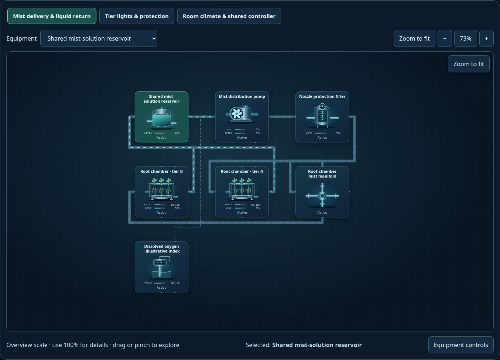
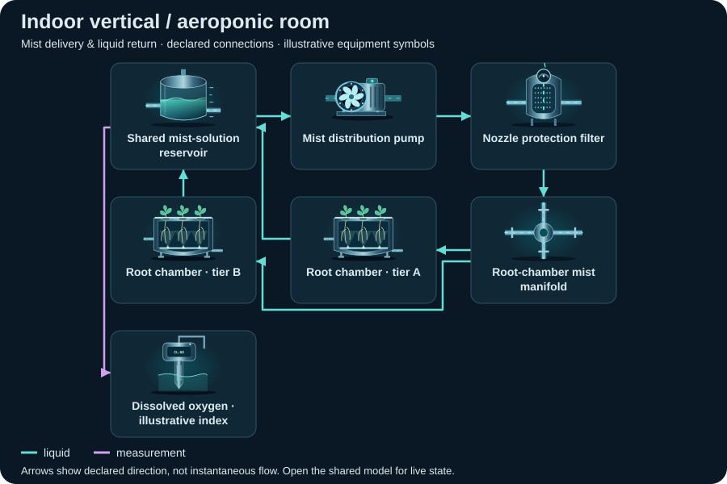

# Indoor vertical / aeroponic room

<!-- Generated by tools/webkit/scada/sim/generate-scenario-docs.py -->

Generated scenario map. Edit the [canonical JSON catalog](../index.json) or the local system/model JSON for facts; edit the [documentation generator](https://github.com/Valpatel/cad-agent/blob/dev/tools/webkit/scada/sim/generate-scenario-docs.py) for layout. Run `npm --prefix tools/webkit/scada run docs:scenarios` from the source repository. Check freshness with `npm --prefix tools/webkit/scada run docs:scenarios:check`; do not hand-edit this output.

[Scenario map](../README.md) · [Package map](../../README.md) · [Model API](../../docs/MODEL-API.md)

Two independently identified root chambers share mist delivery and room climate, while tier lights have separate electrical protection and controls.

**Model contract:** `scada-placeholder-model` v2. **Diagram contract:** `scada-system` v1.
This pair contains 18 equipment records, 32 declared connections and 3 focused views of one shared model.

The thumbnail is a captured initial state; it is not evidence of every fault or animation.
[Capture metadata](../../metadata/thumbnails.json) records its source and state.

## Files and editing

| File | Owns |
| --- | --- |
| [system.json](system.json) | Equipment identities/types/variants, ports, connections, focused layouts, bindings, controls and provenance |
| [model.json](model.json) | Versioned initial state, editable parameters and scenario/component assumptions |
| [../index.json](../index.json) | The `indoor-aeroponics` catalog entry: discovery metadata and experiment command recipes |

Use the [v2 model schema](../../schema/placeholder-model-v2.schema.json) and matching runtime validator when editing.
Keep component IDs synchronized between the two JSON documents. Parameters and
positions are authored teaching assumptions, not measured facility specifications.

## Topology: Mist delivery & liquid return

**Legend:** equipment symbols identify the first focused view's assets; connectors
show declared relationships between them. The SVG is a compact schematic with
illustrative icon states, not a live snapshot or a prediction of instantaneous
flow. [system.json](system.json) retains full port identities, other views and
connections; [model.json](model.json) owns behavior and editable assumptions.

[Browse topology SVGs](../../img/topologies/README.md) · [Generation metadata](../../metadata/topologies.json)

| Focused view | ID | Equipment placements |
| --- | --- | ---: |
| Mist delivery & liquid return | `water` | 7 |
| Tier lights & protection | `light` | 8 |
| Room climate & shared controller | `climate` | 8 |

## Equipment and model roles

Roles below are the actual records in this scenario. A shared family name does
not imply a calibrated device equation. Circuit roles describe resource bookkeeping;
energy roles describe declared supply/conversion/load relationships.

| Equipment ID and label | Symbol | Model / declared domains |
| --- | --- | --- |
| `reservoir` · Shared mist-solution reservoir | `tank` | `storage`; water: water (storage) |
| `mistPump` · Mist distribution pump | `pump` / `water` | `pump`; water: water (passage); energy: load |
| `filter` · Nozzle protection filter | `filter` | `processor`; water: water (passage) |
| `manifold` · Root-chamber mist manifold | `junction` | `pipe`; water: water (passage) |
| `chamberA` · Root chamber · tier A | `aeroponic-chamber` | `storage`; water: water (storage); energy: load; zone: growRoom |
| `chamberB` · Root chamber · tier B | `aeroponic-chamber` | `storage`; water: water (storage); energy: load; zone: growRoom |
| `sitePower` · Explicit grid-service boundary | `transformer` | `processor`; energy: source |
| `plc` · Shared growing-system controller | `plc-rack` | `controller`; energy: load |
| `breakerA` · Tier A light breaker | `breaker` | `valve`; energy: relay |
| `lightA` · Tier A LED light | `grow-light` | `load`; energy: converter; zone: growRoom |
| `breakerB` · Tier B light breaker | `breaker` | `valve`; energy: relay |
| `lightB` · Tier B LED light | `grow-light` | `load`; energy: converter; zone: growRoom |
| `roomFan` · Room-air circulation boundary | `fan` | `load`; air: room-air (source); energy: load; zone: growRoom |
| `dehumidifier` · Room dehumidification unit | `dehumidifier` | `processor`; air: room-air (sink); water: collection-water (passage); energy: load; zone: growRoom |
| `condensate` · Condensate collection | `tank` | `storage`; water: collection-water (storage) |
| `humidityProbe` · Room humidity · illustrative index | `humidity-sensor` | `sensor`; energy: load; explicit observation; zone: growRoom |
| `lightProbe` · Light · illustrative index | `light-sensor` | `sensor`; energy: load; explicit observation; zone: growRoom |
| `waterProbe` · Dissolved oxygen · illustrative index | `water-quality-probe` | `sensor`; energy: load; explicit observation |

## Editable assumptions

The complete scenario and per-component assumptions are in [model.json](model.json).
Reference provenance and authored-layout declarations are in [system.json](system.json).
Key scope statements from this model:

- All sources, sinks, and environmental inputs are explicitly declared. Model values are normalized indices, not plant operating predictions.
- Structural references: A1, A5, A11, A12; every model number remains an editable teaching guess.
- No fish welfare, nutrient sufficiency, crop yield, disease, irrigation schedule or real protection claim.

See the [agriculture reference notes](https://github.com/Valpatel/cad-agent/blob/dev/software/cadagent/webkit/scada/ui/docs/AGRICULTURE_REFERENCES.md) for
structural sources and their limits; biological responses remain illustrative.

## Authored experiments

The [catalog entry](../index.json) stores each recipe, expected observation and
limitation. These are editable playground commands, not operating procedures.
Run or step the shared model to observe time-dependent effects.

| Experiment | Commands |
| --- | --- |
| Interrupt mist delivery (`interrupt-mist`) | `setEnabled(equipment="mistPump", value=false)` |
| Clog tier A nozzles (`clog-nozzles`) | `setFault(equipment="chamberA", value="nozzle-fault")` |
| Open tier B light breaker (`trip-light`) | `setOpen(equipment="breakerB", value=true)` |
| Stop dehumidification (`stop-drying`) | `setEnabled(equipment="dehumidifier", value=false)` |
| Reduce tier A mist duty (`change-mist-duty`) | `setParameter(equipment="chamberA", value=25, key="mistDuty")` |

Serve the sibling packages over HTTP and open
[Explorer](../../../explorer/index.html?scenario=indoor-aeroponics); see the
[host instructions](../../../explorer/README.md). GitHub displays the JSON and
thumbnail but does not execute the Explorer. The host owns the clock and session.

[All scenarios](../README.md) · [Scenario image gallery](../../img/README.md) · [Integration](../../docs/INTEGRATION.md)
