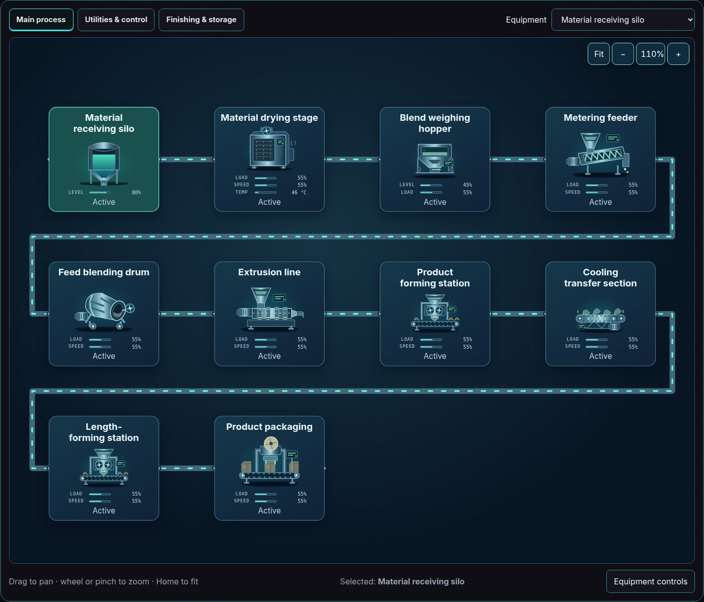
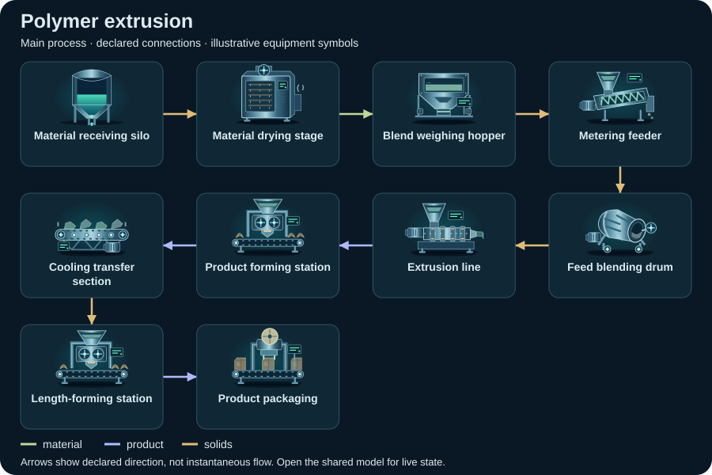

# Polymer extrusion

<!-- Generated by tools/webkit/scada/sim/generate-scenario-docs.py -->

Generated scenario map. Edit the [canonical JSON catalog](../index.json) or the local system/model JSON for facts; edit the [documentation generator](https://github.com/Valpatel/cad-agent/blob/dev/tools/webkit/scada/sim/generate-scenario-docs.py) for layout. Run `npm --prefix tools/webkit/scada run docs:scenarios` from the source repository. Check freshness with `npm --prefix tools/webkit/scada run docs:scenarios:check`; do not hand-edit this output.

[Scenario map](../README.md) · [Package map](../../README.md) · [Model API](../../docs/MODEL-API.md)

Receive, dry and meter generic material, then blend, extrude, form, cool and pack. Material chemistry, tooling and processing recipes are not represented.

**Model contract:** `scada-placeholder-model` v1. **Diagram contract:** `scada-system` v1.
This pair contains 15 equipment records, 25 declared connections and 3 focused views of one shared model.

The thumbnail is a captured initial state; it is not evidence of every fault or animation.
[Capture metadata](../../metadata/thumbnails.json) records its source and state.

## Files and editing

| File | Owns |
| --- | --- |
| [system.json](system.json) | Equipment identities/types/variants, ports, connections, focused layouts, bindings, controls and provenance |
| [model.json](model.json) | Versioned initial state, editable parameters and scenario/component assumptions |
| [../index.json](../index.json) | The `polymer-extrusion` catalog entry: discovery metadata and experiment command recipes |

Use the [v1 model schema](../../schema/placeholder-model-v1.schema.json) and matching runtime validator when editing.
Keep component IDs synchronized between the two JSON documents. Parameters and
positions are authored teaching assumptions, not measured facility specifications.

## Topology: Main process

**Legend:** equipment symbols identify the selected focused view's assets; connectors
show declared relationships between them. The SVG is a compact schematic with
illustrative icon states, not a live snapshot or a prediction of instantaneous
flow. [system.json](system.json) retains full port identities, other views and
connections; [model.json](model.json) owns behavior and editable assumptions.

[Browse topology SVGs](../../img/topologies/README.md) · [Generation metadata](../../metadata/topologies.json)

3 focused views of this system

| Focused view | ID | Equipment placements |
| --- | --- | ---: |
| Main process | `process` | 10 |
| Utilities & control | `utilities` | 7 |
| Finishing & storage | `finishing` | 7 |

## Equipment and model roles

Roles below are the actual records in this scenario. A shared family name does
not imply a calibrated device equation. Circuit roles describe resource bookkeeping;
energy roles describe declared supply/conversion/load relationships.

Inspect the 15 equipment records and model roles

| Equipment ID and label | Symbol | Model / declared domains |
| --- | --- | --- |
| `resin` · Material receiving silo | `silo` | `source` |
| `dryer` · Material drying stage | `dryer` | `heater` |
| `hopper` · Blend weighing hopper | `weigh-hopper` | `storage` |
| `feeder` · Metering feeder | `screw-feeder` | `processor` |
| `blend` · Feed blending drum | `drum-mixer` | `processor` |
| `extruder` · Extrusion line | `extruder` | `processor` |
| `former` · Product forming station | `forming-machine` | `processor` |
| `coolingTransfer` · Cooling transfer section | `conveyor` | `processor` |
| `cutting` · Length-forming station | `forming-machine` | `processor` |
| `packer` · Product packaging | `packaging-line` | `sink` |
| `tower` · Illustrative cooling-water tower | `cooling-tower` | `heater` |
| `power` · Demonstration site power | `generator` | `generator` |
| `distribution` · Extrusion power distribution | `busbar` | `pipe` |
| `controller` · Extrusion controller | `plc-rack` | `controller` |
| `temperature` · Barrel display probe | `temperature-sensor` | `sensor` |

## Editable assumptions

The complete scenario and per-component assumptions are in [model.json](model.json).
Reference provenance and authored-layout declarations are in [system.json](system.json).
Key scope statements from this model:

- All quantities are editable normalized placeholders. Stage names do not supply a production recipe, validated quality criterion or real protection setting.
- Material, electrical, thermal, data and measurement connections have separate roles. The external model owns one shared state and clock for every view.
- Repair clears component damage; it does not undo intentionally changed load, valves, capacity or other operating inputs.
- Optional utility skids illustrate dependency plumbing and are not claims about standard industry equipment or energy performance.

## Authored experiments

The [catalog entry](../index.json) stores each recipe, expected observation and
limitation. These are editable playground commands, not operating procedures.
Run or step the shared model to observe time-dependent effects.

Inspect 4 experiment recipes and commands

| Experiment | Commands |
| --- | --- |
| Stop material receiving silo (`starve-feed`) | `setEnabled(equipment="resin", value=false)` |
| Overload material drying stage (`overload-stage`) | `setParameter(equipment="dryer", key="capacity", value=25)`; `setLoad(equipment="dryer", value=95)` |
| Break material drying stage (`break-stage`) | `setFault(equipment="dryer", value=true)` |
| Trip the demonstration power source (`trip-power`) | `setFault(equipment="power", value=true)` |

Serve the sibling packages over HTTP and open
[Explorer](../../../explorer/index.html?scenario=polymer-extrusion); see the
[host instructions](../../../explorer/README.md). GitHub displays the JSON and
thumbnail but does not execute the Explorer. The host owns the clock and session.

[All scenarios](../README.md) · [Scenario image gallery](../../img/README.md) · [Integration](../../docs/INTEGRATION.md)
