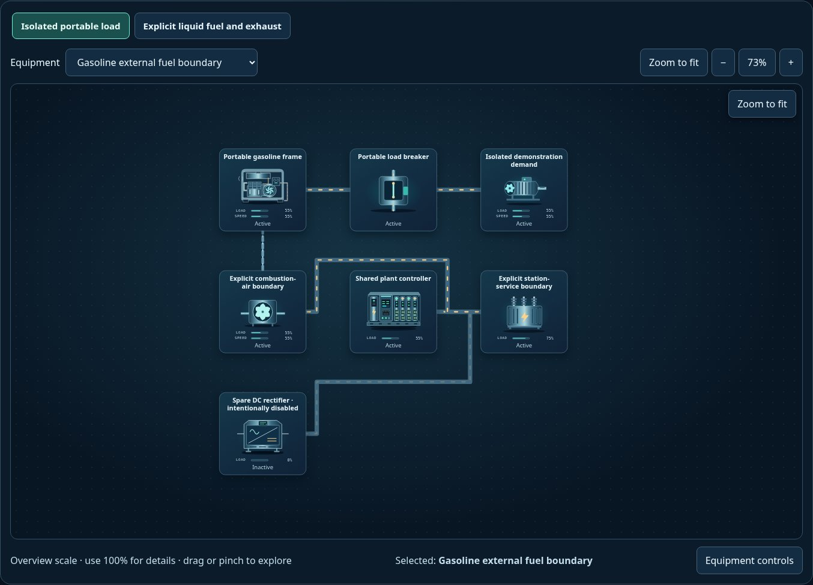
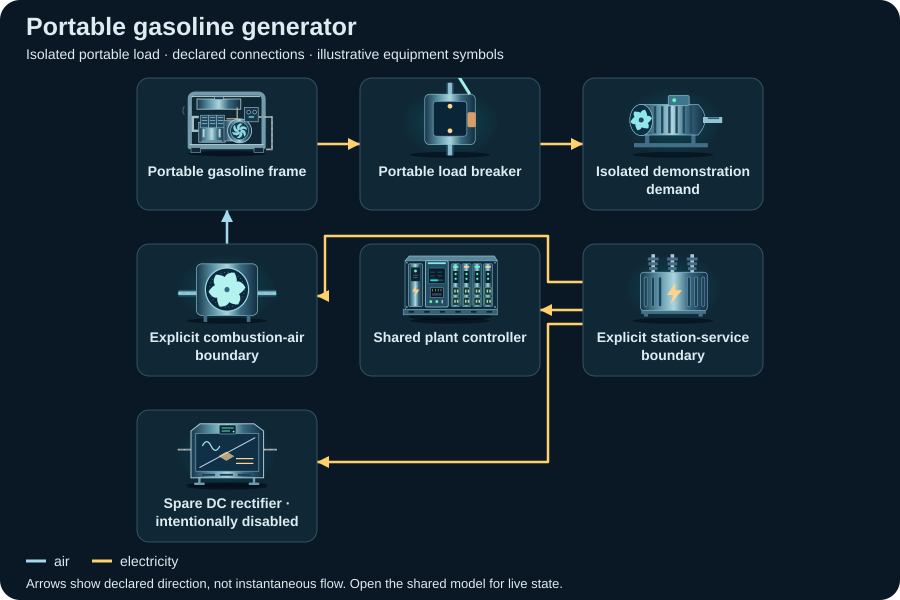

# Portable gasoline generator

<!-- Generated by tools/webkit/scada/sim/generate-scenario-docs.py -->

Generated scenario map. Edit the [canonical JSON catalog](../index.json) or the local system/model JSON for facts; edit the [documentation generator](https://github.com/Valpatel/cad-agent/blob/dev/tools/webkit/scada/sim/generate-scenario-docs.py) for layout. Run `npm --prefix tools/webkit/scada run docs:scenarios` from the source repository. Check freshness with `npm --prefix tools/webkit/scada run docs:scenarios:check`; do not hand-edit this output.

[Scenario map](../README.md) · [Package map](../../README.md) · [Model API](../../docs/MODEL-API.md)

Explicit small liquid-fuel supply → portable gasoline genset → isolated breaker and demonstration load. No utility backfeed connection is drawn.

**Model contract:** `scada-placeholder-model` v2. **Diagram contract:** `scada-system` v1.
This pair contains 10 equipment records, 10 declared connections and 2 focused views of one shared model.

The thumbnail is a captured initial state; it is not evidence of every fault or animation.
[Capture metadata](../../metadata/thumbnails.json) records its source and state.

## Files and editing

| File | Owns |
| --- | --- |
| [system.json](system.json) | Equipment identities/types/variants, ports, connections, focused layouts, bindings, controls and provenance |
| [model.json](model.json) | Versioned initial state, editable parameters and scenario/component assumptions |
| [../index.json](../index.json) | The `power-gasoline-portable` catalog entry: discovery metadata and experiment command recipes |

Use the [v2 model schema](../../schema/placeholder-model-v2.schema.json) and matching runtime validator when editing.
Keep component IDs synchronized between the two JSON documents. Parameters and
positions are authored teaching assumptions, not measured facility specifications.

## Topology: Isolated portable load

**Legend:** equipment symbols identify the first focused view's assets; connectors
show declared relationships between them. The SVG is a compact schematic with
illustrative icon states, not a live snapshot or a prediction of instantaneous
flow. [system.json](system.json) retains full port identities, other views and
connections; [model.json](model.json) owns behavior and editable assumptions.

[Browse topology SVGs](../../img/topologies/README.md) · [Generation metadata](../../metadata/topologies.json)

| Focused view | ID | Equipment placements |
| --- | --- | ---: |
| Isolated portable load | `load` | 7 |
| Explicit liquid fuel and exhaust | `fuel` | 4 |

## Equipment and model roles

Roles below are the actual records in this scenario. A shared family name does
not imply a calibrated device equation. Circuit roles describe resource bookkeeping;
energy roles describe declared supply/conversion/load relationships.

| Equipment ID and label | Symbol | Model / declared domains |
| --- | --- | --- |
| `fuel` · Gasoline external fuel boundary | `tank` | `storage`; water: gasoline (source) |
| `feed` · Liquid-fuel transfer | `pump` / `liquid-fuel` | `pump`; process: gasoline (passage); energy: load |
| `engine` · Portable gasoline frame | `generator` / `gasoline-portable` | `generator`; fuel: gasoline (sink); air-exhaust: combustion-gas (passage); energy: source; retained heat |
| `stack` · Explicit engine-exhaust boundary | `gas-holder` | `storage`; gas: combustion-gas (sink) |
| `load` · Isolated demonstration demand | `motor` | `load`; energy: load |
| `breaker` · Portable load breaker | `breaker` | `valve`; energy: relay |
| `station` · Explicit station-service boundary | `transformer` | `processor`; energy: source |
| `plc` · Shared plant controller | `plc-rack` | `controller`; energy: load |
| `dcService` · Spare DC rectifier · intentionally disabled | `power-rectifier` | `power-converter`; energy: converter |
| `engineAir` · Explicit combustion-air boundary | `fan` | `load`; air: combustion-gas (source); energy: load |

## Editable assumptions

The complete scenario and per-component assumptions are in [model.json](model.json).
Reference provenance and authored-layout declarations are in [system.json](system.json).
Key scope statements from this model:

- All sources, sinks, and environmental inputs are explicitly declared. Model values are normalized indices, not plant operating predictions.
- Structural references support equipment roles and separate circuit relationships. Every parameter, display rating and layout is an editable illustrative assumption.
- Each view reads one external model. View selection and inspector use do not create a new physics island or change time.
- This conceptual factory model has no calibrated engineering, protection or nuclear-operation meaning. Replace the model through the adapter contract for real-system integration.

See the [power reference notes](https://github.com/Valpatel/cad-agent/blob/dev/software/cadagent/webkit/scada/ui/docs/POWER_REFERENCES.md) for the
structural sources and their limits. Reference-backed topology does not validate model numbers.

## Authored experiments

The [catalog entry](../index.json) stores each recipe, expected observation and
limitation. These are editable playground commands, not operating procedures.
Run or step the shared model to observe time-dependent effects.

| Experiment | Commands |
| --- | --- |
| Stop Liquid-fuel transfer (`stop-source`) | `setEnabled(equipment="feed", value=false)` |
| Fault Portable gasoline frame (`inject-fault`) | `setFault(equipment="engine", value=true)` |
| Isolate Portable load breaker (`isolate-output`) | `setOpen(equipment="breaker", value=true)` |
| Raise the selected stage demand (`stress-stage`) | `setParameter(equipment="feed", key="capacity", value=25)`; `setLoad(equipment="feed", value=95)` |

Serve the sibling packages over HTTP and open
[Explorer](../../../explorer/index.html?scenario=power-gasoline-portable); see the
[host instructions](../../../explorer/README.md). GitHub displays the JSON and
thumbnail but does not execute the Explorer. The host owns the clock and session.

[All scenarios](../README.md) · [Scenario image gallery](../../img/README.md) · [Integration](../../docs/INTEGRATION.md)
