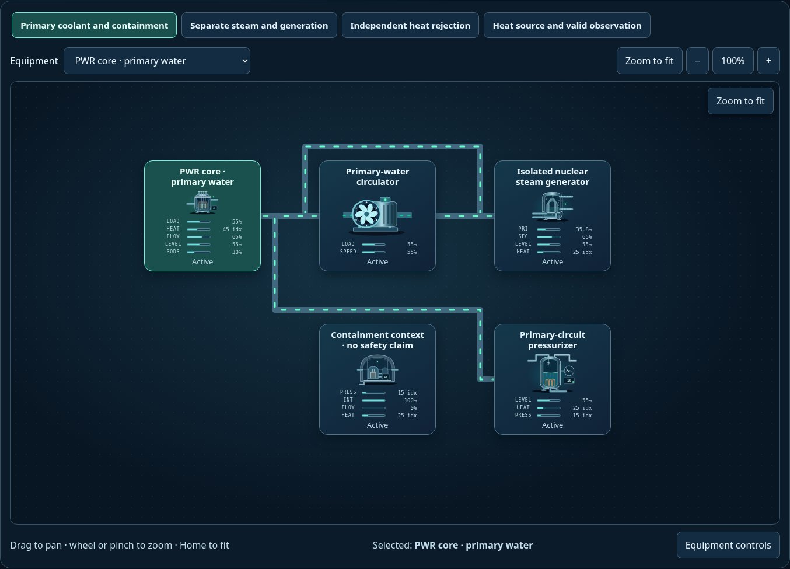
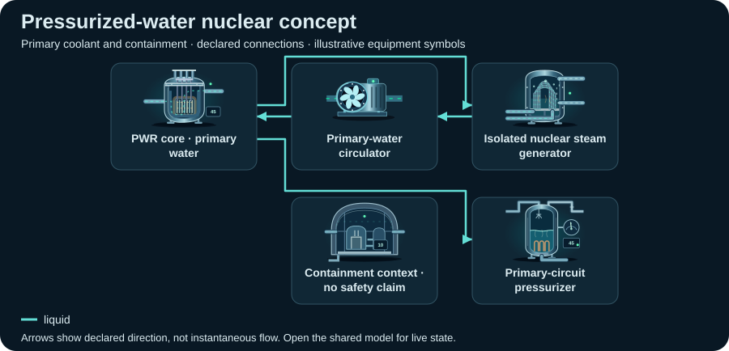

# Pressurized-water nuclear concept

<!-- Generated by tools/webkit/scada/sim/generate-scenario-docs.py -->

Generated scenario map. Edit the [canonical JSON catalog](../index.json) or the local system/model JSON for facts; edit the [documentation generator](https://github.com/Valpatel/cad-agent/blob/main/tools/webkit/scada/sim/generate-scenario-docs.py) for layout. Run `npm --prefix tools/webkit/scada run docs:scenarios` from the source repository. Check freshness with `npm --prefix tools/webkit/scada run docs:scenarios:check`; do not hand-edit this output.

[Scenario map](../README.md) · [Package map](../../README.md) · [Model API](../../docs/MODEL-API.md)

Primary-water coolant circulates from reactor through steam-generator primary and back. Separate secondary water boils in the generator, drives the turbine, condenses and returns; independent water cools the condenser.

**Model contract:** `scada-placeholder-model` v2. **Diagram contract:** `scada-system` v1.
This pair contains 22 equipment records, 35 declared connections and 4 focused views of one shared model.

The thumbnail is a captured initial state; it is not evidence of every fault or animation.
[Capture metadata](../../metadata/thumbnails.json) records its source and state.

## Files and editing

| File | Owns |
| --- | --- |
| [system.json](system.json) | Equipment identities/types/variants, ports, connections, focused layouts, bindings, controls and provenance |
| [model.json](model.json) | Versioned initial state, editable parameters and scenario/component assumptions |
| [../index.json](../index.json) | The `power-nuclear-pwr` catalog entry: discovery metadata and experiment command recipes |

Use the [v2 model schema](../../schema/placeholder-model-v2.schema.json) and matching runtime validator when editing.
Keep component IDs synchronized between the two JSON documents. Parameters and
positions are authored teaching assumptions, not measured facility specifications.

## Topology: Primary coolant and containment

**Legend:** equipment symbols identify the first focused view's assets; connectors
show declared relationships between them. The SVG is a compact schematic with
illustrative icon states, not a live snapshot or a prediction of instantaneous
flow. [system.json](system.json) retains full port identities, other views and
connections; [model.json](model.json) owns behavior and editable assumptions.

[Browse topology SVGs](../../img/topologies/README.md) · [Generation metadata](../../metadata/topologies.json)

| Focused view | ID | Equipment placements |
| --- | --- | ---: |
| Primary coolant and containment | `primary` | 5 |
| Separate steam and generation | `steam` | 7 |
| Independent heat rejection | `cooling` | 8 |
| Heat source and valid observation | `control` | 8 |

## Equipment and model roles

Roles below are the actual records in this scenario. A shared family name does
not imply a calibrated device equation. Circuit roles describe resource bookkeeping;
energy roles describe declared supply/conversion/load relationships.

| Equipment ID and label | Symbol | Model / declared domains |
| --- | --- | --- |
| `core` · PWR core · primary water | `pwr-reactor-vessel` | `conceptual-heat-source`; primary: primary-water (storage); retained heat |
| `primaryPump` · Primary-water circulator | `pump` / `water` | `pump`; process: primary-water (passage); energy: load |
| `steamGenerator` · Isolated nuclear steam generator | `nuclear-steam-generator` / `water-primary` | `heat-exchanger`; primary: primary-water (storage); secondary: secondary-water (storage) |
| `pressurizer` · Primary-circuit pressurizer | `pressurizer` | `thermal-storage`; primary: primary-water (storage); energy: load |
| `turbine` · Integrated steam turbine-generator | `steam-turbine` | `generator`; water: secondary-water (passage); energy: source |
| `condenser` · Isolated surface condenser | `surface-condenser` | `heat-exchanger`; condensing: secondary-water (storage); cooling: cooling-water (storage) |
| `feedPump` · Closed-cycle feedwater pump | `pump` / `water` | `pump`; process: secondary-water (passage); energy: load |
| `coolingTower` · Independent cooling-water loop | `cooling-tower` | `heater`; water: cooling-water (passage); air: air (passage); energy: load; retained heat |
| `coolingPump` · Cooling-water circulation pump | `pump` / `water` | `pump`; process: cooling-water (passage); energy: load |
| `rods` · Rod position · fictional heat command | `control-rod-drive` | `actuator`; energy: load |
| `neutron` · Fictional neutron index | `neutron-monitor` | `sensor`; energy: load; explicit observation |
| `containment` · Containment context · no safety claim | `containment-structure` | `enclosure`; atmosphere: air (passage); collection: collection-water (passage) |
| `radiation` · Fictional containment index | `radiation-monitor` | `sensor`; energy: load; explicit observation |
| `transformer` · Export transformer | `transformer` | `processor`; energy: relay |
| `exportBreaker` · Export breaker | `hv-circuit-breaker` | `switch`; energy: relay |
| `load` · Explicit external electrical demand | `motor` | `load`; energy: load |
| `station` · Explicit station-service boundary | `transformer` | `processor`; energy: source |
| `plc` · Shared plant controller | `plc-rack` | `controller`; energy: load |
| `dcService` · Explicit station AC/DC service | `power-rectifier` | `power-converter`; energy: converter |
| `fuelPool` · Independent used-fuel pool | `used-fuel-pool` | `thermal-storage`; pool: pool-water (storage); retained heat |
| `poolPump` · Independent pool circulation | `pump` / `water` | `pump`; process: pool-water (passage); energy: load |
| `poolCooler` · Pool-water heat exchanger | `heat-exchanger` / `water-water` | `heater`; hot: pool-water (passage); cold: cooling-water (passage); retained heat |

## Editable assumptions

The complete scenario and per-component assumptions are in [model.json](model.json).
Reference provenance and authored-layout declarations are in [system.json](system.json).
Key scope statements from this model:

- All sources, sinks, and environmental inputs are explicitly declared. Model values are normalized indices, not plant operating predictions.
- Structural references support equipment roles and separate circuit relationships. Every parameter, display rating and layout is an editable illustrative assumption.
- Each view reads one external model. View selection and inspector use do not create a new physics island or change time.
- This conceptual factory model has no calibrated engineering, protection or nuclear-operation meaning. Replace the model through the adapter contract for real-system integration.

See the [power reference notes](../../docs/power-sector-references.md) for the
structural sources and their limits. Reference-backed topology does not validate model numbers.

## Authored experiments

The [catalog entry](../index.json) stores each recipe, expected observation and
limitation. These are editable playground commands, not operating procedures.
Run or step the shared model to observe time-dependent effects.

| Experiment | Commands |
| --- | --- |
| Stop PWR core · primary water (`stop-source`) | `setEnabled(equipment="core", value=false)` |
| Fault Primary-water circulator (`inject-fault`) | `setFault(equipment="primaryPump", value=true)` |
| Isolate Export breaker (`isolate-output`) | `setOpen(equipment="exportBreaker", value=true)` |
| Raise the selected stage demand (`stress-stage`) | `setParameter(equipment="core", key="capacity", value=25)`; `setLoad(equipment="core", value=95)` |
| Reduce fictional core heat demand (`insert-rods`) | `setRodPosition(equipment="core", value=100)` |

Serve the sibling packages over HTTP and open
`scada-sim/examples/explorer/?scenario=power-nuclear-pwr`; see the
[runnable example map](../../examples/README.md). GitHub displays the JSON and
thumbnail but does not execute the Explorer. The host owns the clock and session.

[All scenarios](../README.md) · [Scenario image gallery](../../img/README.md) · [Integration](../../docs/INTEGRATION.md)
