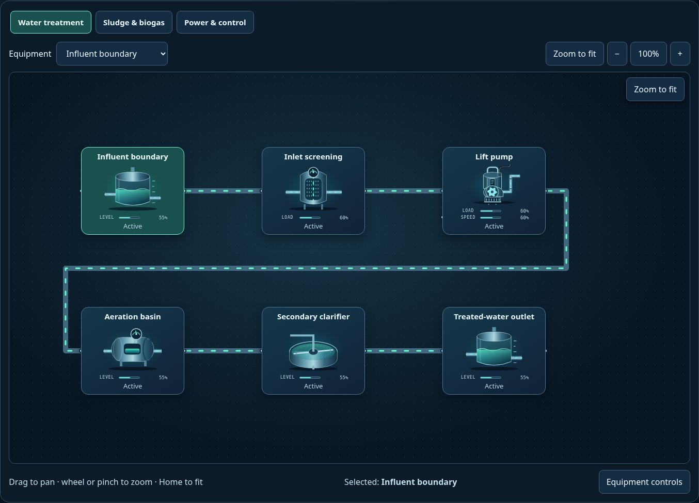
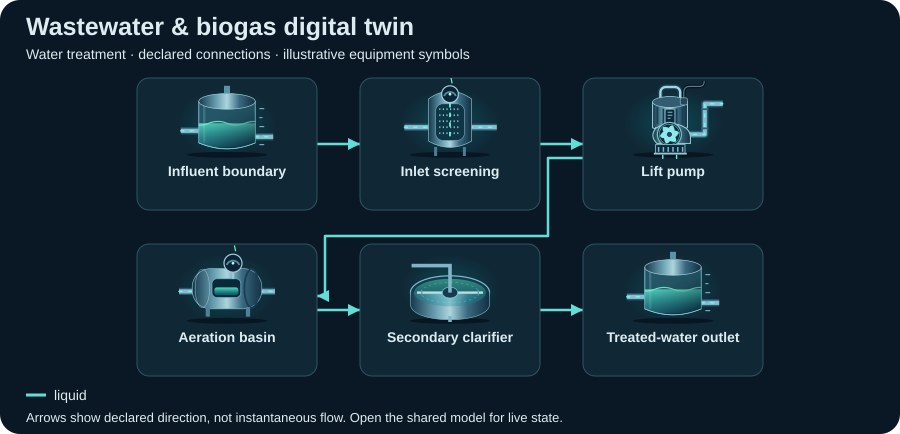

# Wastewater & biogas digital twin

<!-- Generated by tools/webkit/scada/sim/generate-scenario-docs.py -->

Generated scenario map. Edit the [canonical JSON catalog](../index.json) or the local system/model JSON for facts; edit the [documentation generator](https://github.com/Valpatel/cad-agent/blob/main/tools/webkit/scada/sim/generate-scenario-docs.py) for layout. Run `npm --prefix tools/webkit/scada run docs:scenarios` from the source repository. Check freshness with `npm --prefix tools/webkit/scada run docs:scenarios:check`; do not hand-edit this output.

[Scenario map](../README.md) · [Package map](../../README.md) · [Model API](../../docs/MODEL-API.md)

Explore an illustrative wastewater process, shared sludge digestion, biogas storage, generator and flare. All views observe the same editable model.

**Model contract:** `scada-placeholder-model` v1. **Diagram contract:** `scada-system` v1.
This pair contains 17 equipment records, 20 declared connections and 3 focused views of one shared model.

The thumbnail is a captured initial state; it is not evidence of every fault or animation.
[Capture metadata](../../metadata/thumbnails.json) records its source and state.

## Files and editing

| File | Owns |
| --- | --- |
| [system.json](system.json) | Equipment identities/types/variants, ports, connections, focused layouts, bindings, controls and provenance |
| [model.json](model.json) | Versioned initial state, editable parameters and scenario/component assumptions |
| [../index.json](../index.json) | The `wastewater-digester` catalog entry: discovery metadata and experiment command recipes |

Use the [v1 model schema](../../schema/placeholder-model-v1.schema.json) and matching runtime validator when editing.
Keep component IDs synchronized between the two JSON documents. Parameters and
positions are authored teaching assumptions, not measured facility specifications.

## Topology: Water treatment

**Legend:** equipment symbols identify the first focused view's assets; connectors
show declared relationships between them. The SVG is a compact schematic with
illustrative icon states, not a live snapshot or a prediction of instantaneous
flow. [system.json](system.json) retains full port identities, other views and
connections; [model.json](model.json) owns behavior and editable assumptions.

[Browse topology SVGs](../../img/topologies/README.md) · [Generation metadata](../../metadata/topologies.json)

| Focused view | ID | Equipment placements |
| --- | --- | ---: |
| Water treatment | `treatment` | 6 |
| Sludge & biogas | `sludge-energy` | 9 |
| Power & control | `power-control` | 7 |

## Equipment and model roles

Roles below are the actual records in this scenario. A shared family name does
not imply a calibrated device equation. Circuit roles describe resource bookkeeping;
energy roles describe declared supply/conversion/load relationships.

| Equipment ID and label | Symbol | Model / declared domains |
| --- | --- | --- |
| `influent` · Influent boundary | `tank` | `source` |
| `screen` · Inlet screening | `filter` | `processor` |
| `liftPump` · Lift pump | `submersible-pump` | `pump` |
| `aeration` · Aeration basin | `reactor` | `processor` |
| `clarifier` · Secondary clarifier | `clarifier` | `processor` |
| `effluent` · Treated-water outlet | `tank` | `sink` |
| `sludgeValve` · Sludge isolation | `gate-valve` | `valve` |
| `digester` · Anaerobic digester | `digester` | `processor` |
| `digestate` · Digestate storage | `tank` | `storage` |
| `gasHolder` · Biogas buffer | `gas-holder` | `storage` |
| `gasClean` · Biogas conditioning | `gas-treatment` | `processor` |
| `chp` · Biogas CHP generator | `generator` | `generator` |
| `flare` · Biogas flare | `flare` | `heater` |
| `loads` · Electrical loads | `motor` | `load` |
| `standby` · Standby generator | `generator` | `generator` |
| `controller` · Plant PLC | `plc-rack` | `controller` |
| `pressure` · Digester pressure | `pressure-transmitter` | `sensor` |

## Editable assumptions

The complete scenario and per-component assumptions are in [model.json](model.json).
Reference provenance and authored-layout declarations are in [system.json](system.json).
Key scope statements from this model:

- All quantities are editable normalized estimates; no calibrated wastewater kinetics, gas composition, mass stoichiometry or treatment-quality criteria are modeled.
- Water and sludge connections are generic resource indices. The digester branch does not predict methane yield or real gas pressure.
- Influent is replenished; treated-water output is an external sink. Initial inventories prime the gas pathway. Standby generator fuel is an assumed external boundary.
- The CHP generator is connected to the gas pathway and the electrical load; its failure has an explicit downstream effect.

## Authored experiments

The [catalog entry](../index.json) stores each recipe, expected observation and
limitation. These are editable playground commands, not operating procedures.
Run or step the shared model to observe time-dependent effects.

| Experiment | Commands |
| --- | --- |
| Stop the inlet lift pump (`stop-influent`) | `setEnabled(equipment="liftPump", value=false)` |
| Close the sludge valve (`isolate-sludge`) | `setOpen(equipment="sludgeValve", value=false)` |
| Inject a digester leak (`leak-digester`) | `setFault(equipment="digester", value="leaking")` |
| Overload the electrical branch (`overload-generator`) | `setParameter(equipment="loads", key="demand", value=95)`; `setLoad(equipment="loads", value=100)` |
| Break the biogas generator (`break-generator`) | `setFault(equipment="chp", value=true)` |

Serve the sibling packages over HTTP and open
`scada-sim/examples/explorer/?scenario=wastewater-digester`; see the
[runnable example map](../../examples/README.md). GitHub displays the JSON and
thumbnail but does not execute the Explorer. The host owns the clock and session.

[All scenarios](../README.md) · [Scenario image gallery](../../img/README.md) · [Integration](../../docs/INTEGRATION.md)
