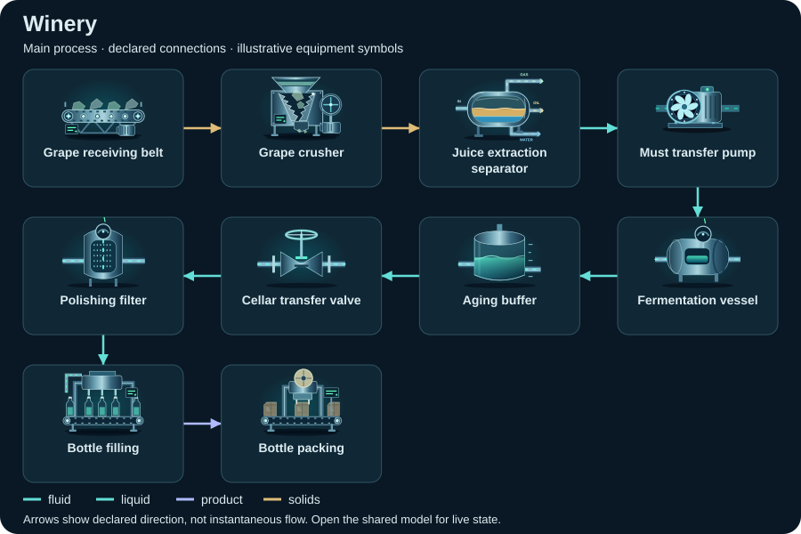

# Winery

<!-- Generated by tools/webkit/scada/sim/generate-scenario-docs.py -->

Generated scenario map. Edit the [canonical JSON catalog](../index.json) or the local system/model JSON for facts; edit the [documentation generator](https://github.com/Valpatel/cad-agent/blob/dev/tools/webkit/scada/sim/generate-scenario-docs.py) for layout. Run `npm --prefix tools/webkit/scada run docs:scenarios` from the source repository. Check freshness with `npm --prefix tools/webkit/scada run docs:scenarios:check`; do not hand-edit this output.

[Scenario map](../README.md) · [Package map](../../README.md) · [Model API](../../docs/MODEL-API.md)

Operate receiving, fermentation, cellar and packaging branches with instrument taps, local pump controls and PLC-controlled transfer valves.

**Model contract:** `scada-placeholder-model` v1. **Diagram contract:** `scada-system` v1.
This pair contains 23 equipment records, 42 declared connections and 4 focused views of one shared model.

The thumbnail is a captured initial state; it is not evidence of every fault or animation.
[Capture metadata](../../metadata/thumbnails.json) records its source and state.

## Files and editing

| File | Owns |
| --- | --- |
| [system.json](system.json) | Equipment identities/types/variants, ports, connections, focused layouts, bindings, controls and provenance |
| [model.json](model.json) | Versioned initial state, editable parameters and scenario/component assumptions |
| [../index.json](../index.json) | The `winery` catalog entry: discovery metadata and experiment command recipes |

Use the [v1 model schema](../../schema/placeholder-model-v1.schema.json) and matching runtime validator when editing.
Keep component IDs synchronized between the two JSON documents. Parameters and
positions are authored teaching assumptions, not measured facility specifications.

## Topology: Fermentation & cellar

**Legend:** equipment symbols identify the selected focused view's assets; connectors
show declared relationships between them. The SVG is a compact schematic with
illustrative icon states, not a live snapshot or a prediction of instantaneous
flow. [system.json](system.json) retains full port identities, other views and
connections; [model.json](model.json) owns behavior and editable assumptions.

[Browse topology SVGs](../../img/topologies/README.md) · [Generation metadata](../../metadata/topologies.json)

4 focused views of this system

| Focused view | ID | Equipment placements |
| --- | --- | ---: |
| Winery overview | `process` | 23 |
| Fermentation & cellar | `fermentation` | 10 |
| Bottling & packaging | `finishing` | 10 |
| Power & instruments | `utilities` | 19 |

## Equipment and model roles

Roles below are the actual records in this scenario. A shared family name does
not imply a calibrated device equation. Circuit roles describe resource bookkeeping;
energy roles describe declared supply/conversion/load relationships.

Inspect the 23 equipment records and model roles

| Equipment ID and label | Symbol | Model / declared domains |
| --- | --- | --- |
| `grapeIntake` · Grape receiving belt | `conveyor` | `source` |
| `crusher` · Grape crusher | `crusher` | `processor` |
| `extraction` · Juice extraction separator | `separator` | `processor` |
| `mustTransfer` · Must transfer pump | `pump` | `pump` |
| `fermenter` · Fermentation vessel | `reactor` | `processor` |
| `aging` · Aging buffer | `tank` | `storage` |
| `transferValve` · Cellar transfer valve | `gate-valve` | `valve` |
| `polishing` · Polishing filter | `filter` | `processor` |
| `bottler` · Bottle filling | `filling-line` | `processor` |
| `packer` · Bottle packing | `packaging-line` | `sink` |
| `effluent` · Illustrative effluent digester | `digester` | `processor` |
| `biogasFlare` · Illustrative biogas flare | `flare` | `heater` |
| `power` · Demonstration site power | `generator` | `generator` |
| `controller` · Cellar controller | `plc-rack` | `controller` |
| `pressure` · PT-101 Transfer pressure | `pressure-transmitter` | `sensor` |
| `mustValve` · FCV-101 Must feed | `control-valve` | `valve` |
| `cellarValve` · FCV-201 Cellar feed | `control-valve` | `valve` |
| `fillValve` · FCV-301 Bottling feed | `control-valve` | `valve` |
| `mustFlow` · FT-101 Must flow | `flow-meter` | `sensor` |
| `fermenterTemperature` · TT-201 Fermenter temp | `temperature-sensor` | `sensor` |
| `fermenterLevel` · LT-201 Fermenter level | `level-sensor` | `sensor` |
| `cellarLevel` · LT-202 Cellar level | `level-sensor` | `sensor` |
| `remoteIO` · RIO-01 Field I/O | `remote-io` | `controller` |

## Editable assumptions

The complete scenario and per-component assumptions are in [model.json](model.json).
Reference provenance and authored-layout declarations are in [system.json](system.json).
Key scope statements from this model:

- Follow grape handling, extraction, fermentation vessels and bottling, with a separately labeled illustrative effluent-energy branch.
- All quantities are editable normalized placeholders. Stage names do not supply a production recipe, validated quality criterion or real protection setting.
- Material, electrical, thermal, data and measurement connections have separate roles. The external model owns one shared state and clock for every view.
- Repair clears component damage; it does not undo intentionally changed load, valves, capacity or other operating inputs.

## Authored experiments

The [catalog entry](../index.json) stores each recipe, expected observation and
limitation. These are editable playground commands, not operating procedures.
Run or step the shared model to observe time-dependent effects.

Inspect 7 experiment recipes and commands

| Experiment | Commands |
| --- | --- |
| Stop grape receiving belt (`starve-feed`) | `setEnabled(equipment="grapeIntake", value=false)` |
| Close cellar transfer valve (`isolate-transfer`) | `setOpen(equipment="transferValve", value=false)` |
| Overload grape crusher (`overload-stage`) | `setParameter(equipment="crusher", key="capacity", value=25)`; `setLoad(equipment="crusher", value=95)` |
| Break grape crusher (`break-stage`) | `setFault(equipment="crusher", value=true)` |
| Trip the demonstration power source (`trip-power`) | `setFault(equipment="power", value=true)` |
| Isolate fermenter feed (`isolate-must-feed`) | `setOpen(equipment="mustValve", value=false)` |
| Lose winery control (`lose-winery-plc`) | `setEnabled(equipment="controller", value=false)` |

Serve the sibling packages over HTTP and open
[Explorer](../../../explorer/index.html?scenario=winery); see the
[host instructions](../../../explorer/README.md). GitHub displays the JSON and
thumbnail but does not execute the Explorer. The host owns the clock and session.

[All scenarios](../README.md) · [Scenario image gallery](../../img/README.md) · [Integration](../../docs/INTEGRATION.md)
