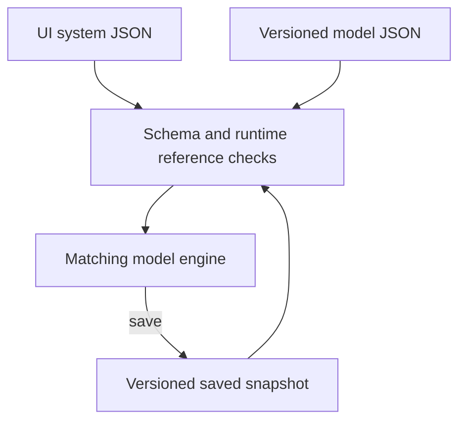

# Versioned model schemas

[Package map](../README.md) · [Model API](../docs/MODEL-API.md) · [Source](../src/README.md)

These JSON Schema documents describe the model package's persisted inputs and
snapshots. They are separate from the UI package's `scada-system` diagram schema.
Keep model versions explicit: v1 files are not automatically upgraded to v2.

Both model versions accept optional data-only `equations` selectors for trusted
registered providers. Snapshots add optional top-level `equationState` only when
custom providers are selected. Runtime checks registered identity/version, units,
resolved parameters, canonical schema signatures and each state schema before
committing. JSON Schema alone cannot validate callback purity or provider
availability; see the [provider contract](../src/equations/README.md) and
[adaptation guide](../docs/REAL_MODEL_ADAPTATION.md).

| File | Purpose | Package export |
| --- | --- | --- |
| [placeholder-model-v1.schema.json](./placeholder-model-v1.schema.json) | v1 component parameters and initial state | `@valpatel/scada-sim/schema` |
| [placeholder-snapshot-v1.schema.json](./placeholder-snapshot-v1.schema.json) | v1 saved system, model and mutable state | `@valpatel/scada-sim/snapshot-schema` |
| [placeholder-model-v2.schema.json](./placeholder-model-v2.schema.json) | v2 circuits, energy, thermal stores/links, observations, environment and zones | `@valpatel/scada-sim/schema-v2` |
| [placeholder-snapshot-v2.schema.json](./placeholder-snapshot-v2.schema.json) | v2 saved system, model, controls, circuit stock/heat/tracers and replay state | `@valpatel/scada-sim/snapshot-schema-v2` |

Schema shape and bounds do not prove that referenced component IDs, ports, circuit
identities or model behavior are correct. Use the matching runtime validator before
constructing a model or restoring a snapshot. The [tests map](https://github.com/Valpatel/cad-agent/blob/dev/tests/webkit/scada/sim/README.md)
separates package checks from cross-package scenario and browser checks.

See [the scenario maps](../scenarios/README.md) for concrete inputs and their
thumbnails. Schema files have no visual asset of their own.
