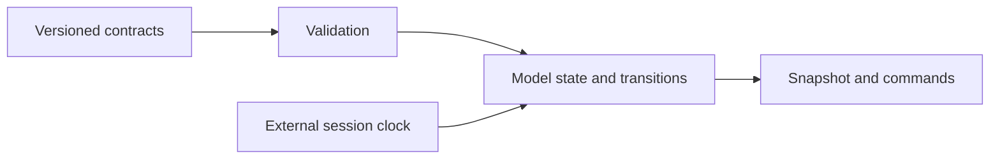
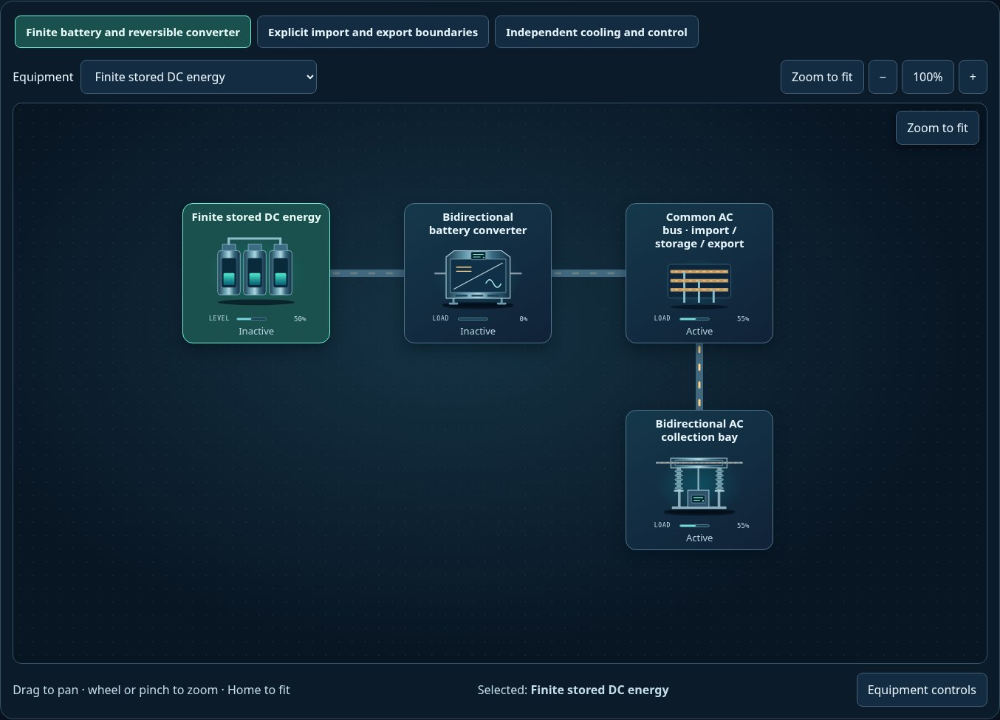

# Headless model source

[Package map](../README.md) · [Model API](../docs/MODEL-API.md) · [Schemas](../schema/README.md) · [Examples](../scenarios/README.md)

[`index.mjs`](./index.mjs) is the public entry. The model package imports no UI or application
code and starts no timer, network request or browser persistence operation.

| Owner | Modules |
| --- | --- |
| Version 1 compatibility | [type-contracts.mjs](./type-contracts.mjs), [model-registry.mjs](./model-registry.mjs), [validation.mjs](./validation.mjs) |
| Version 1 component behavior | [components.mjs](./components.mjs), [placeholder-system.mjs](./placeholder-system.mjs) |
| Shared viewer bridge | [adapter.mjs](./adapter.mjs); forwards snapshots/commands without importing a renderer |
| Version 2 circuits/energy/environment | [`v2/`](./v2/README.md) |
| Original interchangeable equipment laws | [`equation-examples/`](./equation-examples/README.md): pure SI pump/thermal equations and registered core providers |
| Registered constitutive laws | [`equations/`](./equations/README.md): provider selection, phase/unit contracts, owned custom state and compatible replay |

The original v1 documents retain their original contracts. The checked-in
`type-contracts.mjs` files are owned snapshots, not output from
`build:model-metadata`. That command serializes registry metadata for discovery.
Changing a descriptor requires the matching model implementation, schema/parity
checks and a meaningful example; it must not silently reinterpret v1 files.

Host application code belongs in [`apps/scada-explorer`](../../explorer).
The packaged `examples/explorer` copy is generated for distribution compatibility.
The host owns model lifetime, time advancement, audio, DOM, file IO and storage.

[Package map](../README.md) · [Integration contract](../docs/INTEGRATION.md)

The [battery scenario map](../scenarios/power-battery-storage/README.md) shows a
consumer of these contracts. The source engine has no artwork of its own; the
preview is rendered by the sibling UI package.
