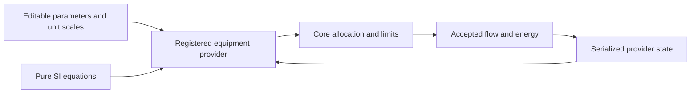
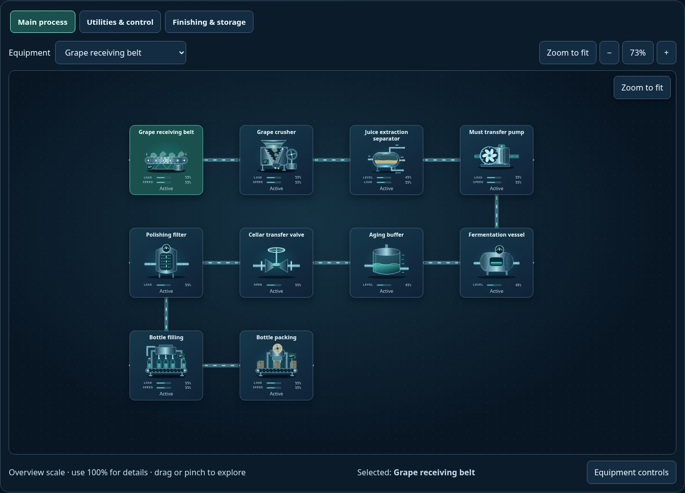

# Original equipment equations and core providers

[Source map](../README.md) · [Provider runtime](../equations/README.md) · [Runnable benches](../../examples/equation-models/README.md) · [Adaptation guide](../../docs/REAL_MODEL_ADAPTATION.md)

These are interchangeable executable equations, with editable assumed parameters.
The pumps replace actual operating response, resource capacity, electrical demand
and pressure in both engine versions. The v2 resistor replaces electrical demand
and heat accepted into the engine's thermal store. The providers demonstrate the
replacement boundary; they are not calibrated equipment or a plant hydraulic solver.

| File | Responsibility |
| --- | --- |
| [physics.mjs](./physics.mjs) | Pure SI equations, numeric validation, local operating-point roots, power-budget solution, first-order response and lumped thermal balance |
| [providers.mjs](./providers.mjs) | Registered callbacks, parameter/state schemas, explicit index conversions and replayable JSON state |
| [index.mjs](./index.mjs) | Portable exports for browser and headless hosts |

The preview is an existing illustrative scenario, not evidence of pump calibration.
The [model-switching bench](../../examples/model-switching/README.md) exercises these
providers with the reusable viewer. No artwork, DOM, clock or timer is imported here.

## Pumps: two characteristics, one replacement contract

Both providers have version `1.0.0`, state version `1`, and support engines 1 and 2:

| ID | Nominal characteristic | Affinity-scaled characteristic |
| --- | --- | --- |
| `engineering.pump.quadratic` | `H = H0 - a Q²` | `H = H0 s² - a Q²` |
| `engineering.pump.linear` | `H = H0 - b Q` | `H = H0 s² - b s Q` |

`Q` is forward flow in m³/s, `H` is developed differential head in metres, and `s`
is nominal speed ratio. The local system is `Hstatic + R Q²`. Its intersection is
solved analytically with a cancellation-resistant positive root for the linear
curve. Forward flow is zero below static head; reverse flow is excluded by an
assumed check valve. A running blocked pump retains shutoff head and idle draw.
Disabled equipment has zero developed head. External static head is reported
separately by the pure helper.

`Δp = ρgH`, `Phydraulic = ρgQH`, and
`Pelectrical = Phydraulic / (ηpump ηmotor ηdrive) + Pidle` while running.
Density, gravity, constant efficiencies, coefficients, static head, idle power,
speed limit, initial speed and response time are editable assumptions. The
`parameterUnits` export supplies unit labels; each provider carries its own
`defaultParameters` and strict `parameterSchema`.

With the default physical coefficients at `s=1`, both curves intersect at
20 L/s and 16 m: 156,906.4 Pa, 3,138.128 W hydraulic power and 4,458.511111 W
electrical duty power. At `s=0.5`, quadratic flow is 8.164966 L/s while linear
flow is 7.320508 L/s. This independently calculable off-design difference is used
to verify that swapping implementations changes core behavior.

The electrical request is deliberately conservative: `pumpPowerEnvelope` finds
the **maximum** electrical power along `0 ≤ Q ≤ Qlocal`. A throttled centrifugal
pump can require more power than its selected duty point. The extra requested
power represents a conservative supply allocation, not a metered efficiency
prediction. An idealized drive selects a reduced effective speed by bisection
when actual `availablePower` is below that envelope. Supply at or below idle
power inhibits flow. Kernel demand ratings can therefore reduce physical flow
even when the kernel's demand-relative `powerFactor` is one.

An engineering pump requires an explicit electrical supply connection in both
engines. V1's compatibility-only `unconnected-bench` power is treated as zero by
these providers; the legacy behavior of unbound equipment is unchanged.

Fractional health reduces speed as an explicit demonstration assumption. An
external controller factor also reduces resource-side speed; the motor request
remains a conservative full-command request. The kernel owns absolute disable,
isolation and supply gates, ratings, finite stock and receiver limits. It does
not multiply the provider's fractional law a second time. These are not
cavitation, wear, torque, motor-starting or protection models.

## State, units and acceptance

The exact first-order commanded-shaft response is
`snext = target + (sprevious - target) exp(-dt / τ)`.
This fitted response is not conserved rotational inertia. `evaluate` is pure;
only `advance` commits JSON state once per accepted interval. No implementation
holds mutable state in a closure. During a swap the core state is retained and
provider state initializes from the new binding's `initialSpeedRatio`. A saved
snapshot restores the bound provider identity, resolved parameters and state.
Every evaluation and state advance also checks parameter/state correlations:
initial and saved shaft speeds must fit the selected maximum, accepted effective
speed cannot exceed its interval shaft speed, and the saved stock-volume scale
must exactly match the engine version and bound flow scale. Import rejects these
inconsistencies transactionally during refresh, leaving the existing session
usable. Nonnegative, bounded historical totals are observations; they are not
cryptographic evidence of an authentic prior trajectory.
The kernel holds each accepted rate over its substep; it does not analytically
integrate the nonlinear flow curve over the shaft's transient trajectory.

| Conversion | Definition |
| --- | --- |
| Flow | `Q = resourceRate × flowAt100M3s / 100` |
| Electrical power | `W = powerRate × powerAt100W / 100` |
| Pressure | `index = Pa / pressureAt100Pa × 100` |
| Duration | `seconds = dtMinutes × 60` |
| V1 stock volume | `flowAt100M3s × 6` m³ per inventory-index unit; the kernel advances stock by `rate × dtMinutes / 10` |
| V2 stock volume | `flowAt100M3s × 0.6` m³ per amount unit; the kernel advances amount by `rate × dtMinutes` |

The two engine stock units intentionally differ. `volumePerStockUnitM3` exposes
the conversion, and `acceptedVolumeM3` integrates physical accepted discharge.
The source/receiver fixture must use the same scale for inventory interpretation.
V2 `stockScale` converts the visible inventory percentage into amount units.
The engine still has normalized units internally; binding these examples does
not assign physical units to every other component in an existing scenario.

`lastPotentialFlowM3s` is the unrestricted local curve intersection at commanded
speed after health derating. `lastAcceptedFlowM3s` is actual kernel discharge;
`lastAcceptedElectricalPowerW` is actual electrical allocation.
`lastRequiredElectricalPowerW` and `lastDevelopedHeadM` evaluate the pump curve
at accepted discharge and power-limited speed. State records the **last accepted
interval**, whereas visible readings can be refreshed for the next interval.
Same-step failures use the accepted allocation's captured gates for bookkeeping.

Accepted flow can be below local potential because of a valve, empty source,
rating or full receiver. At that point the pump head and the configured local
system curve need not balance: the directed network kernel is not solving
nonlinear network hydraulics. This example cannot establish surge, pipe
pressure loss, NPSH, reverse flow, multi-pump operating points or plant safety.
The pressure hook reports developed differential head on the normalized pressure
channel; v1 approaches its target through the original family response, while
v2 sets the next circuit pressure directly. It is not absolute node pressure.
An index beyond the configured 0–100 range fails transactionally; enlarge the
explicit display scale instead of silently clipping an engineering result.

## Heater and thermal helper

`engineering.heater.resistive@1.0.0` supports v2 `energy` and `thermal-source`.
For constant resistance and RMS voltage, `P = V²/R × duty`. Accepted electricity
caps heat before conversion efficiency is applied. A host must declare an
`energy-input` heat source, thermal store and adequate ratings. The engine retains
heat and accounts for rejected electricity in its ledger. With the power scale
used above, one engine energy/heat unit represents `powerAt100W × 0.6` joules.
The example does not infer a temperature scale from a normalized thermal store.

The separately exported `stepLumpedThermal` solves
`C dT/dt = P - UA(T - Ta)` exactly for constant inputs using Kelvin, J/K, W/K,
watts and seconds. It returns signed heat loss and stored-energy change. This
pure helper is tested independently; it is **not** silently applied on top of
the resistor provider's kernel-owned heat store. A replacement thermal provider
must explicitly configure the compatible capacity and temperature mapping.

## Evidence, references and ownership

Run the complete package checks with `npm --prefix packages/scada-sim test`.
The focused source tests are
[equation-physics.test.mjs](../../../../../../../tests/webkit/scada/sim/equation-physics.test.mjs)
and [equation-examples.test.mjs](../../../../../../../tests/webkit/scada/sim/equation-examples.test.mjs).
They cover independent analytic points, affinity scaling, invalid inputs,
finite power, core flow/power/pressure changes in both engines, acceptance
clipping, unit bridges, state replay and actual heater energy accounting.

Engineering references reviewed for the equations and their limitations:

- [Modelica Standard Library: PartialPump](https://build.openmodelica.org/Documentation/Modelica.Fluid.Machines.BaseClasses.PartialPump.html): affinity scaling, replaceable efficiency/power characteristics, zero-flow power and check-valve/dynamic assumptions.
- [Modelica: linearFlow](https://build.openmodelica.org/Documentation/Modelica.Fluid.Machines.BaseClasses.PumpCharacteristics.linearFlow.html): nominal two-point linear pump characteristic.
- [Modelica: HeatCapacitor](https://build.openmodelica.org/Documentation/Modelica.Thermal.HeatTransfer.Components.HeatCapacitor.html): constant lumped `C = m cp` and Kelvin temperature.
- [Modelica: ThermalConductor](https://build.openmodelica.org/Documentation/Modelica.Thermal.HeatTransfer.Components.ThermalConductor.html): constant conductance in W/K.

The implementation is original JavaScript; no Modelica source was copied or
vendored and Modelica is not a dependency. Those projects are references, not
endorsements or validation of this implementation. These files inherit this
private package's `UNLICENSED` status; references do not grant redistribution
rights to this repository's code.
