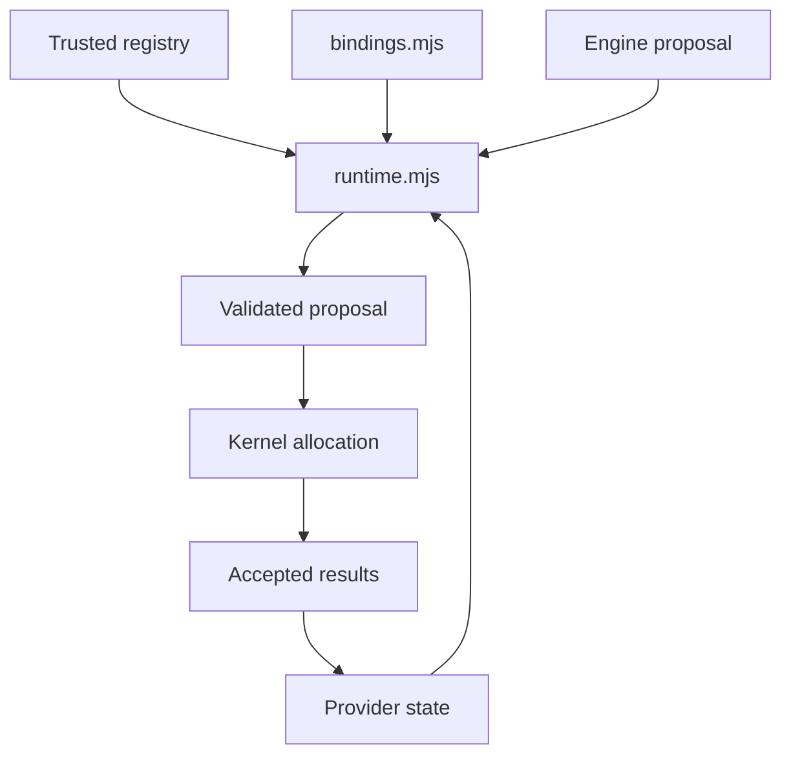

# Registered equation providers

[Source map](../README.md) · [Model adaptation guide](../../docs/REAL_MODEL_ADAPTATION.md) · [Model API](../../docs/MODEL-API.md)

This core module selects trusted JavaScript constitutive laws without embedding
code in model JSON. Both engine versions call the selected laws during real
allocation and state updates; providers are not display patches. The engines
retain topology, absolute supply/isolation gates, inventories, ledgers, clock and
transaction ownership. The no-binding path preserves the built-in calculations.

| File | Owns |
| --- | --- |
| [contracts.mjs](./contracts.mjs) | Phase/output/unit contracts and bounded plain-data cloning |
| [bindings.mjs](./bindings.mjs) | Versioned data selectors, precedence and explicit built-in opt-out |
| [schema.mjs](./schema.mjs) | Closed, bounded JSON Schema subset for provider parameters/state; no refs or executable expressions |
| [runtime.mjs](./runtime.mjs) | Trusted provider registry, frozen contexts, once-per-substep owned state, compatible persistence and rollback checkpoints |
| [index.mjs](./index.mjs) | Public core exports, also exposed by the model package entry |

Import this contract from `@valpatel/scada-sim/equations`; use
`@valpatel/scada-sim/equation-examples` for the supplied physical-law examples.



Selection is component → type → engine-scoped family → built-in. A `null`
selector explicitly chooses built-in behavior instead of falling through. Provider
identity/version is supplied in JSON; the host registers the corresponding
functions through constructor `equationProviders`. The model never fetches or
evaluates code from a definition or saved session.

`evaluate(phase, context)` can run repeatedly during solve/refresh. It returns a
partial numeric proposal and must be pure. `initialize(context)` creates custom
state; optional `advance(context)` replaces that state once per accepted engine
substep. State lives in the runtime's validated JSON record, not in a provider
closure. Contexts and outputs are copied/frozen; this prevents accidental alias
mutation but does not sandbox trusted JavaScript or prove its lack of IO, random
draws or external side effects. Those are the provider author's responsibility.

The session initializes after it has initial core state, passing a context per
equipment. Direct `createEquationRuntime` initialization has only common metadata;
engine authors can use `initialize:false` then `reset(id => context)`. Saved-state
import bypasses initialization. `accepted.core`/`accepted.gates` describe the
completed interval, while top-level core/gates describe current post-update state.

Rates are **effective requests** in explicitly documented normalized kernel units.
The kernel enforces configured rating, absolute disabled/closed/unpowered/control
isolation and finite stock/energy allocation. It does not multiply fractional
derating again or clamp a new law to the old law's result. The provider decides
its fractional response to `gates.healthFactor`, `powerFactor`, `controlFactor`
and `operatingFraction`; conservation alone does not prove physical consistency.

The phase table's `engineUnits` distinguishes legacy v1 inventory changes
(`acceptedRate × dtMinutes / 10`) from v2 amount changes
(`acceptedRate × dtMinutes`). V2 amount equals inventory index × `stockScale`.
SI helper equations use explicit bridge parameters at this boundary. Pressure
also has an engine-specific stage: v1 supplies a response target; v2 supplies
the next pressure index. Consult `engineSemantics` before authoring a shared law.

Saved `equationState` includes provider ID/version/state version, unit contract,
resolved parameters, canonical parameter/state schema signature and custom state.
Import validates those identities before committing, without initialization or
time replay. The schema signature is canonical JSON, not a cryptographic code
hash; changed JavaScript under the same declared version is not detected. Pin
source/dependency revisions and increment provider versions deliberately.

`setEquationBindings()` belongs to the engine session. It swaps registered
selections/parameters atomically, initializes newly selected custom state and
retains core stocks/heat/controls. Runtime `checkpoint`/`restore` are engine
transaction helpers; they execute no provider callbacks. The
[adaptation guide](../../docs/REAL_MODEL_ADAPTATION.md) documents supported phases,
state lifecycle, public session usage and meaningful acceptance fixtures.

Run the independent core tests from the repository root:

```sh
node --test tests/webkit/scada/sim/equation-runtime.test.mjs
```

The [source tests](https://github.com/Valpatel/cad-agent/blob/dev/tests/webkit/scada/sim/equation-runtime.test.mjs)
cover contracts and defensive boundaries; engine-specific tests additionally
prove that the proposals change actual allocation/state and remain atomic.

<a href="../../img/topologies/manufacturing-thermal-processing/electric-batch-oven/topology.svg"></a>

This package-owned topology illustrates the kernel's explicit boundaries. It is
not a capture of a registered physical-law provider or a calibration receipt.
