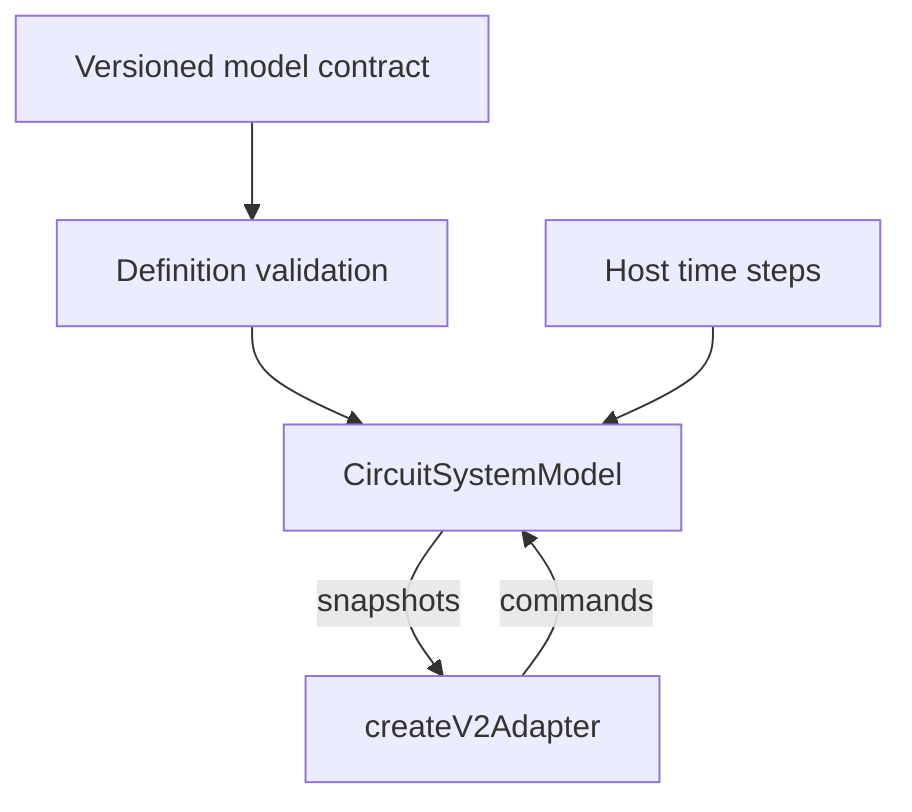

# Version 2 model

[Source map](../README.md) · [Package map](../../README.md) · [Model API](../../docs/MODEL-API.md)

- [type-contracts.mjs](./type-contracts.mjs): explicit equipment/variant state and port snapshot.
- [contract.mjs](./contract.mjs): model descriptors and editable circuit, energy and zone parameters.
- [validation.mjs](./validation.mjs): versioned document/reference/bounds validation.
- [circuit-system.mjs](./circuit-system.mjs): state transitions, conservation accounting, faults,
  snapshot handling and the public adapter.

Keep fluid circuits, energy links, environmental zones and illustrative composition
indices explicit. Diagram positions are not physical dimensions. A host may replace
this teaching engine while retaining the UI's snapshot/command adapter boundary;
that does not make two engines' configuration or snapshot formats interchangeable.

[Source map](../README.md) · [Version 2 model contract](../../docs/MODEL-API.md)

The [PWR scenario](../../scenarios/power-nuclear-pwr/README.md) separates primary,
steam and cooling circuits. The [electric batch oven](../../scenarios/electric-batch-oven/README.md)
provides a smaller three-device example with explicit supply and retained heat.
Both use editable indices, not calibrated operating values.

## Files

| File | Purpose |
| --- | --- |
| [circuit-system.mjs](circuit-system.mjs) | Version 2 circuit model session and state progression. |
| [contract.mjs](contract.mjs) | Version 2 fields, quantities and domain contracts. |
| [type-contracts.mjs](type-contracts.mjs) | Version 2 per-type and variant model descriptors. |
| [validation.mjs](validation.mjs) | Runtime validation of explicit version 2 definitions. |
