# Valpatel SCADA UI

[Packages map](../README.md) · [Repository map](../README.md) · [Documentation map](./docs/README.md) · [Examples map](./examples/README.md)

Reusable animated equipment, accessible workspace primitives and a system viewer for browser applications. The package contains **142 equipment types across 11 families**, typed visual state and a versioned system-definition contract. It has no framework dependency and no process, electrical, PLC or network simulation inside it.

The [state coverage review](./docs/STATE_COVERAGE.md) separates equipment-specific
responses, shared effects, actual browser evidence and remaining lifecycle gaps
for every type and variant. Catalog membership does not mean every state is complete.

This is the canonical source package for the Digester Twin app. It can also be used through a local file dependency, an npm tarball or the standalone browser kit. The package is `private: true` and `UNLICENSED`; it has not been published to the public npm registry, and packaging does not grant new license rights.

[API reference](./docs/API.md) · [System format](./docs/SYSTEM_FORMAT.md) · [Style guide](./STYLE_GUIDE.md) · [Contributing](./CONTRIBUTING.md) · [Agent prompts](./AGENT_PROMPTS.md) · [Animated image gallery](./img/README.md) · [Thumbnail manifest](./metadata/thumbnails.json) · [Variant previews](./docs/VARIANTS.md) · [Power references](./docs/POWER_REFERENCES.md) · [Agriculture references](./docs/AGRICULTURE_REFERENCES.md)

## Folder map

| Folder | Contents |
| --- | --- |
| [src/](./src/README.md) | Canonical data contracts, equipment art, workspace primitives and viewer/controller implementations. |
| [docs/](./docs/README.md) | Public APIs, system format, references and candid state-coverage review. |
| [schema/](./schema/README.md) | Portable presentation schema and its catalog-derived sections. |
| [metadata/](./metadata/README.md) | Generated discovery snapshots and image provenance receipts. |
| [examples/](./examples/README.md) | Authored single-component and shared-model viewer examples. |
| [img/](./img/README.md) | This package's animated symbol gallery, state images and JPEG thumbnails. |
| [scripts/](../../../../../tools/webkit/scada/ui/README.md) | Package-owned generation, capture and QA tools. |
| [tests/](../../../../../tests/webkit/scada/ui/README.md) | Package contracts, rendering, interaction and export checks. |

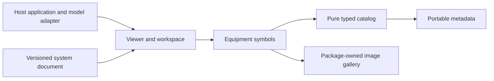

The arrows show ownership/use, not a second simulation engine. The host owns one canonical model/session; the package supplies reusable views and controls for that session. Gallery and metadata outputs are generated from those same source owners.

## Find the right layer

| You need to… | Start here |
| --- | --- |
| Filter by industry, technology, medium or fuel | [Discovery API](./docs/API.md#discovery-and-variants), `src/scada-catalog.mjs` |
| Pick a symbol or family | [Animated family gallery](./img/README.md), [equipment catalog](#equipment-catalog), [contact sheet](./img/thumbnails/contact-sheet.jpg) |
| Render one device from visual state | [Component API](./docs/API.md), `src/scada-components.mjs` |
| Add dialogs, toolbars or status surfaces | [Workspace primitives](#workspace-primitives), `src/scada-workspace.mjs` / `.css` |
| Display and control another application's system | [Viewer and model adapter](#viewer-and-model-adapter), public `ScadaViewer` |
| Define equipment, layouts, bindings and controls as data | [System format](./docs/SYSTEM_FORMAT.md), [JSON Schema](./schema/scada-system.schema.json), [minimal definition](./examples/minimal-system.json) |
| Match the appearance or add a type/state | [Style guide](./STYLE_GUIDE.md), [contribution workflow](./CONTRIBUTING.md) |
| Give a future agent a concrete task | [Copy-paste prompts](./AGENT_PROMPTS.md) |

```text
packages/scada-ui/
├── package.json                 local package and explicit public exports
├── README.md                    this map and thumbnail catalog
├── STYLE_GUIDE.md                appearance, geometry, states and accessibility
├── CONTRIBUTING.md              canonical-source and verification workflow
├── AGENT_PROMPTS.md / AGENTS.md  future-agent tasks and scoped rules
├── src/
│   ├── index.mjs / styles.css   stable public package entries
│   ├── metadata.mjs             data-only registry/discovery entry
│   ├── scada-*.mjs/css          stable compatibility entry facades
│   ├── twin-art.* / system-definition.mjs  historical entry facades
│   ├── catalog/                pure descriptors, state normalization, discovery
│   │   └── definitions/        industrial, power and agriculture metadata
│   ├── contracts/              system-definition validation and bindings
│   ├── symbols/                equipment renderer and component skin
│   │   ├── art/                process, industrial, controls, agriculture, twin art
│   │   └── power/              energy, electrical, nuclear and genset art
│   ├── workspace/              native dialogs, focus and toolbar lifecycle
│   └── viewer/                 diagram rendering and adapter-driven controller
├── docs/                        API and versioned system-format documentation
├── schema/                      machine-readable system definition contract
├── examples/                    browser examples and a minimal system definition
├── metadata/                    generated registry and thumbnail manifests
├── img/                         symbols/, states/ and thumbnails/ with Markdown indexes
├── scripts/                     package-owned metadata, schema and image generators
└── tests/                       contracts, rendering, camera and exporter verification
```

[The source map](./src/README.md) explains ownership and dependency direction. The flat `src/scada-*`, `twin-art.*` and `system-definition.mjs` files are compatibility facades; edit implementations in the named domains. Catalog, metadata and system validation do not import SVG renderers. Public npm export paths remain supported; the site maintains explicit legacy entry-page bridges.

`src/` is canonical. Run **`npm run build:library` from the repository root** to regenerate `metadata/components.json`; `npm run build` composes the single browser projection under `dist/client/packages/scada-ui/`. Do not fix a generated copy. The package does not own the host application's model, clock, persistence or plant connection.

## Package-owned image gallery

[Browse animated symbols by family](./img/README.md), [visual state examples](./img/states/README.md), and [viewer/workspace snapshots](./img/thumbnails/README.md). Every equipment type and declared variant has a source-derived preview. The SVG files contain the canonical artwork and inline decorative CSS animation; they require no JavaScript, external styles, fonts or live model. Static renderers retain the silhouette and readouts. Image animation support is renderer-dependent; use the interactive examples to change state.

The gallery travels with this library under `img/`. [Scenario diagrams](../sim/img/README.md) belong to the model library's own `img/`, and future electrical-panel or harness libraries should own their galleries in the same way. Root documentation links to owners; it does not become a shared asset bucket. Machine-readable [gallery metadata](./metadata/gallery.json) records the exact supplied state, source hashes and output hashes. Existing `@valpatel/scada-ui/thumbnails/*` imports remain an alias for `img/thumbnails/*`; new assets are available under `@valpatel/scada-ui/img/*`.

## Use it

For a bundler or Node-based project, install the local package or a packed tarball:

```sh
# From the repository containing this package:
npm pack ./packages/scada-ui --pack-destination /tmp

# From the consuming application (substitute the actual absolute path):
npm install /absolute/path/valpatel-scada-ui-1.4.1.tgz
# Or: npm install /absolute/path/digester-insight/packages/scada-ui
```

```js
import {renderScadaComponent} from '@valpatel/scada-ui';
import '@valpatel/scada-ui/styles'; // For bundlers that load CSS imports.

container.innerHTML = renderScadaComponent('plc-rack', {
  id: 'north-plc',
  label: 'North process controller',
  state: {active: true, running: true, connected: true, load: 45},
});
```

For a browser without a bundler, serve the package directory and use relative URLs:

```html
<link rel="stylesheet" href="./src/styles.css">
<div id="equipment" style="width:260px;height:200px"></div>
<script type="module">
  import {renderScadaComponent} from './src/index.mjs';
  document.querySelector('#equipment').innerHTML =
    renderScadaComponent('tank', {
      id: 'reuse-water-tank',
      label: 'Reuse water tank',
      state: {level: 38, running: true},
    });
</script>
```

Use `python -m http.server 8000` from the package directory, then open `http://localhost:8000/examples/components/` for the [equipment example](./examples/components/index.html) or `/examples/viewer/` for the system viewer. ES-module loading from `file:` URLs is browser-dependent. The package is already browser-ready; consumers need no repository build script. Individual component/workspace entry points and styles are available through the explicit `package.json` export map. [The API reference](./docs/API.md) explains all fields, dependencies and lifecycle details.

## Viewer and model adapter

The reusable viewer follows a model/view/controller boundary:

- **Model:** your application owns one canonical state, clock, persistence and command implementation. The package has no independent plant session.
- **Definition:** a validated, versioned JSON document describes equipment, layouts, bindings and controls. Bindings read explicit snapshot paths; JSON is never evaluated as code.
- **View:** equipment renderers and workspace primitives display the supplied state.
- **Controller:** `ScadaViewer` manages active layout, selection, zoom, the inspector and dispatch through the supplied adapter.

An adapter provides `getSnapshot()` and `subscribe(listener)`. `dispatch(command)` is optional; omitting it creates a read-only viewer. Share the same adapter/model between views so a valve change, fault, clock or reading is consistent everywhere. Switching layout or destroying a presentation must not reset that external model.

```js
import {ScadaViewer, validateSystemDefinition} from '@valpatel/scada-ui';

export function mountSystem(root, definition, adapter) {
  const result = validateSystemDefinition(definition);
  if (!result.ok) {
    throw new Error(result.errors.map(error =>
      `${error.path}: ${error.message}`).join('\n'));
  }
  const viewer = new ScadaViewer({definition: result.definition, adapter});
  viewer.mount(root);
  return () => viewer.destroy(); // The external model/clock stays owned by you.
}
```

Use the [minimal definition](./examples/minimal-system.json) and [system-format guide](./docs/SYSTEM_FORMAT.md) rather than inventing a JSON structure. [API.md](./docs/API.md) records the actual viewer methods and adapter contract. The [independent viewer demo](./examples/viewer/index.html) keeps its [utility model](./examples/viewer/utility-model.mjs) separate from the package UI.

[](./examples/viewer/index.html)

## Equipment catalog

The registry is authoritative for exact fields and ports. Each preview is rendered from its canonical source with a fixed visual pose. Variant choices preserve the type ID; use discovery filters and resolved metadata before connecting a system. All capacities and model values remain external, editable assumptions.

### Process vessels

| Preview | Component | Extra states | Ports | Support |
| --- | --- | --- | --- | --- |
| <a href="./img/thumbnails/digester.jpg">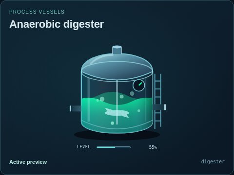</a> | **Anaerobic digester**<br>`digester`<br>[API](./docs/API.md#public-api) · [source](./src/twin-art.mjs) | `level`, `damage` | 4 | Twin artwork |
| <a href="./img/thumbnails/tank.jpg"></a> | **Storage tank**<br>`tank`<br>[API](./docs/API.md#public-api) · [source](./src/scada-components.mjs) | `level`, `damage` | 2 | Visual only |
| <a href="./img/thumbnails/gas-holder.jpg"></a> | **Gas holder**<br>`gas-holder`<br>[API](./docs/API.md#public-api) · [source](./src/twin-art.mjs) | `level`, `damage` | 2 | Twin artwork |
| <a href="./img/thumbnails/mixing-tank.jpg"></a> | **Mixing tank**<br>`mixing-tank`<br>[API](./docs/API.md#public-api) · [source](./src/scada-components.mjs) | `level`, `damage` | 3 | Visual only |
| <a href="./img/thumbnails/reactor.jpg">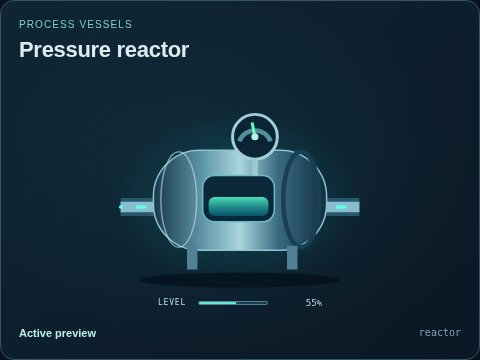</a> | **Pressure reactor**<br>`reactor`<br>[API](./docs/API.md#public-api) · [source](./src/scada-components.mjs) | `level`, `damage` | 4 | Visual only |
| <a href="./img/thumbnails/clarifier.jpg"></a> | **Circular clarifier**<br>`clarifier`<br>[API](./docs/API.md#public-api) · [source](./src/scada-components.mjs) | `level`, `damage` | 3 | Visual only |
| <a href="./img/thumbnails/silo.jpg">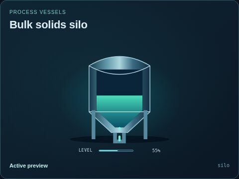</a> | **Bulk solids silo**<br>`silo`<br>[API](./docs/API.md#public-api) · [source](./src/scada-components.mjs) | `level`, `damage` | 2 | Visual only |
| <a href="./img/thumbnails/heat-exchanger.jpg"></a> | **Heat exchanger**<br>`heat-exchanger`<br>[API](./docs/API.md#public-api) · [source](./src/scada-components.mjs)<br>8 explicit variants | `load`, `temperature`, `damage` | 4 | Visual only |
| <a href="./img/thumbnails/filter.jpg">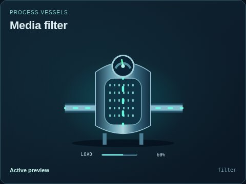</a> | **Media filter**<br>`filter`<br>[API](./docs/API.md#public-api) · [source](./src/scada-components.mjs) | `load`, `damage` | 3 | Visual only |
| <a href="./img/thumbnails/gas-treatment.jpg"></a> | **Gas treatment train**<br>`gas-treatment`<br>[API](./docs/API.md#public-api) · [source](./src/twin-art.mjs) | `load`, `damage` | 3 | Twin artwork |
| <a href="./img/thumbnails/boiler.jpg">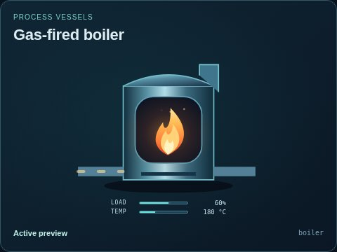</a> | **Gas-fired boiler**<br>`boiler`<br>[API](./docs/API.md#public-api) · [source](./src/twin-art.mjs)<br>3 explicit variants | `load`, `temperature`, `damage` | 6 | Twin artwork |
| <a href="./img/thumbnails/flare.jpg"></a> | **Flare stack**<br>`flare`<br>[API](./docs/API.md#public-api) · [source](./src/twin-art.mjs) | `load`, `damage` | 2 | Twin artwork |
| <a href="./img/thumbnails/centrifuge.jpg">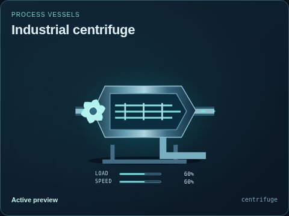</a> | **Industrial centrifuge**<br>`centrifuge`<br>[API](./docs/API.md#public-api) · [source](./src/scada-process-art.mjs) | `load`, `speed`, `damage` | 4 | Visual only |
| <a href="./img/thumbnails/flotation-cell.jpg"></a> | **Flotation cell**<br>`flotation-cell`<br>[API](./docs/API.md#public-api) · [source](./src/scada-process-art.mjs) | `level`, `load`, `speed`, `damage` | 5 | Visual only |
| <a href="./img/thumbnails/membrane-filter.jpg"></a> | **Membrane filter**<br>`membrane-filter`<br>[API](./docs/API.md#public-api) · [source](./src/scada-process-art.mjs) | `load`, `damage` | 4 | Visual only |
| <a href="./img/thumbnails/reverse-osmosis.jpg">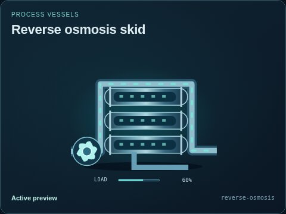</a> | **Reverse osmosis skid**<br>`reverse-osmosis`<br>[API](./docs/API.md#public-api) · [source](./src/scada-process-art.mjs) | `load`, `damage` | 4 | Visual only |
| <a href="./img/thumbnails/distillation-column.jpg">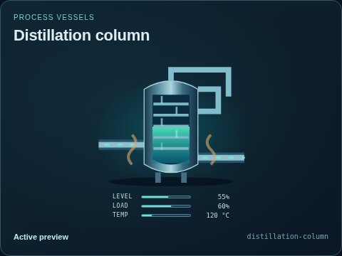</a> | **Distillation column**<br>`distillation-column`<br>[API](./docs/API.md#public-api) · [source](./src/scada-process-art.mjs) | `level`, `load`, `temperature`, `damage` | 5 | Visual only |
| <a href="./img/thumbnails/separator.jpg">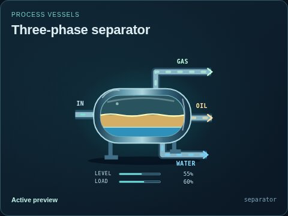</a> | **Three-phase separator**<br>`separator`<br>[API](./docs/API.md#public-api) · [source](./src/scada-process-art.mjs)<br>1 explicit variants | `level`, `load`, `damage` | 5 | Visual only |
| <a href="./img/thumbnails/cyclone.jpg"></a> | **Cyclone separator**<br>`cyclone`<br>[API](./docs/API.md#public-api) · [source](./src/scada-process-art.mjs) | `load`, `damage` | 4 | Visual only |
| <a href="./img/thumbnails/scrubber.jpg"></a> | **Wet scrubber**<br>`scrubber`<br>[API](./docs/API.md#public-api) · [source](./src/scada-process-art.mjs) | `level`, `load`, `damage` | 5 | Visual only |
| <a href="./img/thumbnails/cooling-tower.jpg">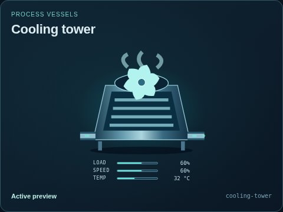</a> | **Cooling tower**<br>`cooling-tower`<br>[API](./docs/API.md#public-api) · [source](./src/scada-process-art.mjs) | `load`, `speed`, `temperature`, `damage` | 5 | Visual only |
| <a href="./img/thumbnails/chiller.jpg">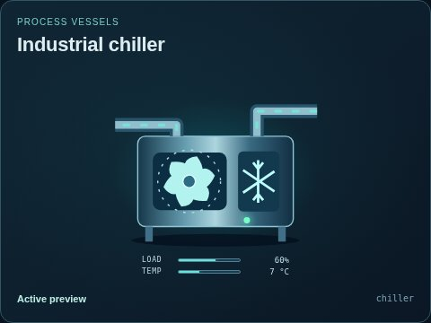</a> | **Industrial chiller**<br>`chiller`<br>[API](./docs/API.md#public-api) · [source](./src/scada-process-art.mjs) | `load`, `temperature`, `damage` | 4 | Visual only |
| <a href="./img/thumbnails/evaporator.jpg"></a> | **Falling-film evaporator**<br>`evaporator`<br>[API](./docs/API.md#public-api) · [source](./src/scada-process-art.mjs) | `level`, `load`, `temperature`, `damage` | 5 | Visual only |
| <a href="./img/thumbnails/wellhead.jpg"></a> | **Production wellhead**<br>`wellhead`<br>[API](./docs/API.md#public-api) · [source](./src/scada-process-art.mjs)<br>2 explicit variants | `load`, `open`, `value`, `damage` | 3 | Visual only |
| <a href="./img/thumbnails/aeration-basin.jpg"></a> | **Aeration basin**<br>`aeration-basin`<br>[API](./docs/API.md#public-api) · [source](./src/scada-process-art.mjs) | `level`, `load`, `damage` | 5 | Visual only |

### Pumps & machinery

| Preview | Component | Extra states | Ports | Support |
| --- | --- | --- | --- | --- |
| <a href="./img/thumbnails/pump.jpg">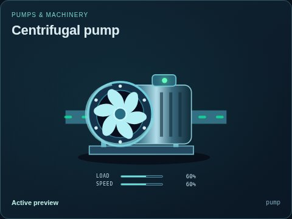</a> | **Centrifugal pump**<br>`pump`<br>[API](./docs/API.md#public-api) · [source](./src/twin-art.mjs)<br>8 explicit variants | `load`, `speed`, `damage` | 3 | Twin artwork |
| <a href="./img/thumbnails/submersible-pump.jpg"></a> | **Submersible pump**<br>`submersible-pump`<br>[API](./docs/API.md#public-api) · [source](./src/scada-components.mjs)<br>8 explicit variants | `load`, `speed`, `damage` | 3 | Visual only |
| <a href="./img/thumbnails/dosing-pump.jpg"></a> | **Metering pump**<br>`dosing-pump`<br>[API](./docs/API.md#public-api) · [source](./src/scada-components.mjs) | `load`, `speed`, `damage` | 3 | Visual only |
| <a href="./img/thumbnails/blower.jpg"></a> | **Centrifugal blower**<br>`blower`<br>[API](./docs/API.md#public-api) · [source](./src/scada-components.mjs)<br>1 explicit variants | `load`, `speed`, `damage` | 3 | Visual only |
| <a href="./img/thumbnails/compressor.jpg">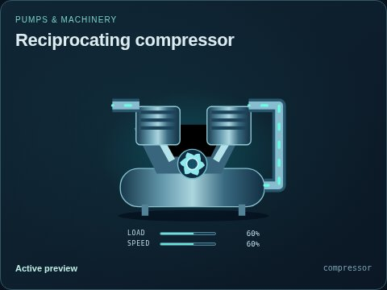</a> | **Reciprocating compressor**<br>`compressor`<br>[API](./docs/API.md#public-api) · [source](./src/scada-components.mjs) | `load`, `speed`, `damage` | 3 | Visual only |
| <a href="./img/thumbnails/motor.jpg"></a> | **Electric motor**<br>`motor`<br>[API](./docs/API.md#public-api) · [source](./src/scada-components.mjs) | `load`, `speed`, `damage` | 2 | Visual only |
| <a href="./img/thumbnails/fan.jpg"></a> | **Axial ventilation fan**<br>`fan`<br>[API](./docs/API.md#public-api) · [source](./src/scada-process-art.mjs) | `load`, `speed`, `damage` | 4 | Visual only |

### Power & energy

| Preview | Component | Extra states | Ports | Support |
| --- | --- | --- | --- | --- |
| <a href="./img/thumbnails/generator.jpg">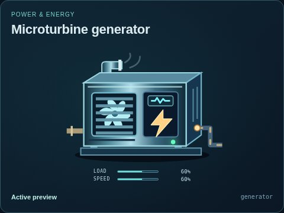</a> | **Microturbine generator**<br>`generator`<br>[API](./docs/API.md#public-api) · [source](./src/twin-art.mjs)<br>5 explicit variants | `load`, `speed`, `damage` | 5 | Twin artwork |
| <a href="./img/thumbnails/transformer.jpg">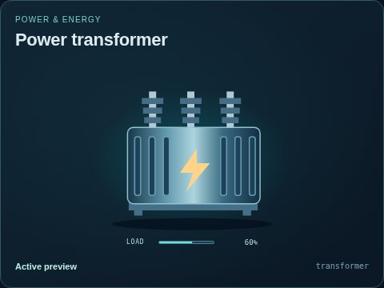</a> | **Power transformer**<br>`transformer`<br>[API](./docs/API.md#public-api) · [source](./src/scada-components.mjs) | `load`, `damage` | 2 | Visual only |
| <a href="./img/thumbnails/breaker.jpg"></a> | **Circuit breaker**<br>`breaker`<br>[API](./docs/API.md#public-api) · [source](./src/scada-components.mjs) | `open`, `damage` | 2 | Visual only |
| <a href="./img/thumbnails/busbar.jpg">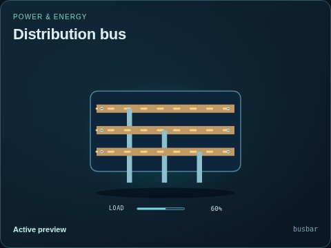</a> | **Distribution bus**<br>`busbar`<br>[API](./docs/API.md#public-api) · [source](./src/scada-components.mjs) | `load`, `damage` | 4 | Visual only |
| <a href="./img/thumbnails/battery.jpg"></a> | **Battery bank**<br>`battery`<br>[API](./docs/API.md#public-api) · [source](./src/scada-components.mjs) | `level`, `damage` | 1 | Visual only |
| <a href="./img/thumbnails/ups.jpg"></a> | **Uninterruptible supply**<br>`ups`<br>[API](./docs/API.md#public-api) · [source](./src/scada-components.mjs) | `level`, `load`, `damage` | 3 | Visual only |
| <a href="./img/thumbnails/solar-panel.jpg"></a> | **Solar array**<br>`solar-panel`<br>[API](./docs/API.md#public-api) · [source](./src/scada-components.mjs) | `load`, `damage` | 1 | Visual only |
| <a href="./img/thumbnails/electrical-meter.jpg">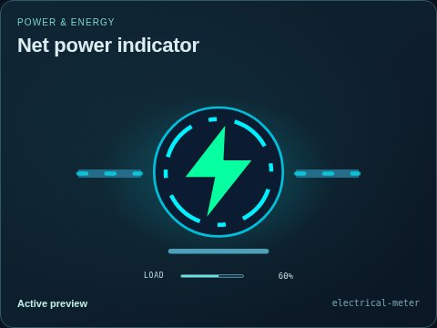</a> | **Net power indicator**<br>`electrical-meter`<br>[API](./docs/API.md#public-api) · [source](./src/twin-art.mjs) | `load`, `damage` | 2 | Twin artwork |
| <a href="./img/thumbnails/electrolyzer.jpg"></a> | **Water electrolyzer**<br>`electrolyzer`<br>[API](./docs/API.md#public-api) · [source](./src/scada-process-art.mjs) | `load`, `temperature`, `damage` | 4 | Visual only |
| <a href="./img/thumbnails/fuel-cell.jpg"></a> | **Fuel-cell generator**<br>`fuel-cell`<br>[API](./docs/API.md#public-api) · [source](./src/scada-process-art.mjs) | `load`, `temperature`, `damage` | 5 | Visual only |
| <a href="./img/thumbnails/wind-turbine.jpg">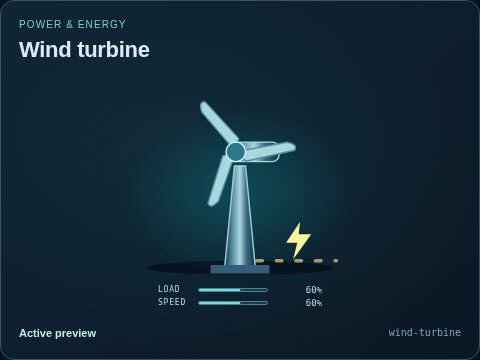</a> | **Wind turbine**<br>`wind-turbine`<br>[API](./docs/API.md#public-api) · [source](./src/scada-process-art.mjs) | `load`, `speed`, `damage` | 2 | Visual only |
| <a href="./img/thumbnails/steam-turbine.jpg">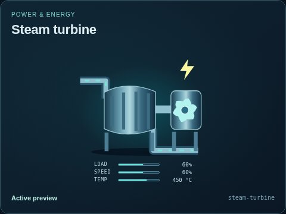</a> | **Steam turbine**<br>`steam-turbine`<br>[API](./docs/API.md#public-api) · [source](./src/scada-process-art.mjs) | `load`, `speed`, `temperature`, `damage` | 3 | Visual only |
| <a href="./img/thumbnails/gas-turbine.jpg">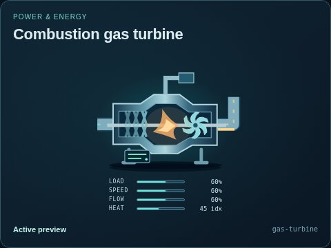</a> | **Combustion gas turbine**<br>`gas-turbine`<br>[API](./docs/API.md#public-api) · [source](./src/scada-energy-art.mjs) | `load`, `speed`, `flow`, `heat`, `damage` | 6 | Visual only |
| <a href="./img/thumbnails/heat-recovery-steam-generator.jpg">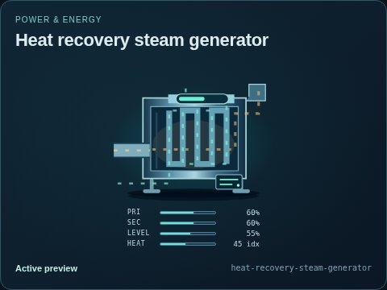</a> | **Heat recovery steam generator**<br>`heat-recovery-steam-generator`<br>[API](./docs/API.md#public-api) · [source](./src/scada-energy-art.mjs) | `primaryFlow`, `secondaryFlow`, `level`, `heat`, `damage` | 6 | Visual only |
| <a href="./img/thumbnails/surface-condenser.jpg"></a> | **Surface condenser**<br>`surface-condenser`<br>[API](./docs/API.md#public-api) · [source](./src/scada-energy-art.mjs) | `primaryFlow`, `secondaryFlow`, `level`, `heat`, `damage` | 5 | Visual only |
| <a href="./img/thumbnails/deaerator.jpg"></a> | **Feedwater deaerator**<br>`deaerator`<br>[API](./docs/API.md#public-api) · [source](./src/scada-energy-art.mjs) | `level`, `flow`, `heat`, `damage` | 5 | Visual only |
| <a href="./img/thumbnails/cooling-radiator.jpg">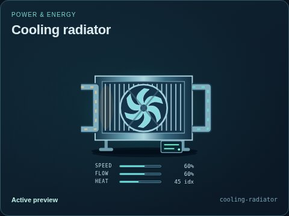</a> | **Cooling radiator**<br>`cooling-radiator`<br>[API](./docs/API.md#public-api) · [source](./src/scada-energy-art.mjs) | `speed`, `flow`, `heat`, `damage` | 6 | Visual only |
| <a href="./img/thumbnails/fuel-pressure-regulator.jpg">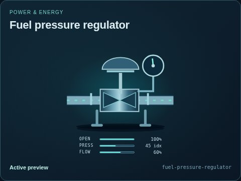</a> | **Fuel pressure regulator**<br>`fuel-pressure-regulator`<br>[API](./docs/API.md#public-api) · [source](./src/scada-energy-art.mjs) | `open`, `opening`, `pressure`, `flow`, `damage` | 4 | Visual only |
| <a href="./img/thumbnails/reservoir.jpg">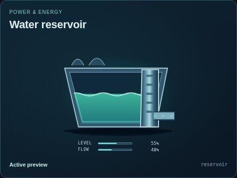</a> | **Water reservoir**<br>`reservoir`<br>[API](./docs/API.md#public-api) · [source](./src/scada-energy-art.mjs) | `level`, `flow`, `damage` | 5 | Visual only |
| <a href="./img/thumbnails/intake-gate.jpg">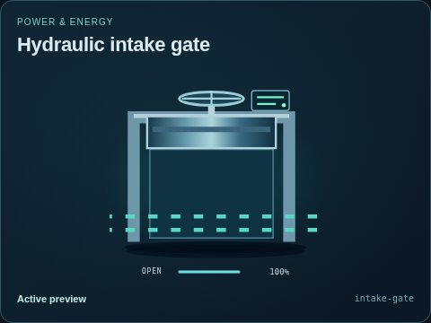</a> | **Hydraulic intake gate**<br>`intake-gate`<br>[API](./docs/API.md#public-api) · [source](./src/scada-energy-art.mjs) | `open`, `opening`, `damage` | 4 | Visual only |
| <a href="./img/thumbnails/hydro-turbine.jpg">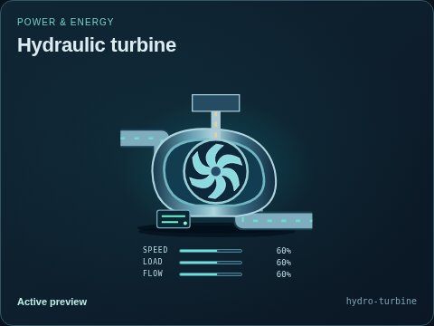</a> | **Hydraulic turbine**<br>`hydro-turbine`<br>[API](./docs/API.md#public-api) · [source](./src/scada-energy-art.mjs) | `speed`, `load`, `flow`, `damage` | 4 | Visual only |
| <a href="./img/thumbnails/reversible-pump-turbine.jpg">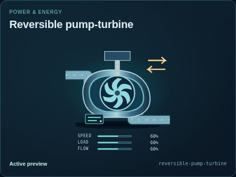</a> | **Reversible pump-turbine**<br>`reversible-pump-turbine`<br>[API](./docs/API.md#public-api) · [source](./src/scada-energy-art.mjs) | `speed`, `load`, `flow`, `mode`, `damage` | 4 | Visual only |
| <a href="./img/thumbnails/power-inverter.jpg"></a> | **DC/AC power inverter**<br>`power-inverter`<br>[API](./docs/API.md#public-api) · [source](./src/scada-electrical-art.mjs)<br>2 explicit variants | `load`, `direction`, `damage` | 4 | Visual only |
| <a href="./img/thumbnails/heliostat.jpg"></a> | **Heliostat mirror**<br>`heliostat`<br>[API](./docs/API.md#public-api) · [source](./src/scada-energy-art.mjs) | `position`, `irradiance`, `damage` | 3 | Visual only |
| <a href="./img/thumbnails/solar-receiver.jpg"></a> | **Solar tower receiver**<br>`solar-receiver`<br>[API](./docs/API.md#public-api) · [source](./src/scada-energy-art.mjs) | `flow`, `heat`, `damage` | 4 | Visual only |
| <a href="./img/thumbnails/parabolic-trough.jpg">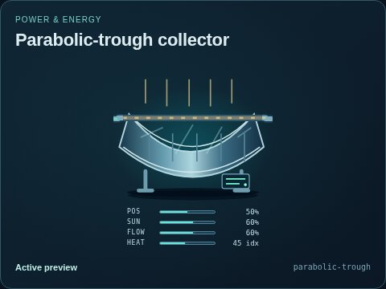</a> | **Parabolic-trough collector**<br>`parabolic-trough`<br>[API](./docs/API.md#public-api) · [source](./src/scada-energy-art.mjs) | `position`, `irradiance`, `flow`, `heat`, `damage` | 4 | Visual only |
| <a href="./img/thumbnails/tidal-turbine.jpg">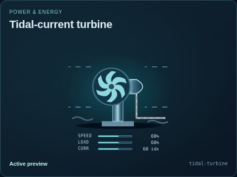</a> | **Tidal-current turbine**<br>`tidal-turbine`<br>[API](./docs/API.md#public-api) · [source](./src/scada-energy-art.mjs) | `speed`, `load`, `current`, `direction`, `damage` | 3 | Visual only |
| <a href="./img/thumbnails/wave-energy-converter.jpg"></a> | **Wave point absorber**<br>`wave-energy-converter`<br>[API](./docs/API.md#public-api) · [source](./src/scada-energy-art.mjs) | `load`, `wave`, `damage` | 3 | Visual only |
| <a href="./img/thumbnails/alternator.jpg">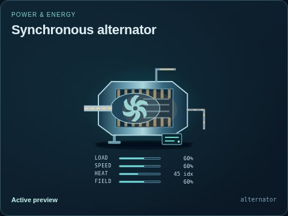</a> | **Synchronous alternator**<br>`alternator`<br>[API](./docs/API.md#public-api) · [source](./src/scada-energy-art.mjs)<br>2 explicit variants | `load`, `speed`, `heat`, `field`, `damage` | 5 | Visual only |
| <a href="./img/thumbnails/hv-circuit-breaker.jpg">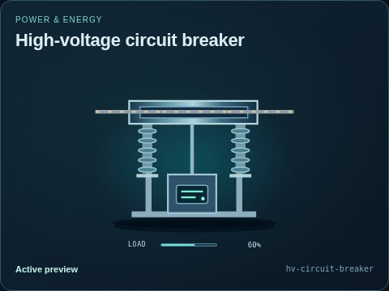</a> | **High-voltage circuit breaker**<br>`hv-circuit-breaker`<br>[API](./docs/API.md#public-api) · [source](./src/scada-electrical-art.mjs) | `open`, `load`, `damage` | 5 | Visual only |
| <a href="./img/thumbnails/disconnect-switch.jpg">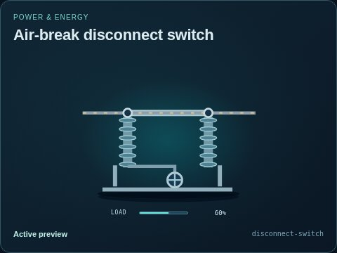</a> | **Air-break disconnect switch**<br>`disconnect-switch`<br>[API](./docs/API.md#public-api) · [source](./src/scada-electrical-art.mjs)<br>2 explicit variants | `open`, `load`, `damage` | 5 | Visual only |
| <a href="./img/thumbnails/earthing-switch.jpg"></a> | **Earthing switch**<br>`earthing-switch`<br>[API](./docs/API.md#public-api) · [source](./src/scada-electrical-art.mjs) | `open`, `damage` | 4 | Visual only |
| <a href="./img/thumbnails/current-transformer.jpg">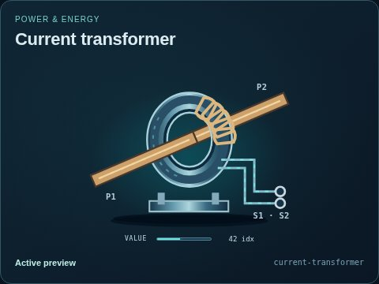</a> | **Current transformer**<br>`current-transformer`<br>[API](./docs/API.md#public-api) · [source](./src/scada-electrical-art.mjs) | `value`, `connected`, `damage` | 3 | Visual only |
| <a href="./img/thumbnails/voltage-transformer.jpg">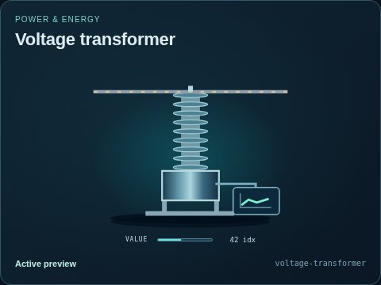</a> | **Voltage transformer**<br>`voltage-transformer`<br>[API](./docs/API.md#public-api) · [source](./src/scada-electrical-art.mjs) | `value`, `connected`, `damage` | 3 | Visual only |
| <a href="./img/thumbnails/surge-arrester.jpg"></a> | **Surge arrester**<br>`surge-arrester`<br>[API](./docs/API.md#public-api) · [source](./src/scada-electrical-art.mjs) | `stress`, `damage` | 3 | Visual only |
| <a href="./img/thumbnails/capacitor-bank.jpg">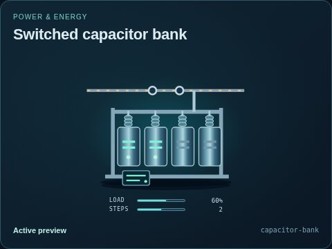</a> | **Switched capacitor bank**<br>`capacitor-bank`<br>[API](./docs/API.md#public-api) · [source](./src/scada-electrical-art.mjs) | `open`, `load`, `steps`, `damage` | 3 | Visual only |
| <a href="./img/thumbnails/shunt-reactor.jpg"></a> | **Shunt reactor**<br>`shunt-reactor`<br>[API](./docs/API.md#public-api) · [source](./src/scada-electrical-art.mjs) | `open`, `load`, `heat`, `damage` | 3 | Visual only |
| <a href="./img/thumbnails/protection-relay.jpg">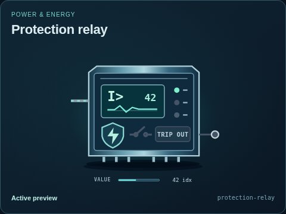</a> | **Protection relay**<br>`protection-relay`<br>[API](./docs/API.md#public-api) · [source](./src/scada-electrical-art.mjs) | `value`, `connected`, `tripped`, `damage` | 4 | Visual only |
| <a href="./img/thumbnails/switchgear-panel.jpg"></a> | **Metal-clad switchgear panel**<br>`switchgear-panel`<br>[API](./docs/API.md#public-api) · [source](./src/scada-electrical-art.mjs) | `open`, `load`, `connected`, `damage` | 5 | Visual only |
| <a href="./img/thumbnails/gis-bay.jpg">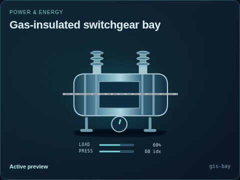</a> | **Gas-insulated switchgear bay**<br>`gis-bay`<br>[API](./docs/API.md#public-api) · [source](./src/scada-electrical-art.mjs) | `open`, `load`, `pressure`, `damage` | 5 | Visual only |
| <a href="./img/thumbnails/automatic-transfer-switch.jpg">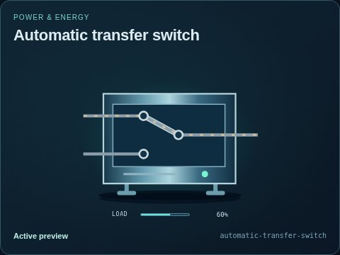</a> | **Automatic transfer switch**<br>`automatic-transfer-switch`<br>[API](./docs/API.md#public-api) · [source](./src/scada-electrical-art.mjs) | `source`, `load`, `automatic`, `damage` | 5 | Visual only |
| <a href="./img/thumbnails/excitation-system.jpg">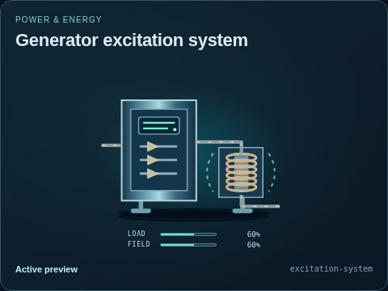</a> | **Generator excitation system**<br>`excitation-system`<br>[API](./docs/API.md#public-api) · [source](./src/scada-electrical-art.mjs) | `load`, `field`, `connected`, `damage` | 4 | Visual only |
| <a href="./img/thumbnails/power-rectifier.jpg">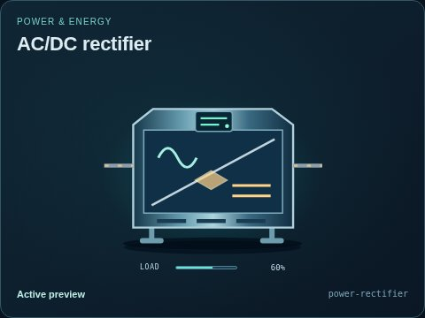</a> | **AC/DC rectifier**<br>`power-rectifier`<br>[API](./docs/API.md#public-api) · [source](./src/scada-electrical-art.mjs) | `load`, `direction`, `damage` | 4 | Visual only |

### Valves

| Preview | Component | Extra states | Ports | Support |
| --- | --- | --- | --- | --- |
| <a href="./img/thumbnails/gate-valve.jpg">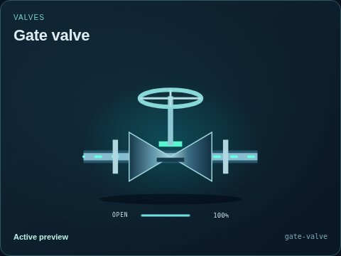</a> | **Gate valve**<br>`gate-valve`<br>[API](./docs/API.md#public-api) · [source](./src/scada-components.mjs)<br>8 explicit variants | `open`, `opening`, `damage` | 2 | Visual only |
| <a href="./img/thumbnails/control-valve.jpg"></a> | **Control valve**<br>`control-valve`<br>[API](./docs/API.md#public-api) · [source](./src/scada-components.mjs)<br>8 explicit variants | `open`, `opening`, `damage` | 3 | Visual only |
| <a href="./img/thumbnails/check-valve.jpg">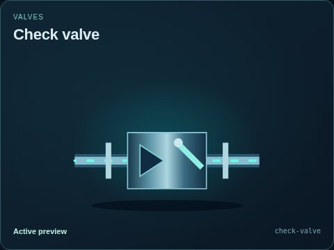</a> | **Check valve**<br>`check-valve`<br>[API](./docs/API.md#public-api) · [source](./src/scada-components.mjs)<br>8 explicit variants | `open`, `damage` | 2 | Visual only |
| <a href="./img/thumbnails/relief-valve.jpg"></a> | **Pressure relief valve**<br>`relief-valve`<br>[API](./docs/API.md#public-api) · [source](./src/scada-components.mjs)<br>8 explicit variants | `open`, `damage` | 2 | Visual only |
| <a href="./img/thumbnails/butterfly-valve.jpg">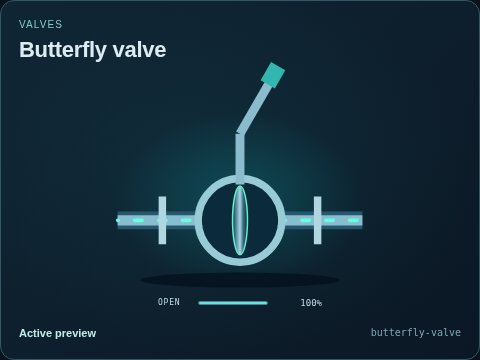</a> | **Butterfly valve**<br>`butterfly-valve`<br>[API](./docs/API.md#public-api) · [source](./src/scada-components.mjs)<br>8 explicit variants | `open`, `opening`, `damage` | 2 | Visual only |

### Instruments

| Preview | Component | Extra states | Ports | Support |
| --- | --- | --- | --- | --- |
| <a href="./img/thumbnails/pressure-transmitter.jpg">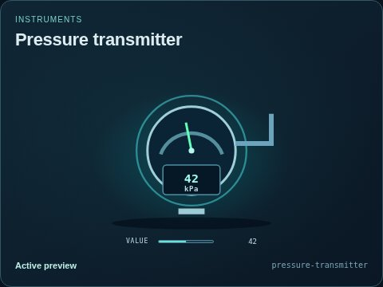</a> | **Pressure transmitter**<br>`pressure-transmitter`<br>[API](./docs/API.md#public-api) · [source](./src/scada-components.mjs) | `value`, `damage` | 3 | Visual only |
| <a href="./img/thumbnails/flow-meter.jpg">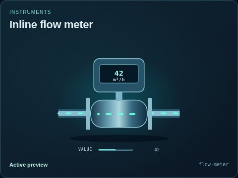</a> | **Inline flow meter**<br>`flow-meter`<br>[API](./docs/API.md#public-api) · [source](./src/scada-components.mjs) | `value`, `damage` | 3 | Visual only |
| <a href="./img/thumbnails/temperature-sensor.jpg"></a> | **Temperature probe**<br>`temperature-sensor`<br>[API](./docs/API.md#public-api) · [source](./src/scada-components.mjs) | `value`, `damage` | 3 | Visual only |
| <a href="./img/thumbnails/level-sensor.jpg"></a> | **Level transmitter**<br>`level-sensor`<br>[API](./docs/API.md#public-api) · [source](./src/scada-components.mjs) | `level`, `value`, `damage` | 3 | Visual only |
| <a href="./img/thumbnails/gas-analyzer.jpg">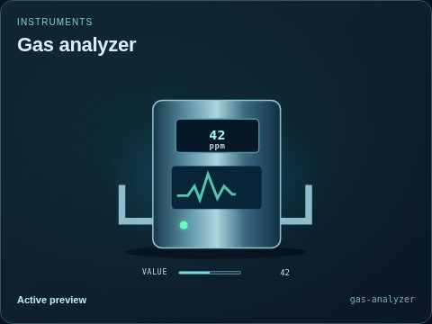</a> | **Gas analyzer**<br>`gas-analyzer`<br>[API](./docs/API.md#public-api) · [source](./src/scada-components.mjs) | `value`, `damage` | 3 | Visual only |
| <a href="./img/thumbnails/water-quality-probe.jpg">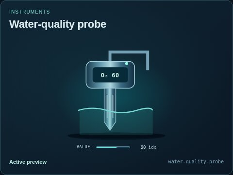</a> | **Water-quality probe**<br>`water-quality-probe`<br>[API](./docs/API.md#public-api) · [source](./src/scada-agriculture-art.mjs) | `connected`, `measurement`, `value`, `damage` | 3 | Visual only |
| <a href="./img/thumbnails/humidity-sensor.jpg">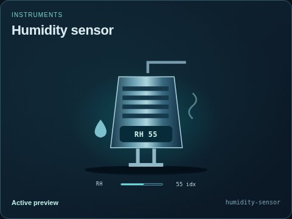</a> | **Humidity sensor**<br>`humidity-sensor`<br>[API](./docs/API.md#public-api) · [source](./src/scada-agriculture-art.mjs) | `connected`, `humidity`, `damage` | 3 | Visual only |
| <a href="./img/thumbnails/light-sensor.jpg"></a> | **PAR light sensor**<br>`light-sensor`<br>[API](./docs/API.md#public-api) · [source](./src/scada-agriculture-art.mjs) | `connected`, `light`, `damage` | 3 | Visual only |

### PLC & networks

| Preview | Component | Extra states | Ports | Support |
| --- | --- | --- | --- | --- |
| <a href="./img/thumbnails/plc-rack.jpg">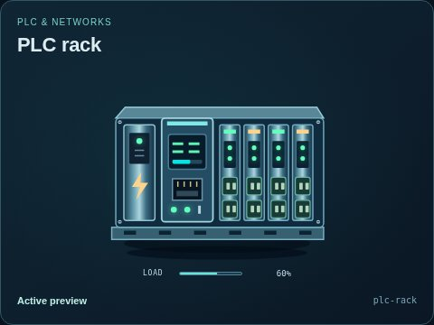</a> | **PLC rack**<br>`plc-rack`<br>[API](./docs/API.md#public-api) · [source](./src/scada-control-art.mjs) | `connected`, `load`, `damage` | 3 | Visual only |
| <a href="./img/thumbnails/plc-cpu.jpg"></a> | **PLC CPU**<br>`plc-cpu`<br>[API](./docs/API.md#public-api) · [source](./src/scada-control-art.mjs) | `connected`, `load`, `damage` | 3 | Visual only |
| <a href="./img/thumbnails/remote-io.jpg"></a> | **Remote IO station**<br>`remote-io`<br>[API](./docs/API.md#public-api) · [source](./src/scada-control-art.mjs) | `connected`, `load`, `damage` | 4 | Visual only |
| <a href="./img/thumbnails/hmi.jpg"></a> | **Operator HMI**<br>`hmi`<br>[API](./docs/API.md#public-api) · [source](./src/scada-control-art.mjs) | `connected`, `damage` | 2 | Visual only |
| <a href="./img/thumbnails/scada-server.jpg"></a> | **SCADA server**<br>`scada-server`<br>[API](./docs/API.md#public-api) · [source](./src/scada-control-art.mjs) | `connected`, `load`, `damage` | 2 | Visual only |
| <a href="./img/thumbnails/network-switch.jpg"></a> | **Industrial network switch**<br>`network-switch`<br>[API](./docs/API.md#public-api) · [source](./src/scada-control-art.mjs) | `connected`, `load`, `damage` | 3 | Visual only |
| <a href="./img/thumbnails/radio.jpg"></a> | **Telemetry radio**<br>`radio`<br>[API](./docs/API.md#public-api) · [source](./src/scada-control-art.mjs) | `connected`, `damage` | 3 | Visual only |

### Connections

| Preview | Component | Extra states | Ports | Support |
| --- | --- | --- | --- | --- |
| <a href="./img/thumbnails/pipe.jpg"></a> | **Process pipe**<br>`pipe`<br>[API](./docs/API.md#public-api) · [source](./src/scada-components.mjs)<br>8 explicit variants | `open`, `damage` | 2 | Visual only |
| <a href="./img/thumbnails/junction.jpg"></a> | **Four-way junction**<br>`junction`<br>[API](./docs/API.md#public-api) · [source](./src/scada-components.mjs) | `open`, `damage` | 4 | Visual only |

### Manufacturing & solids

| Preview | Component | Extra states | Ports | Support |
| --- | --- | --- | --- | --- |
| <a href="./img/thumbnails/conveyor.jpg"></a> | **Belt conveyor**<br>`conveyor`<br>[API](./docs/API.md#public-api) · [source](./src/scada-industrial-art.mjs) | `load`, `speed`, `damage` | 3 | Visual only |
| <a href="./img/thumbnails/crusher.jpg"></a> | **Jaw crusher**<br>`crusher`<br>[API](./docs/API.md#public-api) · [source](./src/scada-industrial-art.mjs) | `load`, `speed`, `damage` | 3 | Visual only |
| <a href="./img/thumbnails/vibrating-screen.jpg"></a> | **Vibrating screen**<br>`vibrating-screen`<br>[API](./docs/API.md#public-api) · [source](./src/scada-industrial-art.mjs) | `load`, `speed`, `damage` | 3 | Visual only |
| <a href="./img/thumbnails/grinding-mill.jpg"></a> | **Grinding mill**<br>`grinding-mill`<br>[API](./docs/API.md#public-api) · [source](./src/scada-industrial-art.mjs) | `load`, `speed`, `damage` | 3 | Visual only |
| <a href="./img/thumbnails/rotary-kiln.jpg"></a> | **Rotary kiln**<br>`rotary-kiln`<br>[API](./docs/API.md#public-api) · [source](./src/scada-industrial-art.mjs) | `load`, `speed`, `temperature`, `damage` | 6 | Visual only |
| <a href="./img/thumbnails/oven.jpg"></a> | **Conveyor oven**<br>`oven`<br>[API](./docs/API.md#public-api) · [source](./src/scada-industrial-art.mjs) | `load`, `temperature`, `damage` | 6 | Visual only |
| <a href="./img/thumbnails/rack-oven.jpg"></a> | **Rack / batch oven**<br>`rack-oven`<br>[API](./docs/API.md#public-api) · [source](./src/scada-industrial-art.mjs) | `load`, `temperature`, `open`, `damage` | 5 | Visual only |
| <a href="./img/thumbnails/dryer.jpg"></a> | **Rotary dryer**<br>`dryer`<br>[API](./docs/API.md#public-api) · [source](./src/scada-industrial-art.mjs) | `load`, `speed`, `temperature`, `damage` | 6 | Visual only |
| <a href="./img/thumbnails/extruder.jpg"></a> | **Screw extruder**<br>`extruder`<br>[API](./docs/API.md#public-api) · [source](./src/scada-industrial-art.mjs) | `load`, `speed`, `damage` | 5 | Visual only |
| <a href="./img/thumbnails/tablet-press.jpg"></a> | **Tablet press**<br>`tablet-press`<br>[API](./docs/API.md#public-api) · [source](./src/scada-industrial-art.mjs) | `load`, `speed`, `damage` | 3 | Visual only |
| <a href="./img/thumbnails/filling-line.jpg"></a> | **Filling line**<br>`filling-line`<br>[API](./docs/API.md#public-api) · [source](./src/scada-industrial-art.mjs) | `load`, `speed`, `damage` | 3 | Visual only |
| <a href="./img/thumbnails/packaging-line.jpg"></a> | **Packaging line**<br>`packaging-line`<br>[API](./docs/API.md#public-api) · [source](./src/scada-industrial-art.mjs) | `load`, `speed`, `damage` | 3 | Visual only |
| <a href="./img/thumbnails/granulator.jpg"></a> | **Granulator**<br>`granulator`<br>[API](./docs/API.md#public-api) · [source](./src/scada-industrial-art.mjs) | `load`, `speed`, `damage` | 3 | Visual only |
| <a href="./img/thumbnails/forming-machine.jpg"></a> | **Forming machine**<br>`forming-machine`<br>[API](./docs/API.md#public-api) · [source](./src/scada-industrial-art.mjs) | `load`, `speed`, `damage` | 3 | Visual only |
| <a href="./img/thumbnails/drum-mixer.jpg"></a> | **Drum mixer**<br>`drum-mixer`<br>[API](./docs/API.md#public-api) · [source](./src/scada-industrial-art.mjs) | `load`, `speed`, `damage` | 3 | Visual only |
| <a href="./img/thumbnails/paper-machine.jpg"></a> | **Paper machine**<br>`paper-machine`<br>[API](./docs/API.md#public-api) · [source](./src/scada-industrial-art.mjs) | `load`, `speed`, `damage` | 3 | Visual only |
| <a href="./img/thumbnails/weigh-hopper.jpg"></a> | **Weigh hopper**<br>`weigh-hopper`<br>[API](./docs/API.md#public-api) · [source](./src/scada-industrial-art.mjs) | `level`, `load`, `damage` | 3 | Visual only |
| <a href="./img/thumbnails/screw-feeder.jpg"></a> | **Screw feeder**<br>`screw-feeder`<br>[API](./docs/API.md#public-api) · [source](./src/scada-industrial-art.mjs) | `load`, `speed`, `damage` | 3 | Visual only |

### Nuclear systems

| Preview | Component | Extra states | Ports | Support |
| --- | --- | --- | --- | --- |
| <a href="./img/thumbnails/pwr-reactor-vessel.jpg"></a> | **Pressurized-water reactor vessel**<br>`pwr-reactor-vessel`<br>[API](./docs/API.md#public-api) · [source](./src/scada-nuclear-art.mjs) | `load`, `heat`, `flow`, `level`, `rodPosition`, `damage` | 4 | Visual only |
| <a href="./img/thumbnails/bwr-reactor-vessel.jpg"></a> | **Boiling-water reactor vessel**<br>`bwr-reactor-vessel`<br>[API](./docs/API.md#public-api) · [source](./src/scada-nuclear-art.mjs) | `load`, `heat`, `flow`, `level`, `rodPosition`, `damage` | 6 | Visual only |
| <a href="./img/thumbnails/phwr-calandria.jpg"></a> | **PHWR calandria and pressure channels**<br>`phwr-calandria`<br>[API](./docs/API.md#public-api) · [source](./src/scada-nuclear-art.mjs) | `load`, `heat`, `flow`, `level`, `rodPosition`, `damage` | 6 | Visual only |
| <a href="./img/thumbnails/gas-cooled-reactor.jpg"></a> | **Gas-cooled reactor concept**<br>`gas-cooled-reactor`<br>[API](./docs/API.md#public-api) · [source](./src/scada-nuclear-art.mjs) | `load`, `heat`, `flow`, `rodPosition`, `damage` | 4 | Visual only |
| <a href="./img/thumbnails/sodium-reactor-vessel.jpg"></a> | **Sodium-cooled reactor concept**<br>`sodium-reactor-vessel`<br>[API](./docs/API.md#public-api) · [source](./src/scada-nuclear-art.mjs) | `load`, `heat`, `flow`, `level`, `rodPosition`, `damage` | 4 | Visual only |
| <a href="./img/thumbnails/molten-salt-reactor.jpg"></a> | **Molten-salt reactor concept**<br>`molten-salt-reactor`<br>[API](./docs/API.md#public-api) · [source](./src/scada-nuclear-art.mjs)<br>1 explicit variants | `load`, `heat`, `flow`, `level`, `rodPosition`, `damage` | 4 | Visual only |
| <a href="./img/thumbnails/nuclear-steam-generator.jpg"></a> | **Nuclear steam generator**<br>`nuclear-steam-generator`<br>[API](./docs/API.md#public-api) · [source](./src/scada-nuclear-art.mjs)<br>5 explicit variants | `primaryFlow`, `secondaryFlow`, `level`, `heat`, `damage` | 5 | Visual only |
| <a href="./img/thumbnails/pressurizer.jpg"></a> | **Pressurizer**<br>`pressurizer`<br>[API](./docs/API.md#public-api) · [source](./src/scada-nuclear-art.mjs) | `level`, `heat`, `pressure`, `damage` | 6 | Visual only |
| <a href="./img/thumbnails/containment-structure.jpg"></a> | **Containment structure**<br>`containment-structure`<br>[API](./docs/API.md#public-api) · [source](./src/scada-nuclear-art.mjs) | `pressure`, `integrity`, `flow`, `heat`, `damage` | 5 | Visual only |
| <a href="./img/thumbnails/used-fuel-pool.jpg"></a> | **Used-fuel cooling pool**<br>`used-fuel-pool`<br>[API](./docs/API.md#public-api) · [source](./src/scada-nuclear-art.mjs) | `level`, `flow`, `heat`, `damage` | 4 | Visual only |
| <a href="./img/thumbnails/control-rod-drive.jpg"></a> | **Control-rod drive indicator**<br>`control-rod-drive`<br>[API](./docs/API.md#public-api) · [source](./src/scada-nuclear-art.mjs) | `rodPosition`, `speed`, `moving`, `damage` | 3 | Visual only |
| <a href="./img/thumbnails/neutron-monitor.jpg"></a> | **Neutron monitor concept**<br>`neutron-monitor`<br>[API](./docs/API.md#public-api) · [source](./src/scada-nuclear-art.mjs) | `value`, `connected`, `damage` | 3 | Visual only |
| <a href="./img/thumbnails/radiation-monitor.jpg"></a> | **Radiation monitor concept**<br>`radiation-monitor`<br>[API](./docs/API.md#public-api) · [source](./src/scada-nuclear-art.mjs) | `value`, `connected`, `damage` | 3 | Visual only |

### Growing & aquaculture

| Preview | Component | Extra states | Ports | Support |
| --- | --- | --- | --- | --- |
| <a href="./img/thumbnails/fish-tank.jpg"></a> | **Aquaculture fish tank**<br>`fish-tank`<br>[API](./docs/API.md#public-api) · [source](./src/scada-agriculture-art.mjs) | `level`, `oxygen`, `load`, `damage` | 5 | Visual only |
| <a href="./img/thumbnails/biofilter.jpg"></a> | **Biological media filter**<br>`biofilter`<br>[API](./docs/API.md#public-api) · [source](./src/scada-agriculture-art.mjs) | `level`, `oxygen`, `load`, `damage` | 5 | Visual only |
| <a href="./img/thumbnails/media-grow-bed.jpg"></a> | **Media grow bed**<br>`media-grow-bed`<br>[API](./docs/API.md#public-api) · [source](./src/scada-agriculture-art.mjs) | `level`, `moisture`, `phase`, `damage` | 4 | Visual only |
| <a href="./img/thumbnails/dwc-raft-bed.jpg"></a> | **Deep-water raft bed**<br>`dwc-raft-bed`<br>[API](./docs/API.md#public-api) · [source](./src/scada-agriculture-art.mjs) | `level`, `oxygen`, `load`, `damage` | 5 | Visual only |
| <a href="./img/thumbnails/nft-channel.jpg"></a> | **Nutrient-film channel**<br>`nft-channel`<br>[API](./docs/API.md#public-api) · [source](./src/scada-agriculture-art.mjs) | `moisture`, `load`, `damage` | 4 | Visual only |
| <a href="./img/thumbnails/ebb-flow-table.jpg"></a> | **Ebb-and-flow nursery table**<br>`ebb-flow-table`<br>[API](./docs/API.md#public-api) · [source](./src/scada-agriculture-art.mjs) | `level`, `moisture`, `phase`, `damage` | 5 | Visual only |
| <a href="./img/thumbnails/drip-zone.jpg"></a> | **Drip irrigation zone**<br>`drip-zone`<br>[API](./docs/API.md#public-api) · [source](./src/scada-agriculture-art.mjs) | `moisture`, `load`, `damage` | 4 | Visual only |
| <a href="./img/thumbnails/aeroponic-chamber.jpg"></a> | **Aeroponic root chamber**<br>`aeroponic-chamber`<br>[API](./docs/API.md#public-api) · [source](./src/scada-agriculture-art.mjs) | `moisture`, `load`, `damage` | 5 | Visual only |
| <a href="./img/thumbnails/grow-light.jpg"></a> | **Horticultural light panel**<br>`grow-light`<br>[API](./docs/API.md#public-api) · [source](./src/scada-agriculture-art.mjs) | `light`, `load`, `damage` | 4 | Visual only |
| <a href="./img/thumbnails/air-diffuser.jpg"></a> | **Submerged air diffuser**<br>`air-diffuser`<br>[API](./docs/API.md#public-api) · [source](./src/scada-agriculture-art.mjs) | `airflow`, `oxygen`, `damage` | 2 | Visual only |

### Climate control

| Preview | Component | Extra states | Ports | Support |
| --- | --- | --- | --- | --- |
| <a href="./img/thumbnails/greenhouse-vent.jpg"></a> | **Greenhouse vent**<br>`greenhouse-vent`<br>[API](./docs/API.md#public-api) · [source](./src/scada-agriculture-art.mjs) | `opening`, `airflow`, `damage` | 4 | Visual only |
| <a href="./img/thumbnails/shade-screen.jpg"></a> | **Retractable shade screen**<br>`shade-screen`<br>[API](./docs/API.md#public-api) · [source](./src/scada-agriculture-art.mjs) | `opening`, `light`, `damage` | 4 | Visual only |
| <a href="./img/thumbnails/evaporative-pad.jpg"></a> | **Evaporative cooling pad**<br>`evaporative-pad`<br>[API](./docs/API.md#public-api) · [source](./src/scada-agriculture-art.mjs) | `moisture`, `airflow`, `humidity`, `damage` | 5 | Visual only |
| <a href="./img/thumbnails/dehumidifier.jpg"></a> | **Air dehumidifier**<br>`dehumidifier`<br>[API](./docs/API.md#public-api) · [source](./src/scada-agriculture-art.mjs) | `humidity`, `level`, `load`, `damage` | 5 | Visual only |

## Workspace primitives

These surfaces use the same standalone stylesheet and native controls. The workspace shell owns focus and dialog lifecycle, not system state.

| Preview | Primitive | API / source |
| --- | --- | --- |
| <a href="./img/thumbnails/workspace-toolbar.jpg"></a> | Toolbar and grouped actions | `renderScadaToolbar()` · [API](./docs/API.md#workspace-api) · [source](./src/scada-workspace.mjs) |
| <a href="./img/thumbnails/workspace-dialog.jpg"></a> | Native modal with focus return | `renderScadaDialog()` + `ScadaWorkspace` · [API](./docs/API.md#workspace-api) |
| <a href="./img/thumbnails/workspace-statusbar.jpg"></a> | Status bar | `.scada-statusbar` · [styles](./src/scada-workspace.css) |
| <a href="./img/thumbnails/workspace-buttons.jpg"></a> | Normal, primary, pressed, danger and disabled buttons; badges | `.scada-toolbutton`, `.scada-toolbadge` · [styles](./src/scada-workspace.css) |
| <a href="./img/thumbnails/workspace-panels.jpg"></a> | Panel groups and actions | `.scada-panel-grid`, `.scada-panel-section`, `.scada-actions` · [styles](./src/scada-workspace.css) |
| <a href="./img/thumbnails/workspace-metrics.jpg"></a> | Readable metric strip | `.scada-metric-strip` · [styles](./src/scada-workspace.css) |

Use a neutral `.scada-workspace` container; no application-specific `#main` wrapper is required. Keep user text escaped when composing trusted body/footer/control markup. All interactive targets should be native controls with visible focus and at least 44 px size. See [STYLE_GUIDE.md](./STYLE_GUIDE.md) for behavior and [API.md](./docs/API.md) for lifecycle examples.

## Thumbnails and verification

[The contact sheet](./img/thumbnails/contact-sheet.jpg) compares equipment silhouettes. [metadata/thumbnails.json](./metadata/thumbnails.json) records generated files, render settings and state. [`img/thumbnails/states/`](./img/thumbnails/states/) contains representative non-default states. Static previews document appearance; they do not prove animation or command behavior.

From the repository root, run `npm run build:library`, `npm test` and `npm run thumbnails` for visual changes. `npm run thumbnails -- --check` verifies the manifest and source/image hashes without silently accepting stale previews. The [contribution guide](./CONTRIBUTING.md) distinguishes source sync, rendered checks, npm packaging, the standalone ZIP and live deployment. A generated artifact or a green test does not publish a release.
