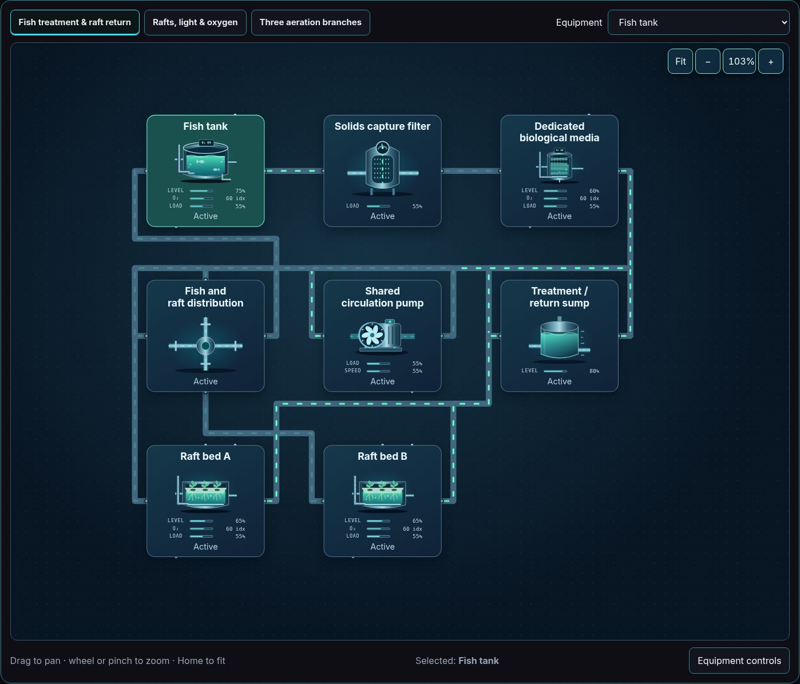

# Agriculture and growing equipment coverage

The [agriculture reference register](AGRICULTURE_REFERENCES.md) records the studied sources and their limits. Six current scenarios use the same UI, version 2 model, snapshot adapter and host lifecycle as the power and industrial examples. Equipment type, growing technology and facility type are separate choices.

| Example | Main relationships |
| --- | --- |
| [Raft aquaponics](https://github.com/Valpatel/cad-agent/blob/dev/software/cadagent/webkit/scada/sim/scenarios/aquaponics-dwc/README.md) | Fish inventory, solids removal, biological filtration, aeration and growing beds share declared water circuits. |
| [Nutrient film hydroponics](https://github.com/Valpatel/cad-agent/blob/dev/software/cadagent/webkit/scada/sim/scenarios/hydroponics-nft/README.md) | Nutrient reservoir, circulation, film channels and return remain distinct. |
| [Ebb-and-flow hydroponics](https://github.com/Valpatel/cad-agent/blob/dev/software/cadagent/webkit/scada/sim/scenarios/hydroponics-ebb-flow/README.md) | Flood and drain phases expose changing tray and reservoir state. |
| [Aeroponics](https://github.com/Valpatel/cad-agent/blob/dev/software/cadagent/webkit/scada/sim/scenarios/indoor-aeroponics/README.md) | Root chamber, mist delivery and nutrient supply show pressure and moisture separately. |
| [Greenhouse](https://github.com/Valpatel/cad-agent/blob/dev/software/cadagent/webkit/scada/sim/scenarios/greenhouse-drip/README.md) | Irrigation, ventilation, heating, humidity and environmental zones share the system session. |
| [Media-bed aquaponics](https://github.com/Valpatel/cad-agent/blob/dev/software/cadagent/webkit/scada/sim/scenarios/aquaponics-media-bed/README.md) | Fish loop, solids and media beds provide a distinct treatment and growing arrangement. |

Use the [scenario catalog](https://github.com/Valpatel/cad-agent/blob/dev/software/cadagent/webkit/scada/sim/scenarios/README.md) for authoritative IDs, definitions, views, controls and experiment recipes. Each scenario keeps its own JSON pair and assumptions. Library models use illustrative moisture, oxygen, nutrient, solids, pH/EC and climate indices; they do not predict yield, fish welfare or a safe crop recipe.

## Extension and state review

Reuse pumps, valves, heaters, filtration, PLCs and electrical services where their ports match. Add a new symbol when geometry or role differs: nutrient film channel, raft bed, fish tank, root chamber, tray and greenhouse vent should remain visually distinguishable. Label a supply boundary rather than creating water or energy from an unconnected inlet.

Review actual inventory, flow, light, temperature and moisture independently from activity. A stopped pump can leave water in a bed; switched-off lights do not remove room heat; ventilation position must remain visible while paused. Warning, sensor failure and damage must not fabricate a valid reading. Use [state coverage](STATE_COVERAGE.md) and the [component workflow](../CONTRIBUTING.md) to inspect inactive, low/mid/high, warning, damage, repair and reduced-motion states.

For measured equipment or crop responses, replace declared laws through the [model adaptation boundary](https://github.com/Valpatel/cad-agent/blob/dev/software/cadagent/webkit/scada/sim/docs/REAL_MODEL_ADAPTATION.md). Keep units, calibration evidence, operating range and source rights with the provider. A structurally informed diagram and an animated plant are separate from a validated biological model.

[Documentation map](README.md) · [Agriculture references](AGRICULTURE_REFERENCES.md)
