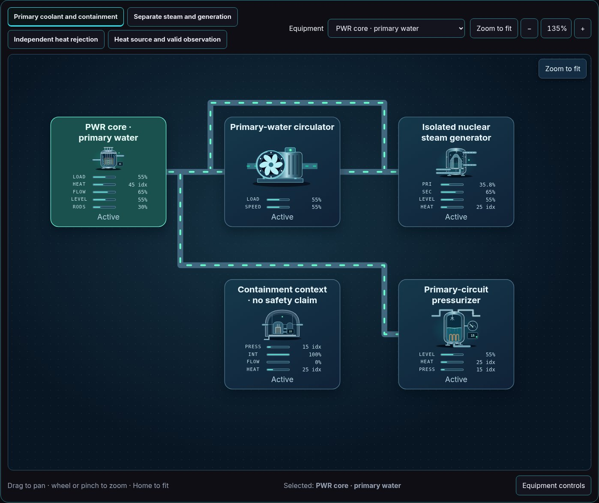

# Power equipment and example coverage

The [power reference register](POWER_REFERENCES.md) supports equipment roles, readable geometry and separation of process circuits. The [scenario catalog](https://github.com/Valpatel/cad-agent/blob/dev/software/cadagent/webkit/scada/sim/scenarios/README.md) owns the actual runnable systems and counts; [state coverage](STATE_COVERAGE.md) records demonstrated artwork behavior and remaining gaps. All numerical defaults remain editable illustrative assumptions.

| Family | Browse equipment or examples | Contract to preserve |
| --- | --- | --- |
| Fuelled generation | [Gas CHP](https://github.com/Valpatel/cad-agent/blob/dev/software/cadagent/webkit/scada/sim/scenarios/power-ng-engine-chp/README.md), [diesel standby](https://github.com/Valpatel/cad-agent/blob/dev/software/cadagent/webkit/scada/sim/scenarios/power-diesel-standby/README.md), [portable gasoline](https://github.com/Valpatel/cad-agent/blob/dev/software/cadagent/webkit/scada/sim/scenarios/power-gasoline-portable/README.md) | Fuel identity, shaft conversion, nameplate display and actual power state are separate. |
| Thermal cycles | [Combined cycle](https://github.com/Valpatel/cad-agent/blob/dev/software/cadagent/webkit/scada/sim/scenarios/power-gas-combined-cycle/README.md), [coal steam](https://github.com/Valpatel/cad-agent/blob/dev/software/cadagent/webkit/scada/sim/scenarios/power-coal-steam/README.md) | Exhaust, feedwater, steam, condenser cooling and useful heat have explicit paths. |
| Hydro and storage | [Impoundment](https://github.com/Valpatel/cad-agent/blob/dev/software/cadagent/webkit/scada/sim/scenarios/power-hydro-impoundment/README.md), [pumped storage](https://github.com/Valpatel/cad-agent/blob/dev/software/cadagent/webkit/scada/sim/scenarios/power-pumped-storage/README.md) | Water inventories and direction-dependent energy conversion remain distinct. |
| Solar, wind and marine | [PV](https://github.com/Valpatel/cad-agent/blob/dev/software/cadagent/webkit/scada/sim/scenarios/power-solar-pv/README.md), [wind](https://github.com/Valpatel/cad-agent/blob/dev/software/cadagent/webkit/scada/sim/scenarios/power-wind-collection/README.md), [tidal](https://github.com/Valpatel/cad-agent/blob/dev/software/cadagent/webkit/scada/sim/scenarios/power-tidal-current/README.md), [wave](https://github.com/Valpatel/cad-agent/blob/dev/software/cadagent/webkit/scada/sim/scenarios/power-wave-point-absorber/README.md) | Environmental input can persist when conversion stops; AC, DC and optical connections remain distinct. |
| Grid interface | [Distribution substation](https://github.com/Valpatel/cad-agent/blob/dev/software/cadagent/webkit/scada/sim/scenarios/power-substation-distribution/README.md), [GIS](https://github.com/Valpatel/cad-agent/blob/dev/software/cadagent/webkit/scada/sim/scenarios/power-substation-gis/README.md), [HVDC](https://github.com/Valpatel/cad-agent/blob/dev/software/cadagent/webkit/scada/sim/scenarios/power-hvdc-interface/README.md) | Switching, isolation, earthing, measurement, protection and conversion are different roles. |
| Nuclear concepts | [PWR](https://github.com/Valpatel/cad-agent/blob/dev/software/cadagent/webkit/scada/sim/scenarios/power-nuclear-pwr/README.md), [BWR](https://github.com/Valpatel/cad-agent/blob/dev/software/cadagent/webkit/scada/sim/scenarios/power-nuclear-bwr/README.md), [PHWR](https://github.com/Valpatel/cad-agent/blob/dev/software/cadagent/webkit/scada/sim/scenarios/power-nuclear-phwr/README.md), [HTGR](https://github.com/Valpatel/cad-agent/blob/dev/software/cadagent/webkit/scada/sim/scenarios/power-nuclear-htgr/README.md), [sodium](https://github.com/Valpatel/cad-agent/blob/dev/software/cadagent/webkit/scada/sim/scenarios/power-nuclear-sodium-fast/README.md), [salt](https://github.com/Valpatel/cad-agent/blob/dev/software/cadagent/webkit/scada/sim/scenarios/power-nuclear-molten-salt/README.md) | Selected coolant, heat-transfer boundary and fuel concept are explicit. These models do not implement neutronics or predict protection performance. |

## Adding or refining equipment

Choose a new type only when geometry or function differs. Capacity, fuel and enclosure generally belong in explicit variants or model parameters. Use the [discovery API](API.md#discovery-and-variants), [model contracts](https://github.com/Valpatel/cad-agent/blob/dev/software/cadagent/webkit/scada/sim/docs/MODEL-API.md) and [component workflow](../CONTRIBUTING.md) together. An `alternator` converts shaft power; a packaged `generator` has its own declared fuel contract. A relay observes and controls a circuit rather than acting as an entire feeder load.

Separate commanded activity, driven motion, delivered power, inventory, heat and damage. A trip can stop a source while residual heat or a leak persists. Show actual open/closed contacts and direction cues; a visible animation is not a verified interlock. Nuclear incident artwork must not describe a generic vessel failure as a nuclear detonation.

Check off, low/mid/high, warning, trip, damage, repair, pause and reduced-motion states against the relevant descriptor. Capture geometry and source state together. Add equations through the [registered provider boundary](https://github.com/Valpatel/cad-agent/blob/dev/software/cadagent/webkit/scada/sim/docs/REAL_MODEL_ADAPTATION.md) with independent evidence and operating limits; references to facility guides alone do not validate a physical model.

[Documentation map](README.md) · [Power references](POWER_REFERENCES.md)
