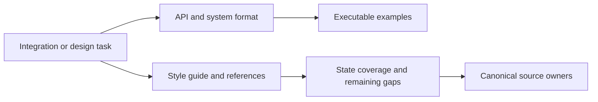

# SCADA UI documentation

[Package map](../README.md) · [Source owners](../src/README.md) · [Examples](../examples/README.md) · [Gallery](../img/README.md)

This folder explains the public contracts, design evidence and known limits. Runtime implementations live in `src/`; system models live in the separate simulation package. A documentation example or gallery pose is not a live process measurement.

| Document | Use it for |
| --- | --- |
| [API.md](./API.md) | Component, discovery, workspace, viewer and camera APIs; imports, lifecycle and state inputs. |
| [SYSTEM_FORMAT.md](./SYSTEM_FORMAT.md) | Versioned JSON system documents, ports, bindings, commands, provenance and assumptions. |
| [VARIANTS.md](./VARIANTS.md) | Explicit technology/service variants and existing visual previews. |
| [STATE_COVERAGE.md](./STATE_COVERAGE.md) | Per-type coverage, confirmed behavior and remaining design work. |
| [state-coverage.json](./state-coverage.json) | Reviewed source-bound coverage measurements and hashes; a manual review artifact, not generated catalog metadata. |
| [GALLERY_EXPORT.md](./GALLERY_EXPORT.md) | How canonical renderers become standalone animated SVG gallery images. |
| [VISUAL_REFERENCES.md](./VISUAL_REFERENCES.md) | Primary references, original drawing choices and refinement evidence. |
| [POWER_REFERENCES.md](./POWER_REFERENCES.md) | Power, substation, generator and conceptual nuclear reference boundaries. |
| [AGRICULTURE_REFERENCES.md](./AGRICULTURE_REFERENCES.md) | Growing, aquaculture and climate reference boundaries. |

Start with [the style guide](../STYLE_GUIDE.md) for appearance and state semantics, [contributing](../CONTRIBUTING.md) for the change workflow, and [agent prompts](../AGENT_PROMPTS.md) for reusable tasks. Keep limitations beside claims: typed state, model availability and a moving picture are different kinds of evidence.

The preview links to this package's existing gallery. It is an illustrative supplied state; image animation depends on the Markdown renderer.
