# Equipment variant previews

Generated from the canonical registry: **97 explicit variants** across **20 component types**. These supplement the **142 base equipment symbols** in the [main catalog](../README.md#equipment-catalog).

Select a variant with `renderScadaComponent(type, { variant, state })` or the `variant` field of a system component. The [API](API.md) and [system format](SYSTEM_FORMAT.md) describe validation. Each preview records its exact normalized state in the [thumbnail manifest](../metadata/thumbnails.json).

Variants may change the silhouette, supported fluid, ports or connection roles. A shared silhouette does not imply shared or mixed circuits. These declarations are presentation contracts; the external model supplies operating assumptions and state.

| Preview | Type and variant | Meaning from the descriptor |
| --- | --- | --- |
| <a href="../img/thumbnails/variants/heat-exchanger--water-water.jpg">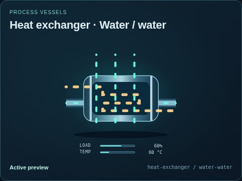</a> | **Water / water** `heat-exchanger` `water-water` | Tube bundle with visually separate hot and cold flow paths.  Circuits: hot = water; cold = water. Ports: hot-in (liquid, in); hot-out (liquid, out); cold-in (liquid, in); cold-out (liquid, out). |
| <a href="../img/thumbnails/variants/heat-exchanger--heavy-water-water.jpg">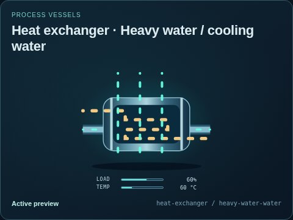</a> | **Heavy water / cooling water** `heat-exchanger` `heavy-water-water` | Tube bundle with visually separate hot and cold flow paths.  Circuits: hot = heavy-water; cold = water. Ports: hot-in (liquid, in); hot-out (liquid, out); cold-in (liquid, in); cold-out (liquid, out). |
| <a href="../img/thumbnails/variants/heat-exchanger--helium-water.jpg">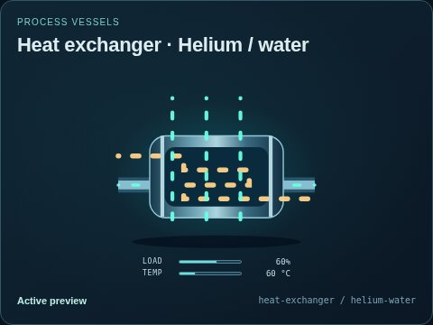</a> | **Helium / water** `heat-exchanger` `helium-water` | Tube bundle with visually separate hot and cold flow paths.  Circuits: hot = helium; cold = water. Ports: hot-in (gas, in); hot-out (gas, out); cold-in (liquid, in); cold-out (liquid, out). |
| <a href="../img/thumbnails/variants/heat-exchanger--sodium-sodium.jpg">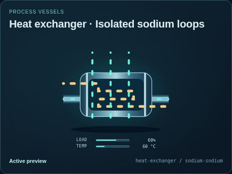</a> | **Isolated sodium loops** `heat-exchanger` `sodium-sodium` | Tube bundle with visually separate hot and cold flow paths.  Circuits: hot = sodium; cold = sodium. Ports: hot-in (thermal-fluid, in); hot-out (thermal-fluid, out); cold-in (thermal-fluid, in); cold-out (thermal-fluid, out). |
| <a href="../img/thumbnails/variants/heat-exchanger--salt-salt.jpg">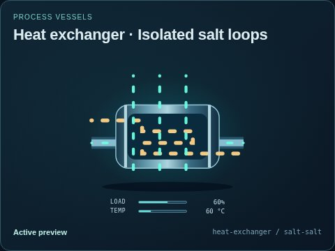</a> | **Isolated salt loops** `heat-exchanger` `salt-salt` | Tube bundle with visually separate hot and cold flow paths.  Circuits: hot = salt; cold = salt. Ports: hot-in (thermal-fluid, in); hot-out (thermal-fluid, out); cold-in (thermal-fluid, in); cold-out (thermal-fluid, out). |
| <a href="../img/thumbnails/variants/heat-exchanger--salt-water.jpg">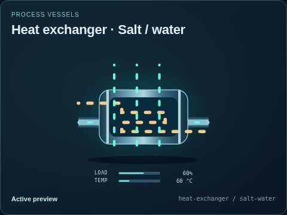</a> | **Salt / water** `heat-exchanger` `salt-water` | Tube bundle with visually separate hot and cold flow paths.  Circuits: hot = salt; cold = water. Ports: hot-in (thermal-fluid, in); hot-out (thermal-fluid, out); cold-in (liquid, in); cold-out (liquid, out). |
| <a href="../img/thumbnails/variants/heat-exchanger--thermal-fluid-water.jpg">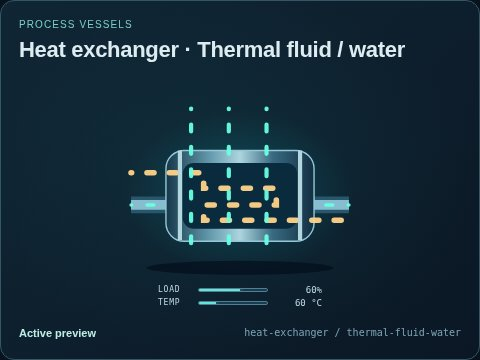</a> | **Thermal fluid / water** `heat-exchanger` `thermal-fluid-water` | Tube bundle with visually separate hot and cold flow paths.  Circuits: hot = thermal-fluid; cold = water. Ports: hot-in (thermal-fluid, in); hot-out (thermal-fluid, out); cold-in (liquid, in); cold-out (liquid, out). |
| <a href="../img/thumbnails/variants/heat-exchanger--geothermal-working-fluid.jpg">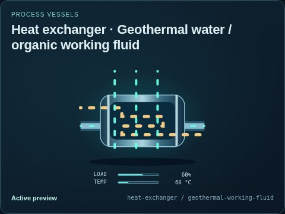</a> | **Geothermal water / organic working fluid** `heat-exchanger` `geothermal-working-fluid` | Tube bundle with visually separate hot and cold flow paths.  Circuits: hot = geothermal-water; cold = organic-working-fluid. Ports: hot-in (liquid, in); hot-out (liquid, out); cold-in (thermal-fluid, in); cold-out (thermal-fluid, out). |
| <a href="../img/thumbnails/variants/boiler--gas-fired.jpg">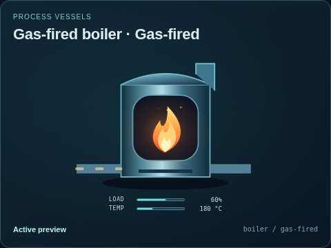</a> | **Gas-fired** `boiler` `gas-fired` | Burner window, flame and stack, reused from the twin useful-gas branch.  Fuel: natural-gas. Circuits: fuel = fuel-gas; air-exhaust = combustion-gas; water = secondary-water. Ports: fuel (gas, in); heat (thermal, out); exhaust (gas, out); steam (steam, out); feedwater (liquid, in); air (air, in). |
| <a href="../img/thumbnails/variants/boiler--solid-fuel.jpg">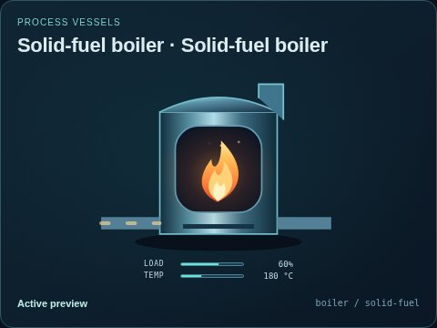</a> | **Solid-fuel boiler** `boiler` `solid-fuel` | Generic boiler illustration with an explicit solid-fuel supply, separate combustion-air path and isolated feedwater/steam inventory.  Fuel: solid-fuel. Circuits: fuel = solid-fuel; air-exhaust = combustion-gas; water = secondary-water. Ports: heat (thermal, out); exhaust (gas, out); steam (steam, out); feedwater (liquid, in); air (air, in); solid-fuel (solids, in). |
| <a href="../img/thumbnails/variants/boiler--liquid-fuel.jpg">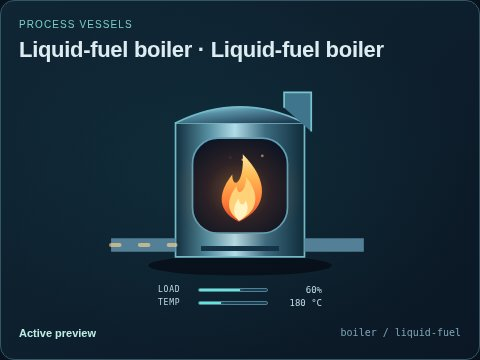</a> | **Liquid-fuel boiler** `boiler` `liquid-fuel` | Generic boiler illustration with an explicit liquid-fuel supply, separate combustion-air path and isolated feedwater/steam inventory.  Fuel: liquid-fuel. Circuits: fuel = liquid-fuel; air-exhaust = combustion-gas; water = secondary-water. Ports: heat (thermal, out); exhaust (gas, out); steam (steam, out); feedwater (liquid, in); air (air, in); liquid-fuel (liquid, in). |
| <a href="../img/thumbnails/variants/pump--water.jpg">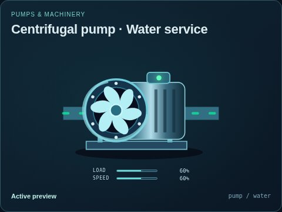</a> | **Water service** `pump` `water` | Explicit illustrative compatibility selection; engineering service suitability is not established.  Circuits: process = water. Ports: inlet (liquid, in); outlet (liquid, out); drive (electricity, in). |
|  | **Heat-transfer fluid** `pump` `thermal-fluid` | Explicit illustrative compatibility selection; engineering service suitability is not established.  Circuits: process = thermal-fluid. Ports: inlet (thermal-fluid, in); outlet (thermal-fluid, out); drive (electricity, in). |
| <a href="../img/thumbnails/variants/pump--helium.jpg">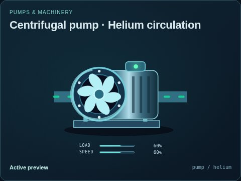</a> | **Helium circulation** `pump` `helium` | Explicit illustrative compatibility selection; engineering service suitability is not established.  Circuits: process = helium. Ports: inlet (gas, in); outlet (gas, out); drive (electricity, in). |
| <a href="../img/thumbnails/variants/pump--sodium.jpg">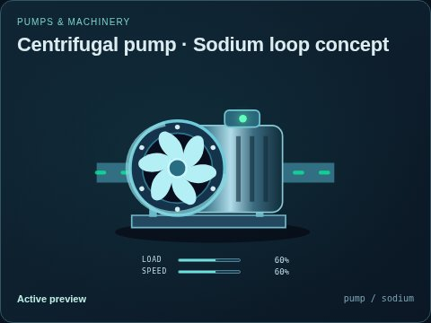</a> | **Sodium loop concept** `pump` `sodium` | Explicit illustrative compatibility selection; engineering service suitability is not established.  Circuits: process = sodium. Ports: inlet (thermal-fluid, in); outlet (thermal-fluid, out); drive (electricity, in). |
| <a href="../img/thumbnails/variants/pump--salt.jpg">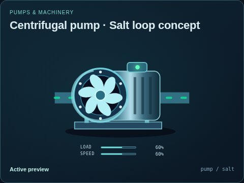</a> | **Salt loop concept** `pump` `salt` | Explicit illustrative compatibility selection; engineering service suitability is not established.  Circuits: process = salt. Ports: inlet (thermal-fluid, in); outlet (thermal-fluid, out); drive (electricity, in). |
| <a href="../img/thumbnails/variants/pump--heavy-water.jpg">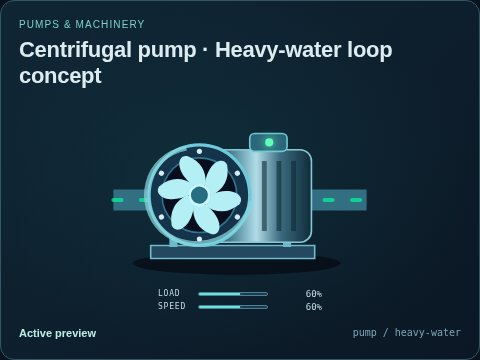</a> | **Heavy-water loop concept** `pump` `heavy-water` | Explicit illustrative compatibility selection; engineering service suitability is not established.  Circuits: process = heavy-water. Ports: inlet (liquid, in); outlet (liquid, out); drive (electricity, in). |
| <a href="../img/thumbnails/variants/pump--organic-working-fluid.jpg">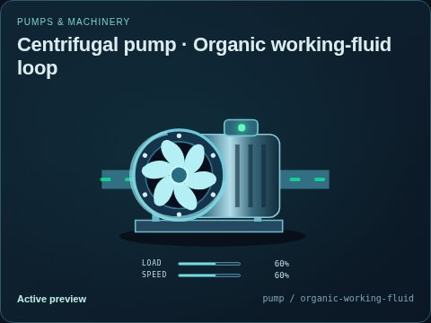</a> | **Organic working-fluid loop** `pump` `organic-working-fluid` | Explicit illustrative compatibility selection; engineering service suitability is not established.  Circuits: process = organic-working-fluid. Ports: inlet (thermal-fluid, in); outlet (thermal-fluid, out); drive (electricity, in). |
|  | **Liquid-fuel transfer** `pump` `liquid-fuel` | Explicit illustrative compatibility selection; engineering service suitability is not established.  Circuits: process = liquid-fuel. Ports: inlet (liquid, in); outlet (liquid, out); drive (electricity, in). |
| <a href="../img/thumbnails/variants/submersible-pump--water.jpg">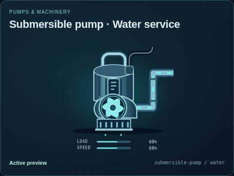</a> | **Water service** `submersible-pump` `water` | Explicit illustrative compatibility selection; engineering service suitability is not established.  Circuits: process = water. Ports: inlet (liquid, in); outlet (liquid, out); drive (electricity, in). |
| <a href="../img/thumbnails/variants/submersible-pump--thermal-fluid.jpg">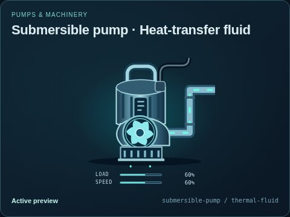</a> | **Heat-transfer fluid** `submersible-pump` `thermal-fluid` | Explicit illustrative compatibility selection; engineering service suitability is not established.  Circuits: process = thermal-fluid. Ports: inlet (thermal-fluid, in); outlet (thermal-fluid, out); drive (electricity, in). |
|  | **Helium circulation** `submersible-pump` `helium` | Explicit illustrative compatibility selection; engineering service suitability is not established.  Circuits: process = helium. Ports: inlet (gas, in); outlet (gas, out); drive (electricity, in). |
| <a href="../img/thumbnails/variants/submersible-pump--sodium.jpg">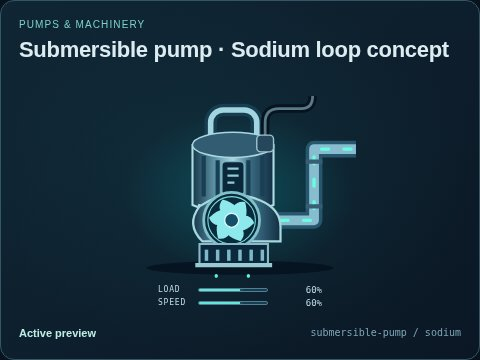</a> | **Sodium loop concept** `submersible-pump` `sodium` | Explicit illustrative compatibility selection; engineering service suitability is not established.  Circuits: process = sodium. Ports: inlet (thermal-fluid, in); outlet (thermal-fluid, out); drive (electricity, in). |
| <a href="../img/thumbnails/variants/submersible-pump--salt.jpg">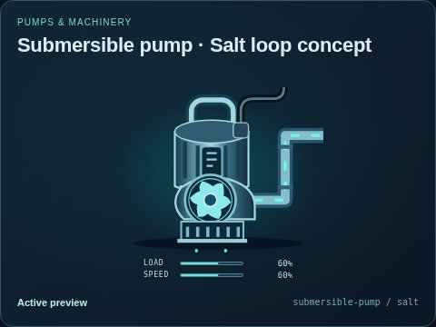</a> | **Salt loop concept** `submersible-pump` `salt` | Explicit illustrative compatibility selection; engineering service suitability is not established.  Circuits: process = salt. Ports: inlet (thermal-fluid, in); outlet (thermal-fluid, out); drive (electricity, in). |
| <a href="../img/thumbnails/variants/submersible-pump--heavy-water.jpg">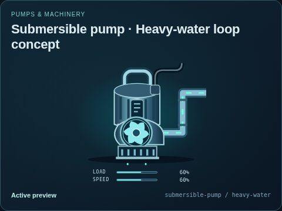</a> | **Heavy-water loop concept** `submersible-pump` `heavy-water` | Explicit illustrative compatibility selection; engineering service suitability is not established.  Circuits: process = heavy-water. Ports: inlet (liquid, in); outlet (liquid, out); drive (electricity, in). |
| <a href="../img/thumbnails/variants/submersible-pump--organic-working-fluid.jpg">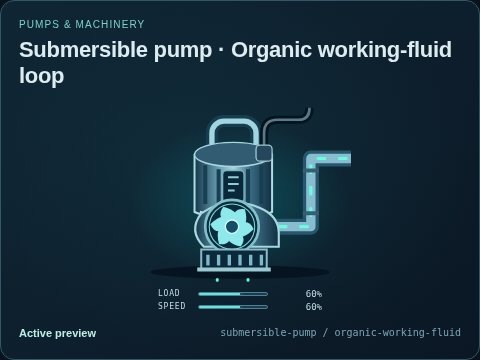</a> | **Organic working-fluid loop** `submersible-pump` `organic-working-fluid` | Explicit illustrative compatibility selection; engineering service suitability is not established.  Circuits: process = organic-working-fluid. Ports: inlet (thermal-fluid, in); outlet (thermal-fluid, out); drive (electricity, in). |
| <a href="../img/thumbnails/variants/submersible-pump--liquid-fuel.jpg">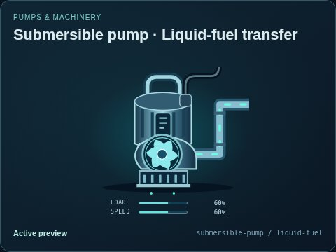</a> | **Liquid-fuel transfer** `submersible-pump` `liquid-fuel` | Explicit illustrative compatibility selection; engineering service suitability is not established.  Circuits: process = liquid-fuel. Ports: inlet (liquid, in); outlet (liquid, out); drive (electricity, in). |
| <a href="../img/thumbnails/variants/blower--helium.jpg">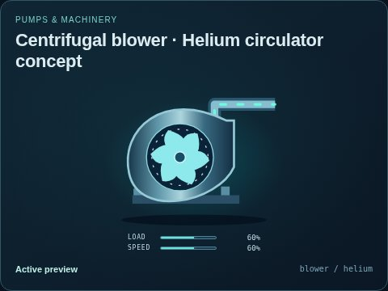</a> | **Helium circulator concept** `blower` `helium` | Scroll housing, guarded radial fan and tangential air outlet.  Circuits: process = helium. Ports: intake (gas, in); discharge (gas, out); drive (electricity, in). |
| <a href="../img/thumbnails/variants/generator--natural-gas-enclosed.jpg">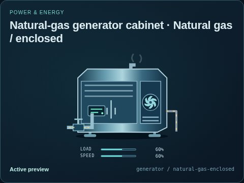</a> | **Natural gas / enclosed** `generator` `natural-gas-enclosed` | Original cabinet packaged-generator illustration with an explicit natural gas inlet. Capacity and dynamics come from the external model.  Fuel: natural-gas. Form: cabinet. Circuits: fuel = fuel-gas; air-exhaust = combustion-gas. Ports: fuel (gas, in); output (electricity, out); exhaust (gas, out); heat (thermal, out); air (air, in). |
| <a href="../img/thumbnails/variants/generator--natural-gas-industrial.jpg">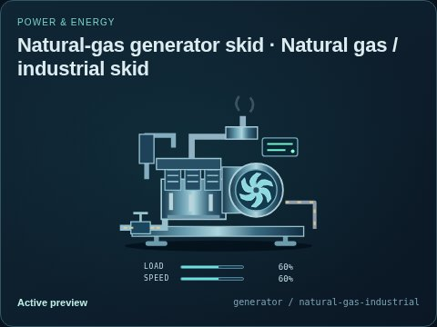</a> | **Natural gas / industrial skid** `generator` `natural-gas-industrial` | Original skid packaged-generator illustration with an explicit natural gas inlet. Capacity and dynamics come from the external model.  Fuel: natural-gas. Form: skid. Circuits: fuel = fuel-gas; air-exhaust = combustion-gas. Ports: fuel (gas, in); output (electricity, out); exhaust (gas, out); heat (thermal, out); air (air, in). |
| <a href="../img/thumbnails/variants/generator--diesel-skid.jpg">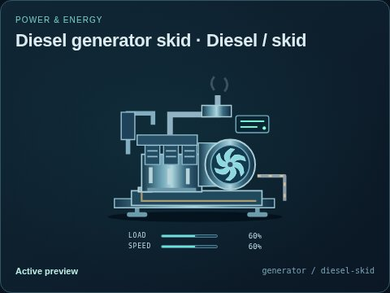</a> | **Diesel / skid** `generator` `diesel-skid` | Original skid packaged-generator illustration with an explicit diesel inlet. Capacity and dynamics come from the external model.  Fuel: diesel. Form: skid. Circuits: fuel = diesel; air-exhaust = combustion-gas. Ports: output (electricity, out); exhaust (gas, out); heat (thermal, out); air (air, in); liquid-fuel (liquid, in). |
| <a href="../img/thumbnails/variants/generator--diesel-enclosed.jpg">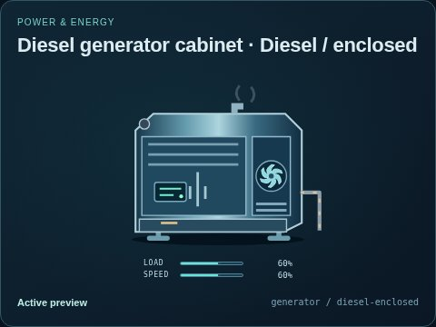</a> | **Diesel / enclosed** `generator` `diesel-enclosed` | Original cabinet packaged-generator illustration with an explicit diesel inlet. Capacity and dynamics come from the external model.  Fuel: diesel. Form: cabinet. Circuits: fuel = diesel; air-exhaust = combustion-gas. Ports: output (electricity, out); exhaust (gas, out); heat (thermal, out); air (air, in); liquid-fuel (liquid, in). |
| <a href="../img/thumbnails/variants/generator--gasoline-portable.jpg">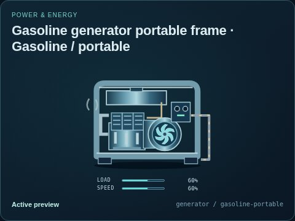</a> | **Gasoline / portable** `generator` `gasoline-portable` | Original portable frame packaged-generator illustration with an explicit gasoline inlet. Capacity and dynamics come from the external model.  Fuel: gasoline. Form: portable-frame. Circuits: fuel = gasoline; air-exhaust = combustion-gas. Ports: output (electricity, out); exhaust (gas, out); heat (thermal, out); air (air, in); liquid-fuel (liquid, in). |
|  | **Bidirectional AC common bus** `busbar` `bidirectional` | A common AC conductor with four bidirectional connections for explicit supply, load and storage branches. The external model determines each branch flow.  Ports: supply (electricity, bidirectional); branch-a (electricity, bidirectional); branch-b (electricity, bidirectional); branch-c (electricity, bidirectional). |
| <a href="../img/thumbnails/variants/gate-valve--water.jpg">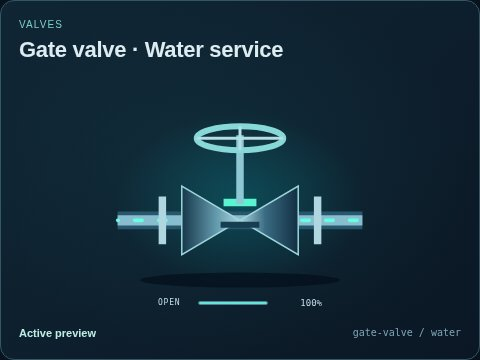</a> | **Water service** `gate-valve` `water` | Explicit illustrative compatibility selection; engineering service suitability is not established.  Circuits: process = water. Ports: inlet (liquid, in); outlet (liquid, out). |
| <a href="../img/thumbnails/variants/gate-valve--thermal-fluid.jpg">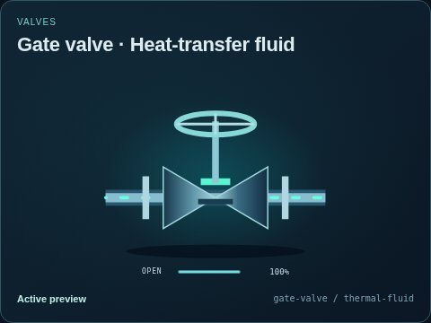</a> | **Heat-transfer fluid** `gate-valve` `thermal-fluid` | Explicit illustrative compatibility selection; engineering service suitability is not established.  Circuits: process = thermal-fluid. Ports: inlet (thermal-fluid, in); outlet (thermal-fluid, out). |
| <a href="../img/thumbnails/variants/gate-valve--helium.jpg">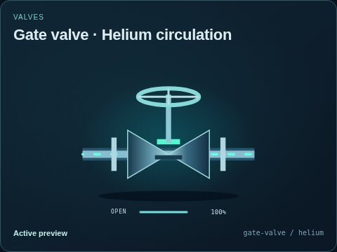</a> | **Helium circulation** `gate-valve` `helium` | Explicit illustrative compatibility selection; engineering service suitability is not established.  Circuits: process = helium. Ports: inlet (gas, in); outlet (gas, out). |
| <a href="../img/thumbnails/variants/gate-valve--sodium.jpg">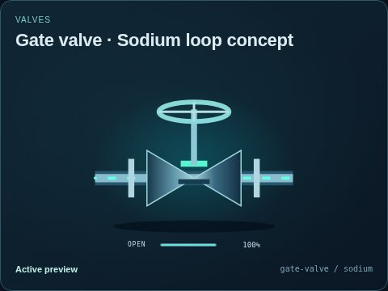</a> | **Sodium loop concept** `gate-valve` `sodium` | Explicit illustrative compatibility selection; engineering service suitability is not established.  Circuits: process = sodium. Ports: inlet (thermal-fluid, in); outlet (thermal-fluid, out). |
| <a href="../img/thumbnails/variants/gate-valve--salt.jpg">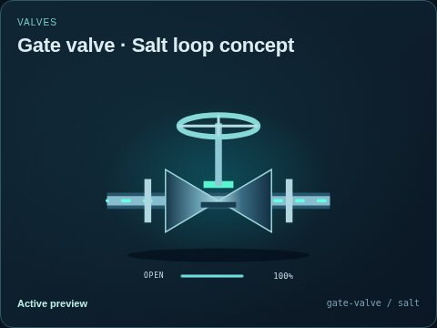</a> | **Salt loop concept** `gate-valve` `salt` | Explicit illustrative compatibility selection; engineering service suitability is not established.  Circuits: process = salt. Ports: inlet (thermal-fluid, in); outlet (thermal-fluid, out). |
| <a href="../img/thumbnails/variants/gate-valve--heavy-water.jpg">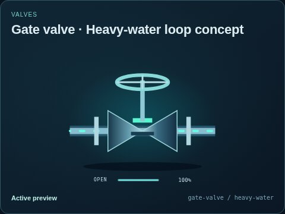</a> | **Heavy-water loop concept** `gate-valve` `heavy-water` | Explicit illustrative compatibility selection; engineering service suitability is not established.  Circuits: process = heavy-water. Ports: inlet (liquid, in); outlet (liquid, out). |
| <a href="../img/thumbnails/variants/gate-valve--organic-working-fluid.jpg">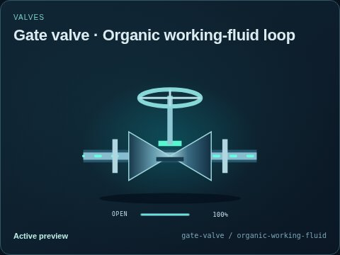</a> | **Organic working-fluid loop** `gate-valve` `organic-working-fluid` | Explicit illustrative compatibility selection; engineering service suitability is not established.  Circuits: process = organic-working-fluid. Ports: inlet (thermal-fluid, in); outlet (thermal-fluid, out). |
| <a href="../img/thumbnails/variants/gate-valve--liquid-fuel.jpg">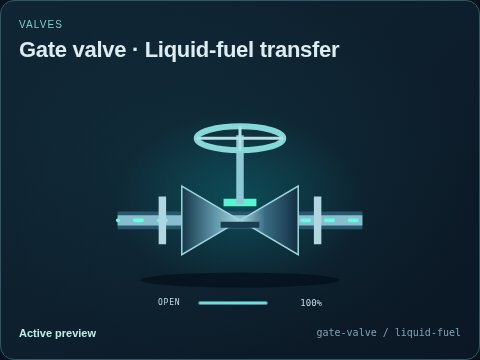</a> | **Liquid-fuel transfer** `gate-valve` `liquid-fuel` | Explicit illustrative compatibility selection; engineering service suitability is not established.  Circuits: process = liquid-fuel. Ports: inlet (liquid, in); outlet (liquid, out). |
| <a href="../img/thumbnails/variants/control-valve--water.jpg">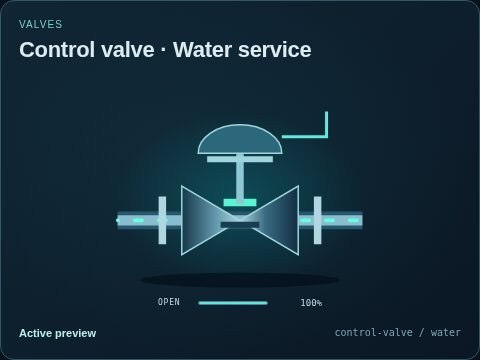</a> | **Water service** `control-valve` `water` | Explicit illustrative compatibility selection; engineering service suitability is not established.  Circuits: process = water. Ports: inlet (liquid, in); outlet (liquid, out); control (data, in). |
|  | **Heat-transfer fluid** `control-valve` `thermal-fluid` | Explicit illustrative compatibility selection; engineering service suitability is not established.  Circuits: process = thermal-fluid. Ports: inlet (thermal-fluid, in); outlet (thermal-fluid, out); control (data, in). |
| <a href="../img/thumbnails/variants/control-valve--helium.jpg">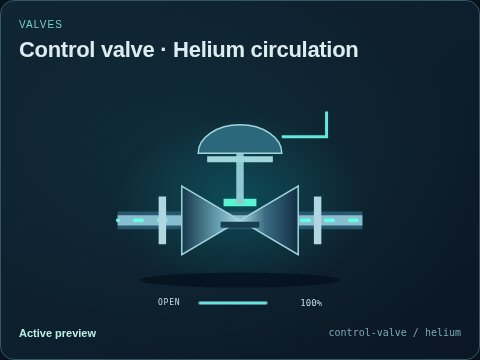</a> | **Helium circulation** `control-valve` `helium` | Explicit illustrative compatibility selection; engineering service suitability is not established.  Circuits: process = helium. Ports: inlet (gas, in); outlet (gas, out); control (data, in). |
| <a href="../img/thumbnails/variants/control-valve--sodium.jpg">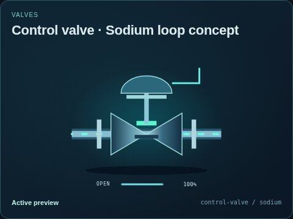</a> | **Sodium loop concept** `control-valve` `sodium` | Explicit illustrative compatibility selection; engineering service suitability is not established.  Circuits: process = sodium. Ports: inlet (thermal-fluid, in); outlet (thermal-fluid, out); control (data, in). |
| <a href="../img/thumbnails/variants/control-valve--salt.jpg">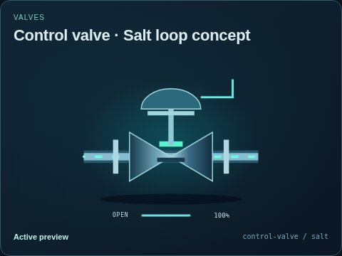</a> | **Salt loop concept** `control-valve` `salt` | Explicit illustrative compatibility selection; engineering service suitability is not established.  Circuits: process = salt. Ports: inlet (thermal-fluid, in); outlet (thermal-fluid, out); control (data, in). |
| <a href="../img/thumbnails/variants/control-valve--heavy-water.jpg">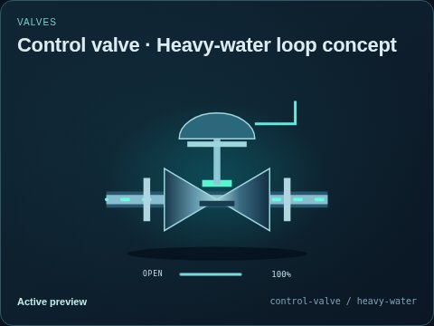</a> | **Heavy-water loop concept** `control-valve` `heavy-water` | Explicit illustrative compatibility selection; engineering service suitability is not established.  Circuits: process = heavy-water. Ports: inlet (liquid, in); outlet (liquid, out); control (data, in). |
| <a href="../img/thumbnails/variants/control-valve--organic-working-fluid.jpg">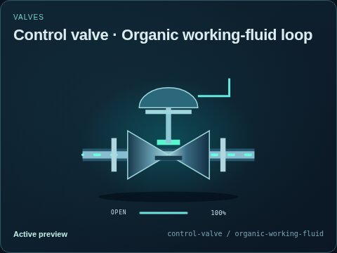</a> | **Organic working-fluid loop** `control-valve` `organic-working-fluid` | Explicit illustrative compatibility selection; engineering service suitability is not established.  Circuits: process = organic-working-fluid. Ports: inlet (thermal-fluid, in); outlet (thermal-fluid, out); control (data, in). |
| <a href="../img/thumbnails/variants/control-valve--liquid-fuel.jpg">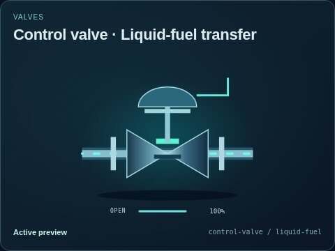</a> | **Liquid-fuel transfer** `control-valve` `liquid-fuel` | Explicit illustrative compatibility selection; engineering service suitability is not established.  Circuits: process = liquid-fuel. Ports: inlet (liquid, in); outlet (liquid, out); control (data, in). |
| <a href="../img/thumbnails/variants/check-valve--water.jpg">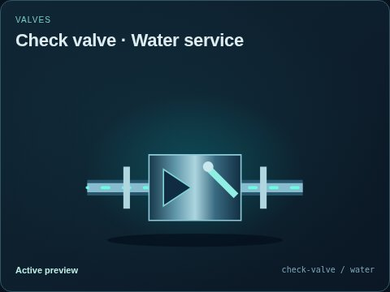</a> | **Water service** `check-valve` `water` | Explicit illustrative compatibility selection; engineering service suitability is not established.  Circuits: process = water. Ports: inlet (liquid, in); outlet (liquid, out). |
| <a href="../img/thumbnails/variants/check-valve--thermal-fluid.jpg">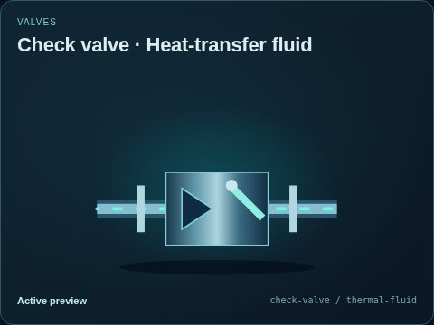</a> | **Heat-transfer fluid** `check-valve` `thermal-fluid` | Explicit illustrative compatibility selection; engineering service suitability is not established.  Circuits: process = thermal-fluid. Ports: inlet (thermal-fluid, in); outlet (thermal-fluid, out). |
| <a href="../img/thumbnails/variants/check-valve--helium.jpg">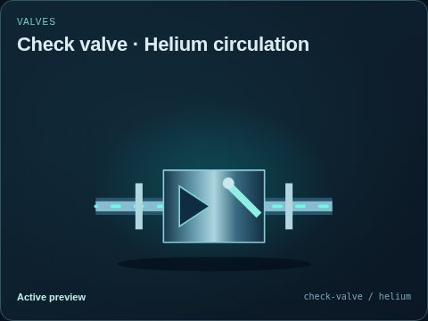</a> | **Helium circulation** `check-valve` `helium` | Explicit illustrative compatibility selection; engineering service suitability is not established.  Circuits: process = helium. Ports: inlet (gas, in); outlet (gas, out). |
| <a href="../img/thumbnails/variants/check-valve--sodium.jpg">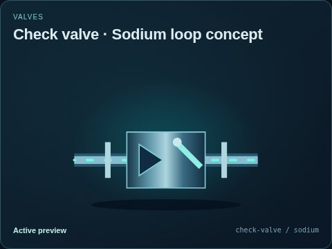</a> | **Sodium loop concept** `check-valve` `sodium` | Explicit illustrative compatibility selection; engineering service suitability is not established.  Circuits: process = sodium. Ports: inlet (thermal-fluid, in); outlet (thermal-fluid, out). |
| <a href="../img/thumbnails/variants/check-valve--salt.jpg">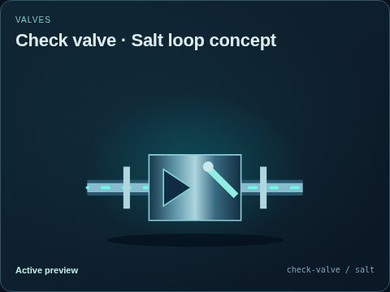</a> | **Salt loop concept** `check-valve` `salt` | Explicit illustrative compatibility selection; engineering service suitability is not established.  Circuits: process = salt. Ports: inlet (thermal-fluid, in); outlet (thermal-fluid, out). |
|  | **Heavy-water loop concept** `check-valve` `heavy-water` | Explicit illustrative compatibility selection; engineering service suitability is not established.  Circuits: process = heavy-water. Ports: inlet (liquid, in); outlet (liquid, out). |
|  | **Organic working-fluid loop** `check-valve` `organic-working-fluid` | Explicit illustrative compatibility selection; engineering service suitability is not established.  Circuits: process = organic-working-fluid. Ports: inlet (thermal-fluid, in); outlet (thermal-fluid, out). |
|  | **Liquid-fuel transfer** `check-valve` `liquid-fuel` | Explicit illustrative compatibility selection; engineering service suitability is not established.  Circuits: process = liquid-fuel. Ports: inlet (liquid, in); outlet (liquid, out). |
|  | **Water service** `relief-valve` `water` | Explicit illustrative compatibility selection; engineering service suitability is not established.  Circuits: process = water. Ports: inlet (liquid, in); relief (liquid, out). |
|  | **Heat-transfer fluid** `relief-valve` `thermal-fluid` | Explicit illustrative compatibility selection; engineering service suitability is not established.  Circuits: process = thermal-fluid. Ports: inlet (thermal-fluid, in); relief (thermal-fluid, out). |
|  | **Helium circulation** `relief-valve` `helium` | Explicit illustrative compatibility selection; engineering service suitability is not established.  Circuits: process = helium. Ports: inlet (gas, in); relief (gas, out). |
|  | **Sodium loop concept** `relief-valve` `sodium` | Explicit illustrative compatibility selection; engineering service suitability is not established.  Circuits: process = sodium. Ports: inlet (thermal-fluid, in); relief (thermal-fluid, out). |
|  | **Salt loop concept** `relief-valve` `salt` | Explicit illustrative compatibility selection; engineering service suitability is not established.  Circuits: process = salt. Ports: inlet (thermal-fluid, in); relief (thermal-fluid, out). |
|  | **Heavy-water loop concept** `relief-valve` `heavy-water` | Explicit illustrative compatibility selection; engineering service suitability is not established.  Circuits: process = heavy-water. Ports: inlet (liquid, in); relief (liquid, out). |
|  | **Organic working-fluid loop** `relief-valve` `organic-working-fluid` | Explicit illustrative compatibility selection; engineering service suitability is not established.  Circuits: process = organic-working-fluid. Ports: inlet (thermal-fluid, in); relief (thermal-fluid, out). |
|  | **Liquid-fuel transfer** `relief-valve` `liquid-fuel` | Explicit illustrative compatibility selection; engineering service suitability is not established.  Circuits: process = liquid-fuel. Ports: inlet (liquid, in); relief (liquid, out). |
|  | **Water service** `butterfly-valve` `water` | Explicit illustrative compatibility selection; engineering service suitability is not established.  Circuits: process = water. Ports: inlet (liquid, in); outlet (liquid, out). |
|  | **Heat-transfer fluid** `butterfly-valve` `thermal-fluid` | Explicit illustrative compatibility selection; engineering service suitability is not established.  Circuits: process = thermal-fluid. Ports: inlet (thermal-fluid, in); outlet (thermal-fluid, out). |
|  | **Helium circulation** `butterfly-valve` `helium` | Explicit illustrative compatibility selection; engineering service suitability is not established.  Circuits: process = helium. Ports: inlet (gas, in); outlet (gas, out). |
|  | **Sodium loop concept** `butterfly-valve` `sodium` | Explicit illustrative compatibility selection; engineering service suitability is not established.  Circuits: process = sodium. Ports: inlet (thermal-fluid, in); outlet (thermal-fluid, out). |
|  | **Salt loop concept** `butterfly-valve` `salt` | Explicit illustrative compatibility selection; engineering service suitability is not established.  Circuits: process = salt. Ports: inlet (thermal-fluid, in); outlet (thermal-fluid, out). |
|  | **Heavy-water loop concept** `butterfly-valve` `heavy-water` | Explicit illustrative compatibility selection; engineering service suitability is not established.  Circuits: process = heavy-water. Ports: inlet (liquid, in); outlet (liquid, out). |
|  | **Organic working-fluid loop** `butterfly-valve` `organic-working-fluid` | Explicit illustrative compatibility selection; engineering service suitability is not established.  Circuits: process = organic-working-fluid. Ports: inlet (thermal-fluid, in); outlet (thermal-fluid, out). |
|  | **Liquid-fuel transfer** `butterfly-valve` `liquid-fuel` | Explicit illustrative compatibility selection; engineering service suitability is not established.  Circuits: process = liquid-fuel. Ports: inlet (liquid, in); outlet (liquid, out). |
|  | **Water service** `pipe` `water` | Explicit illustrative compatibility selection; engineering service suitability is not established.  Circuits: process = water. Ports: inlet (liquid, in); outlet (liquid, out). |
|  | **Heat-transfer fluid** `pipe` `thermal-fluid` | Explicit illustrative compatibility selection; engineering service suitability is not established.  Circuits: process = thermal-fluid. Ports: inlet (thermal-fluid, in); outlet (thermal-fluid, out). |
|  | **Helium circulation** `pipe` `helium` | Explicit illustrative compatibility selection; engineering service suitability is not established.  Circuits: process = helium. Ports: inlet (gas, in); outlet (gas, out). |
|  | **Sodium loop concept** `pipe` `sodium` | Explicit illustrative compatibility selection; engineering service suitability is not established.  Circuits: process = sodium. Ports: inlet (thermal-fluid, in); outlet (thermal-fluid, out). |
|  | **Salt loop concept** `pipe` `salt` | Explicit illustrative compatibility selection; engineering service suitability is not established.  Circuits: process = salt. Ports: inlet (thermal-fluid, in); outlet (thermal-fluid, out). |
|  | **Heavy-water loop concept** `pipe` `heavy-water` | Explicit illustrative compatibility selection; engineering service suitability is not established.  Circuits: process = heavy-water. Ports: inlet (liquid, in); outlet (liquid, out). |
|  | **Organic working-fluid loop** `pipe` `organic-working-fluid` | Explicit illustrative compatibility selection; engineering service suitability is not established.  Circuits: process = organic-working-fluid. Ports: inlet (thermal-fluid, in); outlet (thermal-fluid, out). |
|  | **Liquid-fuel transfer** `pipe` `liquid-fuel` | Explicit illustrative compatibility selection; engineering service suitability is not established.  Circuits: process = liquid-fuel. Ports: inlet (liquid, in); outlet (liquid, out). |
|  | **Water / steam flash separator** `separator` `flash-water` | Horizontal settling vessel showing separate fluid layers and a gas outlet.  Circuits: process = geothermal-water. Ports: inlet (liquid, in); outlet (liquid, out); supply (electricity, in); gas (steam, out); drain (liquid, out). |
|  | **Dry-steam production well** `wellhead` `steam-well` | Christmas-tree wellhead with valves, a pressure readout and production outlet.  Circuits: process = geothermal-water. Ports: outlet (steam, out); control (data, in). |
|  | **Geothermal liquid production well** `wellhead` `geothermal-water` | Christmas-tree wellhead with valves, a pressure readout and production outlet.  Circuits: process = geothermal-water. Ports: outlet (liquid, out); control (data, in). |
|  | **Solid fuel / salt coolant** `molten-salt-reactor` `solid-fuel-salt-cooled` | Selected solid-fuel, salt-cooled loop concept. Liquid-fuel salt arrangements require a separate future contract; no neutronics are implied.  Circuits: primary = salt. Ports: coolant-in (thermal-fluid, in); coolant-out (thermal-fluid, out); control (data, in); monitor (measurement, out). |
|  | **Water primary** `nuclear-steam-generator` `water-primary` | Primary tube loop and isolated secondary water/steam inventory with independently supplied flow indicators.  Circuits: primary = primary-water; secondary = secondary-water. Ports: primary-in (liquid, in); primary-out (liquid, out); feedwater (liquid, in); steam (steam, out); monitor (measurement, out). |
|  | **Heavy-water primary** `nuclear-steam-generator` `heavy-water-primary` | Primary tube loop and isolated secondary water/steam inventory with independently supplied flow indicators.  Circuits: primary = heavy-water; secondary = secondary-water. Ports: primary-in (liquid, in); primary-out (liquid, out); feedwater (liquid, in); steam (steam, out); monitor (measurement, out). |
|  | **Helium primary** `nuclear-steam-generator` `helium-primary` | Primary tube loop and isolated secondary water/steam inventory with independently supplied flow indicators.  Circuits: primary = helium; secondary = secondary-water. Ports: primary-in (gas, in); primary-out (gas, out); feedwater (liquid, in); steam (steam, out); monitor (measurement, out). |
|  | **Sodium intermediate loop** `nuclear-steam-generator` `sodium-primary` | Primary tube loop and isolated secondary water/steam inventory with independently supplied flow indicators.  Circuits: primary = sodium; secondary = secondary-water. Ports: primary-in (thermal-fluid, in); primary-out (thermal-fluid, out); feedwater (liquid, in); steam (steam, out); monitor (measurement, out). |
|  | **Salt intermediate loop** `nuclear-steam-generator` `salt-primary` | Primary tube loop and isolated secondary water/steam inventory with independently supplied flow indicators.  Circuits: primary = salt; secondary = secondary-water. Ports: primary-in (thermal-fluid, in); primary-out (thermal-fluid, out); feedwater (liquid, in); steam (steam, out); monitor (measurement, out). |
|  | **DC to AC** `power-inverter` `dc-to-ac` | DC/AC conversion cabinet; reverse flow requires the explicit bidirectional variant.  Ports: dc (electricity, bidirectional); ac (electricity, bidirectional); control (data, in); monitor (measurement, out). |
|  | **Bidirectional converter** `power-inverter` `bidirectional` | DC/AC conversion cabinet; reverse flow requires the explicit bidirectional variant.  Ports: dc (electricity, bidirectional); ac (electricity, bidirectional); control (data, in); monitor (measurement, out). |
|  | **Generator** `alternator` `generator` | A shaft-to-electrical machine, distinct from the existing fuelled generator package.  Ports: shaft (mechanical, bidirectional); field (electricity, in); output (electricity, bidirectional); control (data, in); monitor (measurement, out). |
|  | **Reversible motor-generator** `alternator` `motor-generator` | A shaft-to-electrical machine, distinct from the existing fuelled generator package.  Ports: shaft (mechanical, bidirectional); field (electricity, in); output (electricity, bidirectional); control (data, in); monitor (measurement, out). |
|  | **AC isolation** `disconnect-switch` `ac-isolator` | Visible isolating blade and insulators, distinct from a circuit breaker interruption chamber.  Ports: line (electricity, bidirectional); load (electricity, bidirectional); supply (electricity, in); control (data, in); monitor (measurement, out). |
|  | **DC isolation** `disconnect-switch` `dc-isolator` | Visible isolating blade and insulators, distinct from a circuit breaker interruption chamber.  Ports: line (electricity, bidirectional); load (electricity, bidirectional); supply (electricity, in); control (data, in); monitor (measurement, out). |

Generated by `tools/webkit/scada/ui/generate-thumbnails.py` from canonical SVG in Chromium at JPEG quality 85. Do not edit this map or the images by hand.
