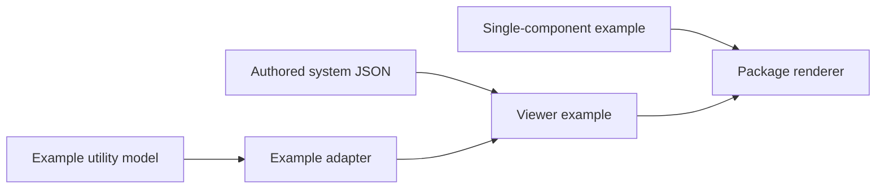
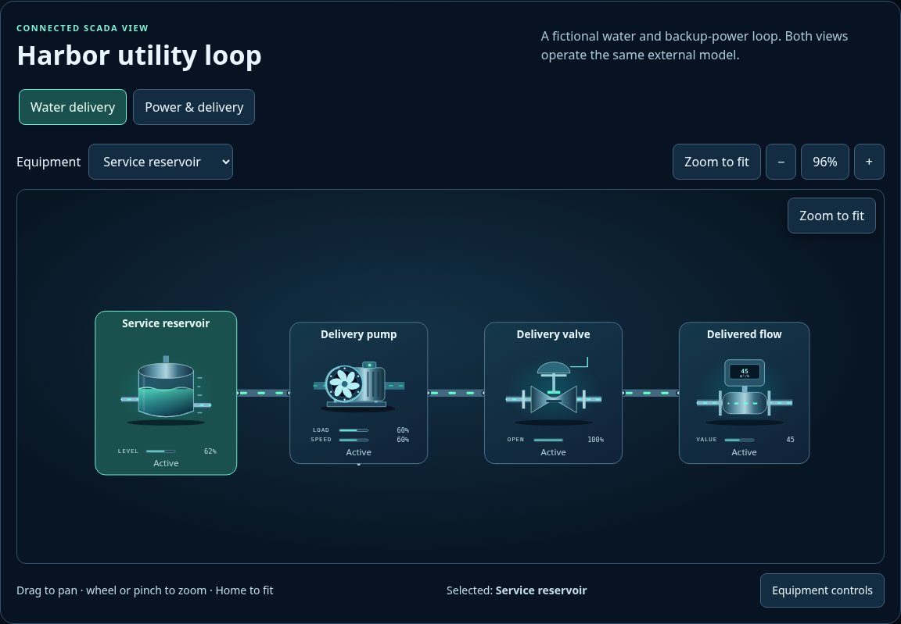

# Standalone integration examples

[Package map](../README.md) · [API](../docs/API.md) · [System format](../docs/SYSTEM_FORMAT.md) · [Source map](../src/README.md)

These are authored browser examples that import the package source directly. They are not build output or a deployment directory. Keep sample model logic, adapter translation, system data and presentation wiring separate so another application can replace one layer at a time.

| Entry | Demonstrates |
| --- | --- |
| [components/](./components/README.md) | Discover, choose and render one equipment type/variant with supplied visual controls. |
| [viewer/](./viewer/README.md) | Two viewers of one fictional external utility model, including a read-only adapter. |
| [minimal-system.json](./minimal-system.json) | A small versioned presentation document with provenance, assumptions, bindings and views; it is data, not a running model. |

From `packages/scada-ui/`, run `python -m http.server 8000`, then open `/examples/components/` or `/examples/viewer/` at `http://localhost:8000`. HTTP serving is required for reliable ES-module loading and JSON fetches. No repository build is needed for these source examples.

The examples illustrate API plumbing. Their numbers, timing and failure behavior are editable guesses. For the separate shared simulation runtime and scenario collection, start at [SCADA simulation](../../sim/README.md); do not grow a second model inside a symbol or viewer.

